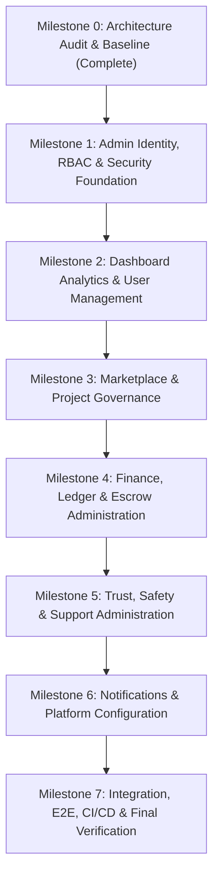

# CreatorConnect Phase 4 — Administration & Platform Management System

## Milestone 0: Comprehensive Architecture, Security & Codebase Audit

**Date:** November 2026  
**Repository:** `F:\CreatorConnect`  
**Branch:** `dev`  
**Base HEAD:** `577331e`  
**Document Status:** AUTHORITATIVE BASELINE AUDIT

---

## 1. Executive Summary

This architecture audit establishes the baseline for **Phase 4: Complete Administration & Platform Management System** of CreatorConnect. In alignment with CreatorConnect's foundational architectural mandate:

> **Core Architectural Principle:** One authoritative backend, multiple clients.  
> The backend REST API is the single source of truth for Web, Android, iOS, and Web Admin clients. Client applications are API consumers and must never implement platform business logic, financial reconciliation, moderation rules, or contract state machines independently.

CreatorConnect is primarily a **mobile-first product** (Android, iOS) with a **secure web-based administrative console**. In this phase, no public marketing website or app store landing pages are built. The administrative platform provides a secure, centralized, role-based control plane for authorized operators, support agents, compliance officers, finance administrators, and trust & safety personnel.

This audit maps the entire monorepo, catalogs all reusable domain services, identifies administrative gaps and security risks, and defines the phased implementation strategy for Phase 4.

---

## 2. Monorepo & Technology Stack Inventory

### 2.1 Workspace Structure

- **Package Manager:** `pnpm` 9.15.4 with Turborepo 2.1.2.
- **Runtimes & Tooling:** Node.js 20 LTS, TypeScript 5.5.4, Vitest 2.1.1, Playwright 1.46.0, Docker Compose.
- **Applications:**
  - `apps/api`: Fastify 5.2.1 REST API service (TypeBox schema validation, Scalar/Swagger OpenAPI documentation).
  - `apps/realtime`: Socket.IO 4.7.5 real-time gateway with `@socket.io/redis-adapter` for multi-node clustering.
  - `apps/worker`: BullMQ 5.8 background worker supervisor and transactional outbox processor.
  - `apps/web-shell`: Next.js 15.5.28 React 18 web shell hosting the administrative panel.
- **Packages:**
  - `packages/auth`: JWKS JWT verification, CASL 6.7 ability builder, session context types.
  - `packages/contracts`: Shared TypeBox DTO schemas and static TypeScript interfaces.
  - `packages/database`: Prisma 5.18 ORM client, migration history, messaging repository, outbox repository, notification repository.
  - `packages/design-system` & `packages/ui`: Tailwind CSS and Radix-based UI components.
  - `packages/utils`: Precise minor-unit currency calculations, UUIDv7 generation, cryptographic hash utilities, state machines.
  - `packages/validation`: RFC 7807 Problem Details formatting, Ajv custom formats, UUID schemas.

### 2.2 Database & Migration Baseline

- **Database Engine:** PostgreSQL 16.
- **Migrations Applied:** 14 sequential migrations (`0001_init_identity_and_roles` through `0014_add_participant_last_delivered_sequence`).
- **Prisma Schema:** 58 database models and 42 enums covering users, profiles, assignments, applications, projects, deliverables, double-entry ledger, payments, disputes, reviews, community hub, support tickets, notifications, and outbox events.

---

## 3. Comprehensive Repository Audit

### 3.1 Authentication & Identity Verification

- **Current State:**
  - Asymmetric JWT authentication via Supabase Auth (RS256/ES256).
  - Token signature and issuer verification executed by `JwtVerifier` using JSON Web Key Sets (JWKS).
  - Pre-handler hook `fastify.authenticate` in `apps/api/src/plugins/auth.ts`:
    1. Validates `Bearer` token via JWKS.
    2. Queries user account status directly in PostgreSQL via `userRepo.getStatusBySub(sub)`.
    3. **PostgreSQL is the sole, authoritative source of truth**: Immediate rejection of `SUSPENDED` (403 `USER_SUSPENDED`) and `DEACTIVATED` (403 `USER_DEACTIVATED`). Redis failure or cache divergence never grants access to non-active accounts.
    4. Fetches and attaches `UserIdentity` and builds CASL `AppAbility`.
- **Existing Admin Concurrency Protection:**
  - `updateUserStatus` in `user.repository.ts` uses pessimistic row-level locking (`SELECT ... FOR UPDATE OF u`) within a PostgreSQL transaction to ensure that concurrent administrative status updates cannot suspend or deactivate the last remaining active administrator (`LastAdminLockoutError`).
- **Administrative Gap:**
  - Authentication currently checks only the global `RoleType.ADMIN`. There is no sub-role resolution (e.g., `SUPER_ADMIN`, `FINANCE_ADMIN`, `TRUST_SAFETY_ADMIN`) or resource-level administrative permission evaluation on request context.

### 3.2 Authorization & CASL Engine

- **Current State:**
  - Implemented in `packages/auth/src/abilities.ts` via `@casl/ability` `PureAbility`.
  - Current rule for administrators:
    ```typescript
    if (user.roles.includes('ADMIN')) {
      can('manage', 'all');
      return build({ conditionsMatcher: lambdaMatcher });
    }
    ```
- **Architectural Gaps & Risks:**
  - Coarse-grained `ADMIN` role has universal access (`can('manage', 'all')`).
  - Lacks fine-grained administrative permissions: `users.read`, `users.suspend`, `projects.read`, `projects.moderate`, `payments.read`, `payments.refund`, `support.manage`, `reports.review`, `analytics.read`, `admins.manage`, `settings.manage`, `audit.read`.
  - No capability to define custom or scoped administrator roles.
  - Risk of privilege escalation if any administrative account is compromised.

### 3.3 Reusable Domain Services & Repositories

The platform already has mature, tested domain services that must be **reused directly** rather than duplicated:

| Domain                       | Existing Services & Repositories                                                                                         | Reusable Capabilities                                                                                                                                                                                                                                 |
| ---------------------------- | ------------------------------------------------------------------------------------------------------------------------ | ----------------------------------------------------------------------------------------------------------------------------------------------------------------------------------------------------------------------------------------------------- |
| **Users & Lifecycle**        | `UsersService`<br>`PrismaUserRepository`<br>`AccountLifecycleService`<br>`LegalHoldService`<br>`DataErasureOrchestrator` | Profile management, status mutations (`ACTIVE`, `SUSPENDED`, `DEACTIVATED`), legal holds, erasure validation, anonymization, last active admin protection.                                                                                            |
| **Profiles & Discovery**     | `ProfilesService`<br>`DiscoveryService`<br>`ProfilesRepository`<br>`DiscoveryRepository`                                 | Creator, professional, brand, and podcaster profiles, skill associations, full-text search (`tsvector`), fuzzy matching (`pg_trgm`).                                                                                                                  |
| **Projects & Deliverables**  | `ProjectsService`<br>`ProjectsRepository`                                                                                | Project lifecycle (`IN_PROGRESS`, `SUBMITTED`, `REVISION_REQUESTED`, `APPROVED`, `COMPLETED`, `CANCELLED`, `DISPUTED`), milestone tracking, deliverable review.                                                                                       |
| **Payments & Ledger**        | `PaymentsService`<br>`LedgerService`<br>`IdempotencyService`<br>`PaymentsRepository`                                     | Balanced double-entry ledger accounts (`CLIENT_WALLET`, `ESCROW`, `PLATFORM_REVENUE`, `CREATOR_PAYABLE`), Razorpay order integration, idempotent refund creation with SHA-256 payload verification.                                                   |
| **Disputes & Cancellations** | `DisputesService`<br>`CancellationsService`<br>`DisputesRepository`                                                      | Dispute lifecycle arbitration, evidence quarantine validation, requester withdrawal, mutual cancellation workflows, compensating ledger balance adjustments.                                                                                          |
| **Reviews & Governance**     | `ReviewsService`<br>`ReviewsRepository`                                                                                  | Verified review submissions, reciprocal reviews, Bayesian reputation scoring ($m = 4.0, C = 5.0$), anti-conflict-of-interest checks (admins cannot moderate disputes/reviews where they are participants), moderation audit logging.                  |
| **Support Ticketing**        | `SupportService`<br>`SupportRepository`                                                                                  | Ticket listing, priority management (`LOW`, `NORMAL`, `HIGH`, `URGENT`), status lifecycle (`OPEN`, `IN_PROGRESS`, `WAITING_FOR_CUSTOMER`, `RESOLVED`, `CLOSED`), staff assignments, internal notes vs public customer messages, ticket audit logging. |
| **Notifications & Outbox**   | `NotificationsService`<br>`NotificationRepository`<br>`OutboxRepository`<br>`NotificationEventHandler`                   | Channel preference management, transactional outbox publishing (`OutboxEvent`), BullMQ event distribution, idempotent event processing.                                                                                                               |
| **Media & Object Storage**   | `MediaService`<br>`S3StorageService`<br>`MediaRepository`                                                                | Presigned S3/R2 upload and download URLs, MIME and size bounds, ClamAV antivirus quarantine workflow (`QUARANTINED` $\to$ `ACTIVE`).                                                                                                                  |

### 3.4 Existing Admin-Accessible Endpoints

The following endpoints currently exist across domain modules with administrative access guards:

1. `PATCH /api/v1/admin/users/:id/status` — Updates user status with last-active-admin lockout guard (`users.routes.ts`).
2. `POST /api/v1/admin/users/:id/legal-holds` — Applies statutory/litigation legal hold (`lifecycle.routes.ts`).
3. `DELETE /api/v1/admin/users/:id/legal-holds/:holdId` — Releases legal hold (`lifecycle.routes.ts`).
4. `GET /api/v1/admin/users/:id/legal-holds` — Lists legal holds for user (`lifecycle.routes.ts`).
5. `POST /api/v1/admin/privacy/requests/:id/execute` — Executes data erasure or export request (`lifecycle.routes.ts`).
6. `PATCH /api/v1/admin/community/posts/:id/moderate` — Moderates community hub post (`community.routes.ts`).
7. `POST /api/v1/reviews/:id/moderate` — Moderates reported review with anti-conflict guard (`reviews.routes.ts`).
8. `POST /api/v1/disputes/:id/resolve` — Arbitrates project dispute with compensating ledger entries (`disputes.routes.ts`).
9. `GET /api/v1/staff/support/tickets` — Staff support ticket queue (`support.routes.ts`).
10. `GET /api/v1/staff/support/tickets/:id` — Staff detailed ticket view (`support.routes.ts`).
11. `POST /api/v1/staff/support/tickets/:id/assign` — Assigns support ticket to staff member (`support.routes.ts`).
12. `POST /api/v1/staff/support/tickets/:id/messages` — Sends staff reply to customer (`support.routes.ts`).
13. `PATCH /api/v1/staff/support/tickets/:id/status` — Updates ticket status (`support.routes.ts`).
14. `PATCH /api/v1/staff/support/tickets/:id/priority` — Updates ticket priority (`support.routes.ts`).

### 3.5 Existing Database Entities & Relationships

- **User & Identity:** `User`, `Role`, `UserRole`, `AuditLog`.
- **Marketplace & Profiles:** `Category`, `Skill`, `UserSkill`, `CreatorProfile`, `ProfessionalProfile`, `BrandProfile`, `PodcasterProfile`, `PortfolioItem`, `MediaAsset`, `Assignment`, `Application`.
- **Contracts & Projects:** `Project`, `ProjectDeliverable`, `ProjectDeliverableSubmission`, `Dispute`, `DisputeEvidence`, `ProjectCancellation`, `Review`, `ReviewReport`, `ReviewModerationAudit`.
- **Financial & Escrow:** `PaymentIntent`, `LedgerAccount`, `LedgerTransaction`, `LedgerEntry`, `IdempotencyRecord`, `Refund`.
- **Support & Moderation:** `SupportTicket`, `SupportTicketMessage`, `SupportTicketAudit`, `Report`, `ModerationAction`.
- **Communications:** `Conversation`, `ConversationParticipant`, `Message`, `Notification`, `NotificationPreference`, `OutboxEvent`.

---

## 4. Gap Analysis: Missing Administrative Capabilities

| Functional Area              | Current Gap                                                                                             | Required Capability                                                                                                                                                      |
| ---------------------------- | ------------------------------------------------------------------------------------------------------- | ------------------------------------------------------------------------------------------------------------------------------------------------------------------------ |
| **Identity & RBAC**          | Only coarse `ADMIN` role exists; no granular permissions; no custom roles.                              | Dedicated administrative roles (`SUPER_ADMIN`, `PLATFORM_ADMIN`, `FINANCE_ADMIN`, etc.), granular permission matrix, permission-based guards (`requireAdminPermission`). |
| **Platform Dashboard**       | No analytics aggregation endpoints; statistics not centralized.                                         | High-performance SQL aggregation for user growth, active projects, transaction volume, revenue, dispute rates, and support response times with date-range filters.       |
| **User Directory**           | No administrative search or filtered user query endpoint.                                               | Administrative user directory with pagination, status filters, account-type filters, verified status, profile completeness, and activity timeline.                       |
| **Creator / Client Views**   | Operational insights for creators/clients are split across user routes.                                 | Dedicated operational endpoints for reviewing creator portfolios/ratings and client spend/project history.                                                               |
| **Marketplace Governance**   | Project listing search and moderation are not aggregated for admin oversight.                           | Administrative project query with status filters (`DISPUTED`, `OVERDUE`, `IN_PROGRESS`), deliverable inspection, and suspension.                                         |
| **Finance & Reconciliation** | Ledger and refund operations exist but lack central reconciliation queries and dual-approval workflows. | Administrative transaction search, ledger balance verification, discrepancy reporting, dual-approval workflow for high-value refunds, anti-self-approval enforcement.    |
| **Central Moderation Queue** | `Report` and `ModerationAction` models exist, but no centralized moderation API connects them.          | Moderation queue endpoints (`GET/POST /api/v1/admin/reports/*`) supporting assignment, evidence review, warning, suspension, content removal, and dismissal.             |
| **Support Administration**   | Support APIs currently live under `/api/v1/staff/support/*`.                                            | Consolidate and alias support operations under `/api/v1/admin/support/*` with internal note enforcement and SLA metrics.                                                 |
| **Notification Campaigns**   | Notifications service only supports transactional notifications.                                        | Administrative notification campaign creation, audience estimation, preview, scheduling, and BullMQ worker queue monitoring.                                             |
| **Platform Configuration**   | Platform settings (feature flags, maintenance mode) are environment-variable only.                      | Dynamic platform settings database model with schema validation, version history, change audit log, and rollback.                                                        |
| **Audit Log Querying**       | `AuditLog` table records mutations, but has no administrative query or export API.                      | Dedicated `GET /api/v1/admin/audit-logs` endpoint with cursor pagination, actor/entity filters, date ranges, and secure export.                                          |

---

## 5. Security & Architectural Risk Assessment

|  Risk Code  | Risk Description                                                                                                                                                                    |   Severity   | Mitigation Strategy                                                                                                                                                                         |
| :---------: | ----------------------------------------------------------------------------------------------------------------------------------------------------------------------------------- | :----------: | ------------------------------------------------------------------------------------------------------------------------------------------------------------------------------------------- |
| **SEC-A01** | **Over-privileged Administrator Accounts**: Coarse-grained `ADMIN` role grants universal access. Compromise of a support account could compromise financial ledger or delete users. | **CRITICAL** | Introduce granular administrative roles and resource-level permissions (e.g., Support Admins cannot refund; Finance Admins cannot delete users). Default-deny authorization.                |
| **SEC-A02** | **Self-Approval & Conflict of Interest**: An administrator might approve their own refund, resolve their own dispute, or moderate their own review.                                 | **CRITICAL** | Strict anti-conflict-of-interest enforcement in domain logic. Administrators cannot approve actions where `adminId === targetUserId` or where they are a project/dispute participant.       |
| **SEC-A03** | **Unbounded Financial Mutations**: Direct database edits or single-operator approval for large refunds could cause financial loss.                                                  |   **HIGH**   | Strict routing through `LedgerService` and `IdempotencyService`. Implement dual-approval workflow for refunds exceeding configured financial threshold (e.g., > ₹50,000 / 5,000,000 paisa). |
| **SEC-A04** | **Stale Authorization Caching**: Redis caching of admin roles could lead to revoked administrators retaining access.                                                                |   **HIGH**   | PostgreSQL remains the authoritative source for admin status and active roles. Cache invalidation on role changes; immediate rejection if PostgreSQL status is not `ACTIVE`.                |
| **SEC-A05** | **Sensitive Data Leakage in Admin APIs**: Admin search endpoints could inadvertently expose passwords, raw JWTs, private chat messages, or full bank account details.               |   **HIGH**   | Strict response schema filtering via TypeBox; PII redaction; private messaging content excluded from default admin views; token hashes never returned.                                      |
| **SEC-A06** | **Unbounded Analytics Queries**: Large SQL table scans or in-memory JavaScript aggregation could cause database CPU spikes and API starvation.                                      |  **MEDIUM**  | Optimized SQL aggregation using PostgreSQL indexes (`COUNT`, `SUM`, date truncations); cursor-based pagination; query timeouts; dashboard caching in Redis with short TTL (e.g., 60s).      |
| **SEC-A07** | **Audit Log Tampering**: Malicious operator could attempt to delete or alter audit log entries to cover up unauthorized actions.                                                    | **CRITICAL** | Append-only database design. No update or delete operations on `audit_logs` exposed in any service or API.                                                                                  |

---

## 6. Proposed Administration System Architecture

### 6.1 Unified Architectural Boundary

All administrative operations will reside under a clean, modular route namespace:

```
/api/v1/admin/*
```

The architecture strictly enforces separation of concerns:

```
[Client Applications]
 (Android / iOS / Web-Shell Admin Console)
           │
           │  HTTPS + Bearer JWT
           ▼
[Fastify HTTP Pipeline]
   ├── Helmet & Strict CORS (no wildcards)
   ├── Rate Limiter (Redis token bucket)
   ├── fastify.authenticate (JWKS + Authoritative PostgreSQL ACTIVE status)
   └── fastify.requireAdminPermission(permission)
           │
           ▼
[Admin Controller & Route Layer] (TypeBox Input/Output Validation)
   ├── /dashboard/*
   ├── /admins & /roles
   ├── /users/*
   ├── /creators & /clients
   ├── /projects/*
   ├── /payments & /refunds/*
   ├── /moderation/*
   ├── /support/*
   ├── /notifications/*
   ├── /settings/*
   └── /audit-logs/*
           │
           ▼
[Authoritative Domain Services]
   ├── UsersService / AccountLifecycleService
   ├── ProjectsService / DisputesService
   ├── PaymentsService / LedgerService
   ├── ReviewsService / SupportService
   ├── AdminDashboardService (Optimized SQL aggregation)
   └── AdminSettingsService / NotificationCampaignService
           │
           ▼
[Prisma Repositories & Database Layer]
   ├── PostgreSQL 16 (Authoritative Data & Row Locks)
   ├── Redis 7 (Short-lived dashboard cache & rate limits)
   └── BullMQ Queues (Async outbox events & notification campaigns)
```

---

## 7. Administrative Permission Matrix (CASL & Fastify)

To achieve fine-grained control without duplicating the authorization system, we introduce standard permission strings evaluated via CASL:

| Role Name              | Description                                                         | Assigned Permissions                                                                                          |
| ---------------------- | ------------------------------------------------------------------- | ------------------------------------------------------------------------------------------------------------- |
| **SUPER_ADMIN**        | Full platform authority, disaster recovery, emergency configuration | `*` (All permissions, including `admins.manage`)                                                              |
| **PLATFORM_ADMIN**     | Day-to-day platform management and marketplace operations           | `users.*`, `projects.*`, `reports.*`, `support.*`, `settings.read`, `analytics.read`, `audit.read`            |
| **USER_ADMIN**         | User lifecycle, account suspensions, verification, privacy requests | `users.read`, `users.update`, `users.suspend`, `users.reactivate`, `users.export`, `users.privacy`            |
| **FINANCE_ADMIN**      | Financial reconciliation, payment disputes, refund management       | `payments.read`, `payments.refund.request`, `payments.refund.approve`, `payments.reconcile`, `analytics.read` |
| **TRUST_SAFETY_ADMIN** | Content moderation, abuse reports, review moderation, suspensions   | `reports.*`, `users.suspend`, `projects.moderate`, `reviews.moderate`, `audit.read`                           |
| **SUPPORT_ADMIN**      | Customer service escalation, ticket reassignment, SLA oversight     | `support.*`, `users.read`, `projects.read`                                                                    |
| **CONTENT_MODERATOR**  | Front-line review, community, and media content moderation          | `reports.review`, `reviews.moderate`, `projects.read`                                                         |
| **ANALYTICS_VIEWER**   | Read-only access to platform metrics and aggregate reports          | `analytics.read`                                                                                              |

---

## 8. Database Design & Migration Requirements

### 8.1 Schema Principles

1. **No Duplication**: Re-use existing `User`, `Role`, `UserRole`, `AuditLog`, `Report`, `ModerationAction`, `SupportTicket`, `Refund`, and `LedgerAccount` models.
2. **Backward-Compatible & Additive**: The existing `RoleType` enum contains `ADMIN`. To support both existing and granular roles seamlessly:
   - Introduce an `AdminProfile` or `AdminRole` / `AdminPermission` relational structure, OR expand `RoleType` to include granular administrative roles while mapping them to permissions.
   - Recommended additive approach: Introduce `admin_roles`, `admin_permissions`, `admin_role_permissions`, and `admin_user_roles` tables for flexible, enterprise-grade dynamic RBAC, while maintaining existing `RoleType.ADMIN` as the gateway check.
3. **New Entities Required**:
   - `AdminRole`: Defines named administrative roles (`SUPER_ADMIN`, `FINANCE_ADMIN`, etc.).
   - `AdminPermission`: Catalog of explicit permission strings (`users.suspend`, `payments.refund`, etc.).
   - `AdminRolePermission`: Many-to-many relationship linking roles and permissions.
   - `AdminUserRole`: Maps platform users to administrative roles with audit metadata (`assigned_by`, `assigned_at`).
   - `PlatformSetting`: Key-value configuration store with JSON schema, environment tag, version, and encrypted sensitive flags.
   - `PlatformSettingAudit`: Change tracking for platform settings with before/after values and rollback capability.
   - `AdminActionApproval`: Dual-approval state machine for high-value financial actions or sensitive operations.
   - `NotificationCampaign`: Broadcast campaign tracking with targeting criteria, estimated recipients, scheduled execution time, and delivery counters.

---

## 9. Dependency & Package Strategy

| Capability                | Recommended Package                                                 | Rationale                                                                                                             |
| ------------------------- | ------------------------------------------------------------------- | --------------------------------------------------------------------------------------------------------------------- |
| **Authorization**         | `@casl/ability` (v6.7.1 already installed)                          | Use existing CASL integration in `@creatorconnect/auth`. Extend with permission rule builders. Zero new dependencies. |
| **Validation**            | `@sinclair/typebox` (v0.33.7 already installed)                     | Fastify native schema compiler. Shared with `@creatorconnect/contracts`. Zero new dependencies.                       |
| **Database**              | `@prisma/client` (v5.18.0 already installed)                        | Reuses existing Prisma setup and connection pooling.                                                                  |
| **Background Processing** | `bullmq` (v5.8.6 already installed in `apps/api` and `apps/worker`) | Reuses existing Redis queue architecture for broadcast notification processing.                                       |
| **Financial Arithmetic**  | `@creatorconnect/utils/currency` (Already implemented)              | Uses exact 64-bit integer arithmetic in minor currency units (paisa). Zero precision loss.                            |
| **CSV / Data Export**     | `fast-csv` or streaming pipeline                                    | For large compliance and audit log streaming without loading full result sets into Node.js heap memory.               |

---

## 10. Phased Implementation Roadmap



### Milestone Breakdown:

- **Milestone 0 — Architecture Audit** _(This document)_: Full inspection, baseline verification, gap identification, and architectural specification.
- **Milestone 1 — Admin Security Foundation**: Administrative RBAC models, permission matrix, authorization pre-handlers (`requireAdminPermission`), last active super admin protection, and audit logging.
- **Milestone 2 — Dashboard & User Management**: Dashboard aggregation queries, user directory search, account lifecycle operations (`SUSPEND`, `REACTIVATE`), activity history, and privacy request tracking.
- **Milestone 3 — Marketplace Administration**: Creator and client management, project directory, deliverable review, application inspection, and project moderation.
- **Milestone 4 — Finance & Escrow Administration**: Transaction search, double-entry ledger reconciliation, dual-approval refund workflow, and anti-conflict enforcement.
- **Milestone 5 — Trust, Safety & Support**: Centralized moderation queue (`reports`), evidence review, account restrictions, and consolidated support ticketing administration.
- **Milestone 6 — Notifications & Configuration**: Notification campaigns, BullMQ broadcast processing, dynamic platform settings with change audit, and feature flags.
- **Milestone 7 — Integration, E2E, CI/CD & Final Verification**: Comprehensive unit, integration, and security tests; web-shell admin integration; CI workflow validation; and final release readiness report.

---

## 11. Acceptance Criteria for Phase 4

1. **Authorization**: Deny-by-default on all `/api/v1/admin/*` routes. Unauthenticated or non-admin callers receive 401/403. Non-super admins cannot access `admins.manage`.
2. **Financial Precision**: All financial metrics and operations strictly use integer minor units (paisa) or balanced ledger entries. Zero floating-point arithmetic.
3. **Idempotency & Anti-Conflict**: Dual-approval refund requests are idempotent with SHA-256 payload verification. Administrators cannot approve their own financial actions.
4. **Data Isolation**: Passwords, secrets, and raw JWTs are never exposed. Private messages excluded from standard admin views.
5. **Auditability**: Every administrative mutation creates an immutable `AuditLog` entry recording actor, action, target entity, timestamp, IP, and reason.
6. **Performance**: Dashboard aggregations use database-side SQL indexes; large queries use cursor pagination; zero unbounded queries.
7. **Testing**: 100% pass rate across unit, integration, and security tests with zero regression to existing messaging, project, and payment suites.
