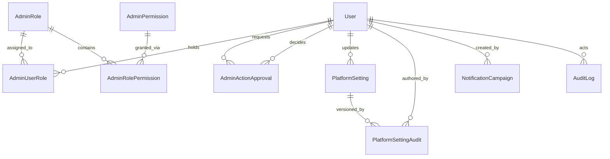

# CreatorConnect: Admin Database Design & Migration 0015 Architecture

Comprehensive architectural and relational reference for the administration data models introduced in Migration 0015 (`0015_add_admin_system_and_rbac`).

---

## 1. Schema Overview & Entity Relationship Model



---

## 2. Table Definitions & Constraints

### 2.1 `admin_permissions`

Stores all discrete, fine-grained administrative permissions.

```sql
CREATE TABLE "admin_permissions" (
    "id" UUID NOT NULL,
    "name" VARCHAR(64) NOT NULL,
    "description" VARCHAR(255),
    "module" VARCHAR(64) NOT NULL,
    "created_at" TIMESTAMP(3) NOT NULL DEFAULT CURRENT_TIMESTAMP,
    CONSTRAINT "admin_permissions_pkey" PRIMARY KEY ("id")
);
CREATE UNIQUE INDEX "admin_permissions_name_key" ON "admin_permissions"("name");
CREATE INDEX "admin_permissions_module_idx" ON "admin_permissions"("module");
```

### 2.2 `admin_roles`

Defines system and user-created custom administrative roles.

```sql
CREATE TABLE "admin_roles" (
    "id" UUID NOT NULL,
    "name" VARCHAR(64) NOT NULL,
    "description" VARCHAR(255),
    "is_system" BOOLEAN NOT NULL DEFAULT false,
    "created_at" TIMESTAMP(3) NOT NULL DEFAULT CURRENT_TIMESTAMP,
    "updated_at" TIMESTAMP(3) NOT NULL,
    CONSTRAINT "admin_roles_pkey" PRIMARY KEY ("id")
);
CREATE UNIQUE INDEX "admin_roles_name_key" ON "admin_roles"("name");
```

### 2.3 `admin_role_permissions`

Join table mapping permissions to roles with cascading deletes.

```sql
CREATE TABLE "admin_role_permissions" (
    "id" UUID NOT NULL,
    "role_id" UUID NOT NULL,
    "permission_id" UUID NOT NULL,
    "created_at" TIMESTAMP(3) NOT NULL DEFAULT CURRENT_TIMESTAMP,
    CONSTRAINT "admin_role_permissions_pkey" PRIMARY KEY ("id"),
    CONSTRAINT "admin_role_permissions_role_id_fkey" FOREIGN KEY ("role_id") REFERENCES "admin_roles"("id") ON DELETE CASCADE,
    CONSTRAINT "admin_role_permissions_permission_id_fkey" FOREIGN KEY ("permission_id") REFERENCES "admin_permissions"("id") ON DELETE CASCADE
);
CREATE UNIQUE INDEX "admin_role_permissions_role_id_permission_id_key" ON "admin_role_permissions"("role_id", "permission_id");
```

### 2.4 `admin_user_roles`

Associates platform users with administrative roles.

```sql
CREATE TABLE "admin_user_roles" (
    "id" UUID NOT NULL,
    "user_id" UUID NOT NULL,
    "role_id" UUID NOT NULL,
    "created_at" TIMESTAMP(3) NOT NULL DEFAULT CURRENT_TIMESTAMP,
    CONSTRAINT "admin_user_roles_pkey" PRIMARY KEY ("id"),
    CONSTRAINT "admin_user_roles_user_id_fkey" FOREIGN KEY ("user_id") REFERENCES "users"("id") ON DELETE CASCADE,
    CONSTRAINT "admin_user_roles_role_id_fkey" FOREIGN KEY ("role_id") REFERENCES "admin_roles"("id") ON DELETE CASCADE
);
CREATE UNIQUE INDEX "admin_user_roles_user_id_role_id_key" ON "admin_user_roles"("user_id", "role_id");
CREATE INDEX "admin_user_roles_user_id_idx" ON "admin_user_roles"("user_id");
CREATE INDEX "admin_user_roles_role_id_idx" ON "admin_user_roles"("role_id");
```

### 2.5 `admin_action_approvals`

Implements dual-approval gating for sensitive actions (e.g. high-value refunds $\ge$ ₹50,000).

```sql
CREATE TABLE "admin_action_approvals" (
    "id" UUID NOT NULL,
    "action_type" VARCHAR(64) NOT NULL,
    "target_entity" VARCHAR(64) NOT NULL,
    "target_entity_id" VARCHAR(64) NOT NULL,
    "requested_by_id" UUID NOT NULL,
    "decided_by_id" UUID,
    "status" VARCHAR(32) NOT NULL DEFAULT 'PENDING',
    "payload" JSONB,
    "requested_amount_minor" BIGINT,
    "notes" TEXT,
    "expires_at" TIMESTAMP(3),
    "created_at" TIMESTAMP(3) NOT NULL DEFAULT CURRENT_TIMESTAMP,
    "updated_at" TIMESTAMP(3) NOT NULL,
    CONSTRAINT "admin_action_approvals_pkey" PRIMARY KEY ("id"),
    CONSTRAINT "admin_action_approvals_requested_by_id_fkey" FOREIGN KEY ("requested_by_id") REFERENCES "users"("id") ON DELETE RESTRICT,
    CONSTRAINT "admin_action_approvals_decided_by_id_fkey" FOREIGN KEY ("decided_by_id") REFERENCES "users"("id") ON DELETE SET NULL
);
CREATE INDEX "admin_action_approvals_status_idx" ON "admin_action_approvals"("status");
CREATE INDEX "admin_action_approvals_target_entity_target_entity_id_idx" ON "admin_action_approvals"("target_entity", "target_entity_id");
```

### 2.6 `platform_settings` and `platform_setting_audits`

Provides versioned, auditable key-value configuration storage.

```sql
CREATE TABLE "platform_settings" (
    "id" UUID NOT NULL,
    "key" VARCHAR(128) NOT NULL,
    "value" JSONB NOT NULL,
    "schema" JSONB,
    "description" VARCHAR(255),
    "is_encrypted" BOOLEAN NOT NULL DEFAULT false,
    "is_system" BOOLEAN NOT NULL DEFAULT false,
    "version" INTEGER NOT NULL DEFAULT 1,
    "updated_by_id" UUID,
    "created_at" TIMESTAMP(3) NOT NULL DEFAULT CURRENT_TIMESTAMP,
    "updated_at" TIMESTAMP(3) NOT NULL,
    CONSTRAINT "platform_settings_pkey" PRIMARY KEY ("id")
);
CREATE UNIQUE INDEX "platform_settings_key_key" ON "platform_settings"("key");

CREATE TABLE "platform_setting_audits" (
    "id" UUID NOT NULL,
    "setting_id" UUID NOT NULL,
    "key" VARCHAR(128) NOT NULL,
    "previous_value" JSONB,
    "newValue" JSONB NOT NULL,
    "version" INTEGER NOT NULL,
    "changed_by_id" UUID NOT NULL,
    "reason" VARCHAR(255),
    "created_at" TIMESTAMP(3) NOT NULL DEFAULT CURRENT_TIMESTAMP,
    CONSTRAINT "platform_setting_audits_pkey" PRIMARY KEY ("id"),
    CONSTRAINT "platform_setting_audits_setting_id_fkey" FOREIGN KEY ("setting_id") REFERENCES "platform_settings"("id") ON DELETE CASCADE,
    CONSTRAINT "platform_setting_audits_changed_by_id_fkey" FOREIGN KEY ("changed_by_id") REFERENCES "users"("id") ON DELETE RESTRICT
);
CREATE INDEX "platform_setting_audits_setting_id_created_at_idx" ON "platform_setting_audits"("setting_id", "created_at" DESC);
CREATE INDEX "platform_setting_audits_key_idx" ON "platform_setting_audits"("key");
```

### 2.7 `notification_campaigns`

Broadcast campaign definition, targeting, and dispatch tracking.

```sql
CREATE TABLE "notification_campaigns" (
    "id" UUID NOT NULL,
    "title" VARCHAR(255) NOT NULL,
    "message" TEXT NOT NULL,
    "target_type" VARCHAR(64) NOT NULL,
    "channels" TEXT[] NOT NULL,
    "status" VARCHAR(32) NOT NULL DEFAULT 'DRAFT',
    "scheduled_at" TIMESTAMP(3),
    "estimated_recipients" INTEGER NOT NULL DEFAULT 0,
    "sent_count" INTEGER NOT NULL DEFAULT 0,
    "failed_count" INTEGER NOT NULL DEFAULT 0,
    "created_by_id" UUID NOT NULL,
    "idempotency_key" VARCHAR(64),
    "created_at" TIMESTAMP(3) NOT NULL DEFAULT CURRENT_TIMESTAMP,
    "updated_at" TIMESTAMP(3) NOT NULL,
    CONSTRAINT "notification_campaigns_pkey" PRIMARY KEY ("id"),
    CONSTRAINT "notification_campaigns_created_by_id_fkey" FOREIGN KEY ("created_by_id") REFERENCES "users"("id") ON DELETE RESTRICT
);
CREATE INDEX "notification_campaigns_status_idx" ON "notification_campaigns"("status");
CREATE INDEX "notification_campaigns_scheduled_at_idx" ON "notification_campaigns"("scheduled_at");
```

---

## 3. Migration 0015 Integrity Verification

Migration `0015_add_admin_system_and_rbac` was generated via Prisma and executed against local PostgreSQL (`localhost:5433`).

Migration verification queries:

```sql
SELECT migration_name, finished_at, rolled_back_at
FROM "_prisma_migrations"
WHERE migration_name = '0015_add_admin_system_and_rbac';
```

Result: `finished_at` is populated, `rolled_back_at` is `NULL`.
All indexes, foreign key cascading definitions, and unique constraints are fully applied.
