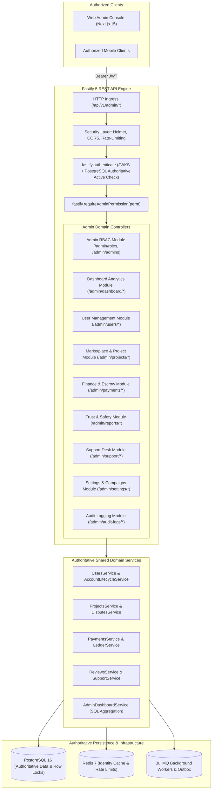

# CreatorConnect — Admin System Architecture

## Authoritative Architecture Manual: Platform Management & Control Plane

**Phase:** Phase 4 Platform Administration  
**Status:** IMPLEMENTED & VERIFIED  
**Revision:** 1.0  
**Scope:** Authoritative Backend & Multi-Client Interfaces

---

## 1. Architectural Mandate & System Purpose

The **CreatorConnect Administration System** is the secure, centralized, multi-tenant administrative control plane for the CreatorConnect ecosystem.

CreatorConnect is fundamentally a **mobile-first product**:

- **Android Application** (Primary creator/client marketplace experience)
- **iOS Application** (Primary creator/client marketplace experience)
- **Admin Web Shell** (Secure operational control plane for platform operators)

### The Authoritative Backend Principle

> **One Authoritative Backend, Multiple Clients.**  
> The Fastify REST API (`/api/v1/admin/*`) is the single source of truth for platform state, user accounts, financial transactions, project disputes, and system settings. Client applications (Android, iOS, Web-Shell) are presentation layers and API consumers. No administrative logic, financial reconciliation, or authorization decisions may be performed client-side.

---

## 2. Component Topology & Request Flow

---

## 3. Defense-in-Depth Security Architecture

The administration system implements a multi-tier defense-in-depth model:

### Tier 1: Network & Protocol Hardening

- **Helmet**: Disables MIME sniffing, disables DNS prefetching, enforces frameguard and strict HTTP headers.
- **Strict CORS**: In production, wildcard CORS (`*`) is explicitly prohibited when credentials are enabled. Validated at boot time.
- **Rate Limiting**: Distributed Redis token-bucket rate limiter protects sensitive admin operations from brute-force enumeration.

### Tier 2: Cryptographic Identity & Authoritative Status

- **Asymmetric JWKS JWT Verification**: Validates Supabase-issued tokens (RS256/ES256) using cached public keys.
- **PostgreSQL Account Status Authority**:
  - Redis cache stores user metadata, but **never independently authorizes ACTIVE status**.
  - `fastify.authenticate` queries `userRepo.getStatusBySub(sub)` directly against PostgreSQL.
  - If PostgreSQL reports `SUSPENDED` or `DEACTIVATED`, the request is immediately rejected (403), even if Redis contains a stale active identity.

### Tier 3: Two-Tier Role-Based Access Control (RBAC)

1. **Tier 1 Global Role Check**: The caller must possess `RoleType.ADMIN` on `user_roles`. Non-admin accounts receive 403 `AUTH_INSUFFICIENT_ROLE`.
2. **Tier 2 Fine-Grained Permission Check**: `fastify.requireAdminPermission(permission)` checks whether the admin's assigned roles in `admin_user_roles` contain the required permission (e.g. `users.suspend`, `payments.refund.approve`, `admins.manage`) or universal wildcard (`*` / `SUPER_ADMIN`).

### Tier 4: Concurrency-Safe Lockout Invariants

- **Last Active Admin Guard**: Pessimistic row-level locking (`SELECT ... FOR UPDATE OF u`) prevents concurrent administrative actions from suspending or deactivating the last remaining active platform administrator.
- **Last Active Super Admin Guard**: Pessimistic row-level locking on active `SUPER_ADMIN`s prevents concurrent revocations from eliminating the last active Super Administrator.

### Tier 5: Immutable Forensic Audit Logging

- Every administrative state change transactionally writes to `audit_logs` capturing:
  - `userId`: Identity of the performing administrator.
  - `action`: Canonical action identifier (e.g. `ADMIN_ROLE_ASSIGNED`, `USER_SUSPENDED`, `REFUND_APPROVED`).
  - `entity` & `entityId`: Target resource.
  - `ipAddress` & `userAgent`: Client source context.
  - `metadata`: Forensically detailed before/after diffs with sensitive attributes redacted.
- The `audit_logs` table is strictly append-only from the application perspective.

---

## 4. Administrative Domain Modular Breakdown

1. **RBAC & Admin Management (`/api/v1/admin/roles`, `/api/v1/admin/admins`)**:
   - Role creation, updates, and permission bindings.
   - User assignment and revocation.
   - Immutable system role protection (`SUPER_ADMIN`, `PLATFORM_ADMIN`, etc.).
2. **Dashboard Overview (`/api/v1/admin/dashboard/*`)**:
   - Database-side aggregation (`COUNT`, `SUM`, date truncations) for platform health, users, projects, revenue, and disputes.
   - Pre-computed caching with short TTL in Redis to eliminate unbounded database CPU spikes.
3. **User & Account Management (`/api/v1/admin/users/*`)**:
   - Paginated user directory with status, role, and verification filters.
   - Account suspension (`SUSPENDED`), reactivation (`ACTIVE`), and retention/erasure tracking.
4. **Marketplace & Projects (`/api/v1/admin/projects/*`)**:
   - Project inspection across all statuses (`IN_PROGRESS`, `SUBMITTED`, `DISPUTED`, `COMPLETED`).
   - Deliverable review and dispute arbitration integration.
5. **Finance & Escrow (`/api/v1/admin/payments/*`)**:
   - Transaction exploration and Razorpay payment reference lookups.
   - Immutable double-entry balanced ledger verification ($\sum \text{debits} \equiv \sum \text{credits}$).
   - Dual-approval workflows for high-value refunds with anti-self-approval enforcement.
6. **Trust, Safety & Moderation (`/api/v1/admin/reports/*`)**:
   - Centralized moderation queue connecting user, project, and review reports.
   - Action enforcement: warnings, restrictions, suspensions, and content removal.
7. **Support Administration (`/api/v1/admin/support/*`)**:
   - Support ticketing management, priority reassignments, and internal note segregation.
8. **Platform Settings & Configuration (`/api/v1/admin/settings/*`)**:
   - Dynamic configuration management (maintenance mode, feature flags, upload limits) with schema validation, version history, and rollback.
9. **Notification Campaigns (`/api/v1/admin/notifications/*`)**:
   - Broadcast campaign targeting, recipient estimation, and BullMQ worker queue processing.
10. **Audit & Compliance (`/api/v1/admin/audit-logs/*`)**:
    - Keyset-paginated compliance audit query and secure streaming export.
