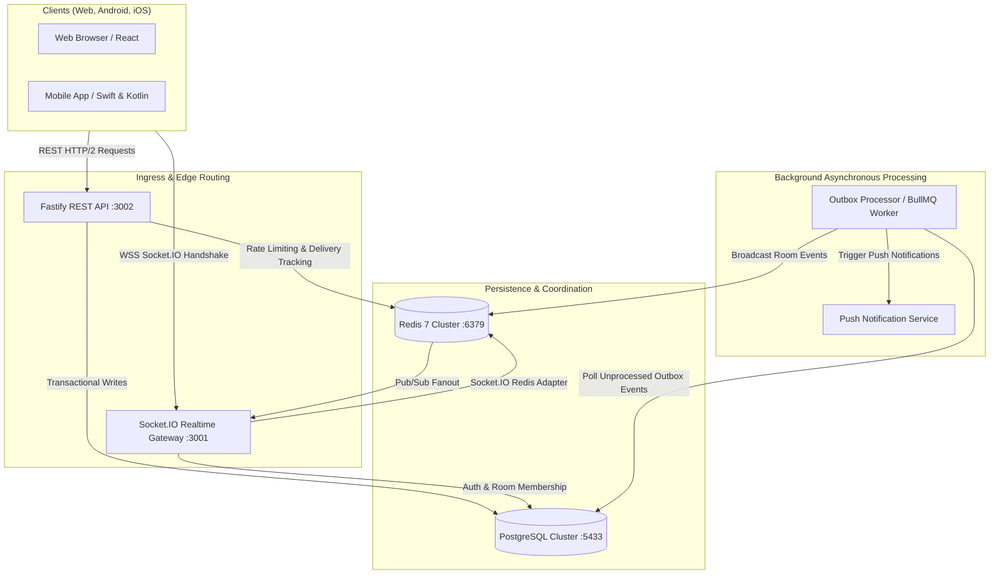
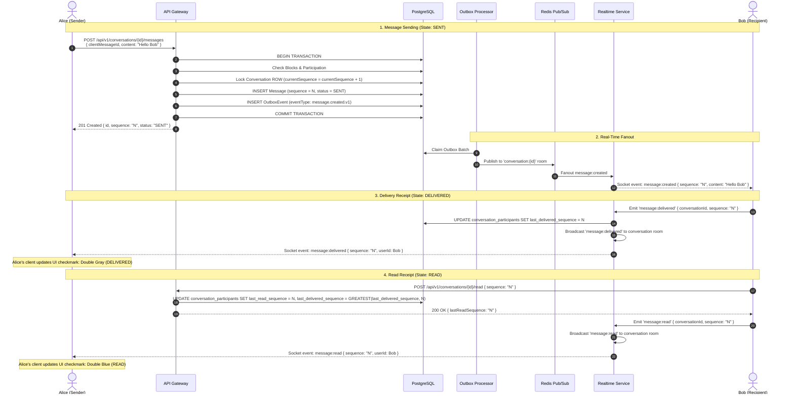

# CreatorConnect — Complete Production-Grade Messaging System Architecture

## 1. Executive Summary & System Overview

CreatorConnect provides a secure, reliable, real-time messaging platform supporting web, Android, and iOS clients. The system is engineered around strict domain boundaries, transactional consistency, bidirectional privacy controls, monotonically ordered message sequences, distinct delivery/read receipts (`SENT` ≠ `DELIVERED` ≠ `READ`), and resilient multi-device real-time event streaming.



---

## 2. The 20 Core Requirement Areas

| #      | Architecture Dimension                                | Design Implementation & Guarantees                                                                                                                                                                                                                                                                                                                                                                          | Enforcement Layer                                      |
| ------ | ----------------------------------------------------- | ----------------------------------------------------------------------------------------------------------------------------------------------------------------------------------------------------------------------------------------------------------------------------------------------------------------------------------------------------------------------------------------------------------- | ------------------------------------------------------ |
| **1**  | **Conversation & Inbox APIs**                         | `POST /api/v1/conversations`, `GET /api/v1/conversations`, `GET /api/v1/conversations/:id`. Cursor pagination. Accurate unread counts excluding self-messages and soft-deleted messages.                                                                                                                                                                                                                    | Fastify API + Prisma + PostgreSQL                      |
| **2**  | **User Discovery & Recipient Selection**              | `GET /api/v1/conversations/recipients?query=...` (and `/api/v1/chat/recipients`). Searches discoverable users; strictly excludes requesting user, suspended/deactivated users, and bidirectionally blocked peers. Never leaks emails, phone numbers, or credentials.                                                                                                                                        | Fastify API + DB Query                                 |
| **3**  | **Message Requests & Consent**                        | Phase 19F consent workflow: `POST /api/v1/chat/requests`, accept, decline, cancel. Direct conversations between unacquainted peers require accepted consent unless an active assignment/application link exists.                                                                                                                                                                                            | API Service + DB Transactions                          |
| **4**  | **Conversation Lifecycle & Membership**               | Peer-to-peer idempotency (single direct conversation per peer pair). Roles (`MEMBER`, `ADMIN`), join/leave state, and mute durations.                                                                                                                                                                                                                                                                       | DB Unique Constraints + Repository                     |
| **5**  | **Message Sending & Persistence**                     | `POST /api/v1/conversations/:id/messages`. Serialized, transactional row insertion. Assigns sequential monotonically increasing integer ID per conversation.                                                                                                                                                                                                                                                | PostgreSQL Transaction (`Serializable/RepeatableRead`) |
| **6**  | **Message Idempotency**                               | Client provides unique `clientMessageId` (UUIDv7). Backed by database unique constraint `@@unique([senderId, conversationId, clientMessageId])`. Duplicate requests safely return existing record without sequence gaps.                                                                                                                                                                                    | PostgreSQL Unique Index                                |
| **7**  | **Message Ordering & Timestamps**                     | Per-conversation monotonic `sequence BigInt`. Serialized as decimal strings over JSON to eliminate 64-bit IEEE 754 precision loss in web/mobile JS runtimes. Keyset base64url cursor pagination (`cursor`, `limit`, `direction`).                                                                                                                                                                           | Database Sequence + Shared Contracts                   |
| **8**  | **Delivery Receipts (`SENT` ≠ `DELIVERED` ≠ `READ`)** | 3-state lifecycle: `SENT` (stored in DB, sequence assigned), `DELIVERED` (received by recipient client, durably persisted in `conversation_participants.last_delivered_sequence` via additive migration `0014`, acknowledged via `POST /conversations/:id/delivered` or `message:delivered` socket event), `READ` (viewed by recipient, acknowledged via `/read` or `message:read`). Monotonic advancement. | PostgreSQL Table Column + Index + Socket.IO Broadcast  |
| **9**  | **Read Receipts & Unread Counts**                     | `lastReadSequence` pointer per participant. Unread count calculated via indexed query: `sequence > lastReadSequence AND senderId != userId AND deletedAt IS NULL`.                                                                                                                                                                                                                                          | PostgreSQL Index + REST API                            |
| **10** | **Real-Time Socket.IO Communication**                 | Authenticated WSS connection (`@creatorconnect/realtime`). Handshake asymmetric JWT verification. Room joining (`conversation:<id>`), `message:send`, `message:delivered`, `message:read`, `conversation:typing`. Redis adapter cluster fanout.                                                                                                                                                             | Socket.IO + Redis Adapter                              |
| **11** | **Offline Sync & Recovery**                           | `conversation:sync` socket event accepts `sinceSequence` and returns delta messages missed while disconnected. REST keyset cursor fallback.                                                                                                                                                                                                                                                                 | Socket Handler + DB                                    |
| **12** | **Multi-Device Synchronization**                      | Multiple concurrent sockets per user. Room events (`message:created`, `message:delivered`, `message:read`) fan out across all active user devices.                                                                                                                                                                                                                                                          | Socket.IO Gateway + Redis Pub/Sub                      |
| **13** | **Attachment Security**                               | Pre-signed Cloudflare R2 uploads, antivirus quarantine scanning before state transitions to `ACTIVE`. Signed expiring download URLs via `GET /conversations/:id/attachments/:id/download`. Audit logging on download.                                                                                                                                                                                       | S3/R2 Storage + Media Processor                        |
| **14** | **Blocking & Abuse Reporting**                        | Bidirectional blocking (`POST /api/v1/blocks`). Immediate socket eviction across all cluster nodes via Redis pub/sub. Active room block guards. Abuse reporting via `POST /api/v1/reports`.                                                                                                                                                                                                                 | BlockEvictionService + Cluster Bridge                  |
| **15** | **Rate Limiting & Anti-Abuse**                        | Distributed Redis sliding window rate limits: 30 msg/min, 60 search/min, 10 requests/hour. Character limits (5000 chars message, 500 chars request). Disallowed control characters filter.                                                                                                                                                                                                                  | Fastify RateLimit Plugin                               |
| **16** | **Transactional Outbox Pattern**                      | Events (`message.created.v1`, `message.deleted.v1`, `user.block.created.v1`, etc.) written to `outbox_events` table in the SAME transaction as entity changes. Background worker claims batches with monotonic lock and exponential backoff.                                                                                                                                                                | OutboxProcessor + Worker                               |
| **17** | **Notifications & Background Jobs**                   | `NotificationEventHandler` processes outbox events and enqueues BullMQ push/in-app notification jobs. Anti-enumeration and block-aware.                                                                                                                                                                                                                                                                     | BullMQ + Outbox Worker                                 |
| **18** | **Shared TypeBox Contracts & Mobile Compatibility**   | `@creatorconnect/contracts` provides authoritative DTO schemas, JSON schema validation, cursor encode/decode, and type inference across Web, Mobile, and API.                                                                                                                                                                                                                                               | Monorepo Shared Package                                |
| **19** | **Observability, Reliability & Telemetry**            | Structured JSON logging (Pino), OpenTelemetry trace IDs (`x-request-id`), correlation IDs on outbox events, dead-letter queue for terminal failures.                                                                                                                                                                                                                                                        | Pino + OpenTelemetry                                   |
| **20** | **Automated Testing & Production Readiness**          | 143 passing API tests, 41 passing Realtime tests, 112 passing Worker tests, 60 passing Contract tests. Zero schema regressions.                                                                                                                                                                                                                                                                             | Vitest + Playwright                                    |

---

## 3. End-to-End Message Lifecycle & Receipt Sequence Diagram



---

### 3.1 Delivery Receipt Durability & Multi-Device Semantics

Authoritative delivery state is persisted in PostgreSQL to guarantee durability across all infrastructure boundaries. In-memory storage is strictly prohibited as the authoritative delivery state.

#### 1. Persistence & Migration (Migration `0014_add_participant_last_delivered_sequence`)

- **Schema**: Column `last_delivered_sequence BIGINT NOT NULL DEFAULT 0` added to `conversation_participants`.
- **Indexing**: Composite index `conversation_participants(conversation_id, last_delivered_sequence)` enables high-throughput sub-millisecond status retrieval without sequential table scans.
- **Durable Across All Restarts**: Delivery state survives API process restarts, Realtime server restarts, worker crashes, and Redis flushes or restarts.
- **Multi-Instance Synchronization**: Independent horizontal API and Realtime containers query and update the same ACID PostgreSQL row, eliminating split-brain state or cache desynchronization.

#### 2. Multi-Device Delivery Policy

- **Definition of DELIVERED**: A message sequence is considered `DELIVERED` as soon as **at least one** authenticated device belonging to the recipient acknowledges receipt.
- **Fanout to Companion Devices**: When Device 1 of User B acknowledges sequence `N`, the delivery pointer advances in PostgreSQL and broadcasts `message:delivered` to all companion devices of User B and to the sender.
- **Monotonic Advancement**: Delivery sequence is strictly monotonic (`cappedSeq > currentDelivered ? cappedSeq : currentDelivered`), preventing replayed or out-of-order network packets from regressing the delivery pointer.
- **Ceiling Capping**: The sequence is capped at `conversation.currentSequence`, rejecting client claims for non-existent future messages.
- **Spoofing Protection**: `userId` is extracted exclusively from the cryptographically verified JWT (`request.user.id` or `socket.data.user.id`), never from client payload bodies. Non-participants attempting delivery acknowledgment are rejected with `404 Not Found`.

---

## 4. Real-Time Socket.IO Protocol Specifications

### 4.1 Connection & Handshake

- **Endpoint**: `wss://realtime.creatorconnect.com/socket.io/?EIO=4&transport=websocket`
- **Auth Payload**:
  ```json
  {
    "auth": {
      "token": "Bearer <Supabase_JWT_Token>"
    }
  }
  ```
- **Validation**: Handshake performs asymmetric ES256/RS256 JWT verification against Supabase Auth public JWKS. Invalid or expired tokens are rejected before socket establishment.

### 4.2 Room Management

- `conversation:join`:

  ```json
  // Client -> Server
  { "conversationId": "01a2097e-..." }
  // Server -> Client Ack
  { "success": true, "data": { "conversationId": "01a2097e-..." } }
  ```

  _Enforces active participant authorization and bidirectional block policy._

- `conversation:leave`:
  ```json
  // Client -> Server
  { "conversationId": "01a2097e-..." }
  ```

### 4.3 Real-Time Messaging Events

- `message:send` (Client -> Server):

  ```json
  {
    "conversationId": "01a2097e-...",
    "clientMessageId": "01a2097f-...",
    "content": "Hello via socket",
    "mediaAssetIds": []
  }
  ```

  Returns Ack `{ success: true, data: MessageResponse }`.

- `message:delivered` (Client -> Server & Room Broadcast):

  ```json
  {
    "conversationId": "01a2097e-...",
    "sequence": "42"
  }
  ```

  Server advances delivered sequence monotonically and broadcasts to room:

  ```json
  {
    "conversationId": "01a2097e-...",
    "userId": "01a2097c-...",
    "sequence": "42",
    "deliveredAt": "2026-11-23T22:00:00.000Z"
  }
  ```

- `message:read` (Client -> Server & Room Broadcast):

  ```json
  {
    "conversationId": "01a2097e-...",
    "sequence": "42"
  }
  ```

  Server updates database `lastReadSequence` and broadcasts:

  ```json
  {
    "conversationId": "01a2097e-...",
    "userId": "01a2097c-...",
    "sequence": "42",
    "readAt": "2026-11-23T22:00:00.000Z"
  }
  ```

- `conversation:typing` (Client -> Server & Room Broadcast):

  ```json
  {
    "conversationId": "01a2097e-...",
    "isTyping": true
  }
  ```

  Ephemeral. Emits to other participants in the room without DB persistence:

  ```json
  {
    "conversationId": "01a2097e-...",
    "userId": "01a2097c-...",
    "isTyping": true,
    "timestamp": "2026-11-23T22:00:00.000Z"
  }
  ```

- `conversation:sync` (Offline Recovery):
  ```json
  // Client -> Server
  { "conversationId": "01a2097e-...", "sinceSequence": "35" }
  // Server -> Client Ack
  {
    "success": true,
    "data": {
      "messages": [ ... ],
      "latestSequence": "42"
    }
  }
  ```

---

## 5. Recipient Discovery & Anti-Enumeration Security

The recipient discovery API (`GET /api/v1/conversations/recipients` and `/api/v1/chat/recipients`) allows users to search for peers to message while enforcing the following security controls:

1. **Authentication Requirement**: Anonymous access is rejected with `401 Unauthorized`.
2. **Self-Exclusion**: The authenticated caller is automatically excluded from search results (`id NOT IN (callerId)`).
3. **Account State Filter**: Only users with status `ACTIVE` are discoverable. `SUSPENDED` and `DEACTIVATED` users are omitted.
4. **Bidirectional Block Isolation**: If User A has blocked User B, OR User B has blocked User A, neither user will appear in the other's search results.
5. **PII Masking**: Results omit sensitive columns:
   - Excluded: `email`, `phone`, `password`, `supabaseAuthId`, `createdAt`, `updatedAt`, `billingAddress`.
   - Included: `id`, `displayName`, `avatarUrl`, `role`, `isVerified`.
6. **Rate Limiting**: Limited to 60 searches per minute per user via Redis token bucket.

---

## 6. Monotonic Keyset Cursor Pagination

Message history pagination uses monotonic sequence-based keyset cursors rather than offset/limit:

- **Encoding**: Sequence number is encoded into an opaque URL-safe base64url JSON token: `{"s": "42"}`.
- **Direction**: Supports `'prev'` (backward toward older messages) and `'next'` (forward toward newer messages).
- **Security**: Tampered, negative, non-numeric, or excessively long cursors (> 512 chars) are rejected with RFC 7807 `400 Bad Request` (`INVALID_MESSAGE_CURSOR`).
- **Precision**: Sequence numbers are strictly handled as strings in contracts and JSON payloads to ensure 64-bit integer values never overflow JavaScript/JSON parsers.
