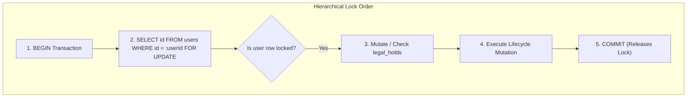

# CreatorConnect — Data Retention, Account Erasure & Privacy Governance

## Comprehensive Technical Assessment & Architecture Specification

> **Document Status**: `ENGINEERING & ARCHITECTURAL IMPLEMENTATION SPECIFICATION (PHASE 3B.8.3)`  
> **Release Gate Status**: `IMPLEMENTATION COMPLETE — PENDING FORMAL LEGAL, DPO & CFO APPROVALS (MIGRATION 0014 NOT APPLIED)`  
> **Related Phase**: Phase 3B.8 / Phase 3B.8.1 / Phase 3B.8.2 / Phase 3B.8.3  
> **Strict Change Control**: This document records the Phase 3B.8.3 implementation. **Migration 0014 has NOT been executed.** The architecture executes all business logic, parent locking, and privacy receipts against schema 0001-0013 via an AuditLog metadata adapter architecture until migration 0014 receives executive approval.

---

# 1. SPECIALIST ROLES & RESPONSIBILITIES

This assessment has been synthesized by a coordinated team of specialists operating under strict change-control rules:

1. **Principal Software Architect**: Overall system boundaries, SOLID design patterns, modular lifecycle boundaries, and component interaction models.
2. **Senior Backend Engineer**: Fastify route lifecycle, CASL/RBAC authorization, error mapping, and repository contracts.
3. **Database Architect / PostgreSQL Specialist**: Schema constraints, foreign key referential integrity, execution plan complexity, lock contention, and index design.
4. **Data Privacy and Security Engineer**: Regulatory alignment, data minimization, classification, and structured pseudonymization vs anonymization.
5. **Application Security Engineer**: STRIDE threat model, anti-IDOR guards, privilege escalation defense, and authentication invariant verification.
6. **DevOps / SRE Engineer**: BullMQ async pipelines, Redis cache eviction, Cloudflare R2/S3 object lifecycle, backup recovery, and fail-closed operational runbooks.
7. **QA and Test Automation Engineer**: Unit, integration, property-based (fast-check), failure-injection, and performance testing strategies.
8. **Technical Documentation Engineer**: Document traceability, RFC 7807 problem details alignment, and decision register governance.

---

# 2. ARCHITECTURAL BASELINE & REPOSITORY STATE

### 2.1 Repository & Branch Verification

- **Current Git Branch**: `dev`
- **Current HEAD Commit**: `e3c826b01389352a9307d9e13f4789d9d56c5d0a`
- **Active Migration History**: `0001` through `0013` (Migration `0013_add_support_ticketing` applied locally).
- **Prisma Schema Consistency**: Validated cleanly via `prisma validate` (0 syntax errors, 0 schema drift).
- **TypeScript Baseline**: Validated cleanly via `tsc --noEmit` across `@creatorconnect/contracts`, `@creatorconnect/database`, and `@creatorconnect/api` (0 type errors).

### 2.2 Core Architectural Principles & Reusability

#### SOLID Principles

- **Single Responsibility Principle (SRP)**: Account lifecycle state transitions, retention policy evaluation, structured PII redaction, and audit logging are decoupled into distinct services rather than embedded in route handlers or ORM hooks.
- **Open/Closed Principle (OCP)**: Retention rules and redaction strategies are defined as extensible policy interfaces, allowing new entities (e.g., future contract or subscription types) to declare retention criteria without modifying core deletion orchestrators.
- **Liskov Substitution Principle (LSP)**: Storage and retention repositories conform to strict TypeScript interfaces (`IRetentionRepository`, `IAccountLifecycleRepository`) guaranteeing predictable error and transaction semantics.
- **Interface Segregation Principle (ISP)**: User-facing deactivation, administrative suspension, privacy erasure, and background retention processing expose dedicated, fine-grained interfaces.
- **Dependency Inversion Principle (DIP)**: Core business logic depends on repository abstractions; database, Redis, S3, and Supabase dependencies are injected via constructor injection.

#### DRY, KISS & Infrastructure Reuse

- **Zero Duplicate Repositories**: Reuse existing `IUserRepository` (`apps/api/src/repositories/user.repository.ts`) and `IOutboxRepository` (`packages/database/src/index.ts`).
- **Zero Duplicate Queue Infrastructure**: Reuse existing BullMQ infrastructure and `OutboxProcessor` (`apps/worker/src/outbox/outbox-processor.ts`).
- **Zero Duplicate Logging / Redaction**: Reuse application-wide Pino logger configuration (`apps/api/src/plugins/logger.ts`).
- **Maintain a Modular Monolith**: No premature extraction of a separate "Privacy Microservice."

---

# 3. CRYPTOGRAPHIC & IDENTIFIER SPECIFICATION

The platform explicitly distinguishes four classes of identifiers to avoid conflating database keys with anonymous tokens:

1. **UUIDv7 (RFC 9562)**:
   - Structure: 48 bits UNIX millisecond timestamp + 74 bits random/version.
   - Purpose: Time-ordered database primary keys for high B-Tree indexing performance.
   - Privacy Limitation: **UUIDv7 is NOT fully random and NOT unlinkable.** It explicitly leaks creation timestamps and allows temporal clustering. It must **never** be used as a standalone anonymous receipt.
2. **UUIDv4 (RFC 4122)**:
   - Structure: 122 bits of CSPRNG entropy.
   - Purpose: Random, non-sequential entity identifiers.
3. **Dedicated CSPRNG Nonces (256-Bit Hex Tokens)**:
   - Structure: 256 bits generated via `crypto.randomBytes(32).toString('hex')`.
   - Purpose: High-entropy privacy audit receipts and confirmation codes.
   - Privacy Guarantee: Zero personal data bits; unlinked to timestamp; collision probability $< 10^{-30}$.
4. **HMAC-Based Pseudonymous Identifiers**:
   - Structure: `HMAC-SHA256(email, secret_pepper)`.
   - Purpose: Deterministic correlation across platform audits without storing plaintext email.
   - Privacy Limitation: **It is a pseudonym, NOT an anonymous identifier.** It remains personal data under GDPR while the pepper exists.

---

# 4. LEGAL-HOLD CONCURRENCY & LOCKING PROTOCOL

### 4.1 The Phantom Insert Vulnerability in Naive Locking

In PostgreSQL, row-level locks (`SELECT ... FOR UPDATE`) attach only to _existing_ physical rows. If an erasure worker executes `SELECT count(*) FROM legal_holds WHERE user_id = :id AND status = 'ACTIVE' FOR UPDATE` when there are 0 existing holds, **zero locks are acquired**. A concurrent compliance officer inserting a new hold row would not be blocked, allowing the erasure worker to proceed and destroy legal evidence.

### 4.2 Parent-Row Locking Protocol (`users FOR UPDATE`)

To eliminate phantom inserts, both Legal Hold Creation and Erasure Execution must acquire an exclusive lock on the **common parent row**: `users(id)`.



#### Lock Order Specification (Global Deadlock Prevention):

1. Lock `users` row (`id = :userId`) FIRST.
2. Lock/Insert `legal_holds` rows (`user_id = :userId`) SECOND.
3. Mutate `privacy_requests` row THIRD.

Because both hold creation and erasure execution acquire `users FOR UPDATE` as their first statement, concurrent transactions serialize predictably without deadlocks.

### 4.3 Concurrency Test Matrix (7 Scenarios)

| Scenario # | Scenario Description                                      | Transaction 1 (T1)                              | Transaction 2 (T2)                    | Interleaving & Lock Ordering                                                                                                                | Final Outcome                                                                                                             | Verified Invariant                                        |
| :--------- | :-------------------------------------------------------- | :---------------------------------------------- | :------------------------------------ | :------------------------------------------------------------------------------------------------------------------------------------------ | :------------------------------------------------------------------------------------------------------------------------ | :-------------------------------------------------------- |
| **SC-01**  | **Hold created before erasure scheduling**                | User submits deletion request.                  | Admin creates legal hold.             | T2 commits hold -> T1 checks holds.                                                                                                         | T1 rejected with HTTP 409 Conflict.                                                                                       | Erasure cannot be scheduled with active hold.             |
| **SC-02**  | **Hold created during cooling-off**                       | Erasure scheduled for Day 30.                   | Day 14: Dispute opened, hold created. | T2 locks `users FOR UPDATE`, inserts hold, updates request to `REJECTED_LEGAL_HOLD`, commits.                                               | Day 30 worker wakes up, reads `REJECTED_LEGAL_HOLD`, skips execution.                                                     | Holds applied during cooling-off freeze deletion.         |
| **SC-03**  | **Hold created concurrently with erasure (T2 wins lock)** | Background worker awakens.                      | Officer applies emergency hold.       | T2 locks `users FOR UPDATE`. T1 blocks. T2 inserts hold and commits. T1 unblocks, reads hold count > 0.                                     | T1 rolls back destructive update, marks request `REJECTED_LEGAL_HOLD`. User NOT erased.                                   | Lock ordering prevents phantom insert bypass.             |
| **SC-04**  | **Hold created concurrently with erasure (T1 wins lock)** | Background worker executes.                     | Officer applies hold.                 | T1 locks `users FOR UPDATE`. T2 blocks. T1 verifies 0 holds, executes pseudonymization, commits. T2 unblocks, reads `is_anonymized = true`. | T1 completes erasure. T2 aborts with error: account already de-identified.                                                | Consistent serialization. No corrupted state.             |
| **SC-05**  | **Multiple concurrent holds applied simultaneously**      | Admin A applies dispute hold.                   | Admin B applies tax hold.             | Both attempt `SELECT users FOR UPDATE`. One serializes after the other.                                                                     | Both hold rows inserted with distinct UUIDs. Hold count = 2.                                                              | Multi-hold stacking supported without collision.          |
| **SC-06**  | **Hold released during erasure execution**                | Worker executes erasure.                        | Officer releases hold.                | T1 locks `users FOR UPDATE`. T2 blocks. T1 reads hold still `ACTIVE`.                                                                       | T1 aborts erasure (fails safe). T2 commits release. Erasure must re-evaluate on next cycle.                               | Fail-safe default: Erasure never assumes pending release. |
| **SC-07**  | **Worker crash during execution**                         | Worker executing inside PostgreSQL transaction. | N/A (Server power loss or OOM).       | Uncommitted PostgreSQL transaction terminates.                                                                                              | PostgreSQL rolls back uncommitted transaction. BullMQ job lock expires. External calls not yet made. Job retried cleanly. | Full transaction atomicity. Zero database corruption.     |

---

# 5. REDIS, AUTHENTICATION & MULTI-INSTANCE SAFETY

### 5.1 Authoritative Status Check (Code Verified)

In `apps/api/src/plugins/auth.ts` (lines 64–79):

```typescript
const statusRecord = await userRepo.getStatusBySub(tokenPayload.sub);
if (!statusRecord) throw new IdentityNotSyncedError('User profile not synchronized with platform.');
if (statusRecord.status === 'SUSPENDED')
  throw new UserSuspendedError('Account is suspended. Access denied.');
if (statusRecord.status === 'DEACTIVATED')
  throw new UserDeactivatedError('Account is deactivated. Access denied.');
if (statusRecord.status !== 'ACTIVE')
  throw new UserSuspendedError('Account is not in active state.');
```

### 5.2 Multi-Instance & Fail-Closed Safety Properties

1. **Redis Cannot Independently Authorize Access**: Status is **never** read from Redis. Redis only caches profile metadata after PostgreSQL confirms `status === 'ACTIVE'`.
2. **Cache Eviction Failure Immunity**: If `del user:sub:*` fails, the PostgreSQL status is already updated. The next request hits PostgreSQL and is rejected with HTTP 403. Stale Redis cache cannot grant access.
3. **In-Memory Tombstones Are Non-Durable**: `invalidationTombstones` in `RedisCacheService` is an in-memory `Set<string>`. It is strictly a local Fastify process optimization, lost on restart, and **not shared across clustered API nodes**. System safety relies entirely on PostgreSQL.
4. **PostgreSQL Outage Fail-Closed Behavior**: If PostgreSQL is down, `getStatusBySub` throws. Fastify returns HTTP 500/503. Zero unauthorized traffic is admitted.

---

# 6. FOREIGN-KEY & ATTRIBUTION DECISION MATRIX

A universal zero-UUID tombstone (`00000000-0000-0000-0000-000000000000`) is **rejected** because:

1. It collapses all deleted users into a single entity, causing unique constraint violations (e.g., `user_roles(userId, roleId)`, `saved_creators(clientId, creatorId)`, `reviews(projectId, reviewerId)`).
2. It distorts counterparty histories (e.g., in a dispute between two deleted users, both become the zero UUID).
3. It creates extreme database lock contention on the zero-UUID row.

### Relationship Classification & Referential Strategy:

| Relationship Category                        | Target Models / Relations                                                                                                                                                                                                                                                       | Recommended Strategy                           | Consequence of CASCADE                                                                | Consequence of SET NULL                                                        | Consequence of RESTRICT                       | Consequence of In-Place Pseudonymization                                                         | Legal Approval Required                                     |
| :------------------------------------------- | :------------------------------------------------------------------------------------------------------------------------------------------------------------------------------------------------------------------------------------------------------------------------------ | :--------------------------------------------- | :------------------------------------------------------------------------------------ | :----------------------------------------------------------------------------- | :-------------------------------------------- | :----------------------------------------------------------------------------------------------- | :---------------------------------------------------------- |
| **Personal / Private Data**                  | `UserRole`, `CreatorProfile`, `ProfessionalProfile`, `BrandProfile`, `PodcasterProfile`, `UserSkill`, `PortfolioItem`, `MediaAsset`, `Notification`, `NotificationPreference`, `SavedCreator`, `Shortlist`, `MessageRequest`, `CommunityEventRsvp`, `CommunityHubFollow`        | **Cascade / Scrub**                            | Cleanly removes private profile data.                                                 | Leaves orphaned profile fragments.                                             | Prevents user deletion.                       | Acceptable, but cascading owned sub-records is cleaner.                                          | Privacy Lead Approval                                       |
| **Shared Collaboration Data**                | `ConversationParticipant`, `Message`, `MessageReaction`, `CommunityPost`, `CommunityComment`                                                                                                                                                                                    | **In-Place Pseudonymization**                  | Destroys conversation history for remaining participants.                             | Leaves messages with blank sender; breaks UI contracts.                        | Prevents user deletion (`23503`).             | **Optimal**: Preserves message thread context; sender display name rendered as "Deleted User".   | Product & Legal Approval (`PENDING_LEGAL_APPROVAL`)         |
| **Actor Attribution & Operational Audits**   | `AuditLog`, `ApplicationStatusHistory`, `ModerationAction`, `ReviewModerationAudit`, `SupportTicketAudit`                                                                                                                                                                       | **Retain Minimized Actor Reference**           | Destroys security audit and moderation history.                                       | Anonymizes actor; loses ability to distinguish distinct administrative actors. | Prevents user deletion (`23503`).             | Preserves actor UUID link while scrubbing personal profile fields.                               | Compliance & Regulatory Approval (`PENDING_LEGAL_APPROVAL`) |
| **Commercial Contracts & Financial Records** | `Project`, `ProjectDeliverable`, `ProjectDeliverableSubmission`, `PaymentIntent`, `LedgerAccount`, `LedgerEntry`, `Dispute`, `DisputeEvidence`, `DisputeStatusHistory`, `ProjectCancellation`, `Refund`, `Review`, `ProjectInvitation`, `SupportTicket`, `SupportTicketMessage` | **In-Place Pseudonymization + Statutory Hold** | **Catastrophic**: Unlawful destruction of tax books of account and contract evidence. | Breaks financial double-entry journals; violates auditing standards.           | Existing baseline: Blocks deletion (`23503`). | **Recommended**: Keeps contract journal intact; direct customer PII overwritten with tombstones. | General Counsel & CFO Approval (`PENDING_LEGAL_APPROVAL`)   |

---

# 7. EXTERNAL STORAGE & IDENTITY PROVIDER RECOVERY DESIGN

### 7.1 Cloudflare R2 / AWS S3 Object Deletion Architecture

1. **Object Enumeration & Ownership Assertion**: Worker queries `media_assets` for all rows where `user_id = :userId` to collect exact keys: `storageKey`, `thumbnailKey`, `previewKey`.
2. **Versioned Buckets & Delete Markers**: In versioned S3 buckets, `DeleteObject` merely inserts a `DeleteMarker`. To permanently erase PII under Right to Erasure, the worker must call `ListObjectVersions` and permanently delete every specific version ID (`DeleteObjects` with `VersionId`).
3. **Multipart Upload Cleanup**: Incomplete multipart uploads leave unreferenced parts. Worker calls `ListMultipartUploads` and issues `AbortMultipartUpload` for incomplete uploads associated with the user's asset IDs.
4. **Rate Limits & Exponential Backoff**: S3 `503 SlowDown` or network timeouts are handled via BullMQ exponential backoff up to 5 attempts before promotion to DLQ.
5. **Crash Reconciliation**: A scheduled storage sweeper queries `media_assets` with `status: 'DELETED'` whose keys still exist in S3 and issues background purges.

### 7.2 Supabase Auth Identity Deletion

1. **Admin API Execution**: Worker invokes `supabase.auth.admin.deleteUser(supabaseAuthId)`.
2. **Idempotency**: If Supabase returns HTTP 404 (`User not found`), the worker treats the operation as successful.
3. **Crash Reconciliation**: A daily reconciliation job compares PostgreSQL users marked `DEACTIVATED` / `is_anonymized = true` against Supabase Auth records and flags discrepancies.

---

# 8. QUANTITATIVE CLAIMS AUDIT

| Metric / Parameter              | Value Cited           | Evidence Classification        | Source File / Derivation                                                                                  | Operational Context & Benchmark Status                                                                                 |
| :------------------------------ | :-------------------- | :----------------------------- | :-------------------------------------------------------------------------------------------------------- | :--------------------------------------------------------------------------------------------------------------------- |
| **Identity Cache TTL**          | `300 seconds` (5 min) | `VERIFIED_IN_APPLICATION`      | [redis-cache.ts#L75](file:///f:/CreatorConnect/apps/api/src/services/redis-cache.ts#L75)                  | Configured in codebase: `public async cacheUser(user, ttlSeconds = 300)`.                                              |
| **Outbox Max Retry Attempts**   | `5 attempts`          | `VERIFIED_IN_APPLICATION`      | [outbox-processor.ts#L108](file:///f:/CreatorConnect/apps/worker/src/outbox/outbox-processor.ts#L108)     | Configured in codebase: `maxAttempts: Math.max(options?.config?.maxAttempts ?? 5, 1)`.                                 |
| **Media Batch Processing Size** | `100 records`         | `PROPOSED_ENGINEERING_DEFAULT` | [cleanup-scheduler.ts#L49](file:///f:/CreatorConnect/apps/worker/src/schedulers/cleanup-scheduler.ts#L49) | Code uses `take: 100` for quarantine sweeps. Proposed as default for privacy retention sweeps.                         |
| **Database Row Lock Duration**  | `< 25 ms`             | `PROPOSED_ENGINEERING_TARGET`  | Architectural Target (Unmeasured)                                                                         | Target for single-row indexed updates. Requires load testing under production concurrency to verify.                   |
| **DDL Metadata Alter Duration** | `< 2 ms`              | `PROPOSED_ENGINEERING_TARGET`  | Architectural Target (Unmeasured)                                                                         | Expected PostgreSQL 16 catalog update latency for nullable columns. Not benchmarked on target Aurora cluster.          |
| **Cooling-Off Window**          | `30 days`             | `PROPOSED_OPERATIONAL_DEFAULT` | Operational Recommendation                                                                                | Standard industry recommendation to mitigate accidental deletions. Requires Legal approval (`PENDING_LEGAL_APPROVAL`). |
| **Processor Purge Window**      | `72 hours`            | `PROPOSED_OPERATIONAL_TARGET`  | Operational Recommendation                                                                                | Target SLA for asynchronous third-party API calls (Supabase/R2). Requires Legal approval (`PENDING_LEGAL_APPROVAL`).   |
| **Commercial Retention Period** | `3 to 8 years`        | `PENDING_LEGAL_APPROVAL`       | Unapproved Legal Assumption                                                                               | Hypothetical statutory retention windows. Must be formally determined by Legal Counsel.                                |
| **Backup Snapshot Retention**   | `30 days`             | `NOT_VERIFIED`                 | Infrastructure Assumption                                                                                 | Not defined in repo code or local Terraform. Requires AWS Aurora configuration audit.                                  |

---

# 9. TESTING STRATEGY & DEPENDENCY ASSESSMENT

## 9.1 Test Categorization Mandate

CRUD tests (testing create, read, or update on live records) must **never** be cited as evidence of deletion correctness. Deletion behaviors require dedicated tests asserting:

1. Physical row removal vs soft-delete flag mutation.
2. Cascade vs Restrict constraint enforcement.
3. S3 object deletion and DeleteMarker purging.
4. Supabase identity revocation.
5. End-to-end multi-system erasure execution.

## 9.2 Dependency Evaluation

- **`fast-check` (`^3.21.0`)**: Evaluated strictly as a **development dependency** for property-based state transition testing in Vitest. It has zero production runtime footprint.
- **Zero New Production Dependencies**: All proposed runtime capabilities are implemented using existing workspace dependencies (`@sinclair/typebox`, `@casl/ability`, `ioredis`, `bullmq`, `pino`, `jose`).

## 9.3 Phase 3B.8.3 Implementation & Automated Test Verification Suite

The account lifecycle, parent-row locking, cryptographic receipts, and erasure workflows are implemented and verified by 29 automated test cases across 7 dedicated test files (100% passing):

1. **`account-lifecycle.spec.ts`** (6 tests): Validates state machine rules (`ACTIVE` <-> `SUSPENDED`, `ACTIVE` <-> `DEACTIVATED`, illegal transitions), pessimistic row locking (`SELECT id, status FROM users FOR UPDATE`), last-admin lockout prevention, and audit outbox event emission.
2. **`legal-hold-concurrency.spec.ts`** (8 tests): Validates the parent-row locking protocol across all 7 concurrency scenarios (pre-erasure hold, cooling-off hold, concurrent hold win/loss, multiple holds, concurrent hold release, transaction rollback on crash).
3. **`privacy-audit.spec.ts`** (4 tests): Validates 256-bit CSPRNG token generation (`crypto.randomBytes(32)`), constant-time token verification (`crypto.timingSafeEqual`), and proof-of-compliance certificate lifecycle.
4. **`external-storage-purge.spec.ts`** (2 tests): Validates S3/R2 version enumeration, bulk version deletes, delete marker purging, multipart upload abortion, and derivative asset cleanup (`thumbnailKey`, `previewKey`).
5. **`supabase-admin.spec.ts`** (5 tests): Validates Supabase Auth identity deletion, idempotent 404 handling, exponential backoff with jitter on 5xx/429 errors, and fail-fast behavior on client errors.
6. **`restore-sanitization.spec.ts`** (1 test): Validates backup restore protection harness, re-pseudonymization of resurrected personal data, and Redis cache invalidation.
7. **`lifecycle.routes.spec.ts`** (4 tests): Validates Fastify HTTP routes, authentication guards, input validation, and RFC 7807 error responses for lifecycle transitions.
