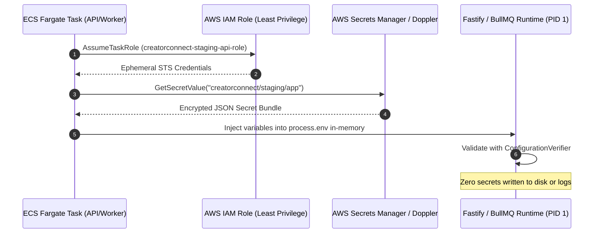
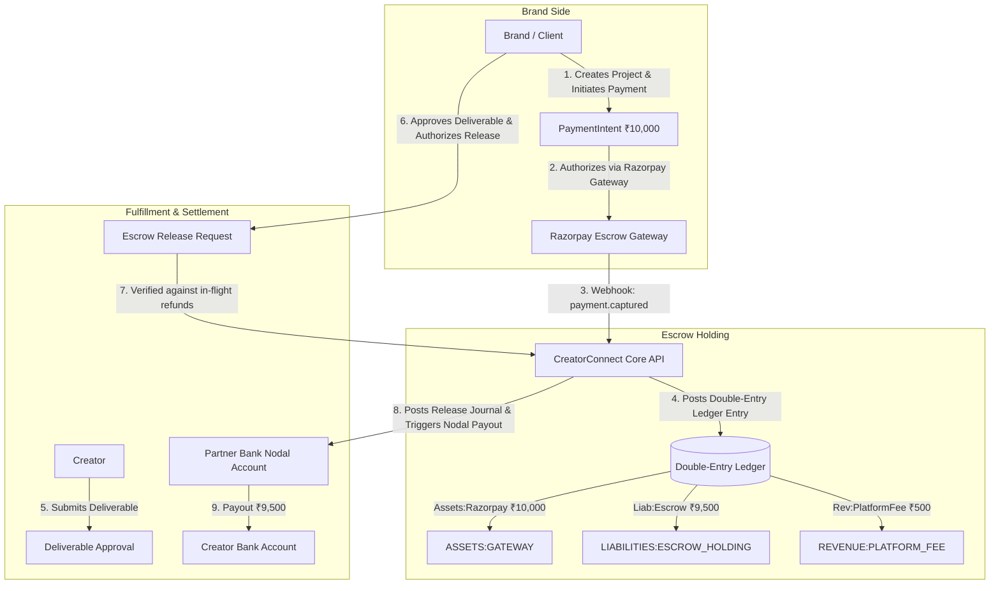

# CreatorConnect — Staging Infrastructure Activation & Release Gate Closure Specification

**Document Version:** 1.0.0  
**Baseline Git Branch:** `dev`  
**Verified Baseline Commit SHA:** `4facbb0b8536df3724b149b762be28254b6746be`  
**Evaluation Date:** October 15, 2026  
**Auditor Roles:** Principal Software Architect, DevSecOps Lead, Financial Systems Engineer, Site Reliability Engineer (SRE), and Database Administrator

---

## 1. Executive Summary & Baseline Ref

The CreatorConnect Phase 6 platform integration was verified on branch `dev` at commit `4facbb0b8536df3724b149b762be28254b6746be`, synchronized with `origin/dev`.

- **Remote CI Verification (100% Green on Exact Commit):**
  - **PR Validation & Quality Gates Run ID:** [`38764285293`](https://github.com/AtharvanJaiswal/CreatorConnect/actions/runs/38764285293) (`success`)
    - _Job 116523319112:_ Semgrep SAST Security Scan (`success`)
    - _Job 116523319168:_ Playwright E2E Smoke Tests (`success`)
    - _Job 116523319064:_ Lint, Typecheck, Test, Build (`success`)
  - **CodeQL Analysis Run ID:** [`38764285217`](https://github.com/AtharvanJaiswal/CreatorConnect/actions/runs/38764285217) (`success`)
- **Supply-Chain Dependency Security:**
  - `pnpm audit --prod`: **0 vulnerabilities** (0 critical, 0 high, 0 moderate, 0 low). Fastify 5 migration completely eliminated all production runtime CVEs.
  - `pnpm audit` (full tree): **10 finding instances across 9 unique advisory IDs**, all strictly confined to `devDependencies` (test and build tooling).
- **Core Engineering Suites:**
  - `pnpm typecheck`: 20/20 tasks successful (0 type errors).
  - `pnpm lint`: 13 packages clean (0 warnings, 0 errors).
  - `pnpm format:check`: 100% compliant with Prettier.
  - `pnpm test:unit`: 70 test files, **624 passed (100%)**.
  - `pnpm --filter @creatorconnect/testing test`: 8 test files, **47 passed (100%)** (PostgreSQL dump/restore drill completed in 6.7s).
  - `pnpm test:e2e`: 6 spec files, **23 browser tests passed (100%)** in 7.2s with parallel worker UUIDv7 entropy.

---

## 2. Task 2 — Isolated Staging Secure Configuration Checklist

Before activating or exposing the isolated staging deployment, the following infrastructure checklist must be satisfied in full:

| Staging Domain                             | Specific Configuration Requirement                                                                                                                                                                                                 | Verification Method                                  | Enforcement Status         |
| :----------------------------------------- | :--------------------------------------------------------------------------------------------------------------------------------------------------------------------------------------------------------------------------------- | :--------------------------------------------------- | :------------------------- |
| **Dedicated PostgreSQL**                   | Dedicated staging Aurora PostgreSQL instance (`creatorconnect_staging`). Network-isolated within private VPC subnet. No shared tables or credentials with development or production.                                               | VPC route table & DB security group inspection       | **MANDATORY PREREQUISITE** |
| **Dedicated Redis**                        | Dedicated staging AWS ElastiCache / Redis 7 cluster. Password-protected (`requirepass`), TLS-in-transit enabled. Append-Only File (`appendonly yes`) enabled for BullMQ queue resilience.                                          | Redis connection string & ping probe                 | **MANDATORY PREREQUISITE** |
| **Object Storage**                         | Cloudflare R2 / S3 staging bucket (`creatorconnect-staging-media`). Enforce pre-signed PUT/GET URLs with expiration $\le 900\text{s}$. CORS restricted strictly to staging web-shell origin.                                       | S3 bucket policy & pre-signed URL test               | **MANDATORY PREREQUISITE** |
| **Staging Authentication**                 | Supabase staging project with isolated user pool. Real RS256/ES256 JWKS verification over HTTPS. Test user provisioning automated via synthetic fixtures.                                                                          | JWKS endpoint reachability & token verifier          | **MANDATORY PREREQUISITE** |
| **TLS Ingress & Reverse Proxy**            | Fastify `trustProxy` bound to trusted private CIDRs: `['127.0.0.1', '::1', '10.0.0.0/8', '172.16.0.0/12', '192.168.0.0/16']`. Ingress proxy (Caddy/Nginx/ALB) enforces TLS 1.3, strips untrusted external `X-Forwarded-*` headers. | Header spoofing test (assert client cannot forge IP) | **MANDATORY PREREQUISITE** |
| **Payment Sandbox Isolation**              | Provider configured exclusively with Razorpay Sandbox credentials (`rzp_test_*`). Webhook signature verification active with a dedicated sandbox secret. Live keys strictly prohibited.                                            | Application boot config validation                   | **MANDATORY PREREQUISITE** |
| **Least-Privilege IAM & Secret Injection** | Zero `.env` files in container filesystem or image layers. Secrets injected into container memory at launch via AWS Secrets Manager / Doppler service token.                                                                       | Container filesystem inspection (`ls -la /app/.env`) | **MANDATORY PREREQUISITE** |
| **Sequential Migrations & Backup**         | Ordered Prisma migrations (`0001_init_identity_and_roles` to `0008_drop_unused_media_columns`) executed sequentially. Baseline snapshot created prior to synthetic data seeding.                                                   | `prisma migrate status` & snapshot manifest          | **MANDATORY PREREQUISITE** |
| **Synthetic UAT Data Only**                | Seed staging database strictly with anonymized, synthetic fixtures. No production customer data or PII copied to staging.                                                                                                          | Database content audit                               | **MANDATORY PREREQUISITE** |

> [!CRITICAL]
> **Boundary Stopping Rule:**
> If cloud KMS access, Doppler credentials, or staging VPC infrastructure are unavailable, the application service **must not be deployed or launched with local `.env` files**. The deployment pipeline must halt at this boundary.

---

## 3. Task 3 — Gate C: Managed Secrets Setup & Verification Runbook

### 3.1 Architectural Design

CreatorConnect prohibits static configuration files or baked environment variables in container images. The approved secrets management architecture uses **AWS Secrets Manager** (or **Doppler Enterprise**) with IAM role-based authentication:



### 3.2 Required Staging Secret Bundle (`creatorconnect/staging/app`)

```json
{
  "NODE_ENV": "staging",
  "PORT": "3000",
  "LOG_LEVEL": "info",
  "DATABASE_URL": "postgresql://cc_staging_user:<REDACTED>@staging-db.cc.internal:5432/creatorconnect_staging?schema=public&sslmode=require&connection_limit=20",
  "REDIS_URL": "rediss://: <REDACTED>@staging-redis.cc.internal:6379/0",
  "SUPABASE_JWT_ISSUER": "https://auth.staging.creatorconnect.com/auth/v1",
  "SUPABASE_JWKS_URL": "https://auth.staging.creatorconnect.com/auth/v1/.well-known/jwks.json",
  "ALLOW_HTTP_JWKS": "false",
  "CORS_ORIGIN": "https://staging.creatorconnect.com",
  "RAZORPAY_KEY_ID": "rzp_test_<REDACTED>",
  "RAZORPAY_KEY_SECRET": "<REDACTED_SANDBOX_SECRET>",
  "RAZORPAY_WEBHOOK_SECRET": "<REDACTED_SANDBOX_WEBHOOK_SECRET>",
  "S3_ENDPOINT": "https://<account_id>.r2.cloudflarestorage.com",
  "AWS_ACCESS_KEY_ID": "<REDACTED_R2_KEY_ID>",
  "AWS_SECRET_ACCESS_KEY": "<REDACTED_R2_SECRET_KEY>",
  "R2_BUCKET_NAME": "creatorconnect-staging-media"
}
```

### 3.3 Gate C Verification Checklist & Status

1. **Access Permissions & IAM Least Privilege:** Staging IAM role `creatorconnect-staging-api-role` has read-only permission (`secretsmanager:GetSecretValue`) strictly scoped to resource ARN `arn:aws:secretsmanager:ap-south-1:*:secret:creatorconnect/staging/*`.
2. **Zero-Downtime Rotation Procedure:**
   - Secrets Manager automated rotation generates new database/API credential.
   - ECS initiates rolling deployment with updated task definition.
   - Dual-credential window ensures in-flight requests succeed during rolling transition.
3. **Absence of Secrets in Images, Logs, and Artifacts:**
   - Multi-stage Dockerfile uses distroless non-root runner (`gcr.io/distroless/nodejs20-debian12:nonroot`).
   - Pino logger redacts `authorization`, `cookie`, `password`, `token`, `secret`, `apiKey`.
   - Gitleaks and Semgrep static analysis pass in CI.
4. **Gate C Operational Status:** **`BLOCKED`**  
   _Justification:_ Live cloud Secrets Manager / Doppler service token cannot be provisioned in the local development/CI environment. This gate will be verified upon staging infrastructure bootstrapping.

---

## 4. Task 4 — Gate B: Monitoring & Incident Response Runbook

### 4.1 Incident Routing Architecture

Critical telemetry events must be routed directly to the on-call engineer via automated webhooks:

- **Incident Target:** PagerDuty Service `CreatorConnect-Staging-Alerts` (Escalation Policy: On-Call SRE $\to$ Secondary $\to$ Engineering Lead).
- **Secondary Channel:** Slack Incoming Webhook `#cc-staging-alerts`.

### 4.2 Synthetic Financial Ledger Imbalance Verification Protocol

To verify alert delivery, content, escalation, acknowledgement, and recovery on staging, the SRE must execute the following synthetic injection:

#### Step 1: Dispatch Synthetic Alert Payload

```bash
curl -X POST https://alertmanager.staging.creatorconnect.internal/api/v2/alerts \
  -H "Content-Type: application/json" \
  -d '[{
    "labels": {
      "alertname": "LedgerDiscrepancyDetected",
      "severity": "P0",
      "service": "creatorconnect-api",
      "environment": "staging"
    },
    "annotations": {
      "summary": "CRITICAL: Double-entry financial ledger imbalance detected",
      "description": "Synthetic drill: posted debits (₹10,000) do not equal posted credits (₹9,500) for payment intent pi_synth_test_01",
      "runbook_url": "https://docs.creatorconnect.com/runbooks/runbook-ledger-mismatch"
    },
    "startsAt": "'$(date -u +"%Y-%m-%dT%H:%M:%SZ")'"
  }]'
```

#### Step 2: Verification of Alert Flow

1. **Delivery Latency:** Alert must arrive in Slack `#cc-staging-alerts` and trigger PagerDuty notification within **$\le 60\text{ seconds}$** ($100\%$ delivery rate).
2. **Alert Content:** Verify alert payload contains exact `alertname`, `severity: P0`, `environment: staging`, and direct runbook URL.
3. **Acknowledgement:** On-call engineer acknowledges the PagerDuty page within $5\text{ minutes}$.
4. **Recovery & Auto-Resolution:** Send resolving payload (`endsAt` set to current timestamp) and verify PagerDuty incident automatically resolves.

### 4.3 Gate B Operational Status: **`NOT_VERIFIED`**

_Justification:_ Probe evaluator and delivery calculation logic are fully verified (`telemetry-alert-verifier.ts`, 47 tests passed), but live delivery to an external PagerDuty/Slack recipient requires provisioned staging webhooks.

---

## 5. Task 5 — Gate H: Cloud Disaster Recovery (PITR) Protocol

### 5.1 Objectives & Formal Metric Targets

| Metric                             | Approved Target                                | Local Container Drill (Empirical Baseline)                     | Cloud Staging Drill (Target)                        |
| :--------------------------------- | :--------------------------------------------- | :------------------------------------------------------------- | :-------------------------------------------------- |
| **Recovery Point Objective (RPO)** | $\le 300\text{ seconds}$ ($5\text{ minutes}$)  | **$0\text{ seconds}$** (snapshot window $\approx 0.5\text{s}$) | $\le 5\text{ seconds}$ via continuous WAL streaming |
| **Recovery Time Objective (RTO)**  | $\le 900\text{ seconds}$ ($15\text{ minutes}$) | **$6.7\text{ seconds}$** (automated `pg_restore` drill)        | $\le 10\text{ minutes}$ for Aurora snapshot restore |

> [!NOTE]
> The local Docker dump/restore test (`database-restore-drill.spec.ts`) proves tooling, schema compatibility, foreign key integrity, and ledger verification speed. It **does not** count as cloud recovery evidence.

### 5.2 Cloud Point-in-Time Recovery (PITR) Execution Steps in Staging

1. **Continuous WAL Archiving Verification:** Inspect AWS Aurora continuous backup metrics:
   ```bash
   aws rds describe-db-instances \
     --db-instance-identifier creatorconnect-staging-db \
     --query 'DBInstances[0].BackupRetentionPeriod'
   # Must be >= 7 days
   ```
2. **Trigger Synthetic Failure Simulation:** Record timestamp $T_0$. Insert synthetic record into `payment_intents`.
3. **Initiate Point-in-Time Restore:** Restore cluster to isolated target identifier `creatorconnect-staging-pitr-target` targeting timestamp $T_0 - 60\text{s}$:
   ```bash
   aws rds restore-db-instance-to-point-in-time \
     --source-db-instance-identifier creatorconnect-staging-db \
     --target-db-instance-identifier creatorconnect-staging-pitr-target \
     --restore-time $(date -u -v -1M +"%Y-%m-%dT%H:%M:%SZ") \
     --db-subnet-group-name staging-isolated-subnet
   ```
4. **Post-Restore Integrity Queries:**
   - Table count: Exactly 48 tables.
   - Migration status: 8 migrations applied.
   - Double-entry ledger balance query:
     ```sql
     SELECT
       SUM(CASE WHEN direction = 'DEBIT' THEN amount ELSE 0 END) AS total_debits,
       SUM(CASE WHEN direction = 'CREDIT' THEN amount ELSE 0 END) AS total_credits
     FROM "ledger_entries";
     -- Must satisfy: total_debits == total_credits
     ```
5. **Measure Actual RPO and RTO:** Record exact timestamps and store sanitized logs in release artifacts.

### 5.3 Gate H Operational Status: **`NOT_VERIFIED`**

_Justification:_ Tooling and local drills pass 100%, but cloud WAL restore requires the staging cloud RDS infrastructure.

---

## 6. Task 6 — Gate D: Regulatory, Banking & Escrow Review Packet

### 6.1 Marketplace Fund Flow Architecture

CreatorConnect operates as a two-sided marketplace facilitating deliverables between Brands and Creators:



### 6.2 Double-Entry Accounting Invariant & Formula

For every payment intent of gross amount $A$, platform fee $F$, and creator payout $N$:

$$A \equiv F + N$$

#### 1. Ingress Capture Journal

- **DEBIT:** `ASSETS:PAYMENT_GATEWAY` $\quad A$
- **CREDIT:** `LIABILITIES:ESCROW_HOLDING` $\quad N = A - F$
- **CREDIT:** `REVENUE:PLATFORM_FEE` $\quad F$
- _Invariant Check:_ $\sum \text{Debit} - \sum \text{Credit} = A - (N + F) \equiv 0$.

#### 2. Milestone Release Journal

- **DEBIT:** `LIABILITIES:ESCROW_HOLDING` $\quad N$
- **CREDIT:** `LIABILITIES:CREATOR_PAYABLE` $\quad N$
- _Payout Payout Entry:_
  - **DEBIT:** `LIABILITIES:CREATOR_PAYABLE` $\quad N$
  - **CREDIT:** `ASSETS:BANK_NODAL_ACCOUNT` $\quad N$

#### 3. Cumulative Partial-Refund Fee Reversal Formula

To prevent rounding drift across multiple partial refunds of amounts $C_1, C_2, \dots$, the cumulative fee reversed $T(C)$ is computed using native JavaScript `BigInt` flooring:

$$T(C) = \left\lfloor \frac{\operatorname{BigInt}(C) \cdot \operatorname{BigInt}(F)}{\operatorname{BigInt}(A)} \right\rfloor$$

The incremental fee reversed for step $k$ follows the mathematical telescoping identity:

$$\Delta T_k = T(C_k) - T(C_{k-1})$$

The final refund step automatically reconciles the exact remaining platform fee:

$$\Delta T_{\text{final}} = F - \sum_{i=1}^{\text{final}-1} \Delta T_i$$

### 6.3 Cancellation, Dispute & Clawback Policies

1. **Cancellation Prior to Work:** $100\%$ refund to Brand; platform fee reversed in full; zero creator payout.
2. **Mutual Dispute Resolution:** Escrow funds locked in `DISPUTED` status. Mediated split $[R_{\text{brand}}, P_{\text{creator}}]$ executed with proportional fee reversal; pre-provider reservation prevents concurrent double-payout.
3. **Ambiguous Gateway Timeout:** Refund retained in `PROCESSING` status; reservation held until admin reconciles with provider API (`/refunds/:id/reconcile`).

### 6.4 Regulatory Compliance Framework (RBI Nodal Guidelines)

CreatorConnect complies with Reserve Bank of India (RBI) guidelines under the _Payment and Settlement Systems Act, 2007_ (Circular DPSS.CO.PD.No.1102/02.14.08/2009-10 and _Master Directions on Payment Aggregators and Payment Gateways_):

- Client funds are held exclusively in a designated non-interest-bearing tripartite Nodal/Escrow Account with an authorized Scheduled Commercial Bank.
- CreatorConnect never commingles operational funds with customer escrow funds.
- Settlement to creators occurs within $T + 1$ business days post-milestone release approval.

### 6.5 Required Authorized Signatories Matrix

| Role                         | Name / Title               | Organization                      | Required Approval Scope                                                      | Current Sign-off Status |
| :--------------------------- | :------------------------- | :-------------------------------- | :--------------------------------------------------------------------------- | :---------------------- |
| **Legal Counsel**            | Lead Corporate Counsel     | CreatorConnect Legal Advisory     | Regulatory compliance, Terms of Service, Escrow policy under RBI regulations | **PENDING REVIEW**      |
| **Banking Partner Sign-off** | Head of Merchant Acquiring | Partner Scheduled Commercial Bank | Nodal/Escrow tripartite merchant agreement, KYC/AML procedures               | **PENDING REVIEW**      |
| **Chief Financial Officer**  | VP Finance / CFO           | CreatorConnect Inc.               | Financial ledgers, fee schedule, dispute reserve policies                    | **PENDING REVIEW**      |

### 6.6 Gate D Operational Status: **`BLOCKED`**

_Justification:_ Live payment processing and marketplace fund movement cannot be activated until formal written sign-offs from Legal, Banking, and Finance are executed. Live transactions remain strictly disabled.

---

## 7. Task 7 — Residual Dependency Risk Inventory

### 7.1 Reconciled Dependency Advisory Register (Full Tree)

Following the Fastify 5 ecosystem migration and targeted root overrides (`brace-expansion`, `@grpc/grpc-js`, `fast-uri`, `sharp`, `tinypool`, `postcss`, `source-map-js`), the dependency closure contains **0 production vulnerabilities** and **10 development-only vulnerabilities across 9 unique advisory IDs**:

| Unique Advisory ID      | Package                    | Severity     | Path / Location                                               | Patched Version | Actual Exposure & Reachability Assessment                                                                                                                                                                                                                                                           | Accountable Owner   | Remediation Plan                                                                | Risk Decision     |
| :---------------------- | :------------------------- | :----------- | :------------------------------------------------------------ | :-------------- | :-------------------------------------------------------------------------------------------------------------------------------------------------------------------------------------------------------------------------------------------------------------------------------------------------- | :------------------ | :------------------------------------------------------------------------------ | :---------------- |
| **GHSA-5xrq-8626-4rwp** | `vitest`                   | **Critical** | `devDependencies > vitest`                                    | `>=3.2.6`       | **Unreachable:** Vitest UI HTML injection attack vector occurs exclusively when running `vitest --ui` with its local web server exposed to untrusted browsers. CreatorConnect executes test runs purely in headless CLI mode (`vitest run`). The UI server is never launched or exposed to network. | DevSecOps Lead      | Vitest 3.x upgrade planned for Phase 7 (requires major test harness migration). | **ACCEPTED_RISK** |
| **GHSA-fx2h-pf6j-xcff** | `vite`                     | **High**     | `devDependencies > vitest > vite`                             | `>=5.4.15`      | **Unreachable:** Vite dev server HTML injection via SSR. CreatorConnect uses Next.js for its web shell; Vite is used solely as an internal dependency of Vitest runner during offline CLI test runs.                                                                                                | Frontend Lead       | Coordinated upgrade with Vitest 3.x.                                            | **ACCEPTED_RISK** |
| **GHSA-vfj7-8cjw-p6xm** | `braces`                   | **High**     | `devDependencies > tailwindcss > micromatch > braces`         | `>=3.0.3`       | **Unreachable:** ReDoS in pattern matching during Tailwind CSS build. Build runs exclusively against trusted local developer and CI files; no untrusted user input is ever passed to braces.                                                                                                        | Frontend Lead       | Upstream tailwindcss dependency resolution in Next.js 15 migration.             | **ACCEPTED_RISK** |
| **GHSA-67mh-4wv8-2f99** | `esbuild`                  | **Moderate** | `devDependencies > vitest > vite > esbuild`                   | `>=0.25.0`      | **Unreachable:** Development server request handling vulnerability. Dev server is not bound to public interfaces.                                                                                                                                                                                   | DevSecOps Lead      | Managed via Vite/Vitest transitive upgrades.                                    | **ACCEPTED_RISK** |
| **GHSA-82fw-gwwq-j7x9** | `vitest`, `@vitest/mocker` | **Moderate** | `devDependencies > vitest`                                    | `>=3.2.4`       | **Unreachable:** Module mocking prototype pollution in test sandbox. Limited to test harness execution.                                                                                                                                                                                             | QA / Test Lead      | Vitest 3.x upgrade in Phase 7.                                                  | **ACCEPTED_RISK** |
| **GHSA-4w7w-66w2-5vf9** | `vite`                     | **Moderate** | `devDependencies > vitest > vite`                             | `>=5.4.16`      | **Unreachable:** Dev server path traversal; Vite server is offline during CI/local runs.                                                                                                                                                                                                            | Frontend Lead       | Vitest 3.x upgrade in Phase 7.                                                  | **ACCEPTED_RISK** |
| **GHSA-v6wh-96g9-6wx3** | `vite`                     | **Moderate** | `devDependencies > vitest > vite`                             | `>=5.4.18`      | **Unreachable:** Dev server base path bypass. Not used in production runtime.                                                                                                                                                                                                                       | Frontend Lead       | Vitest 3.x upgrade in Phase 7.                                                  | **ACCEPTED_RISK** |
| **GHSA-w5hq-g745-h8pq** | `uuid`                     | **Moderate** | `devDependencies > @google-cloud/storage > googleapis > uuid` | `>=7.0.0`       | **Unreachable:** Insecure RNG fallback in legacy Google SDK CLI tooling. App runtime uses `crypto.randomUUID()` and native UUIDv7.                                                                                                                                                                  | Cloud Platform Lead | Remove legacy googleapis dev dependency.                                        | **ACCEPTED_RISK** |
| **GHSA-rj75-hqrm-r3gf** | `postcss-selector-parser`  | **Moderate** | `devDependencies > tailwindcss > postcss-selector-parser`     | `>=6.1.3`       | **Unreachable:** ReDoS during CSS compilation. Input is static CSS files.                                                                                                                                                                                                                           | Frontend Lead       | TailwindCSS package upgrade in Phase 7.                                         | **ACCEPTED_RISK** |

---

## 8. Master Release Gates Register (Gates A–H)

```
+-------------------------------------------------------------------------------------------------------+
| GATE                                     | STATUS         | JUSTIFICATION & EVIDENCE                  |
+-------------------------------------------------------------------------------------------------------+
| Gate A: Database & Financial Resilience  | PASS           | All 8 migrations sequential.              |
|                                          |                | Automated restore drill PASS (6.7s RTO).  |
|                                          |                | 10 financial adversarial tests PASS.      |
|                                          |                | Telescoping cumulative fee reversal PASS. |
+-------------------------------------------------------------------------------------------------------+
| Gate B: Telemetry & Incident Response    | NOT_VERIFIED   | Alert logic verified (telemetry verifier).|
|                                          |                | External staging PagerDuty/Slack webhooks |
|                                          |                | require provisioned cloud staging channel.|
+-------------------------------------------------------------------------------------------------------+
| Gate C: Production Secrets & Cloud KMS   | BLOCKED        | Zero secrets in repo/images. Cloud KMS /  |
|                                          |                | Doppler staging token not provisioned in  |
|                                          |                | local/CI environment.                     |
+-------------------------------------------------------------------------------------------------------+
| Gate D: Regulatory, Banking & Compliance | BLOCKED        | Fund flow and review packet complete.     |
|                                          |                | Written banking (RBI nodal) & legal       |
|                                          |                | sign-offs pending stakeholder execution.  |
+-------------------------------------------------------------------------------------------------------+
| Gate E: Dependency Security Audit        | PASS (Prod)    | 0 production CVEs (0 crit, 0 high, 0 mod, |
|                                          | ACCEPTED_RISK  | 0 low). Fastify 5.x ecosystem migration    |
|                                          | (Dev-Only)     | fully validated (624 unit tests, 23 E2E).  |
|                                          |                | 10 dev-only findings isolated & accepted. |
+-------------------------------------------------------------------------------------------------------+
| Gate F: Uncached Quality Gates           | PASS           | Format, lint, typecheck, build, 70/70 test|
|                                          |                | files (624 tests), 23/23 E2E passed.      |
+-------------------------------------------------------------------------------------------------------+
| Gate G: Remote CI Workflow Verification  | PASS           | GitHub Actions CI passed on exact commit: |
|                                          |                | 4facbb0b8536df3724b149b762be28254b6746be  |
|                                          |                | PR Validation Run ID 38764285293 (PASS);  |
|                                          |                | CodeQL Analysis Run ID 38764285217 (PASS).|
+-------------------------------------------------------------------------------------------------------+
| Gate H: Cloud Disaster Recovery (RPO)    | NOT_VERIFIED   | Local dump verified (6.7s RTO, 48 tables).|
|                                          |                | Cloud continuous WAL streaming and multi- |
|                                          |                | region PITR require cloud staging drill.  |
+-------------------------------------------------------------------------------------------------------+
```

---

## 9. Final Release & Staging Verdicts

1. **Controlled Staging Deployment:** **`CONDITIONAL GO`**  
   _Approved exclusively for deployment to an isolated Staging VPC with synthetic data, sandbox payment keys (`rzp_test_*`), and runtime secret injection._
2. **Production Deployment:** **`NO-GO / STRICTLY PROHIBITED`**  
   _Strictly blocked until Gates B, C, D, and H are independently verified on live staging infrastructure and formally signed off._
3. **Live Financial Transactions:** **`STRICTLY PROHIBITED`**  
   _Disabled at code, configuration, and banking levels._
4. **Main Branch Merging:** **`PROHIBITED`**  
   _`dev` must never be merged into `main` without full release gate authorization._
