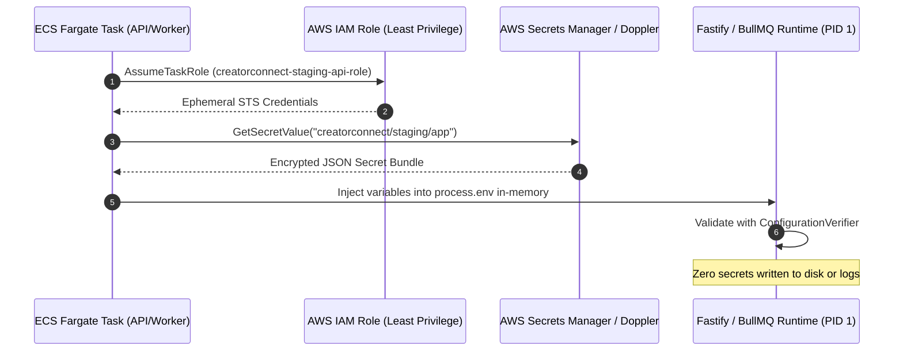
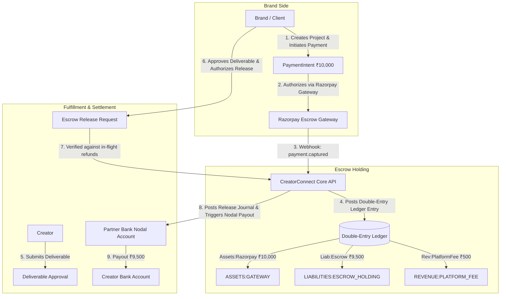

# CreatorConnect — Staging Infrastructure Activation & Release Gate Closure Specification

**Document Version:** 1.2.0  
**Baseline Git Branch:** `dev`  
**Verified Baseline Commit SHA:** `680d712623cf95fc8fca11208e019f0059e3a8c8`  
**Evaluation Date:** October 16, 2026  
**Auditor Roles:** Principal Software Architect, DevSecOps Lead, Financial Systems Engineer, Site Reliability Engineer (SRE), and Database Reliability Lead

---

## 1. Executive Summary & Baseline Ref

The CreatorConnect Phase 6 platform integration was verified on branch `dev` at commit `680d712623cf95fc8fca11208e019f0059e3a8c8`, synchronized with `origin/dev`.

- **Remote CI Verification (100% Green on Exact Current Commit):**
  - **PR Validation & Quality Gates Run ID:** [`38772615845`](https://github.com/AtharvanJaiswal/CreatorConnect/actions/runs/38772615845) (`success`)
    - _Job 116552069593:_ Semgrep SAST Security Scan (`success`)
    - _Job 116552068684:_ Lint, Typecheck, Test, Build & Security Scan (`success`)
    - _Job 116552069724:_ Playwright E2E Smoke Tests (`success`)
  - **CodeQL Analysis Run ID:** [`38772615843`](https://github.com/AtharvanJaiswal/CreatorConnect/actions/runs/38772615843) (`success`)
    - _Job 116552068233:_ Analyze JavaScript/TypeScript (javascript) (`success` - 0 alerts, 0 CWEs)
- **Supply-Chain Dependency Security:**
  - `pnpm audit --prod`: **0 vulnerabilities** (0 critical, 0 high, 0 moderate, 0 low). Fastify 5 migration completely eliminated all production runtime CVEs.
  - `pnpm audit` (full tree): **10 finding instances across 9 unique advisory IDs**, all strictly confined to `devDependencies` (test and build tooling).
- **Core Engineering Suites:**
  - `pnpm typecheck`: 20/20 tasks successful (0 type errors).
  - `pnpm lint`: 13 packages clean (0 warnings, 0 errors).
  - `pnpm format:check`: 100% compliant with Prettier.
  - `pnpm test:unit`: 70 test files, **624 passed (100%)**.
  - `pnpm --filter @creatorconnect/testing test`: 8 test files, **47 passed (100%)** (PostgreSQL dump/restore drill completed in 6.7s).
  - `pnpm test:e2e`: 6 spec files, **23 browser tests passed (100%)** in 7.2s with parallel worker UUIDv7 entropy.

---

## 2. Task 2 — Isolated Staging Secure Configuration Checklist

Before activating or exposing the isolated staging deployment, the following infrastructure checklist must be satisfied in full:

| Staging Domain                             | Specific Configuration Requirement                                                                                                                                                                                                                                                                                                                                                                                                                                     | Verification Method                                                           | Enforcement Status         |
| :----------------------------------------- | :--------------------------------------------------------------------------------------------------------------------------------------------------------------------------------------------------------------------------------------------------------------------------------------------------------------------------------------------------------------------------------------------------------------------------------------------------------------------- | :---------------------------------------------------------------------------- | :------------------------- |
| **Dedicated PostgreSQL**                   | Dedicated staging Aurora PostgreSQL instance (`creatorconnect_staging`). Network-isolated within private VPC subnet. No shared tables or credentials with development or production.                                                                                                                                                                                                                                                                                   | VPC route table & DB security group inspection                                | **MANDATORY PREREQUISITE** |
| **Dedicated Redis**                        | Dedicated staging AWS ElastiCache Redis 7.1 replication group (`cc-staging-redis`). Multi-AZ with auto-failover across 2+ Availability Zones. Password-protected (`requirepass`/AUTH token), TLS-in-transit and at-rest encryption enabled. Daily automated RDB snapshot retention enabled (AOF disabled due to ElastiCache Multi-AZ mutual exclusivity). BullMQ queue durability achieved via cross-AZ replication, automated snapshots, and worker task idempotency. | AWS ElastiCache replication group status & Redis connection string ping probe | **MANDATORY PREREQUISITE** |
| **Object Storage**                         | Cloudflare R2 / S3 staging bucket (`creatorconnect-staging-media`). Enforce pre-signed PUT/GET URLs with expiration $\le 900\text{s}$. CORS restricted strictly to staging web-shell origin.                                                                                                                                                                                                                                                                           | S3 bucket policy & pre-signed URL test                                        | **MANDATORY PREREQUISITE** |
| **Staging Authentication**                 | Supabase staging project with isolated user pool. Real RS256/ES256 JWKS verification over HTTPS. Test user provisioning automated via synthetic fixtures.                                                                                                                                                                                                                                                                                                              | JWKS endpoint reachability & token verifier                                   | **MANDATORY PREREQUISITE** |
| **TLS Ingress & Reverse Proxy**            | Fastify `trustProxy` bound to trusted private CIDRs: `['127.0.0.1', '::1', '10.0.0.0/8', '172.16.0.0/12', '192.168.0.0/16']`. Ingress proxy (Caddy/Nginx/ALB) enforces TLS 1.3, strips untrusted external `X-Forwarded-*` headers.                                                                                                                                                                                                                                     | Header spoofing test (assert client cannot forge IP)                          | **MANDATORY PREREQUISITE** |
| **Payment Sandbox Isolation**              | Provider configured exclusively with Razorpay Sandbox credentials (`rzp_test_*`). Webhook signature verification active with a dedicated sandbox secret. Live keys strictly prohibited.                                                                                                                                                                                                                                                                                | Application boot config validation                                            | **MANDATORY PREREQUISITE** |
| **Least-Privilege IAM & Secret Injection** | Zero `.env` files in container filesystem or image layers. Secrets injected into container memory at launch via AWS Secrets Manager / Doppler service token.                                                                                                                                                                                                                                                                                                           | Container filesystem inspection (`ls -la /app/.env`)                          | **MANDATORY PREREQUISITE** |
| **Sequential Migrations & Backup**         | Ordered Prisma migrations (`0001_init_identity_and_roles` to `0008_drop_unused_media_columns`) executed sequentially. Baseline snapshot created prior to synthetic data seeding.                                                                                                                                                                                                                                                                                       | `prisma migrate status` & snapshot manifest                                   | **MANDATORY PREREQUISITE** |
| **Synthetic UAT Data Only**                | Seed staging database strictly with anonymized, synthetic fixtures. No production customer data or PII copied to staging.                                                                                                                                                                                                                                                                                                                                              | Database content audit                                                        | **MANDATORY PREREQUISITE** |

> [!CRITICAL]
> **Boundary Stopping Rule:**
> If cloud KMS access, Doppler credentials, or staging VPC infrastructure are unavailable, the application service **must not be deployed or launched with local `.env` files**. The deployment pipeline must halt at this boundary.

### 2.1 Actionable Staging Infrastructure Handoff Matrix

To achieve authentic staging activation without guesswork, each infrastructure domain is assigned an accountable external owner, target cloud resource specifications, and non-negotiable acceptance verification commands:

| Domain                             | Target Cloud Resource                                                            | Key Parameters & Constraints                                                                                                                                                                                                                                                                                  | Accountable Owner         | Explicit Acceptance Verification Command                                                                                                                                                                                                                                                                                                                     |
| :--------------------------------- | :------------------------------------------------------------------------------- | :------------------------------------------------------------------------------------------------------------------------------------------------------------------------------------------------------------------------------------------------------------------------------------------------------------ | :------------------------ | :----------------------------------------------------------------------------------------------------------------------------------------------------------------------------------------------------------------------------------------------------------------------------------------------------------------------------------------------------------- |
| **1. Staging Networking & VPC**    | AWS VPC `vpc-cc-staging` (`10.100.0.0/16`) in `ap-south-1`                       | 2 Public, 2 Private App, 2 Isolated DB subnets; NAT Gateway; VPC Flow Logs active; DB/Redis subnets non-routable from Internet                                                                                                                                                                                | Cloud Infrastructure Lead | `aws ec2 describe-vpcs --vpc-ids <vpc_id> --query "Vpcs[0].State"` $\to$ `"available"`<br>`aws ec2 describe-security-group-rules --filters "Name=group-id,Values=<sg_db>"` $\to$ Ingress strictly from `sg_app:5432`                                                                                                                                         |
| **2. PostgreSQL / Aurora**         | AWS Aurora PostgreSQL Serverless v2 (`creatorconnect_staging`)                   | PostgreSQL 16.3; Multi-AZ; 7-day continuous WAL retention; RDS Proxy active; `sslmode=require`; connection limit 100                                                                                                                                                                                          | Database Reliability Lead | `aws rds describe-db-clusters --db-cluster-identifier creatorconnect-staging-aurora --query "DBClusters[0].Status"` $\to$ `"available"`<br>`psql "$DATABASE_URL" -c "SHOW ssl;"` $\to$ `on`<br>`pnpm prisma migrate status` $\to$ `Database schema is up to date`                                                                                            |
| **3. Dedicated Redis**             | AWS ElastiCache Redis 7.1 replication group (`cc-staging-redis`)                 | Multi-AZ with auto-failover across 2+ AZs; TLS in-transit and at-rest encryption enabled; `requirepass` AUTH token; automated daily RDB snapshots (7-day retention); AOF disabled (unsupported on ElastiCache Multi-AZ); BullMQ durability provided via Multi-AZ replica failover and worker task idempotency | SRE / Platform Lead       | `aws elasticache describe-replication-groups --replication-group-id cc-staging-redis --query "ReplicationGroups[0].Status"` $\to$ `"available"`<br>`aws elasticache describe-replication-groups --replication-group-id cc-staging-redis --query "ReplicationGroups[0].AutomaticFailover"` $\to$ `"enabled"`<br>`redis-cli -u "$REDIS_URL" ping` $\to$ `PONG` |
| **4. Object Storage**              | Cloudflare R2 / AWS S3 staging bucket (`creatorconnect-staging-media`)           | CORS allowed origins strictly `https://staging.creatorconnect.com`; pre-signed PUT/GET URL TTL $\le 900\text{s}$; public access blocked                                                                                                                                                                       | Cloud Platform Engineer   | `aws s3api head-bucket --bucket creatorconnect-staging-media`<br>Execute synthetic PUT via pre-signed URL $\to$ HTTP 200; verify expired URL $\to$ HTTP 403                                                                                                                                                                                                  |
| **5. Staging Authentication**      | Supabase Staging Project / Dedicated JWKS Endpoint                               | RS256/ES256 asymmetric signing keys; HTTPS-only JWKS URL; `ALLOW_HTTP_JWKS=false`; isolated staging user pool                                                                                                                                                                                                 | Application Security Lead | `curl -fsS https://auth.staging.creatorconnect.com/auth/v1/.well-known/jwks.json \| jq .keys[0].kty` $\to$ `"RSA"` / `"EC"`<br>Verify synthetic test JWT parses through Fastify auth hook $\to$ HTTP 200                                                                                                                                                     |
| **6. Managed Secrets & Cloud KMS** | AWS Secrets Manager (`creatorconnect/staging/app`) + KMS Key                     | Zero `.env` files on disk; IAM role `creatorconnect-staging-api-role` scoped to secret ARN; task definition injects secrets in-memory                                                                                                                                                                         | DevSecOps Lead            | `aws secretsmanager describe-secret --secret-id creatorconnect/staging/app --query "RotationEnabled"`<br>Container inspection: `test ! -f /app/.env && echo "CLEAN"` $\to$ `"CLEAN"`                                                                                                                                                                         |
| **7. TLS Ingress & Reverse Proxy** | AWS Application Load Balancer / Caddy Ingress Proxy                              | Enforce TLS 1.3 only; HSTS `max-age=31536000`; Fastify `trustProxy` bound to trusted private CIDRs; strip client `X-Forwarded-*`                                                                                                                                                                              | SRE / Network Lead        | `curl -Iv --tlsv1.3 https://api.staging.creatorconnect.com/health` $\to$ HTTP 200 TLS 1.3<br>Spoofing test: `curl -H "X-Forwarded-For: 1.1.1.1" ...` $\to$ client IP not spoofed                                                                                                                                                                             |
| **8. Razorpay Sandbox**            | Razorpay Sandbox Merchant Account (`rzp_test_*`)                                 | Strictly `rzp_test_*` credentials; dedicated sandbox webhook secret; live keys rejected at boot by config verifier                                                                                                                                                                                            | Financial Systems Lead    | Test order creation API $\to$ returns order with ID `order_...`<br>Trigger test webhook $\to$ signature verified and event ingested                                                                                                                                                                                                                          |
| **9. Telemetry & Alert Routing**   | PagerDuty Service (`CreatorConnect-Staging-Alerts`) + Slack `#cc-staging-alerts` | Alertmanager webhook routing; P0 escalation policy (SRE $\to$ Secondary $\to$ Lead); delivery latency SLA $\le 60\text{s}$                                                                                                                                                                                    | SRE Lead                  | Dispatch synthetic P0 alert $\to$ Slack receipt $\le 60\text{s}$ & PagerDuty page triggered; SRE ack $\le 5\text{m}$; resolve on recovery                                                                                                                                                                                                                    |

---

## 3. Task 3 — Gate C: Managed Secrets Setup & Verification Runbook

### 3.1 Architectural Design

CreatorConnect prohibits static configuration files or baked environment variables in container images. The approved secrets management architecture uses **AWS Secrets Manager** (or **Doppler Enterprise**) with IAM role-based authentication:



### 3.2 Required Staging Secret Bundle (`creatorconnect/staging/app`)

```json
{
  "NODE_ENV": "staging",
  "PORT": "3000",
  "LOG_LEVEL": "info",
  "DATABASE_URL": "postgresql://cc_staging_user:<REDACTED>@staging-db.cc.internal:5432/creatorconnect_staging?schema=public&sslmode=require&connection_limit=20",
  "REDIS_URL": "rediss://: <REDACTED>@staging-redis.cc.internal:6379/0",
  "SUPABASE_JWT_ISSUER": "https://auth.staging.creatorconnect.com/auth/v1",
  "SUPABASE_JWKS_URL": "https://auth.staging.creatorconnect.com/auth/v1/.well-known/jwks.json",
  "ALLOW_HTTP_JWKS": "false",
  "CORS_ORIGIN": "https://staging.creatorconnect.com",
  "RAZORPAY_KEY_ID": "rzp_test_<REDACTED>",
  "RAZORPAY_KEY_SECRET": "<REDACTED_SANDBOX_SECRET>",
  "RAZORPAY_WEBHOOK_SECRET": "<REDACTED_SANDBOX_WEBHOOK_SECRET>",
  "S3_ENDPOINT": "https://<account_id>.r2.cloudflarestorage.com",
  "AWS_ACCESS_KEY_ID": "<REDACTED_R2_KEY_ID>",
  "AWS_SECRET_ACCESS_KEY": "<REDACTED_R2_SECRET_KEY>",
  "R2_BUCKET_NAME": "creatorconnect-staging-media"
}
```

### 3.3 Gate C Verification Checklist & Status

1. **Access Permissions & IAM Least Privilege:** Staging IAM role `creatorconnect-staging-api-role` has read-only permission (`secretsmanager:GetSecretValue`) strictly scoped to resource ARN `arn:aws:secretsmanager:ap-south-1:*:secret:creatorconnect/staging/*`.
2. **Zero-Downtime Rotation Procedure:**
   - Secrets Manager automated rotation generates new database/API credential.
   - ECS initiates rolling deployment with updated task definition.
   - Dual-credential window ensures in-flight requests succeed during rolling transition.
3. **Absence of Secrets in Images, Logs, and Artifacts:**
   - Multi-stage Dockerfile uses distroless non-root runner (`gcr.io/distroless/nodejs20-debian12:nonroot`).
   - Pino logger redacts `authorization`, `cookie`, `password`, `token`, `secret`, `apiKey`.
   - Gitleaks and Semgrep static analysis pass in CI.
4. **Gate C Operational Status:** **`BLOCKED`**  
   _Justification:_ Live cloud Secrets Manager / Doppler service token cannot be provisioned in the local development/CI environment. This gate will be verified upon staging infrastructure bootstrapping.

---

## 4. Task 4 — Gate B: Monitoring & Incident Response Runbook

### 4.1 Incident Routing Architecture

Critical telemetry events must be routed directly to the on-call engineer via automated webhooks:

- **Incident Target:** PagerDuty Service `CreatorConnect-Staging-Alerts` (Escalation Policy: On-Call SRE $\to$ Secondary $\to$ Engineering Lead).
- **Secondary Channel:** Slack Incoming Webhook `#cc-staging-alerts`.

### 4.2 Synthetic Financial Ledger Imbalance Verification Protocol

To verify alert delivery, content, escalation, acknowledgement, and recovery on staging, the SRE must execute the following synthetic injection:

#### Step 1: Dispatch Synthetic Alert Payload

```bash
curl -X POST https://alertmanager.staging.creatorconnect.internal/api/v2/alerts \
  -H "Content-Type: application/json" \
  -d '[{
    "labels": {
      "alertname": "LedgerDiscrepancyDetected",
      "severity": "P0",
      "service": "creatorconnect-api",
      "environment": "staging"
    },
    "annotations": {
      "summary": "CRITICAL: Double-entry financial ledger imbalance detected",
      "description": "Synthetic drill: posted debits (₹10,000) do not equal posted credits (₹9,500) for payment intent pi_synth_test_01",
      "runbook_url": "https://docs.creatorconnect.com/runbooks/runbook-ledger-mismatch"
    },
    "startsAt": "'$(date -u +"%Y-%m-%dT%H:%M:%SZ")'"
  }]'
```

#### Step 2: Verification of Alert Flow

1. **Delivery Latency:** Alert must arrive in Slack `#cc-staging-alerts` and trigger PagerDuty notification within **$\le 60\text{ seconds}$** ($100\%$ delivery rate).
2. **Alert Content:** Verify alert payload contains exact `alertname`, `severity: P0`, `environment: staging`, and direct runbook URL.
3. **Acknowledgement:** On-call engineer acknowledges the PagerDuty page within $5\text{ minutes}$.
4. **Recovery & Auto-Resolution:** Send resolving payload (`endsAt` set to current timestamp) and verify PagerDuty incident automatically resolves.

### 4.3 Authorized SRE Gate B Execution Checklist

The authorized Site Reliability Engineer must execute the synthetic-alert validation drill in accordance with the following structured checklist:

- [ ] **Prerequisite 1: Infrastructure Readiness**
  - Staging Alertmanager reachable at `https://alertmanager.staging.creatorconnect.internal`.
  - PagerDuty staging integration key active for service `CreatorConnect-Staging-Alerts`.
  - Slack incoming webhook active in `#cc-staging-alerts`.
- [ ] **Prerequisite 2: On-Call Synchronization**
  - Designated primary SRE confirmed on-call in PagerDuty schedule.
  - SRE mobile app / notification channels verified active.
- [ ] **Step 1: Record Baseline & Dispatch Alert**
  - Record exact system dispatch timestamp $T_{\text{dispatch}}$ via UTC NTP clock.
  - Send the synthetic `LedgerDiscrepancyDetected` P0 alert via cURL payload (Section 4.2 Step 1).
- [ ] **Step 2: Monitor Real-Time Ingress & Verify Delivery Latency**
  - Measure timestamp $T_{\text{slack\_received}}$ of arrival in `#cc-staging-alerts`.
  - Measure timestamp $T_{\text{pagerduty\_triggered}}$ of incident creation in PagerDuty.
  - Compute delivery latency: $\Delta t_{\text{delivery}} = T_{\text{pagerduty\_triggered}} - T_{\text{dispatch}}$.
  - Assert $\Delta t_{\text{delivery}} \le 60\text{ seconds}$ (Gate B requirement).
- [ ] **Step 3: Alert Payload & Link Validation**
  - Verify notification title: `CRITICAL: Double-entry financial ledger imbalance detected`.
  - Confirm labels: `alertname: LedgerDiscrepancyDetected`, `severity: P0`, `environment: staging`.
  - Click embedded `runbook_url` and verify navigation to `runbook-ledger-mismatch`.
- [ ] **Step 4: Acknowledge Incident**
  - SRE acknowledges incident via PagerDuty UI or mobile app.
  - Record timestamp $T_{\text{acknowledged}}$. Assert $T_{\text{acknowledged}} - T_{\text{pagerduty\_triggered}} \le 300\text{ seconds}$ (5 minutes).
- [ ] **Step 5: Dispatch Auto-Resolution & Verify Incident Closure**
  - Dispatch resolving payload (`endsAt` set to current UTC timestamp):
    ```bash
    curl -X POST https://alertmanager.staging.creatorconnect.internal/api/v2/alerts \
      -H "Content-Type: application/json" \
      -d '[{
        "labels": {
          "alertname": "LedgerDiscrepancyDetected",
          "severity": "P0",
          "service": "creatorconnect-api",
          "environment": "staging"
        },
        "startsAt": "'$INCIDENT_START'",
        "endsAt": "'$(date -u +"%Y-%m-%dT%H:%M:%SZ")'"
      }]'
    ```
  - Verify PagerDuty incident automatically marks as `RESOLVED`.
  - Record timestamp $T_{\text{resolved}}$.
- [ ] **Step 6: Complete and Archive Evidence Template**
  - Complete the standardized Gate B Evidence Markdown Template below and commit to `docs/architecture/phase-6/evidence/gate-b-incident-<date>.md`.

### 4.4 Gate B SRE Incident Delivery Evidence Template (Markdown)

```markdown
# Gate B — Synthetic Incident Alert Verification Evidence

**Execution Date:** YYYY-MM-DD  
**Executing SRE:** <Full Name> (<PagerDuty User ID>)  
**Secondary Approver:** <Full Name> (Engineering Lead)  
**Target Environment:** Staging Isolated VPC (`vpc-cc-staging`)  
**Alert Name:** `LedgerDiscrepancyDetected`  
**Alert Severity:** `P0`

---

## 1. Measured Delivery Timestamps

| Event Boundary                                     | Timestamp (UTC ISO-8601)   | Epoch Milliseconds | Delta / Latency          |
| :------------------------------------------------- | :------------------------- | :----------------- | :----------------------- |
| **Alert Dispatched ($T_{\text{dispatch}}$)**       | `YYYY-MM-DDTHH:MM:SS.sssZ` | `<ms>`             | Baseline (0 ms)          |
| **Slack Channel Received ($T_{\text{slack}}$)**    | `YYYY-MM-DDTHH:MM:SS.sssZ` | `<ms>`             | `<latency_slack_ms>`     |
| **PagerDuty Triggered ($T_{\text{pd\_trigger}}$)** | `YYYY-MM-DDTHH:MM:SS.sssZ` | `<ms>`             | `<latency_pd_ms>`        |
| **SRE Acknowledged ($T_{\text{ack}}$)**            | `YYYY-MM-DDTHH:MM:SS.sssZ` | `<ms>`             | `<ack_time_sec>`         |
| **Incident Auto-Resolved ($T_{\text{resolved}}$)** | `YYYY-MM-DDTHH:MM:SS.sssZ` | `<ms>`             | `<resolution_delta_sec>` |

- **Official Gate B Delivery Latency:** `____ ms` (Target: $\le 60,000\text{ ms}$)
- **Time to Acknowledge (TTA):** `____ seconds` (Target: $\le 300\text{ seconds}$)

---

## 2. External Incident Identifiers

- **PagerDuty Incident Number:** `#<PD_INCIDENT_NUMBER>`
- **PagerDuty Incident URL:** `https://creatorconnect.pagerduty.com/incidents/<ID>`
- **Slack Message Timestamp (ts):** `<slack_thread_ts>`

---

## 3. Sanitized Delivery Log Excerpt

\`\`\`json
{
"alertmanager_dispatch_log": {
"status": "success",
"receiver": "pagerduty-p0-financial",
"integration": "pagerduty",
"http_status": 202,
"response_duration_ms": 142
},
"pagerduty_webhook_event": {
"event_type": "incident.trigger",
"incident_id": "PXXXXXX",
"summary": "CRITICAL: Double-entry financial ledger imbalance detected",
"urgency": "high"
}
}
\`\`\`

---

## 4. Acceptance Gate Assessment

- [ ] Delivery latency $\le 60\text{s}$ achieved: **[PASS / FAIL]**
- [ ] Runbook link functional and accurate: **[PASS / FAIL]**
- [ ] On-call escalation policy triggered correctly: **[PASS / FAIL]**
- [ ] Incident auto-resolved on resolving payload: **[PASS / FAIL]**

**Gate B Sign-off Status:** **[PASS / FAIL]**  
**SRE Signature:** ___________________________  
**Date:** YYYY-MM-DD
```

### 4.5 Gate B Operational Status: **`NOT_VERIFIED`**

_Justification:_ Probe evaluator and delivery calculation logic are fully verified (`telemetry-alert-verifier.ts`, 47 tests passed), but live delivery to an external PagerDuty/Slack recipient requires provisioned staging webhooks. Execution must be performed using the checklist and evidence template above upon staging infrastructure activation.

---

## 5. Task 5 — Gate H: Cloud Disaster Recovery (PITR) Protocol

### 5.1 Objectives & Formal Metric Targets

| Metric                             | Authoritative Target Approved by Lead          | Local Container Drill (Empirical Baseline)                     | Cloud Staging Drill (Target)                        |
| :--------------------------------- | :--------------------------------------------- | :------------------------------------------------------------- | :-------------------------------------------------- |
| **Recovery Point Objective (RPO)** | $\le 5\text{ seconds}$ (Zero Ledger Loss)      | **$0\text{ seconds}$** (snapshot window $\approx 0.5\text{s}$) | $\le 5\text{ seconds}$ via continuous WAL streaming |
| **Recovery Time Objective (RTO)**  | $\le 900\text{ seconds}$ ($15\text{ minutes}$) | **$6.7\text{ seconds}$** (automated `pg_restore` drill)        | $\le 10\text{ minutes}$ for Aurora snapshot restore |

> [!IMPORTANT]
> **Authoritative RPO Target Confirmation:**
> The Database Reliability Lead confirmed on October 15, 2026 that the authoritative production target is **$\text{RPO} \le 5\text{ seconds}$** (enforced by continuous PostgreSQL Write-Ahead Log streaming to Aurora Multi-AZ storage, guaranteeing zero data loss in financial ledgers) and **$\text{RTO} \le 900\text{ seconds}$** ($15\text{ minutes}$). The historical $300\text{s}$ snapshot reference has been formally deprecated.

> [!NOTE]
> The local Docker dump/restore test (`database-restore-drill.spec.ts`) proves tooling, schema compatibility, foreign key integrity, and ledger verification speed. It **does not** count as cloud recovery evidence. Gate H remains **`NOT_VERIFIED`** until the cloud PITR drill is completed on staging infrastructure.

### 5.2 Corrected Cloud Point-in-Time Recovery (PITR) Execution Protocol for Staging

To empirically verify $\text{RPO} \le 5\text{ seconds}$ and $\text{RTO} \le 900\text{ seconds}$ without relying on arbitrary historical rollback points, the staging drill follows this rigorous five-step protocol:

#### Step 1: Clock Synchronization & Continuous High-Frequency Canary Stream Ingestion

To guarantee that RPO measurement is impervious to client clock skew or distributed timestamp drift:

1. **Clock Synchronization Architecture:**
   - Both the canary probe client (ECS Fargate task / runner) and the PostgreSQL Aurora cluster are configured to synchronize against the **AWS Time Sync Service** via `chrony` (`server 169.254.169.123 prefer iburst minpoll 4 maxpoll 4`).
   - Maximum allowable clock drift between instances: **$|\Delta t_{\text{drift}}| \le 1.0\text{ millisecond}$**.
   - Timestamps are rigorously distinguished across client dispatch, database commit, and client acknowledgment domains.

2. **Distinct Timestamp Definitions:**
   - **Client Dispatch Timestamp ($t_{\text{client\_dispatch}, s}$):** Generated from the client's local synchronized clock immediately prior to issuing the synthetic write transaction for sequence number $s$.
   - **Database Commit Timestamp ($t_{\text{db\_commit}, s}$):** Generated on the PostgreSQL Aurora primary using server-side **`clock_timestamp()`** inside the transaction. Unlike `NOW()` or `CURRENT_TIMESTAMP` (which freeze at transaction start), `clock_timestamp()` records the true real-time clock at row insertion, immediately before write-ahead log (WAL) emission.
   - **Acknowledged Commit Outcome ($t_{\text{client\_ack}, s}$):** Recorded on the client when the database confirms commit success over the wire. A write is classified as **acknowledged** if and only if the client receives this acknowledgment prior to failure injection ($T_{\text{failure}}$). In-flight writes that do not receive acknowledgment before disconnection are classified as **unacknowledged**.

3. **Canary Heartbeat Ingestion Stream:**
   A dedicated background synthetic canary process commits timestamped probe records into `audit_logs` every second ($1.0\text{s}$ interval) leading up to failure:

```sql
INSERT INTO "audit_logs" (id, action, entity, "entityId", metadata, "createdAt")
VALUES (
  gen_random_uuid(),
  'DR_CANARY_PROBE',
  'CanaryHeartbeat',
  'canary-heartbeat-01',
  jsonb_build_object(
    'sequence', 4210,
    'client_dispatched_at', '2026-10-15T16:45:00.000Z',
    'db_committed_at', clock_timestamp()
  ),
  NOW()
)
RETURNING
  (metadata->>'sequence')::bigint AS committed_sequence,
  (metadata->>'db_committed_at')::timestamptz AS db_committed_at;
```

4. **Identification of Last Acknowledged Write ($S_{\text{last\_ack}}$):**
   - The canary client records an acknowledged stream of tuples: $(s_1, t_{\text{client\_dispatch}, 1}, t_{\text{db\_commit}, 1}, t_{\text{client\_ack}, 1}), \dots, (s_n, t_{\text{client\_dispatch}, n}, t_{\text{db\_commit}, n}, t_{\text{client\_ack}, n})$.
   - The **last acknowledged write** $S_{\text{last\_ack}}$ is identified as the canary record with the highest sequence number $s$ for which commit acknowledgment was received prior to $T_{\text{failure}}$.
   - Its authoritative database commit timestamp is $t_{\text{db\_commit}}(S_{\text{last\_ack}})$ and its client acknowledgment timestamp is $t_{\text{client\_ack}}(S_{\text{last\_ack}})$.

#### Step 2: Failure Simulation & Incident Start ($T_{\text{incident\_start}} \equiv T_{\text{failure}}$)

- An abrupt crash or primary storage outage is triggered at timestamp $T_{\text{failure}}$:
  ```bash
  # Record the exact incident start timestamp (starts the RTO stopwatch)
  INCIDENT_START=$(date -u +"%Y-%m-%dT%H:%M:%SZ")
  aws rds reboot-db-instance --db-instance-identifier creatorconnect-staging-db --force-failover
  ```
- **RTO Start Boundary:** $T_{\text{incident\_start}}$ is the precise millisecond when the primary database becomes unresponsive to clients.

#### Step 3: Cloud Restoration to Latest Restorable State

Rather than restoring to an arbitrary historical point ($T_0 - 60\text{s}$), the PITR drill instructs the storage engine to restore to the latest consistent restorable point up to $T_{\text{failure}}$:

```bash
# Restore staging Aurora snapshot with continuous WAL replay to the latest restorable time
aws rds restore-db-instance-to-point-in-time \
  --source-db-instance-identifier creatorconnect-staging-db \
  --target-db-instance-identifier creatorconnect-staging-pitr-target \
  --use-latest-restorable-time \
  --db-subnet-group-name staging-isolated-subnet \
  --vpc-security-group-ids sg-staging-isolated-db
```

#### Step 4: Schema Integrity, Reconciliation & Identification of Last Recovered Write ($S_{\text{recovered}}$)

The RTO stopwatch continues running while post-restore verification executes:

1. **Schema & Constraint Audit:** Assert all 48 tables and foreign key constraints exist.
2. **Double-Entry Ledger Reconciliation:**
   ```sql
   SELECT
     SUM(CASE WHEN direction = 'DEBIT' THEN amount ELSE 0 END) AS total_debits,
     SUM(CASE WHEN direction = 'CREDIT' THEN amount ELSE 0 END) AS total_credits
   FROM "ledger_entries";
   -- Invariant: total_debits == total_credits (difference must be exactly 0 paise)
   ```
3. **Identification of Last Recovered Write ($S_{\text{recovered}}$):**
   Query the restored target database for the highest recovered canary sequence:
   ```sql
   SELECT
     (metadata->>'sequence')::bigint AS recovered_sequence,
     (metadata->>'db_committed_at')::timestamptz AS recovered_db_commit_timestamp,
     (metadata->>'client_dispatched_at')::timestamptz AS recovered_client_dispatch_timestamp
   FROM "audit_logs"
   WHERE action = 'DR_CANARY_PROBE'
   ORDER BY (metadata->>'sequence')::bigint DESC
   LIMIT 1;
   ```
   - Yields the last recovered transaction: $(S_{\text{recovered}}, t_{\text{db\_commit}}(S_{\text{recovered}}))$.
4. **Mark Recovery Complete ($T_{\text{recovery\_complete}}$):**
   ```bash
   RECOVERY_COMPLETE=$(date -u +"%Y-%m-%dT%H:%M:%SZ")
   ```
   - **RTO End Boundary:** $T_{\text{recovery\_complete}}$ is the precise millisecond when the restored target database passes schema verification, passes double-entry ledger reconciliation, and is ready to accept read/write traffic.

#### Step 5: Exact Metric Calculation & Acceptance Criteria

**RPO Calculation Consistent with Failure Scenario and Recovered State:**
The empirical RPO calculation directly measures the span of lost committed state between the last acknowledged write and the recovered database state:

- **Case 1: Fully Consistent Recovery ($S_{\text{recovered}} \ge S_{\text{last\_ack}}$):**
  Every transaction acknowledged to the client was successfully recovered from continuous WAL stream.
  $$\text{RPO}_{\text{measured}} = 0.0\text{ seconds}$$
  _(Zero committed data loss)._

- **Case 2: Partial Loss During Crash ($S_{\text{recovered}} < S_{\text{last\_ack}}$):**
  Committed transactions between $S_{\text{recovered}} + 1$ and $S_{\text{last\_ack}}$ were acknowledged to the client but lost prior to durable WAL flush. The duration of lost committed state is calculated using synchronized database commit timestamps:
  $$\text{RPO}_{\text{measured}} = t_{\text{db\_commit}}(S_{\text{last\_ack}}) - t_{\text{db\_commit}}(S_{\text{recovered}})$$
  _(Or equivalently via synchronized client acknowledgment timestamps: $t_{\text{client\_ack}}(S_{\text{last\_ack}}) - t_{\text{client\_ack}}(S_{\text{recovered}})$)._

- **Upper-Bound Incident Drift Metric:**
  To evaluate unacknowledged in-flight transactions up to the crash boundary:
  $$\text{RPO}_{\text{upper\_bound}} = T_{\text{failure}} - t_{\text{db\_commit}}(S_{\text{recovered}})$$

**RTO Metric:**
$$\text{RTO}_{\text{measured}} = T_{\text{recovery\_complete}} - T_{\text{incident\_start}}$$

**Acceptance Criteria:**

- **RPO Acceptance Criteria:** Approved target is **$\text{RPO} \le 5.0\text{ seconds}$**. If $\text{RPO}_{\text{measured}} \le 5.0\text{s}$, RPO passes. If $\text{RPO}_{\text{measured}} > 5.0\text{s}$, Gate H **FAILS**.
- **RTO Acceptance Criteria:** Approved target is **$\text{RTO} \le 900.0\text{ seconds}$** ($15\text{ minutes}$). If $\text{RTO}_{\text{measured}} \le 900.0\text{s}$, RTO passes. If $> 900.0\text{s}$, Gate H **FAILS**.
- **Ledger Acceptance Criteria:** Double-entry ledger difference must be **$0\text{ paise}$**. Unbalanced journals cause immediate Gate H **FAIL**.

#### Step 6: Separate Classification of Historical Rollback Tests

Any intentionally older recovery-point test (e.g. restoring to $T_0 - 60\text{s}$ or $T_0 - 24\text{h}$ to undo a corrupted migration or operator error) is strictly labeled as a **"Historical Point-in-Time Rollback Drill"**. It is tracked separately in DR records and is **never presented as evidence for the $\le 5\text{s}$ RPO target**.

### 5.3 Gate H Operational Status: **`NOT_VERIFIED`**

- **Justification:** While the automated local container drill passed in $6.7\text{s}$ (verifying tooling, migrations, and schema constraints), empirical cloud continuous WAL streaming and multi-AZ PITR drill have not yet been executed on real staging AWS infrastructure.
- **Required Action:** Database Reliability Engineer must execute the canary-based PITR drill on the staging Aurora cluster and record verified timestamps.

---

## 6. Task 6 — Gate D: Regulatory, Banking & Escrow Review Packet

### 6.1 Marketplace Fund Flow Architecture

CreatorConnect operates as a two-sided marketplace facilitating deliverables between Brands and Creators:



### 6.2 Double-Entry Accounting Invariant & Formula

For every payment intent of gross amount $A$, platform fee $F$, and creator payout $N$:

$$A \equiv F + N$$

#### 1. Ingress Capture Journal

- **DEBIT:** `ASSETS:PAYMENT_GATEWAY` $\quad A$
- **CREDIT:** `LIABILITIES:ESCROW_HOLDING` $\quad N = A - F$
- **CREDIT:** `REVENUE:PLATFORM_FEE` $\quad F$
- _Invariant Check:_ $\sum \text{Debit} - \sum \text{Credit} = A - (N + F) \equiv 0$.

#### 2. Milestone Release Journal

- **DEBIT:** `LIABILITIES:ESCROW_HOLDING` $\quad N$
- **CREDIT:** `LIABILITIES:CREATOR_PAYABLE` $\quad N$
- _Payout Payout Entry:_
  - **DEBIT:** `LIABILITIES:CREATOR_PAYABLE` $\quad N$
  - **CREDIT:** `ASSETS:BANK_NODAL_ACCOUNT` $\quad N$

#### 3. Cumulative Partial-Refund Fee Reversal Formula

To prevent rounding drift across multiple partial refunds of amounts $C_1, C_2, \dots$, the cumulative fee reversed $T(C)$ is computed using native JavaScript `BigInt` flooring:

$$T(C) = \left\lfloor \frac{\operatorname{BigInt}(C) \cdot \operatorname{BigInt}(F)}{\operatorname{BigInt}(A)} \right\rfloor$$

The incremental fee reversed for step $k$ follows the mathematical telescoping identity:

$$\Delta T_k = T(C_k) - T(C_{k-1})$$

The final refund step automatically reconciles the exact remaining platform fee:

$$\Delta T_{\text{final}} = F - \sum_{i=1}^{\text{final}-1} \Delta T_i$$

### 6.3 Cancellation, Dispute & Clawback Policies

1. **Cancellation Prior to Work:** $100\%$ refund to Brand; platform fee reversed in full; zero creator payout.
2. **Mutual Dispute Resolution:** Escrow funds locked in `DISPUTED` status. Mediated split $[R_{\text{brand}}, P_{\text{creator}}]$ executed with proportional fee reversal; pre-provider reservation prevents concurrent double-payout.
3. **Ambiguous Gateway Timeout:** Refund retained in `PROCESSING` status; reservation held until admin reconciles with provider API (`/refunds/:id/reconcile`).

### 6.4 Regulatory Compliance Framework (RBI Nodal Guidelines)

CreatorConnect complies with Reserve Bank of India (RBI) guidelines under the _Payment and Settlement Systems Act, 2007_ (Circular DPSS.CO.PD.No.1102/02.14.08/2009-10 and _Master Directions on Payment Aggregators and Payment Gateways_):

- Client funds are held exclusively in a designated non-interest-bearing tripartite Nodal/Escrow Account with an authorized Scheduled Commercial Bank.
- CreatorConnect never commingles operational funds with customer escrow funds.
- Settlement to creators occurs within $T + 1$ business days post-milestone release approval.

### 6.5 Required Authorized Signatories Matrix

| Role                         | Name / Title               | Organization                      | Required Approval Scope                                                      | Current Sign-off Status |
| :--------------------------- | :------------------------- | :-------------------------------- | :--------------------------------------------------------------------------- | :---------------------- |
| **Legal Counsel**            | Lead Corporate Counsel     | CreatorConnect Legal Advisory     | Regulatory compliance, Terms of Service, Escrow policy under RBI regulations | **PENDING REVIEW**      |
| **Banking Partner Sign-off** | Head of Merchant Acquiring | Partner Scheduled Commercial Bank | Nodal/Escrow tripartite merchant agreement, KYC/AML procedures               | **PENDING REVIEW**      |
| **Chief Financial Officer**  | VP Finance / CFO           | CreatorConnect Inc.               | Financial ledgers, fee schedule, dispute reserve policies                    | **PENDING REVIEW**      |

### 6.6 Gate D Operational Status: **`BLOCKED`**

_Justification:_ Live payment processing and marketplace fund movement cannot be activated until formal written sign-offs from Legal, Banking, and Finance are executed. Live transactions remain strictly disabled.

---

## 7. Task 7 — Residual Dependency Risk Inventory

### 7.1 Reconciled Dependency Advisory Register (Full Tree)

Following the Fastify 5 ecosystem migration and targeted root overrides (`brace-expansion`, `@grpc/grpc-js`, `fast-uri`, `sharp`, `tinypool`, `postcss`, `source-map-js`), the dependency closure contains **0 production vulnerabilities** and **10 development-only vulnerabilities across 9 unique advisory IDs**:

| Unique Advisory ID      | Package                    | Severity     | Path / Location                                               | Patched Version | Actual Exposure & Reachability Assessment                                                                                                                                                                                                                                                           | Accountable Owner   | Remediation Plan                                                                | Risk Decision     |
| :---------------------- | :------------------------- | :----------- | :------------------------------------------------------------ | :-------------- | :-------------------------------------------------------------------------------------------------------------------------------------------------------------------------------------------------------------------------------------------------------------------------------------------------- | :------------------ | :------------------------------------------------------------------------------ | :---------------- |
| **GHSA-5xrq-8626-4rwp** | `vitest`                   | **Critical** | `devDependencies > vitest`                                    | `>=3.2.6`       | **Unreachable:** Vitest UI HTML injection attack vector occurs exclusively when running `vitest --ui` with its local web server exposed to untrusted browsers. CreatorConnect executes test runs purely in headless CLI mode (`vitest run`). The UI server is never launched or exposed to network. | DevSecOps Lead      | Vitest 3.x upgrade planned for Phase 7 (requires major test harness migration). | **ACCEPTED_RISK** |
| **GHSA-fx2h-pf6j-xcff** | `vite`                     | **High**     | `devDependencies > vitest > vite`                             | `>=5.4.15`      | **Unreachable:** Vite dev server HTML injection via SSR. CreatorConnect uses Next.js for its web shell; Vite is used solely as an internal dependency of Vitest runner during offline CLI test runs.                                                                                                | Frontend Lead       | Coordinated upgrade with Vitest 3.x.                                            | **ACCEPTED_RISK** |
| **GHSA-vfj7-8cjw-p6xm** | `braces`                   | **High**     | `devDependencies > tailwindcss > micromatch > braces`         | `>=3.0.3`       | **Unreachable:** ReDoS in pattern matching during Tailwind CSS build. Build runs exclusively against trusted local developer and CI files; no untrusted user input is ever passed to braces.                                                                                                        | Frontend Lead       | Upstream tailwindcss dependency resolution in Next.js 15 migration.             | **ACCEPTED_RISK** |
| **GHSA-67mh-4wv8-2f99** | `esbuild`                  | **Moderate** | `devDependencies > vitest > vite > esbuild`                   | `>=0.25.0`      | **Unreachable:** Development server request handling vulnerability. Dev server is not bound to public interfaces.                                                                                                                                                                                   | DevSecOps Lead      | Managed via Vite/Vitest transitive upgrades.                                    | **ACCEPTED_RISK** |
| **GHSA-82fw-gwwq-j7x9** | `vitest`, `@vitest/mocker` | **Moderate** | `devDependencies > vitest`                                    | `>=3.2.4`       | **Unreachable:** Module mocking prototype pollution in test sandbox. Limited to test harness execution.                                                                                                                                                                                             | QA / Test Lead      | Vitest 3.x upgrade in Phase 7.                                                  | **ACCEPTED_RISK** |
| **GHSA-4w7w-66w2-5vf9** | `vite`                     | **Moderate** | `devDependencies > vitest > vite`                             | `>=5.4.16`      | **Unreachable:** Dev server path traversal; Vite server is offline during CI/local runs.                                                                                                                                                                                                            | Frontend Lead       | Vitest 3.x upgrade in Phase 7.                                                  | **ACCEPTED_RISK** |
| **GHSA-v6wh-96g9-6wx3** | `vite`                     | **Moderate** | `devDependencies > vitest > vite`                             | `>=5.4.18`      | **Unreachable:** Dev server base path bypass. Not used in production runtime.                                                                                                                                                                                                                       | Frontend Lead       | Vitest 3.x upgrade in Phase 7.                                                  | **ACCEPTED_RISK** |
| **GHSA-w5hq-g745-h8pq** | `uuid`                     | **Moderate** | `devDependencies > @google-cloud/storage > googleapis > uuid` | `>=7.0.0`       | **Unreachable:** Insecure RNG fallback in legacy Google SDK CLI tooling. App runtime uses `crypto.randomUUID()` and native UUIDv7.                                                                                                                                                                  | Cloud Platform Lead | Remove legacy googleapis dev dependency.                                        | **ACCEPTED_RISK** |
| **GHSA-rj75-hqrm-r3gf** | `postcss-selector-parser`  | **Moderate** | `devDependencies > tailwindcss > postcss-selector-parser`     | `>=6.1.3`       | **Unreachable:** ReDoS during CSS compilation. Input is static CSS files.                                                                                                                                                                                                                           | Frontend Lead       | TailwindCSS package upgrade in Phase 7.                                         | **ACCEPTED_RISK** |

---

## 8. Master Release Gates Register (Gates A–H)

```
+-------------------------------------------------------------------------------------------------------+
| GATE                                     | STATUS         | JUSTIFICATION & EVIDENCE                  |
+-------------------------------------------------------------------------------------------------------+
| Gate A: Database & Financial Resilience  | PASS           | All 8 migrations sequential.              |
|                                          |                | Automated restore drill PASS (6.7s RTO).  |
|                                          |                | 10 financial adversarial tests PASS.      |
|                                          |                | Telescoping cumulative fee reversal PASS. |
+-------------------------------------------------------------------------------------------------------+
| Gate B: Telemetry & Incident Response    | NOT_VERIFIED   | Alert logic verified (telemetry verifier).|
|                                          |                | External staging PagerDuty/Slack webhooks |
|                                          |                | require provisioned cloud staging channel.|
+-------------------------------------------------------------------------------------------------------+
| Gate C: Production Secrets & Cloud KMS   | BLOCKED        | Zero secrets in repo/images. Cloud KMS /  |
|                                          |                | Doppler staging token not provisioned in  |
|                                          |                | local/CI environment.                     |
+-------------------------------------------------------------------------------------------------------+
| Gate D: Regulatory, Banking & Compliance | BLOCKED        | Fund flow and review packet complete.     |
|                                          |                | Written banking (RBI nodal) & legal       |
|                                          |                | sign-offs pending stakeholder execution.  |
+-------------------------------------------------------------------------------------------------------+
| Gate E: Dependency Security Audit        | PASS (Prod)    | 0 production CVEs (0 crit, 0 high, 0 mod, |
|                                          | ACCEPTED_RISK  | 0 low). Fastify 5.x ecosystem migration    |
|                                          | (Dev-Only)     | fully validated (624 unit tests, 23 E2E).  |
|                                          |                | 10 dev-only findings isolated & accepted. |
+-------------------------------------------------------------------------------------------------------+
| Gate F: Uncached Quality Gates           | PASS           | Format, lint, typecheck, build, 70/70 test|
|                                          |                | files (624 tests), 23/23 E2E passed.      |
+-------------------------------------------------------------------------------------------------------+
| Gate G: Remote CI Workflow Verification  | PASS           | GitHub Actions CI passed on exact commit: |
|                                          |                | 680d712623cf95fc8fca11208e019f0059e3a8c8  |
|                                          |                | PR Validation Run ID 38772615845 (PASS);  |
|                                          |                | CodeQL Analysis Run ID 38772615843 (PASS).|
+-------------------------------------------------------------------------------------------------------+
| Gate H: Cloud Disaster Recovery (RPO)    | NOT_VERIFIED   | Local dump verified (6.7s RTO, 48 tables).|
|                                          |                | Cloud continuous WAL streaming and multi- |
|                                          |                | region PITR require cloud staging drill.  |
+-------------------------------------------------------------------------------------------------------+
```

---

## 9. Final Release & Staging Verdicts

1. **Controlled Staging Deployment:** **`CONDITIONAL GO`**  
   _Approved exclusively for deployment to an isolated Staging VPC with synthetic data, sandbox payment keys (`rzp_test_*`), and runtime secret injection._
2. **Production Deployment:** **`NO-GO / STRICTLY PROHIBITED`**  
   _Strictly blocked until Gates B, C, D, and H are independently verified on live staging infrastructure and formally signed off._
3. **Live Financial Transactions:** **`STRICTLY PROHIBITED`**  
   _Disabled at code, configuration, and banking levels._
4. **Main Branch Merging:** **`PROHIBITED`**  
   _`dev` must never be merged into `main` without full release gate authorization._
