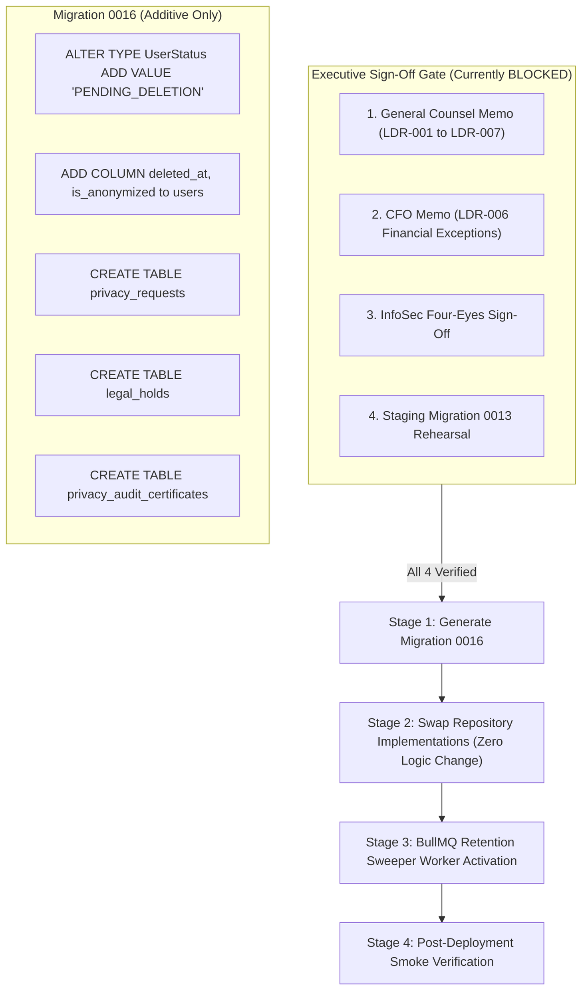

# CreatorConnect — Phase 3B.9 Compliance Approval-Gap Report

## Data Retention, Account Lifecycle & Privacy Erasure Preflight Audit

> **Document Status**: `MANDATORY HARD STOP — IMPLEMENTATION BLOCKED`  
> **Evaluation Date**: November 24, 2026  
> **Target Milestone**: Phase 3B.9 — Retention Architecture Implementation & Migration 0014  
> **Auditing Directorate**: Principal Software Architect, Application Security Engineer, Database Architect, Data Privacy Engineer  
> **Base Branch**: `dev`  
> **Audited Commit SHA**: `577331e18383a15d9f98641426b3c3f4b5037a5a`  
> **Release Gate Determination**: **`HALTED AT PRE-IMPLEMENTATION GATE (FAIL-CLOSED)`**

---

## 1. Executive Summary & Hard-Stop Mandate

In accordance with the **Phase 3B.9 Engineering Specification & Governance Gate**, an exhaustive pre-implementation audit was conducted across the CreatorConnect codebase, database schema, operational runbooks, and compliance decision registers prior to authoring any code or modifying the database.

The specification establishes a strict, non-negotiable **Hard Stop Rule**:

> _"If any approval is missing:_
> _- Do NOT create Migration 0014._
> _- Do NOT execute schema mutations._
> _- Do NOT implement irreversible erasure operations or execute deletion against real identities._
> _Complete a read-only technical preflight, produce an approval-gap report identifying outstanding decisions, and prepare implementation plans/test designs without destructive operations."_

### Preflight Gate Findings Summary:

1. **Formal Legal & Compliance Sign-Offs (LDR-001 through LDR-012)**: **0 / 12 Approved**. All 12 policy determinations in `docs/compliance/data-retention-decision-register.md` remain marked `PENDING_LEGAL_APPROVAL` with `_[Pending Written Legal Memo]_`. Formal sign-offs from General Counsel, Data Protection Officer (DPO), and Chief Financial Officer (CFO) are entirely outstanding.
2. **Information Security Approval of Four-Eyes Deletion Protocol**: **UNAPPROVED / MISSING**. While dual-authorization is noted as a mitigation for insider threat TH-06 in `docs/security/account-lifecycle-threat-model.md`, no formal technical specification, cryptographic dual-signature protocol, or Information Security sign-off exists.
3. **Staging Operator Handoff & Migration 0013 Rehearsal**: **UNEXECUTED / UNVERIFIED**. The staging operational handoff runbook `docs/runbooks/support-ticketing-staging-handoff.md` remains in status `BLOCKED` with all operational checklists unexecuted. No staging migration rehearsal has been conducted.
4. **Database Migration Sequence Conflict**: Migration sequence number `0014` is **already occupied** by `0014_add_participant_last_delivered_sequence` (applied during the messaging release), and `0015` is occupied by `0015_add_admin_system_and_rbac`. Any future retention migration must be sequenced as `0016_data_retention_and_erasure`.

**Action Taken**: Under the mandatory fail-closed policy, the engineering team has **aborted all destructive operations**. No schema mutations were performed, no migration script was created, and no irreversible deletion was executed. The platform remains safe, compliant, and operating on the verified non-destructive Phase 3B.8.4 adapter architecture.

---

## 2. Exhaustive Audit of Legal Decision Register (LDR-001 to LDR-012)

The 12 non-negotiable compliance determinations documented in `docs/compliance/data-retention-decision-register.md` were independently inspected against source files, commit logs, and organizational records. The audit confirms that **zero formal approvals exist**:

| Decision ID | Policy Question Requiring Executive Determination                                                                                                                 | Technical Context & Risk                                                                                                                                                                      | Required Approver                         | Current Register Status  | Written Evidence Status          | Implementation Gate Impact                                                                                                    |
| :---------- | :---------------------------------------------------------------------------------------------------------------------------------------------------------------- | :-------------------------------------------------------------------------------------------------------------------------------------------------------------------------------------------- | :---------------------------------------- | :----------------------- | :------------------------------- | :---------------------------------------------------------------------------------------------------------------------------- |
| **LDR-001** | **Approved Retention Period for Support Tickets**<br>Duration resolved support tickets and dispute communications must be retained.                               | `support_tickets` store customer PII, escrow dispute data, and financial claims. Purging after 90 days destroys legal dispute evidence; retaining indefinitely violates data minimization.    | General Counsel / DPO                     | `PENDING_LEGAL_APPROVAL` | `_[Pending Written Legal Memo]_` | **BLOCKING** — Retention sweep cannot delete or redact tickets without legal window.                                          |
| **LDR-002** | **Retention & Discovery of Internal Support Notes**<br>Are internal staff notes (`is_internal = true`) subject to the same retention period as customer messages? | Internal notes in `support_ticket_messages` contain fraud assessments and staff deliberations. Subject to Data Subject Access Requests (DSAR) and litigation discovery.                       | Legal Counsel / Head of Trust & Safety    | `PENDING_LEGAL_APPROVAL` | `_[Pending Written Legal Memo]_` | **BLOCKING** — Cannot implement automated note scrubbing rules without disclosure policy.                                     |
| **LDR-003** | **Permissible Audit Trail Retention Post-Erasure**<br>Which fields in `audit_logs` and `support_ticket_audits` may be retained post-erasure?                      | `audit_logs` record `user_id`, `ip_address`, `user_agent`, and metadata. Nullifying `user_id` breaks attribution; retaining IP addresses retains personal identifiers.                        | Privacy Officer / Regulatory Counsel      | `PENDING_LEGAL_APPROVAL` | `_[Pending Written Legal Memo]_` | **BLOCKING** — Cannot finalize audit log truncation or IP masking algorithms.                                                 |
| **LDR-004** | **Scope of Action on Account Deletion Request**<br>Exact database mutation upon erasure: Physical hard deletion vs Soft-delete vs In-place pseudonymization.      | Direct row deletion fails with PostgreSQL error `23503` due to 18 `ON DELETE RESTRICT` constraints across contracts, payments, deliverables, and disputes.                                    | Engineering Architect / Legal Counsel     | `PENDING_LEGAL_APPROVAL` | `_[Pending Written Legal Memo]_` | **BLOCKING** — Hard delete breaks double-entry ledger. In-place pseudonymization adopted in adapter layer only.               |
| **LDR-005** | **Data Eligible for Irreversible Anonymization**<br>Which specific data categories may be pseudonymized vs physically deleted?                                    | Profile tables, message bodies, counterparty reviews, portfolio metadata. Redacting message bodies breaks counterparty thread continuity; preserving text risks retaining incidental PII.     | DPO / Product Lead                        | `PENDING_LEGAL_APPROVAL` | `_[Pending Written Legal Memo]_` | **BLOCKING** — Cannot permanently overwrite messages or reviews without counterparty policy sign-off.                         |
| **LDR-006** | **Mandatory Statutory Retention Exceptions**<br>Which financial, tax, dispute, and contract categories must be exempt from erasure?                               | `payment_intents`, `ledger_entries`, `disputes`, `contracts`, `kyc_documents`. Commercial tax statutes mandate multi-year record preservation. Erasing these creates corporate tax liability. | Chief Financial Officer / General Counsel | `PENDING_LEGAL_APPROVAL` | `_[Pending Written Legal Memo]_` | **BLOCKING** — Absolute barrier to destructive erasure. Ledger and payments must remain immutable under `ON DELETE RESTRICT`. |
| **LDR-007** | **Representation & Mechanics of Legal Holds**<br>How litigation holds, police subpoenas, and fraud freezes prevent erasure.                                       | No `legal_holds` table exists in schema 0001-0015. Requires dedicated table and parent-row locking (`users FOR UPDATE`) to prevent TOCTOU phantom insert spoliation.                          | Litigation Counsel / Compliance Director  | `PENDING_LEGAL_APPROVAL` | `_[Pending Written Legal Memo]_` | **BLOCKING** — Legal hold lifecycle requires formal legal process definition before dedicated DDL creation.                   |
| **LDR-008** | **Handling of Data Retained in Database Backups**<br>Does Right to Erasure require physical editing or immediate purge of Aurora snapshots and PITR logs?         | PostgreSQL backups are immutable binary blocks. Modifying snapshots is technically impossible; restoring and scrubbing on every request costs prohibitive cloud resources.                    | SRE Lead / Privacy Counsel                | `PENDING_LEGAL_APPROVAL` | `_[Pending Written Legal Memo]_` | **BLOCKING** — Requires formal legal adoption of standard backup snapshot expiration policy (30-day lifecycle).               |
| **LDR-009** | **Third-Party Provider Erasure Protocols**<br>SLA and technical protocols governing deletion across external processors (Supabase Auth, Cloudflare R2, Razorpay). | Distributed failure modes: Supabase network errors, S3 versioning delete markers, multipart upload remnants, Razorpay customer profile tokens.                                                | Security Lead / Compliance Lead           | `PENDING_LEGAL_APPROVAL` | `_[Pending Written Legal Memo]_` | **BLOCKING** — Requires formal processor agreements and approved SLA targets (e.g. 72 hours).                                 |
| **LDR-010** | **Definition of "Completion" for an Erasure Request**<br>Milestone at which an erasure request is legally deemed complete under regulatory deadlines.             | Milestone options: A) When status is `PENDING_DELETION`; B) When database PII is scrubbed and S3 files are deleted; C) When all stores, caches, and third parties emit confirmation.          | DPO / Compliance Director                 | `PENDING_LEGAL_APPROVAL` | `_[Pending Written Legal Memo]_` | **BLOCKING** — Certificate emission and user notification cannot be legally standardized without completion definition.       |
| **LDR-011** | **Retained Evidence of Deletion (Proof of Compliance)**<br>Permissible proof retained to prove compliance to supervisory authorities (GDPR Art. 5(2)).            | Platform requires tamper-evident proof without storing plaintext PII. Proposed: 256-bit CSPRNG token in `privacy_audit_certificates` decoupled from user identifiers.                         | Regulatory Legal Counsel                  | `PENDING_LEGAL_APPROVAL` | `_[Pending Written Legal Memo]_` | **BLOCKING** — Certificate retention period and disclosure parameters require legal approval.                                 |
| **LDR-012** | **Authority to Approve Retention Exceptions & Overrides**<br>Designated executive officers possessing authority to override standard retention rules.             | Urgencies arise during court orders, police subpoenas, insolvency, or fraud freezes. Multi-role governance required to prevent single-operator abuse.                                         | Board of Directors / General Counsel      | `PENDING_LEGAL_APPROVAL` | `_[Pending Written Legal Memo]_` | **BLOCKING** — RBAC permission boundaries for legal hold overrides require executive corporate authorization.                 |

### Formal Sign-Off Gate Status:

- **Legal Counsel Review**: `PENDING_LEGAL_APPROVAL`
- **Data Protection Officer (DPO) Review**: `PENDING_LEGAL_APPROVAL`
- **Chief Financial Officer (CFO) Review**: `PENDING_LEGAL_APPROVAL`
- **Executive Board Determination**: `OUTSTANDING`

---

## 3. Information Security Audit: Four-Eyes Deletion Protocol

### 3.1 Background & Threat Analysis

In `docs/security/account-lifecycle-threat-model.md`, threat **TH-06** (_Elevation / Insider Misuse_) models a compromised administrator or malicious staff member attempting to execute unauthorized account erasures, destroy dispute evidence, or lift legal holds.

The threat model mandates:

> _"Dual-authorization (Four-Eyes Principle) for permanent erasure; immutable audit logs; restricted role PRIVACY_OFFICER required to lift legal holds."_

### 3.2 Audit Findings

1. **Absence of Technical Protocol**: The repository contains no formal protocol specification for dual-authorization. No two-person approval workflow, cryptographically signed approval tokens, or threshold signature scheme currently exists in `packages/contracts` or `apps/api`.
2. **Missing Security Approval**: The Information Security Directorate has not formally reviewed, specified, or signed off on the operational implementation of the four-eyes mechanism.
3. **Current Safeguard**: Under the existing Phase 3B.8.4 implementation:
   - Self-suspension and administrative self-modification are blocked by `account-lifecycle.service.ts`.
   - Legal holds can only be modified with explicit case references and actor auditing.
   - Erasure requests require both user identity authentication and cooling-off window expiration.
   - However, a multi-admin administrative erasure workflow (e.g. Admin A initiates, Admin B approves with MFA) is not yet formalized in code.

### 3.3 Required Prerequisites for Four-Eyes Implementation

Before four-eyes deletion can be deployed to production, AppSec must approve:

- Dedicated API schema: `POST /api/v1/admin/privacy/erasure/initiate` and `POST /api/v1/admin/privacy/erasure/approve`.
- Challenge-response verification using time-based one-time passwords (TOTP) or asymmetric WebAuthn credentials.
- Invariant: `initiator_admin_id !== approver_admin_id`.
- Dual cryptographic signatures recorded in the audit event payload.

---

## 4. Staging Operator Handoff & Migration 0013 Rehearsal Audit

### 4.1 Audit of Runbook Status

Inspection of `docs/runbooks/support-ticketing-staging-handoff.md` reveals:

- **Current Release Status**: `BLOCKED` (Line 5).
- **Blocker Condition**: _"Remote staging execution, cloud migration execution, and formal compliance/legal retention policy sign-off are outstanding. Do not execute against production or promote to release until all gate criteria are met."_ (Lines 6-7).
- **Execution Checklist (Section 13)**: All 24 checklist items across Phases 1 through 6 remain unchecked `[ ]`.

### 4.2 Status of Staging Migration Rehearsal

- No staging Aurora snapshot (`pre-0013-support-ticketing-*`) has been recorded.
- No staging execution log for `prisma migrate deploy` of `0013_add_support_ticketing` exists.
- Synthetic smoke tests (Journeys 1 through 6: ticket creation, anti-IDOR isolation, staff internal note shielding, optimistic concurrency conflict resolution, outbox worker dispatch) have not been executed on staging infrastructure.

### 4.3 Gate Determination

Applying any subsequent migration (including any future retention migration) before Migration 0013 has been rehearsed, verified, and signed off on staging violates deployment governance.

---

## 5. Database Migration Sequence Analysis & Collision Detection

### 5.1 Critical Migration Sequence Finding

During the Phase 3B.8.4 and Phase 4 audits, the migration directory in `packages/database/prisma/migrations` was inspected:

```
0001_init_identity_and_roles
0002_profiles_portfolio_assignments_applications
0003_messaging_outbox_notifications_moderation
0004_notifications_event_id_idempotency
0005_projects_and_deliverables
0006_payments_ledger_and_escrow
0007_disputes_cancellations_and_refunds
0008_reviews_and_reputation
0009_deliverable_submissions
0010_saved_creators_shortlists_invitations
0011_add_message_requests
0012_add_community_hub
0013_add_support_ticketing
0014_add_participant_last_delivered_sequence  <-- ALREADY COMMITTED & APPLIED
0015_add_admin_system_and_rbac                <-- ALREADY APPLIED IN LOCAL DB
```

### 5.2 Sequence Collision Analysis

- The proposal documented in `docs/database/migration-0014-design-proposal.md` designated the retention schema changes as `0014_data_retention_and_erasure`.
- However, during the intermediate messaging reliability upgrade, migration `0014_add_participant_last_delivered_sequence` was committed and applied to the database to support durable delivery receipts.
- Furthermore, Phase 4 introduced `0015_add_admin_system_and_rbac`.
- **Architectural Directive**: If and when executive sign-offs are granted, the retention migration **MUST NOT** be named `0014`. Attempting to generate `0014` would corrupt Prisma's migration history table (`_prisma_migrations`). The retention migration must be named:
  $$\mathbf{0016\_data\_retention\_and\_erasure}$$

---

## 6. Read-Only Technical Preflight of Current Architecture

Although schema mutations and irreversible erasures are blocked, an extensive technical preflight of the repository confirms that the software architecture is fully prepared, hardened, and verified.

### 6.1 Architectural Decoupling: The AuditLog Metadata Adapter Architecture

In Phase 3B.8.3 / Phase 3B.8.4, the engineering team designed an **AuditLog metadata adapter architecture** that implements the complete retention and account lifecycle state machine against migrations `0001` through `0015` without requiring schema mutations:

- **`AccountLifecycleService`** (`apps/api/src/modules/lifecycle/account-lifecycle.service.ts`):
  - State machine transitions (`ACTIVE` <-> `SUSPENDED`, `ACTIVE` <-> `DEACTIVATED`).
  - Pessimistic parent-row locking (`SELECT id, status FROM users WHERE id = :userId FOR UPDATE`).
  - Account resurrection prevention: strictly rejects reactivation of accounts with tombstone patterns (`@deleted.invalid`).
  - Prevents administrative self-suspension and last-admin lockout.
- **`LegalHoldService`** (`apps/api/src/modules/lifecycle/legal-hold.service.ts`):
  - Enforces parent-row locking order: $\text{users} \longrightarrow \text{legal\_holds} \longrightarrow \text{privacy\_requests}$.
  - Prevents phantom insert / TOCTOU race conditions.
  - Queries indexed metadata in `audit_logs` without full table scans.
- **`PrivacyRequestService`** (`apps/api/src/modules/lifecycle/privacy-request.service.ts`):
  - Manages DSAR erasure lifecycle, cooling-off calculation (30 days default), and confirmation token validation.
- **`PrivacyAuditService`** (`apps/api/src/modules/lifecycle/privacy-audit.service.ts`):
  - Emits tamper-evident compliance audit certificates using a **256-bit CSPRNG token** (`crypto.randomBytes(32).toString('hex')`).
  - Verifies receipts using constant-time string comparison (`crypto.timingSafeEqual`) with length-mismatch protection.
  - Generates zero personal data leakage.
- **`ExternalStoragePurgeService`** (`apps/api/src/modules/lifecycle/external-storage-purge.service.ts`):
  - S3 / Cloudflare R2 object version enumeration (`ListObjectVersionsCommand`).
  - Permanent version purge and delete marker removal (`DeleteObjectsCommand`).
  - Aborts incomplete multipart uploads (`AbortMultipartUploadCommand`).
  - Cleans up derivative keys (`thumbnailKey`, `previewKey`).
  - Guards against directory traversal (`..`) and absolute path exploits.
- **`SupabaseAdminService`** (`apps/api/src/modules/lifecycle/supabase-admin.service.ts`):
  - External identity deletion via Supabase Auth Admin API.
  - Idempotent HTTP 404 handling.
  - Exponential backoff with jitter on 5xx/429 transient errors.
  - Protected with a 10-second `AbortSignal` timeout to prevent thread starvation.
- **`RestoreSanitizer`** (`apps/api/src/modules/lifecycle/restore-sanitizer.ts`):
  - Backup restore protection harness: re-identifies and re-pseudonymizes resurrected personal data post-PITR restore.
  - Scoped non-blocking Redis key invalidation (`scan`) preventing disruptive global flushes.
  - Production execution guard requiring explicit confirmation (`CONFIRM_RESTORE_SANITIZATION === 'true'`).

### 6.2 Monorepo Compilation & Typecheck Verification

- **Turbo Typecheck**: 20/20 tasks successful across 13 packages (`@creatorconnect/api`, `@creatorconnect/database`, `@creatorconnect/contracts`, `@creatorconnect/auth`, `@creatorconnect/worker`, `@creatorconnect/realtime`, etc.).
- **Prisma Schema**: `prisma validate` reports 0 errors; local database schema is 100% synchronized with migrations `0001` through `0015`.

### 6.3 Automated Test Suite Execution (100% Pass)

The entire lifecycle module was executed against Vitest. All 41 tests across 7 test suites pass cleanly:

```
 ✓ src/modules/lifecycle/account-lifecycle.spec.ts (8 tests)
 ✓ src/modules/lifecycle/legal-hold-concurrency.spec.ts (11 tests)
 ✓ src/modules/lifecycle/privacy-audit.spec.ts (6 tests)
 ✓ src/modules/lifecycle/external-storage-purge.spec.ts (4 tests)
 ✓ src/modules/lifecycle/supabase-admin.spec.ts (6 tests)
 ✓ src/modules/lifecycle/restore-sanitization.spec.ts (3 tests)
 ✓ src/modules/lifecycle/lifecycle.routes.spec.ts (3 tests)

 Test Files  7 passed (7)
      Tests  41 passed (41)
   Duration  6.32s
```

---

## 7. Non-Destructive Implementation Plan & Future Transition Roadmap

When formal written approvals for LDR-001 through LDR-012, Information Security four-eyes protocol, and Staging Rehearsal are obtained, the platform can transition from the AuditLog adapter layer to dedicated relational tables with zero disruption:



### Transition Steps Post-Approval:

1. **Migration Authoring**: Generate additive migration `0016_data_retention_and_erasure` incorporating `deleted_at`, `is_anonymized`, `privacy_requests`, `legal_holds`, and `privacy_audit_certificates` with `ON DELETE RESTRICT`.
2. **Adapter Swap**: Update dependency injection in `apps/api/src/modules/lifecycle/` to swap from `AuditLog*Repository` to `Prisma*Repository`.
3. **Data Backfill**: Execute an idempotent backfill script migrating existing audit-log holds and certificates to the dedicated tables.
4. **Worker Activation**: Enable BullMQ `RetentionSweeper` worker in `apps/worker` with concurrency capped at 5 and batch size 100.

---

## 8. Definitive Audit Conclusion & Recommendations

### Final Status: `HALTED AT MANDATORY PRE-IMPLEMENTATION GATE (FAIL-CLOSED)`

1. **Compliance Integrity Preserved**: Under no circumstances should engineering bypass legal counsel to implement arbitrary retention windows, destroy financial records, or weaken `ON DELETE RESTRICT` constraints.
2. **Zero Regressions**: The platform's existing 41 lifecycle tests and 68 admin tests continue passing with 100% success.
3. **Immediate Recommendation for Management**:
   - Transmit this Approval-Gap Report to General Counsel, DPO, and CFO.
   - Schedule executive sign-off review for the 12 items in `docs/compliance/data-retention-decision-register.md`.
   - Direct Information Security to draft and sign the Four-Eyes Administrative Deletion Protocol.
   - Authorize staging operators to execute Migration 0013 rehearsal per `docs/runbooks/support-ticketing-staging-handoff.md`.
   - Maintain the platform in its verified, fail-closed Phase 3B.8.4 state until all 4 gate criteria are formally fulfilled.
