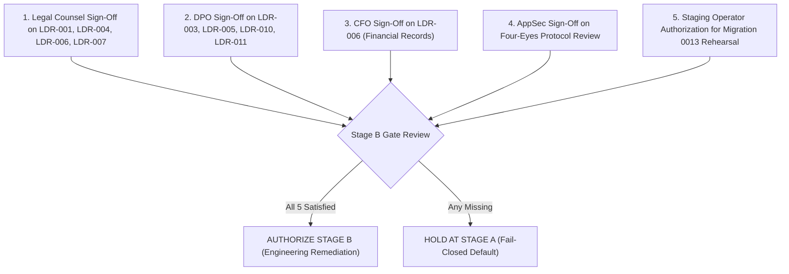

# CreatorConnect — Phase 3B.9 Executive Governance Approval Package

## Comprehensive Data Retention, Account Lifecycle & Privacy Decision Register

> **Document Status**: `PENDING EXECUTIVE DETERMINATION (STAGE A DELIVERABLE)`  
> **Target Milestones**: Phase 3B.9 — Data Retention, Account Lifecycle, Privacy Erasure, and Legal Hold Architecture  
> **Evaluation Date**: November 24, 2026  
> **Target Directorate**: General Counsel, Data Protection Officer (DPO), Chief Financial Officer (CFO), Head of Trust & Safety, Application Security Lead  
> **Repository Context**: `F:\CreatorConnect` (Branch: `dev`, HEAD: `577331e18383a15d9f98641426b3c3f4b5037a5a`)  
> **Legal Disclaimer**: This document is an engineering and compliance assessment prepared by the technical architecture team. It does **not** constitute formal legal counsel, statutory tax certification, or regulatory sign-off. All 12 policy determinations remain strictly `PENDING_APPROVAL` until executed by authorized executive officers.

---

## 1. Executive Summary & Purpose

CreatorConnect operates a multi-sided commercial marketplace coordinating collaborations, contracts, intellectual property deliverables, escrow disbursements, peer-to-peer messaging, and customer dispute resolution.

To achieve production-grade compliance under applicable data privacy frameworks (e.g., General Data Protection Regulation (GDPR), Digital Personal Data Protection (DPDP) Act, California Consumer Privacy Act (CCPA)) while satisfying statutory tax, corporate record-keeping, and commercial contract retention obligations, **formal written determinations are required from executive stakeholders**.

Engineering has implemented a fail-closed, non-destructive **AuditLog metadata adapter architecture** that enforces parent-row locking (`users FOR UPDATE`), preserves all 18 `ON DELETE RESTRICT` constraints, overwrites personal data with irreversible RFC 2606 cryptographic tombstones (`deleted-<uuid>@deleted.invalid`), purges versioned media from Cloudflare R2/S3, and issues non-repudiable 256-bit CSPRNG privacy audit receipts.

**This package presents the 12 non-negotiable policy decisions for formal executive review, defines the data retention category matrix, establishes approval ownership, and outlines the entry conditions for subsequent engineering stages.**

---

## 2. Executive Stakeholder Responsibility Matrix

| Stakeholder Role                             | Primary Governance Scope                                                                                                                   | Specific Required Sign-Offs                          |
| :------------------------------------------- | :----------------------------------------------------------------------------------------------------------------------------------------- | :--------------------------------------------------- |
| **General Counsel**                          | Statutory legal interpretation, commercial contract limitation periods, litigation hold governance, regulatory inquiry disclosure.         | LDR-001, LDR-004, LDR-006, LDR-007, LDR-011, LDR-012 |
| **Data Protection Officer (DPO)**            | Data minimization (GDPR Art. 5(1)(c)), Right to Erasure (Art. 17), DSAR completion standards, anonymization vs. pseudonymization criteria. | LDR-001, LDR-003, LDR-005, LDR-010, LDR-012          |
| **Chief Financial Officer (CFO)**            | Commercial books of account, payment dispute history, tax audit retention windows, double-entry ledger immutability.                       | LDR-006, LDR-012                                     |
| **Head of Trust & Safety**                   | Abuse reporting records, fraud risk notes, internal staff assessment shielding, counterparty reputation scoring.                           | LDR-002, LDR-005, LDR-007                            |
| **Information Security Lead (AppSec)**       | Dual-authorization protocol (Four-Eyes Principle), cryptographic nonce entropy, key destruction, access boundary enforcement.              | Four-Eyes Deletion Protocol, LDR-009, LDR-011        |
| **Staging Infrastructure Lead / SRE**        | Pre-deployment database snapshots, point-in-time recovery (PITR) procedures, migration execution rehearsal, backup re-sanitization.        | Migration 0013 Rehearsal, LDR-008                    |
| **Board of Directors / Executive Committee** | Escalation body for retention exceptions, law enforcement compliance, and corporate risk overrides.                                        | LDR-012                                              |

---

## 3. Exhaustive 12-Item Compliance Decision Register (LDR-001 to LDR-012)

Every determination is presented below with full technical context, risk analysis, neutral options, and current sign-off status. Zero approvals are fabricated.

---

### LDR-001: Approved Retention Period for Support Tickets & Customer Inquiries

- **Exact Decision Question**: _What duration must resolved customer support tickets, dispute inquiries, and associated communications be retained before automated redaction or deletion?_
- **Existing Proposal**: Retain ticket metadata and messages for a statutory dispute limitation window (e.g., commercial contract statute of limitations) with personal data anonymized after resolution closure.
- **Business Justification**: Support tickets document contract fulfillment disputes, escrow release agreements, and platform fee refund claims. Premature purge exposes the platform to litigation vulnerability; permanent unredacted retention violates data minimization.
- **Data Categories Affected**: Customer names, emails, dispute subjects, escrow amounts, deliverable links, support message bodies, timestamps.
- **Applicable System Components**: `support_tickets`, `support_ticket_messages`, `support_ticket_audits`, Fastify API `/api/v1/support/*`.
- **Security & Privacy Implications**: Tickets store free-text customer disclosures and transaction context. High risk of incidental PII retention.
- **Technical Consequences**: Requires schema support for nullable customer references or in-place pseudonymization of `author_id`.
- **Dependencies**: LDR-002 (Internal Notes), LDR-004 (Deletion Scope), LDR-006 (Financial Exceptions).
- **Risks of Approval**: Retaining data across commercial dispute windows increases platform attack surface during DSAR discovery.
- **Risks of Rejection**: Purging tickets after 90 days destroys evidence needed to defend payment chargebacks or breach of contract claims.
- **Required Approver**: General Counsel & Data Protection Officer (DPO).
- **Evidence Required**: Written Legal & Privacy Memorandum specifying applicable statutory dispute windows.
- **Approval Status**: `PENDING_APPROVAL`
- **Approver Identity**: `[Pending Formal Designation]`
- **Approval Date**: `[Pending Formal Execution]`
- **Conditions / Restrictions**: Must maintain `ON DELETE RESTRICT` on `support_ticket_messages.author_id`.
- **Reconsideration Requirements**: Mandatory biennial review or upon amendment of commercial marketplace statutes.

---

### LDR-002: Retention & Discovery of Internal Support Notes

- **Exact Decision Question**: _Are internal staff assessment notes (`is_internal = true`) subject to the same retention period as customer-facing communications, and are they discoverable under Data Subject Access Requests (DSAR)?_
- **Existing Proposal**: Retain internal staff notes under platform work-product privilege for fraud defense, shielded from customer DSAR exports unless ordered by subpoena.
- **Business Justification**: Internal notes record fraud flags, moderation deliberations, risk scores, and account compromise investigations. Exposing them compromises fraud defenses; deleting them destroys corporate incident records.
- **Data Categories Affected**: Staff user IDs, internal risk evaluations, fraud detection flags, moderation commentary.
- **Applicable System Components**: `support_ticket_messages.is_internal`, `support_ticket_audits.is_internal`, Support Ticketing Gateway.
- **Security & Privacy Implications**: Internal notes may contain unverified allegations regarding customer conduct. DSAR leakage could create defamation liabilities.
- **Technical Consequences**: Fastify support routes strictly filter `is_internal = false` for customer queries; DSAR export workers must exclude internal notes.
- **Dependencies**: LDR-001 (Support Tickets), LDR-003 (Audit Logs).
- **Risks of Approval**: Over-broad shielding may conflict with GDPR Art. 15 if deemed personal data of the requester.
- **Risks of Rejection**: Disclosing internal risk deliberations destroys anti-fraud heuristics and reveals investigation methodologies.
- **Required Approver**: Legal Counsel & Head of Trust & Safety.
- **Evidence Required**: Trust & Safety Operational Policy Memo and Legal Privilege Determination.
- **Approval Status**: `PENDING_APPROVAL`
- **Approver Identity**: `[Pending Formal Designation]`
- **Approval Date**: `[Pending Formal Execution]`
- **Conditions / Restrictions**: Internal notes must never leak via customer Socket.IO channels or customer REST endpoints.
- **Reconsideration Requirements**: Annual review against evolving supervisory authority guidance on DSAR work-product exemptions.

---

### LDR-003: Permissible Audit Trail Retention Post-Erasure

- **Exact Decision Question**: _Which specific fields in `audit_logs` and `support_ticket_audits` may be retained post-erasure to satisfy security accountability without violating Right to Erasure?_
- **Existing Proposal**: Retain immutable audit event records with `user_id` preserved as a historical UUID link, while nullifying direct profile identifiers and truncating IP addresses to network prefixes (/24 for IPv4, /48 for IPv6).
- **Business Justification**: GDPR Art. 5(2) (Accountability Principle) and ISO 27001 mandate retaining tamper-evident security logs to detect unauthorized access, fraud, and privilege escalation.
- **Data Categories Affected**: User IDs, IP addresses, user agents, action names, entity IDs, metadata payloads.
- **Applicable System Components**: `audit_logs`, `support_ticket_audits`, `ModerationAction`, `ReviewModerationAudit`.
- **Security & Privacy Implications**: Raw IP addresses constitute personal data under GDPR (Breyer v. Germany). Storing raw IPs indefinitely post-erasure is non-compliant.
- **Technical Consequences**: Audit log repositories must implement IP subnet masking and metadata PII sanitization.
- **Dependencies**: LDR-004 (Account Deletion Scope), LDR-011 (Proof of Compliance).
- **Risks of Approval**: Retaining masked IP and user agent metadata carries residual re-identification risk if combined with network logs.
- **Risks of Rejection**: Deleting audit logs destroys platform security monitoring, intrusion detection, and compliance certifications.
- **Required Approver**: Privacy Officer & Regulatory Counsel.
- **Evidence Required**: Technical Privacy Impact Assessment (DPIA) on Security Logging.
- **Approval Status**: `PENDING_APPROVAL`
- **Approver Identity**: `[Pending Formal Designation]`
- **Approval Date**: `[Pending Formal Execution]`
- **Conditions / Restrictions**: Audit logs must remain strictly append-only; update and delete operations prohibited in production database roles.
- **Reconsideration Requirements**: Re-evaluation upon changes to security information event management (SIEM) architecture.

---

### LDR-004: Scope of Action on Account Deletion Request

- **Exact Decision Question**: _When a user successfully completes a Right to Erasure request, what exact database mutation must occur across the relational graph?_
- **Existing Proposal**: Adopt **In-Place Irreversible Pseudonymization** across `users`, `creator_profiles`, and `brand_profiles`. Overwrite personal identifiers with RFC 2606 tombstones (`deleted-<uuid>@deleted.invalid`, name: "Deleted User", avatar: null), preserve distinct UUIDs, maintain all 18 `ON DELETE RESTRICT` foreign keys, and set `status = DEACTIVATED` and `is_anonymized = true`.
- **Business Justification**: Direct physical row deletion (`DELETE FROM users WHERE id = :id`) fails with PostgreSQL error `23503` due to foreign keys across contracts, ledgers, disputes, deliverables, and messages. Cascading deletion unlawfully destroys commercial accounting and tax records.
- **Data Categories Affected**: User identity, auth provider IDs, profile bios, avatars, social links, addresses.
- **Applicable System Components**: `users`, `creator_profiles`, `brand_profiles`, `user_roles`, PostgreSQL schema constraints.
- **Security & Privacy Implications**: Guarantees personal data is scrubbed from production tables while eliminating unique constraint collisions and counterparty contract corruption.
- **Technical Consequences**: Completely eliminates database deadlock and foreign-key collision risks. Universal zero-UUID pattern is strictly rejected.
- **Dependencies**: LDR-005 (Anonymization Scope), LDR-006 (Financial Records).
- **Risks of Approval**: Tombstone records retain immutable UUIDs; must guarantee UUIDs cannot be linked back to individual natural persons.
- **Risks of Rejection**: Physical deletion corrupts double-entry financial journals and violates tax law. Universal zero-UUID causes database write locks and unique constraint aborts.
- **Required Approver**: Principal Software Architect & General Counsel.
- **Evidence Required**: Architectural Assessment and Relational Integrity Audit Report.
- **Approval Status**: `PENDING_APPROVAL`
- **Approver Identity**: `[Pending Formal Designation]`
- **Approval Date**: `[Pending Formal Execution]`
- **Conditions / Restrictions**: Reactivation of tombstone accounts (`@deleted.invalid`) must remain strictly blocked (`AccountAlreadyDeletedError`).
- **Reconsideration Requirements**: Re-evaluation if major database ORM or schema restructuring occurs.

---

### LDR-005: Data Categories Eligible for Irreversible Anonymization vs. Physical Deletion

- **Exact Decision Question**: _Which specific data categories must be physically deleted, which must be pseudonymized, and which must remain intact for non-deleting counterparties?_
- **Existing Proposal**:
  1. _Physical Deletion_: Private drafts, notifications, notification preferences, shortlist memberships, saved creator entries, unassigned portfolio media.
  2. _In-Place Pseudonymization_: User core profile, creator bio, brand name, counterparty message sender attribution, review author names.
  3. _Intact Preservation_: Message thread text (counterparty continuity), deliverable files (contract evidence), financial ledger journals.
- **Business Justification**: In a multi-sided marketplace, deleting message text destroys conversation history for the remaining non-deleting counterparty; deleting reviews distorts aggregate platform reputation scores.
- **Data Categories Affected**: Portfolio media, messages, reactions, reviews, community posts, saved creator bookmarks.
- **Applicable System Components**: `messages`, `reviews`, `portfolio_items`, `community_posts`, `media_assets`.
- **Security & Privacy Implications**: Free-text messages and reviews may contain incidental PII disclosed during collaboration.
- **Technical Consequences**: UI rendering logic renders deleted sender names as "Deleted User"; redaction service cleans profile tables.
- **Dependencies**: LDR-004 (Deletion Scope), LDR-006 (Financial Exceptions).
- **Risks of Approval**: Preserving message text may leave incidental personal data in counterparty inboxes unless explicitly scrubbed.
- **Risks of Rejection**: Blanking message text degrades collaboration history and damages counterparty project defense.
- **Required Approver**: Data Protection Officer & Marketplace Product Lead.
- **Evidence Required**: User Experience & Privacy Balancing Assessment.
- **Approval Status**: `PENDING_APPROVAL`
- **Approver Identity**: `[Pending Formal Designation]`
- **Approval Date**: `[Pending Formal Execution]`
- **Conditions / Restrictions**: Media assets associated with deleted users must be purged from S3/R2 storage unless bound to an active contract deliverable.
- **Reconsideration Requirements**: Biennial review of marketplace content moderation policies.

---

### LDR-006: Mandatory Statutory Retention Exceptions (Financial & Tax Records)

- **Exact Decision Question**: _Which financial, tax, dispute, and contractual categories must the platform refuse to erase under statutory legal exemptions?_
- **Existing Proposal**: Retain all `payment_intents`, `ledger_accounts`, `ledger_entries`, `disputes`, `dispute_evidence`, `contracts`, `project_deliverables`, and `refunds` for the statutory commercial tax window (e.g., 7 to 8 years under applicable commercial tax codes); exempt these categories from user erasure requests.
- **Business Justification**: Corporate tax laws, financial audit standards, anti-money laundering (AML) regulations, and commercial codes strictly mandate multi-year preservation of books of account and transaction deliverables. Erasing financial records creates severe corporate criminal liability.
- **Data Categories Affected**: Transaction amounts, billing names, payment provider IDs, ledger journal entries, invoice line items, dispute evidence.
- **Applicable System Components**: `payment_intents`, `ledger_entries`, `disputes`, `refunds`, `projects`.
- **Security & Privacy Implications**: GDPR Art. 17(3)(b) explicitly provides that Right to Erasure does not apply where processing is required for compliance with a legal obligation.
- **Technical Consequences**: All 18 `ON DELETE RESTRICT` constraints remain permanently active. User erasure never touches ledger accounts or financial balances.
- **Dependencies**: LDR-004 (Deletion Scope), LDR-007 (Legal Holds).
- **Risks of Approval**: Requires explicit communication to users explaining why financial transaction records cannot be erased.
- **Risks of Rejection**: Attempting to erase financial records violates corporate tax statutes and auditing standards.
- **Required Approver**: Chief Financial Officer & General Counsel.
- **Evidence Required**: Formal Statutory Tax & Accounting Compliance Memorandum.
- **Approval Status**: `PENDING_APPROVAL`
- **Approver Identity**: `[Pending Formal Designation]`
- **Approval Date**: `[Pending Formal Execution]`
- **Conditions / Restrictions**: Financial records must remain append-only; zero mutation of ledger entries permitted.
- **Reconsideration Requirements**: Mandatory review upon changes to national or state commercial tax legislation.

---

### LDR-007: Representation & Mechanics of Legal Holds

- **Exact Decision Question**: _How must litigation holds, regulatory inquiries, police subpoenas, and trust & safety investigations prevent data erasure and status transitions?_
- **Existing Proposal**: Model legal holds with dedicated case references, enforcing the **parent-row locking protocol** (`users FOR UPDATE`). If hold count $> 0$, erasure requests are rejected or frozen in `REJECTED_LEGAL_HOLD` status. Holds can only be applied or released with audited case citations.
- **Business Justification**: Federal Rules of Civil Procedure (FRCP) and international evidence spoliation laws strictly penalize the destruction of evidence once litigation is anticipated. Offline ticketing introduces fatal TOCTOU race conditions.
- **Data Categories Affected**: Target user IDs, case references, hold reasons, notes, applied/released staff IDs, timestamps.
- **Applicable System Components**: `legal_holds` (future table / AuditLog adapter), `account-lifecycle.service.ts`, `data-erasure-orchestrator.ts`.
- **Security & Privacy Implications**: Bypassing a legal hold results in unlawful evidence spoliation and obstruction of justice sanctions.
- **Technical Consequences**: Enforces the atomic locking order: $\text{users} \to \text{legal\_holds} \to \text{privacy\_requests}$.
- **Dependencies**: LDR-004 (Deletion Scope), LDR-012 (Override Authority).
- **Risks of Approval**: Over-utilization of legal holds could indefinitely delay legitimate user privacy requests; requires active release workflows.
- **Risks of Rejection**: Failure to enforce transactional legal holds results in automated background workers erasing litigation evidence.
- **Required Approver**: Litigation Counsel & Director of Compliance.
- **Evidence Required**: Corporate Legal Hold Operational Policy and Spoliation Prevention Directive.
- **Approval Status**: `PENDING_APPROVAL`
- **Approver Identity**: `[Pending Formal Designation]`
- **Approval Date**: `[Pending Formal Execution]`
- **Conditions / Restrictions**: Applying or releasing a legal hold must generate a transactional outbox event and forensically complete audit log.
- **Reconsideration Requirements**: Annual review of active holds to prevent indefinite data retention.

---

### LDR-008: Handling of Data Retained in Binary Database Backups

- **Exact Decision Question**: _Does the Right to Erasure require physical editing or immediate destruction of immutable PostgreSQL backups, Aurora snapshots, and PITR WAL archives?_
- **Existing Proposal**: Adopt the international consensus standard: commit to standard binary backup expiration (e.g., 30-day snapshot lifecycle); do not attempt to edit binary snapshots; maintain an authoritative compliance certificate ledger to re-pseudonymize any resurrected personal data immediately post-restore before user traffic is admitted.
- **Business Justification**: PostgreSQL WAL logs and Aurora binary snapshots are block-level encrypted storage images and cannot be selectively edited. Restoring, scrubbing, and re-snapshotting multi-terabyte clusters on every erasure request is technically prohibitive and creates extreme cloud costs.
- **Data Categories Affected**: Full binary database snapshots, WAL archives, read-replica replication streams.
- **Applicable System Components**: AWS Aurora Cluster Snapshots, S3 backup buckets, `restore-sanitizer.ts`.
- **Security & Privacy Implications**: French CNIL, UK ICO, and European Data Protection Board (EDPB) guidelines recognize that Right to Erasure does not mandate immediate physical editing of binary backup media provided backups expire within a defined window and restored databases are re-sanitized.
- **Technical Consequences**: Engineering has implemented `RestoreSanitizerService` to automatically detect and re-scrub resurrected personal data post-restore.
- **Dependencies**: LDR-004 (Deletion Scope), LDR-011 (Proof of Compliance).
- **Risks of Approval**: If a disaster recovery restore procedure fails to execute `RestoreSanitizerService`, previously deleted accounts could momentarily reappear.
- **Risks of Rejection**: Attempting live editing of binary backups destabilizes disaster recovery capabilities and creates prohibitive operational costs.
- **Required Approver**: SRE Lead & Privacy Counsel.
- **Evidence Required**: Disaster Recovery & Backup Retention Architecture Specification.
- **Approval Status**: `PENDING_APPROVAL`
- **Approver Identity**: `[Pending Formal Designation]`
- **Approval Date**: `[Pending Formal Execution]`
- **Conditions / Restrictions**: `RestoreSanitizerService` execution must be mandatory in all staging and production disaster recovery runbooks.
- **Reconsideration Requirements**: Review upon changes to cloud database backup storage engines.

---

### LDR-009: Third-Party Provider Erasure Protocols (SLA & Retry Boundaries)

- **Exact Decision Question**: _What service-level agreements (SLAs), retry ceilings, and reconciliation workflows govern the deletion of personal data held by external processors (Supabase Auth, Cloudflare R2, Razorpay)?_
- **Existing Proposal**: Enforce an automated transactional outbox workflow targeting complete third-party deletion within an operational window (e.g., 72 hours). Retry transient errors (5xx, 429) up to 5 attempts with exponential backoff and jitter; route exhausted failures to a Dead-Letter Queue (DLQ) for operator intervention.
- **Business Justification**: Distributed systems cannot participate in single ACID transactions. External processors experience network partitions, rate limits, and outages.
- **Data Categories Affected**: Supabase Auth identities (`auth.users`), S3 media assets (`storageKey`, `thumbnailKey`, `previewKey`), Razorpay customer billing tokens.
- **Applicable System Components**: `apps/worker/src/outbox/`, `supabase-admin.service.ts`, `external-storage-purge.service.ts`.
- **Security & Privacy Implications**: GDPR Art. 28 mandates that controllers ensure processors erase personal data following termination of services.
- **Technical Consequences**: S3 purges all object versions and delete markers; Supabase admin deletes identities with idempotent 404 handling.
- **Dependencies**: LDR-010 (Completion Definition).
- **Risks of Approval**: Processor API rate limits or prolonged third-party outages may delay certificate emission beyond 72 hours.
- **Risks of Rejection**: Lack of automated outbox retries leads to orphaned personal data lingering indefinitely across cloud processors.
- **Required Approver**: Application Security Lead & Compliance Director.
- **Evidence Required**: Third-Party Vendor Data Processing Agreements (DPA) and Architecture SLA Audit.
- **Approval Status**: `PENDING_APPROVAL`
- **Approver Identity**: `[Pending Formal Designation]`
- **Approval Date**: `[Pending Formal Execution]`
- **Conditions / Restrictions**: Third-party credentials must reside in AWS Secrets Manager; zero hardcoded API keys in code or documentation.
- **Reconsideration Requirements**: Annual review of third-party processor SLA performance.

---

### LDR-010: Legal Definition of "Completion" for an Erasure Request

- **Exact Decision Question**: _At what precise operational milestone is a Right to Erasure request legally deemed "complete" under statutory regulatory deadlines?_
- **Existing Proposal**: An erasure request is legally complete when **all four distributed phases finalize**:
  1. Primary database in-place pseudonymization committed.
  2. Cloudflare R2 / S3 versioned media objects purged.
  3. Supabase Auth external identity deleted.
  4. Immutable `PrivacyAuditCertificate` emitted and Redis caches evicted.
- **Business Justification**: Prematurely marking a request complete when only PostgreSQL is scrubbed misrepresents compliance if gigabytes of private media remain publicly accessible on CDN edges.
- **Data Categories Affected**: Privacy request status, completion timestamps, user notification triggers.
- **Applicable System Components**: `data-erasure-orchestrator.ts`, `privacy-request.service.ts`, `PrivacyAuditCertificate`.
- **Security & Privacy Implications**: Regulatory authorities enforce strict statutory response deadlines (e.g. 30 calendar days under GDPR Art. 12(3)).
- **Technical Consequences**: Fastify API emits `PrivacyReceiptResponse` containing the non-repudiable 256-bit CSPRNG token only upon Phase 4 finalization.
- **Dependencies**: LDR-004 (Deletion Scope), LDR-009 (Third-Party SLAs), LDR-011 (Proof of Compliance).
- **Risks of Approval**: Delay in third-party API processing could extend overall completion timeline close to statutory deadlines.
- **Risks of Rejection**: Premature certificate emission before external purges finish exposes platform to regulatory fines for false compliance reporting.
- **Required Approver**: Data Protection Officer & Compliance Director.
- **Evidence Required**: Regulatory Compliance Procedure Specification.
- **Approval Status**: `PENDING_APPROVAL`
- **Approver Identity**: `[Pending Formal Designation]`
- **Approval Date**: `[Pending Formal Execution]`
- **Conditions / Restrictions**: If any external stage fails permanently, the request enters `PROCESSING_DEGRADED` and alerts the SRE on-call team.
- **Reconsideration Requirements**: Review upon amendment of statutory privacy timelines.

---

### LDR-011: Retained Evidence of Deletion (Proof of Compliance & Certificates)

- **Exact Decision Question**: _What proof or certificate of erasure may the platform retain to prove compliance to supervisory authorities without re-identifying the data subject?_
- **Existing Proposal**: Retain an immutable compliance ledger entry (`PrivacyAuditCertificate`) containing:
  - High-entropy 256-bit CSPRNG token (`crypto.randomBytes(32)`).
  - SHA-256 token hash (only the hash is stored in PostgreSQL; raw token returned exclusively to user).
  - Cryptographic HMAC payload signature (`crypto.createHmac('sha256')`).
  - Request ID, Completion Timestamp, Action Taken, Records Scrubbed, Media Files Purged.
  - Zero plaintext personal data bits (no email, no name, no IP).
- **Business Justification**: GDPR Art. 5(2) (Accountability Principle) requires platforms to demonstrate compliance to regulators. Scrubbing 100% of records with zero compliance receipt leaves the platform defenseless against claims of failure to respond.
- **Data Categories Affected**: Certificate ID, Request ID, SHA-256 Token Hash, HMAC Signature, Operation Counts.
- **Applicable System Components**: `privacy-audit.service.ts`, `privacy_audit_certificates` (future table / AuditLog adapter).
- **Security & Privacy Implications**: Storing raw tokens or reversible subject hashes permits dictionary attacks. Storing only 256-bit CSPRNG hashes completely decouples proof from subject identity.
- **Technical Consequences**: Public verification endpoint `/api/v1/privacy/verify-receipt` validates raw tokens in constant time (`crypto.timingSafeEqual`) without exposing identity.
- **Dependencies**: LDR-003 (Audit Logs), LDR-010 (Completion Definition).
- **Risks of Approval**: Loss of the raw receipt token by the user prevents public verification; platform must rely on internal HMAC audit trail.
- **Risks of Rejection**: Zero compliance evidence creates insurmountable legal liability during supervisory audits.
- **Required Approver**: Regulatory Legal Counsel & Information Security Lead.
- **Evidence Required**: Cryptographic Design Specification and Privacy Audit Token Entropy Proof.
- **Approval Status**: `PENDING_APPROVAL`
- **Approver Identity**: `[Pending Formal Designation]`
- **Approval Date**: `[Pending Formal Execution]`
- **Conditions / Restrictions**: Receipt tokens must never be logged in application logs or persisted in plaintext.
- **Reconsideration Requirements**: Annual cryptographic review of hash algorithms and HMAC key rotation procedures.

---

### LDR-012: Authority to Approve Retention Exceptions & Manual Overrides

- **Exact Decision Question**: _Which designated executive officers possess authority to approve exceptions to standard retention rules or authorize manual overrides during emergency inquiries?_
- **Existing Proposal**: Establish a dual-authorization hierarchy:
  1. _Standard Retention Holds_: Applied by Compliance Staff, Trust & Safety Leads, or Legal Counsel.
  2. _Override / Early Release of Legal Holds_: Requires joint written approval by **General Counsel AND Data Protection Officer**.
  3. _Administrative Account Erasure_: Enforces the **Four-Eyes Principle** ($RequesterID \ne ApproverID$ with AppSec-approved MFA verification).
- **Business Justification**: Single-operator overrides create catastrophic risks of insider threat, rogue data wiping, evidence destruction, or corruption under external duress.
- **Data Categories Affected**: Authorization audit events, override justification records, multi-signature tokens.
- **Applicable System Components**: RBAC CASL permissions (`packages/auth`), `account-lifecycle.service.ts`, Fastify Admin Routes.
- **Security & Privacy Implications**: Separates duties to prevent unilateral tampering with corporate legal holds or privacy requests.
- **Technical Consequences**: RBAC rules reject any single-admin attempt to release a hold without independent counter-signature.
- **Dependencies**: LDR-007 (Legal Holds), Four-Eyes Administrative Deletion Protocol.
- **Risks of Approval**: Dual-approval requirements may introduce scheduling latency during urgent law enforcement subpoenas.
- **Risks of Rejection**: Single-admin override authority permits rogue employees to destroy litigation evidence or wipe competitor accounts.
- **Required Approver**: Board of Directors / Chief Executive Officer & General Counsel.
- **Evidence Required**: Corporate Governance Charter & Executive Delegation of Authority Policy.
- **Approval Status**: `PENDING_APPROVAL`
- **Approver Identity**: `[Pending Formal Designation]`
- **Approval Date**: `[Pending Formal Execution]`
- **Conditions / Restrictions**: All override approvals must be recorded in the immutable audit log with cryptographic timestamps.
- **Reconsideration Requirements**: Annual review of executive delegation thresholds.

---

## 4. Comprehensive Platform Data Retention Category Matrix

The following matrix documents all 13 core platform data categories, distinguishing approved, proposed, and unknown policy parameters:

| Data Category                          | Primary Owner        | Storage Locations                                                 | Data Classification             | Proposed Retention Anchor ($t_{anchor}$)         | Proposed Duration ($\Delta t$)                           | Status of Duration       | Deletion / Redaction Method                                                  | Legal Hold Freezable?               | External Provider Dependencies   |
| :------------------------------------- | :------------------- | :---------------------------------------------------------------- | :------------------------------ | :----------------------------------------------- | :------------------------------------------------------- | :----------------------- | :--------------------------------------------------------------------------- | :---------------------------------- | :------------------------------- |
| **1. User Profile Data**               | User                 | PostgreSQL `users`, `creator_profiles`, `brand_profiles`          | PII / Confidential              | Account deletion confirmation timestamp          | 30-day cooling-off window                                | `PROPOSED_DEFAULT`       | In-place pseudonymization (`deleted-<uuid>@deleted.invalid`, nullified bios) | **YES** (Parent lock freezes purge) | Supabase Auth Admin              |
| **2. Auth & Session Credentials**      | Platform / User      | Supabase Auth, Redis `user:sub:*`, `auth:*`                       | Highly Confidential             | Account deactivation or erasure completion       | Immediate upon terminal transition                       | `PROPOSED_DEFAULT`       | API identity deletion in Supabase; scoped Redis key pattern invalidation     | **YES** (Prevents auth wipe)        | Supabase Auth, Redis ElastiCache |
| **3. Support Tickets & Messages**      | Customer & Staff     | PostgreSQL `support_tickets`, `support_ticket_messages`           | Confidential                    | Formal resolution closure of ticket              | Commercial dispute window (e.g. 3 to 6 years)            | `PENDING_LEGAL_APPROVAL` | Ticket metadata retained; requester ID pseudonymized; messages preserved     | **YES** (Freezes ticket purge)      | None                             |
| **4. Internal Support Staff Notes**    | Platform / Staff     | PostgreSQL `support_ticket_messages(is_internal=true)`            | Restricted / Work Product       | Resolution closure of parent ticket              | Platform fraud defense window (e.g. 5 years)             | `PENDING_LEGAL_APPROVAL` | Retained as privileged work product; excluded from DSAR customer exports     | **YES** (Freezes note purge)        | None                             |
| **5. Dispute Records & Evidence**      | Disputing Parties    | PostgreSQL `disputes`, `dispute_evidence`, S3 evidence bucket     | Restricted / Legal Evidence     | Formal dispute settlement timestamp              | Commercial dispute limitation window (e.g. 6 years)      | `PENDING_LEGAL_APPROVAL` | Retained intact under `ON DELETE RESTRICT`; evidence files preserved         | **YES** (Mandatory statutory hold)  | Cloudflare R2 / AWS S3           |
| **6. Financial Ledgers & Payments**    | Platform & Merchants | PostgreSQL `payment_intents`, `ledger_accounts`, `ledger_entries` | Highly Confidential / Financial | Fiscal year end of transaction settlement        | Statutory commercial tax window (e.g. 7 to 8 years)      | `PENDING_LEGAL_APPROVAL` | Permanently exempt from erasure; append-only double-entry ledger             | **YES** (Mandatory statutory hold)  | Razorpay                         |
| **7. Project Deliverable Submissions** | Talent & Client      | PostgreSQL `project_deliverables`, `submissions`, S3 media        | Commercial IP / Deliverables    | Contract completion or project cancellation date | Contract dispute limitation period (e.g. 6 years)        | `PENDING_LEGAL_APPROVAL` | Final submitted assets retained as contract fulfillment evidence             | **YES** (Freezes file purge)        | Cloudflare R2 / AWS S3           |
| **8. Media Assets & Unbound Blobs**    | User                 | PostgreSQL `media_assets`, Cloudflare R2 / AWS S3                 | User Content                    | User erasure execution timestamp                 | 72 hours post-confirmation                               | `PROPOSED_DEFAULT`       | Multi-version S3 purge (`DeleteObjectsCommand` + delete marker removal)      | **YES** (Blocks S3 purge)           | Cloudflare R2 / AWS S3           |
| **9. Platform Security Audit Logs**    | Platform / Security  | PostgreSQL `audit_logs`, SIEM logging bucket                      | Restricted / Security Audit     | Event emission timestamp                         | Security compliance accountability window (e.g. 3 years) | `PENDING_LEGAL_APPROVAL` | Append-only; IP addresses truncated (/24); metadata PII redacted             | **YES** (Immutable preservation)    | None                             |
| **10. Privacy Request Records**        | Platform / DPO       | PostgreSQL `privacy_requests` (future table / AuditLog)           | Confidential / Compliance       | Completion or cancellation timestamp             | Statutory privacy audit window (e.g. 5 years)            | `PENDING_LEGAL_APPROVAL` | Decoupled request history retained for supervisory authority proof           | **YES** (Holds freeze status)       | None                             |
| **11. Legal Hold Records**             | Platform / Legal     | PostgreSQL `legal_holds` (future table / AuditLog)                | Restricted / Privileged         | Formal legal hold release timestamp              | Permanent corporate compliance archive                   | `PENDING_LEGAL_APPROVAL` | Immutable record of hold application and release justification               | **NO** (Holds cannot hold holds)    | None                             |
| **12. Security Incident Records**      | Trust & Safety       | PostgreSQL `moderation_actions`, `reports`                        | Restricted / Security           | Incident closure timestamp                       | Anti-fraud defense window (e.g. 5 years)                 | `PENDING_LEGAL_APPROVAL` | Reporter/target user IDs decoupled; violation notes retained                 | **YES** (Freezes incident purge)    | None                             |
| **13. Database Binary Backups**        | SRE / DevOps         | AWS Aurora Automated Snapshots, S3 WAL archives                   | Encrypted System Images         | Snapshot generation timestamp                    | 30 calendar days (rolling snapshot lifecycle)            | `PROPOSED_DEFAULT`       | Automated AWS lifecycle expiration; `RestoreSanitizerService` on restore     | **NO** (Binary storage)             | AWS RDS / S3                     |

---

## 5. Formal Approval Recording & Decision Execution Templates

When an executive officer formally determines a policy question, the record must be documented in the following format and committed to the compliance archive:

```markdown
### Formal Decision Record: LDR-[XXX]

- **Decision Title**: [Exact Title of Approved Policy]
- **Approved Determination**: [Option A / Option B / Specific Defined Text]
- **Authoritative Statutory Reference**: [e.g., GDPR Art. 17(3)(b) / Companies Act Sec. 128 / Tax Code Sec. 44AA]
- **Exact Operational Duration**: [e.g., 7 Years from Fiscal Year End / 30 Days Cooling-Off]
- **Designated Approver**: [Full Name of Approving Officer]
- **Approver Executive Role**: [e.g., General Counsel / Chief Financial Officer / Data Protection Officer]
- **Form of Evidence**: [e.g., Board Resolution #2026-11-A / Formal Legal Memo Ref #GC-2026-089]
- **Evidence Storage Location**: [Secure Internal Legal Document Repository Link]
- **Execution Timestamp**: [ISO 8601 UTC Timestamp]
- **Signature / Hash**: [Cryptographic Signature or Document SHA-256 Hash]
- **Implementation Authorization**: [AUTHORIZED TO PROCEED TO STAGE B / C]
```

---

## 6. Stage B Entry Conditions & Governance Gate

Progressing from **Stage A (Governance Preparation)** to **Stage B (Engineering Remediation)** is strictly conditional upon satisfying the following entry gates:



### Mandatory Stage B Prerequisites:

- [ ] Written legal memos signed by General Counsel and DPO for LDR-001 through LDR-012.
- [ ] Written financial exemption directive signed by CFO for LDR-006.
- [ ] AppSec approval of the Four-Eyes Administrative Deletion Protocol specification.
- [ ] Change management authorization to conduct the Migration 0013 staging rehearsal.
- [ ] Technical change tickets created for GAP-06, GAP-07, GAP-08, and GAP-09.

**Current Stage Determination**: **`DOCUMENTATION PREPARED — APPROVALS PENDING (STAGE A COMPLETE)`**
