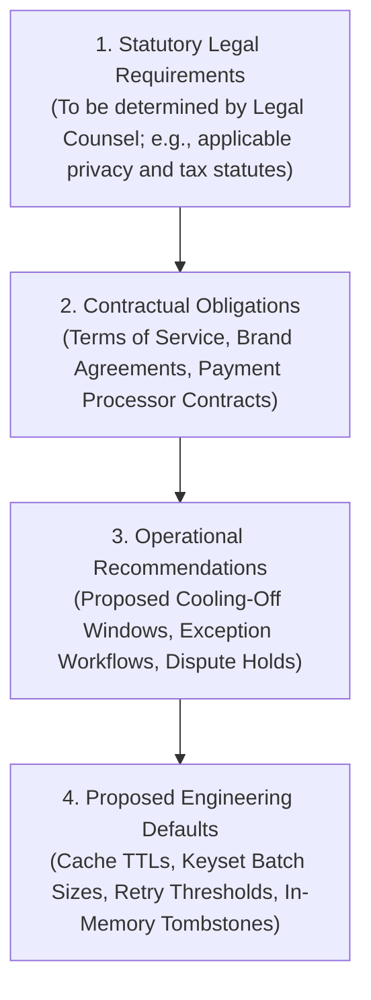

# CreatorConnect — Data Retention, Account Erasure & Privacy Governance

## Formal Legal & Compliance Decision Register

> **Document Status**: `PENDING FORMAL APPROVAL (IMPLEMENTATION STAGED — PHASE 3B.8.3)`  
> **Target Directorate**: Legal Counsel, Regulatory Compliance, Data Protection Officer (DPO)  
> **Related Architecture Phase**: Phase 3B.8 / Phase 3B.8.1 / Phase 3B.8.2 / Phase 3B.8.3  
> **Disclaimer**: This document is an engineering assessment prepared by the technical team. It does **not** constitute legal advice, a statutory determination, or a platform compliance certification. All legal questions, retention durations, and statutory exemptions remain strictly `PENDING_LEGAL_APPROVAL`.

---

## 1. Executive Context & Distinction of Governance Tiers

CreatorConnect operates a multi-sided marketplace facilitating collaborations, commercial deliverables, escrow payments, and customer inquiries. Engineering requires formal written determinations from Legal & Compliance before implementing automated deletion or retention rules.

To ensure clarity, this register explicitly distinguishes four tiers of governance:

1. **Statutory Legal Requirements**: Specific statutory obligations (such as privacy rights under GDPR/DPDP Act or commercial/tax record-keeping requirements under applicable law) that must be determined by qualified legal counsel. Engineering does not assert statutory rules.
2. **Contractual Obligations**: Commitments made under the platform's Terms of Service, Master Services Agreements, and merchant contracts with third parties (such as Razorpay or Cloudflare).
3. **Operational Recommendations**: Practical operational defaults proposed by the engineering team (such as a 30-day cooling-off period to prevent accidental loss from impulsive deletions).
4. **Proposed Engineering Defaults**: Internal software constants (such as 300-second Redis cache TTL, 100-record batch processing size, and 5-attempt retry ceilings) designed for system stability and memory boundedness.

---

## 2. Formal Compliance Decision Register (12 Questions)

The following register contains the 12 non-negotiable policy questions requiring formal determination by Legal & Compliance.

| Decision ID | Legal & Compliance Decision Required                                                                                                                                                  | Technical Context                                                                                                                                     | Available Neutral Options                                                                                                                                                                                                                                                                                                                                   | Technical Consequences                                                                                                                                                                                                                           | Governance & Privacy Risk                                                                                                                                       | Required Approver                         | Current Status           | Written Evidence / Sign-Off Reference |
| :---------- | :------------------------------------------------------------------------------------------------------------------------------------------------------------------------------------ | :---------------------------------------------------------------------------------------------------------------------------------------------------- | :---------------------------------------------------------------------------------------------------------------------------------------------------------------------------------------------------------------------------------------------------------------------------------------------------------------------------------------------------------- | :----------------------------------------------------------------------------------------------------------------------------------------------------------------------------------------------------------------------------------------------- | :-------------------------------------------------------------------------------------------------------------------------------------------------------------- | :---------------------------------------- | :----------------------- | :------------------------------------ |
| **LDR-001** | **Approved Retention Period for Support Tickets** What duration should resolved support tickets and customer communications be retained?                                           | Support tickets (`support_tickets`) store requester ID, dispute subjects, escrow amounts, and timestamps. Messages link via `author_id` (`RESTRICT`). | **Option A**: Purge 90 days post-resolution. **Option B**: Retain for commercial dispute limitation window (`PENDING_LEGAL_APPROVAL`). **Option C**: Retain for tax audit retention window (`PENDING_LEGAL_APPROVAL`). **Option D**: Anonymize requester ID after 30 days; retain ticket metadata for statutory audit window.                      | Option A risks loss of evidence in contract disputes. Options B & C accumulate personal data indefinitely unless redacted. Option D decouples personal identity while preserving financial dispute records.                                | Option A creates litigation vulnerability; Options B & C increase data footprint; Option D requires schema support for nullable requesters.                     | General Counsel / DPO                     | `PENDING_LEGAL_APPROVAL` | _[Pending Written Legal Memo]_        |
| **LDR-002** | **Retention & Discovery of Internal Support Notes** Are internal staff notes (`is_internal = true`) subject to the same retention period as customer messages?                     | Internal notes in `support_ticket_messages` store staff assessments, fraud flags, and risk assessments shielded from customer view.                   | **Option A**: Same retention period as parent ticket. **Option B**: Retain indefinitely as confidential platform work product. **Option C**: Purge internal notes immediately upon ticket closure.                                                                                                                                                    | Option A ties note lifecycle to ticket. Option B retains staff notes permanently in database. Option C purges internal context for historical moderation actions.                                                                          | Option B creates exposure during Data Subject Access Requests (DSAR) or litigation discovery; Option C destroys platform fraud defense records.                 | Legal Counsel / Head of Trust & Safety    | `PENDING_LEGAL_APPROVAL` | _[Pending Written Legal Memo]_        |
| **LDR-003** | **Permissible Audit Trail Retention Post-Erasure** Which fields in `audit_logs` and `support_ticket_audits` may be retained after an account erasure request?                      | `audit_logs` records `user_id`, `ip_address`, `user_agent`, `action`, and JSON metadata. `userId` is `SET NULL`.                                      | **Option A**: Set `user_id` to `NULL` and truncate IP addresses to `/24` or `/48`. **Option B**: Retain audit records completely untouched for statutory window. **Option C**: Store a salted cryptographic pseudonym instead of plaintext ID.                                                                                                        | Option A preserves event counts and timestamps without individual identification. Option B retains network identifiers. Option C maintains linkability across audit entries without plaintext identity.                                    | Option A prevents tracing specific user actions; Option B risks retaining identifiers after erasure; Option C requires secure salt lifecycle.                   | Privacy Officer / Regulatory Counsel      | `PENDING_LEGAL_APPROVAL` | _[Pending Written Legal Memo]_        |
| **LDR-004** | **Scope of Action on Account Deletion Request** When a user requests account deletion, what exact database mutation must occur?                                                    | Deleting `users` row fails with error `23503` due to `RESTRICT` foreign keys across 18 models.                                                        | **Option A**: Physical hard deletion of `users` (requires cascading or nullifying all dependent records). **Option B**: Soft-delete (`deleted_at`), revoke auth, de-index from search; purge after operational cooling-off window. **Option C**: In-place pseudonymization of personal fields; preserve transactional contracts with tombstone ID.    | Option A breaks transactional accounting and contract history. Option B permits user recovery within cooling-off period. Option C preserves database relational integrity while scrubbing personal identity.                               | Option A breaks double-entry ledger; Option B retains personal data during cooling-off window; Option C must ensure pseudonymization cannot be easily reversed. | Engineering Architect / Legal Counsel     | `PENDING_LEGAL_APPROVAL` | _[Pending Written Legal Memo]_        |
| **LDR-005** | **Data Eligible for Irreversible Anonymization** Which specific data categories may be pseudonymized or anonymized rather than physically deleted?                                 | Profile tables, message bodies, reviews, portfolio metadata.                                                                                          | **Option A**: Full physical row deletion across all tables. **Option B**: Anonymize author fields (`author_name = "Deleted User"`), scrub avatars/bios, preserve message text and reviews. **Option C**: Redact message bodies and reviews entirely with placeholder (`"[Content Removed]"`).                                                         | Option A destroys conversation continuity for counterparties. Option B preserves conversation threads and platform reputation scores. Option C degrades historical project and review context for remaining users.                         | Option A impacts non-deleting counterparties; Option B leaves incidental free-text personal data unless scrubbed; Option C damages platform review integrity.   | DPO / Product Lead                        | `PENDING_LEGAL_APPROVAL` | _[Pending Written Legal Memo]_        |
| **LDR-006** | **Mandatory Statutory Retention Exceptions** Which categories of data must the platform refuse to erase under statutory retention exemptions?                                      | `payment_intents`, `ledger_entries`, `disputes`, `contracts`, `kyc_documents`.                                                                        | **Option A**: Retain all financial, tax, dispute, and contract records for statutory period (`PENDING_LEGAL_APPROVAL`); exempt these from erasure. **Option B**: Retain financial transaction totals only; erase deliverable files and dispute evidence after operational window. **Option C**: Erase all records upon user demand without exception. | Option A satisfies statutory commercial record-keeping. Option B risks loss of contract deliverables during tax audit. Option C creates immediate statutory tax non-compliance.                                                            | Option A requires explaining statutory exceptions to users; Option B and Option C create severe corporate legal liability.                                      | Chief Financial Officer / General Counsel | `PENDING_LEGAL_APPROVAL` | _[Pending Written Legal Memo]_        |
| **LDR-007** | **Representation & Mechanics of Legal Holds** How must litigation holds, fraud investigations, and regulatory inquiries prevent erasure?                                           | No legal hold flag currently exists on `User` or `SupportTicket` models in Prisma schema.                                                             | **Option A**: Dedicated `legal_holds` table blocking any lifecycle transition or erasure execution. **Option B**: Add `is_legal_hold Boolean` column to `users` and `projects`. **Option C**: Manage holds offline via manual operational tickets.                                                                                                    | Option A supports multiple concurrent holds with distinct case references and audit trails. Option B is simple but lacks historical tracking. Option C introduces catastrophic human error risk.                                           | Option A requires new database table; Option B lacks multi-hold support; Option C risks unlawful spoliation of legal evidence.                                  | Litigation Counsel / Compliance Director  | `PENDING_LEGAL_APPROVAL` | _[Pending Written Legal Memo]_        |
| **LDR-008** | **Handling of Data Retained in Database Backups** Does the Right to Erasure require physical editing or immediate purge of database backups and PITR logs?                         | PostgreSQL backups (Aurora snapshots and WAL logs) are binary storage blocks and cannot be selectively edited.                                        | **Option A**: Commit to standard snapshot retention expiration (`PENDING_LEGAL_APPROVAL`); maintain tombstone table to re-scrub restored databases. **Option B**: Manually restore, scrub, and re-snapshot backups on every erasure request. **Option C**: Disable automated database backups.                                                        | Option A aligns with international privacy guidance regarding technical impossibility in binary backups. Option B is technically prohibitive ($O(N)$ multi-terabyte restores). Option C causes total loss of disaster recovery capability. | Option A risks accidental data resurrection if restore script fails; Option B causes prohibitive cloud costs; Option C creates existential business risk.       | SRE Lead / Privacy Counsel                | `PENDING_LEGAL_APPROVAL` | _[Pending Written Legal Memo]_        |
| **LDR-009** | **Third-Party Provider Erasure Protocols** What SLA and technical steps govern deletion of user data held by external processors (Supabase, Razorpay, Cloudflare R2)?              | External processors hold copies of auth credentials, billing profiles, and media files.                                                               | **Option A**: Automated transactional outbox worker calls processor APIs within target window (`PENDING_LEGAL_APPROVAL`). **Option B**: Manual operator ticket dispatched to third parties. **Option C**: Rely on third-party default retention policies without active API calls.                                                                    | Option A ensures verifiable end-to-end erasure across distributed providers. Option B is slow and prone to operational oversight. Option C leaves personal data unmanaged across third parties.                                            | Option A requires API integration and retry handling; Option B introduces SLA breaches; Option C violates processor oversight requirements.                     | Security Lead / Compliance Lead           | `PENDING_LEGAL_APPROVAL` | _[Pending Written Legal Memo]_        |
| **LDR-010** | **Definition of "Completion" for an Erasure Request** At what exact milestone is an erasure request legally deemed complete under regulatory deadlines?                            | Regulatory statutes mandate completion within specified windows post-receipt (`PENDING_LEGAL_APPROVAL`).                                              | **Option A**: Immediately when user status changes to `PENDING_DELETION`. **Option B**: When database PII is scrubbed and S3 files are deleted. **Option C**: When all database tables, external providers, search indexes, and caches are purged.                                                                                                    | Option A leaves personal data accessible to internal workers. Option B satisfies primary data store erasure. Option C is the strict regulatory standard for final certificate emission.                                                    | Option A risks misrepresenting completion status; Option B leaves external processors pending; Option C requires distributed orchestration.                     | DPO / Compliance Director                 | `PENDING_LEGAL_APPROVAL` | _[Pending Written Legal Memo]_        |
| **LDR-011** | **Retained Evidence of Deletion (Proof of Compliance)** What proof or certificate of erasure may the platform retain to prove compliance to supervisory authorities?               | Scrubbing all records leaves zero evidence that the platform complied with the user's request.                                                        | **Option A**: Retain immutable `PrivacyAuditCertificate` with Request ID, Timestamp, Pseudonymized Subject Hash, and Completion Details. **Option B**: Retain nothing (zero-knowledge). **Option C**: Retain the original signed request email in a private compliance archive.                                                                       | Option A provides tamper-evident compliance proof without storing plaintext personal data. Option B leaves platform defenseless against regulatory inquiry. Option C retains raw PII indefinitely.                                         | Option A requires careful salt management to avoid dictionary attacks; Option B violates Accountability Principle; Option C retains personal data.              | Regulatory Legal Counsel                  | `PENDING_LEGAL_APPROVAL` | _[Pending Written Legal Memo]_        |
| **LDR-012** | **Authority to Approve Retention Exceptions & Manual Overrides** Which designated roles or executive officers possess authority to approve exceptions to standard retention rules? | Exceptions arise during court orders, police subpoenas, insolvency proceedings, or fraud investigations.                                              | **Option A**: Engineering Lead or Technical Administrator. **Option B**: Sole approval by Data Protection Officer (DPO) or General Counsel. **Option C**: Dual approval by Chief Executive Officer (CEO) and General Counsel.                                                                                                                         | Option A violates governance separation of duties. Option B is standard corporate compliance protocol. Option C introduces scheduling bottlenecks for urgent law enforcement requests.                                                     | Option A creates severe compliance risk; Option B provides appropriate legal oversight; Option C may cause operational delays.                                  | Board of Directors / General Counsel      | `PENDING_LEGAL_APPROVAL` | _[Pending Written Legal Memo]_        |

---

## 3. Formal Sign-Off Gate

All 12 items in this register remain unresolved and awaiting executive determination:

- **Legal Counsel Review**: `PENDING_LEGAL_APPROVAL`
- **Data Protection Officer (DPO) Review**: `PENDING_LEGAL_APPROVAL`
- **Chief Financial Officer (CFO) Review**: `PENDING_LEGAL_APPROVAL`
- **Engineering Implementation Status**: `COMPLETE (PHASE 3B.8.3)`
- **Production Release Promotion Status**: **`BLOCKED`** (Awaiting formal legal, DPO, and CFO determinations)
