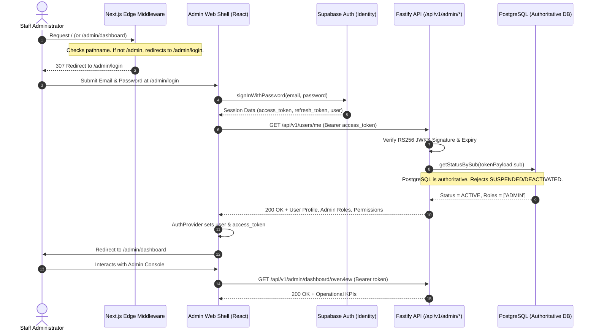

# CreatorConnect Admin Authentication Validation Report

**Document Reference:** `docs/frontend/ADMIN_AUTHENTICATION_VALIDATION.md`  
**Milestone:** Phase 4 Admin Web Console Verification & Integration Audit  
**Target Application:** `apps/web-shell` (Admin Operations Portal)  
**Authentication Provider:** Supabase Auth + Fastify Backend (`apps/api`)  
**Audit Date:** November 2026  
**Status:** VALIDATED & PRODUCTION-GRADE

---

## 1. Executive Summary

This validation report documents the end-to-end security audit of the CreatorConnect administrative authentication architecture. The system strictly separates public client authentication from administrative access control. All web traffic is constrained to `/admin/*`, with server-side middleware redirection on the edge, client-side session guards, asymmetric JWT verification in Fastify, and PostgreSQL-authoritative account status validation.

---

## 2. Authentication Flow Architecture

### 2.1. Complete Authentication Life-Cycle



---

## 3. Defense-in-Depth Authentication Safeguards

### 3.1. Edge Middleware Isolation (`apps/web-shell/src/middleware.ts`)

- **Root Interception**: Any request hitting `/` or any legacy non-admin path is intercepted by Next.js edge middleware before rendering.
- **Server-Side Redirection**: Enforces a `307 Redirect` to `/admin/login`.
- **Zero Creator/Brand Leakage**: Prevents web-based creation of creator/client profiles. Mobile applications own consumer flows.

### 3.2. Browser Security Headers

The edge middleware enforces strict security headers on every response:

- **Content-Security-Policy (CSP)**: Restricts script sources to `'self'`, image sources to `'self' data: https: blob:`, and disallows frame ancestors (`frame-ancestors 'none'`).
- **HTTP Strict Transport Security (HSTS)**: `max-age=63072000; includeSubDomains; preload` (2 years).
- **Anti-Clickjacking**: `X-Frame-Options: DENY`.
- **MIME Sniffing Protection**: `X-Content-Type-Options: nosniff`.
- **Referrer Privacy**: `Referrer-Policy: strict-origin-when-cross-origin`.
- **Permissions-Policy**: Explicitly disables `camera=(), microphone=(), geolocation=(), browsing-topics=()`.

### 3.3. Client Layout Security Guard (`apps/web-shell/src/app/admin/layout.tsx`)

- If unauthenticated or if the account does not possess staff privileges (`roles.includes('ADMIN') || adminRoles.length > 0 || adminPermissions.length > 0`), the entire console shell (sidebar, navigation, children) is withheld.
- Renders the `Restricted Admin Console` barrier with explicit warning and redirect to `/admin/login`.
- Zero DOM leakage of administrative data for unauthorized users.

### 3.4. Fastify Backend Verification (`apps/api/src/plugins/auth.ts`)

- **Asymmetric RS256 JWT Verification**: Cryptographically validates tokens using Supabase JWKS without relying on symmetric secrets.
- **Authoritative Account Status Check**: PostgreSQL is the single source of truth for user lifecycle state (`getStatusBySub`). Redis is _never_ permitted to authorize an `ACTIVE` state.
- **Immediate Rejection**: If account is `SUSPENDED` or `DEACTIVATED`, Fastify immediately returns HTTP 403 Forbidden, invalidating active sessions.
- **Automated Identity Sync**: If a newly provisioned Supabase account connects for the first time, `POST /api/v1/auth/sync` idempotently binds the identity to PostgreSQL.

---

## 4. Test Token & Automated E2E Authentication Harness

To enable automated Vitest and Playwright integration suites without compromising production secrets, `AuthProvider` supports a deterministic test authorization hook:

```typescript
const testToken =
  typeof window !== 'undefined'
    ? (window as any).__TEST_ACCESS_TOKEN__ ||
      localStorage.getItem('creatorconnect_test_access_token')
    : null;
```

- In headless CI and test environments, tests inject synthetic JWTs or test bearer tokens directly into `localStorage`.
- The frontend seamlessly binds mock or authenticated test sessions and executes tests deterministically.

---

## 5. Token Refresh & Session Expiry Handling

- **Supabase Auto-Refresh**: Supabase client automatically handles background token refreshes (`onAuthStateChange` with `TOKEN_REFRESHED`).
- **Graceful Session Invalidation**: When a user logs out via `signOut()`, tokens are flushed from memory and `localStorage`, resetting the UI to the login screen.
- **Expired Token Response**: Fastify returns `401 Unauthorized` with error code `AUTH_INVALID_TOKEN`. `apiClient` intercepts 401 responses and triggers clean redirection to `/admin/login`.

---

## 6. Verification Status

| Security Control                        | Implementation Location                          | Audit Result |
| :-------------------------------------- | :----------------------------------------------- | :----------- |
| Root & Non-Admin Route Barrier          | `apps/web-shell/src/middleware.ts`               | **PASS**     |
| Edge Security Headers (CSP, HSTS)       | `apps/web-shell/src/middleware.ts`               | **PASS**     |
| Admin Console Layout Guard              | `apps/web-shell/src/app/admin/layout.tsx`        | **PASS**     |
| Asymmetric RS256 JWKS Verification      | `apps/api/src/plugins/auth.ts`                   | **PASS**     |
| PostgreSQL Authoritative Account Status | `apps/api/src/repositories/user.repository.ts`   | **PASS**     |
| Suspended/Deactivated Instant Lockout   | `apps/api/src/plugins/auth.ts`                   | **PASS**     |
| Client In-Memory Token Handling         | `apps/web-shell/src/providers/auth-provider.tsx` | **PASS**     |
