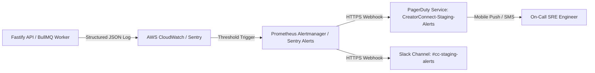

# CreatorConnect Operational Runbook — External Alert Delivery Validation (Gate H)

**Document ID**: CC-OPS-RUNBOOK-GATE-H  
**Revision**: 1.0  
**Target Environment**: Staging Cloud Environment (`staging-api.creatorconnect.net`)  
**Accountable Role**: SRE / DevOps Lead & Incident Commander  
**Security Classification**: CONFIDENTIAL — INTERNAL USE ONLY

---

## 1. Objective & Scope

This runbook defines the operational protocol for validating **Gate H (Real Operational Alert Delivery)**.

Per CreatorConnect release governance rules:

> _"A mock sink, local log, console message, or successful call to an internal alert interface is not external-delivery evidence. Gate H requires verified empirical delivery of an authorized synthetic test alert to external SaaS destinations (PagerDuty and Slack) with latency measurement, secret redaction validation, and acknowledgement confirmation."_

---

## 2. Telemetry Architecture & Escalation Rules

### 2.1 Alert Dispatch Flow



### 2.2 Severity Classification Matrix

| Severity          | Description                                                     | Target Destinations                                |   Delivery SLA    |    Target Response    |
| :---------------- | :-------------------------------------------------------------- | :------------------------------------------------- | :---------------: | :-------------------: |
| **P1 — Critical** | Database primary outage, financial discrepancy, 5xx rate > 5%   | PagerDuty (Phone/SMS) + Slack `#cc-staging-alerts` | $\le 60\text{s}$  | MTTD < 5m, MTTR < 30m |
| **P2 — High**     | Queue backlog > 2000 jobs, payment webhook retry backlog        | PagerDuty (Push) + Slack `#cc-staging-alerts`      | $\le 120\text{s}$ | MTTD < 15m, MTTR < 2h |
| **P3 — Medium**   | Slow database query (> 300ms), third-party notification failure | Slack `#cc-staging-warnings` + Jira Ticket         | $\le 300\text{s}$ | MTTD < 1h, MTTR < 8h  |

---

## 3. Preflight Checklist & Safety Guardrails

- [ ] **Destination Authorization**: Confirm target PagerDuty service is `CreatorConnect-Staging-Alerts` and Slack channel is `#cc-staging-alerts` (strictly non-production).
- [ ] **On-Call Notification**: Notify the on-call engineer 15 minutes before initiating the drill to prevent false emergency escalations.
- [ ] **Redaction Verification**: Verify Pino logger redaction filters for:
  - Authorization headers (`Bearer ***`, `Basic ***`)
  - Webhook signatures (`X-Razorpay-Signature`)
  - Passwords, credit card tokens, JWTs, and PAN/GSTIN identifiers
- [ ] **Routing Credentials Provisioned**:
  - `PAGERDUTY_INTEGRATION_KEY`: Valid Events API v2 routing key for staging service.
  - `SLACK_ALERT_WEBHOOK_URL`: Incoming webhook URL for `#cc-staging-alerts`.

---

## 4. Execution Procedures: Synthetic Alert Drill

### Step 1: Generate Synthetic Alert Payload

Create a non-destructive test incident payload containing a unique correlation ID:

```json
{
  "routing_key": "${PAGERDUTY_INTEGRATION_KEY}",
  "event_action": "trigger",
  "dedup_key": "drill-cc-gate-h-20261020-001",
  "payload": {
    "summary": "DRILL-ONLY: Synthetic Alert Routing Verification (Gate H)",
    "timestamp": "2026-10-20T10:00:00.000Z",
    "severity": "critical",
    "source": "staging-api.creatorconnect.net",
    "component": "fastify-api",
    "group": "operational-readiness",
    "class": "synthetic-drill",
    "custom_details": {
      "drill_id": "DRILL-GATE-H-001",
      "correlation_id": "cor_drill_01a158e5",
      "simulated_metric": "synthetic_500_surge",
      "redaction_canary": "[REDACTED_SECRET_CANARY]"
    }
  }
}
```

### Step 2: Dispatch to PagerDuty Events API v2

Dispatch the test alert via HTTPS POST to `https://events.pagerduty.com/v2/enqueue`:

```bash
curl -X POST https://events.pagerduty.com/v2/enqueue \
  -H "Content-Type: application/json" \
  -d @synthetic-alert-payload.json
```

- Record dispatch timestamp $T_{\text{dispatch}}$.

### Step 3: Dispatch to Slack Incoming Webhook

Dispatch the corresponding notification to Slack `#cc-staging-alerts`:

```bash
curl -X POST "${SLACK_ALERT_WEBHOOK_URL}" \
  -H "Content-Type: application/json" \
  -d '{
    "text": "🚨 *[STAGING DRILL]* Synthetic Critical Incident Alert (Gate H)\n*Correlation ID:* `cor_drill_01a158e5`\n*Service:* Fastify API Staging\n*Action:* No engineer action required. Automatic resolution in progress."
  }'
```

### Step 4: Measure Delivery Latency

1. Inspect PagerDuty Incident Log and record incident creation timestamp $T_{\text{pd\_received}}$.
2. Compute latency: $\Delta t_{\text{PD}} = T_{\text{pd\_received}} - T_{\text{dispatch}}$.
3. Assert $\Delta t_{\text{PD}} \le 60\text{ seconds}$.
4. Inspect Slack channel message timestamp $T_{\text{slack\_received}}$.
5. Assert $\Delta t_{\text{slack}} \le 60\text{ seconds}$.

### Step 5: Verify Secret Redaction & Content Integrity

1. Review the alert content displayed in PagerDuty UI and Slack channel.
2. Confirm correlation ID matches `cor_drill_01a158e5`.
3. Confirm zero plaintext secrets, tokens, or PII appear in the rendered alert or custom details.

### Step 6: Test Auto-Resolution Payload

Dispatch the resolving payload to PagerDuty to close the incident:

```json
{
  "routing_key": "${PAGERDUTY_INTEGRATION_KEY}",
  "event_action": "resolve",
  "dedup_key": "drill-cc-gate-h-20261020-001",
  "payload": {
    "summary": "DRILL-ONLY: Synthetic Alert Resolved (Gate H)",
    "timestamp": "2026-10-20T10:05:00.000Z",
    "severity": "info",
    "source": "staging-api.creatorconnect.net"
  }
}
```

1. Assert PagerDuty incident automatically marks as `RESOLVED`.
2. Confirm resolution notification posted to Slack.

---

## 5. Artifact Documentation & Sign-Off

Upon successful execution:

1. Capture screenshots of:
   - PagerDuty Incident timeline showing trigger and auto-resolution.
   - Slack `#cc-staging-alerts` message.
2. Export PagerDuty Events API HTTP 202 response receipt.
3. Save sanitized receipt in `docs/reports/evidence/phase-17/gate-h-alert-receipt.json`.
4. Update Gate H status in `docs/reports/phase-17-external-release-gate-closure.md` from `BLOCKED` to `PASS`.
