# CreatorConnect Operational Runbook — Live Razorpay Sandbox Webhook Validation (Gate G)

**Document ID**: CC-OPS-RUNBOOK-GATE-G  
**Revision**: 1.0  
**Target Environment**: Staging Cloud Environment (`staging-api.creatorconnect.net`)  
**Accountable Role**: Payment Operations Lead & Staff Backend Engineer  
**Security Classification**: CONFIDENTIAL — INTERNAL USE ONLY

---

## 1. Objective & Scope

This runbook specifies the step-by-step procedure to execute, record, and verify **Gate G (Live Payment Gateway Sandbox Webhook & Financial Reconciliation)**.

Per CreatorConnect release governance rules:

> _"A local mock or synthetic HTTP request alone does not close Gate G. The gate is satisfied only when real provider-generated sandbox webhooks from Razorpay test servers are delivered over public HTTPS to an authorized staging endpoint, securely verified, processed idempotently, and reconciled against the double-entry ledger."_

---

## 2. Architecture & Security Invariants

### 2.1 Webhook Ingestion Architecture

```mermaid
flowchart LR
    RZP[Razorpay Sandbox Servers] -->|HTTPS POST| CF[Cloudflare Edge / AWS ALB]
    CF -->|TLS Terminated| FASTIFY[Fastify Core API]
    FASTIFY -->|HMAC-SHA256 Timing-Safe| VERIFY[Signature Verifier]
    VERIFY -->|Idempotency Check| INBOX[Idempotency Record Store]
    INBOX -->|State Transition| DOMAIN[Payment Service]
    DOMAIN -->|Prisma $transaction| PG[(PostgreSQL Aurora)]
    PG --> LEDGER[Double-Entry Ledger]
```



### 2.2 Security & Financial Invariants

1. **Raw Body Integrity**: Signature validation requires the exact raw byte stream received over HTTP. Any middleware payload parsing or formatting prior to HMAC computation invalidates the signature.
2. **Timing-Safe Comparison**: HMAC comparison must use `crypto.timingSafeEqual` to eliminate side-channel timing attacks.
3. **Fail-Closed on Secret Missing**: If `RAZORPAY_WEBHOOK_SECRET` is unset or empty, the endpoint must reject all requests with HTTP 400 `INVALID_WEBHOOK_SIGNATURE`.
4. **Idempotency Guarantee**: Delivery of identical `event_id` must return HTTP 200 OK without re-executing state machine transitions or ledger postings.
5. **No Platform Fund Custody**: All fund flows must conform to RBI Payment Aggregator Guidelines (DPSS.CO.PD.No.1810/02.14.008/2019-20). The platform maintains an authoritative mirror ledger while settlement occurs via PA nodal accounts.

---

## 3. Preflight Checklist & Prerequisites

Before initiating the validation drill, confirm the following prerequisites:

- [ ] **Public Staging Endpoint**: Active public HTTPS domain `https://staging-api.creatorconnect.net` with valid TLS certificate (Let's Encrypt / Cloudflare SSL).
- [ ] **Razorpay Sandbox Merchant Account**: Authorized access to Razorpay Test Dashboard (`https://dashboard.razorpay.com/app/test/`).
- [ ] **Webhook Endpoint Registration**: Route registered in Razorpay Dashboard:
  - **Webhook URL**: `https://staging-api.creatorconnect.net/api/v1/payments/webhooks/RAZORPAY`
  - **Active Events**: `payment.captured`, `payment.failed`, `order.paid`, `refund.processed`, `refund.created`
  - **Secret**: Loaded securely from AWS Secrets Manager (`creatorconnect/staging/app` -> `RAZORPAY_WEBHOOK_SECRET`).
- [ ] **Logging Redaction Active**: Confirm that Fastify Pino logger redacts `x-razorpay-signature`, authorization headers, and customer PII.
- [ ] **Target Database Ready**: Confirm Staging PostgreSQL Aurora instance has migration history applied through `0008_reviews_and_reputation`.

---

## 4. Execution Procedures: 10 Mandatory Sandbox Scenarios

Execute each of the following 10 test scenarios and record the empirical outcome:

### Scenario 1: Valid Supported Payment Event (`payment.captured`)

1. Create a test order via `POST /api/v1/payments/intents` from the staging frontend.
2. Complete test checkout in the Razorpay sandbox modal using a standard test card (e.g., OTP `123456`).
3. Verify Razorpay dispatches `payment.captured`.
4. Assert:
   - Staging Fastify access log shows `POST /api/v1/payments/webhooks/RAZORPAY` -> `HTTP 200 OK`.
   - Payment intent status transitions from `PROCESSING` to `SUCCEEDED`.
   - Matching debit and credit entries are posted to `ledger_entries`.

### Scenario 2: Invalid Webhook Signature

1. Dispatch a synthetic request using curl with an altered `X-Razorpay-Signature`:
   ```bash
   curl -X POST https://staging-api.creatorconnect.net/api/v1/payments/webhooks/RAZORPAY \
     -H "Content-Type: application/json" \
     -H "X-Razorpay-Signature: forged_signature_hex_digest" \
     -d '{"event":"payment.captured","payload":{"payment":{"entity":{"id":"pay_test_01"}}}}'
   ```
2. Assert:
   - Fastify rejects with RFC 7807 problem details: HTTP 400 `INVALID_WEBHOOK_SIGNATURE`.
   - Zero state changes or ledger mutations in database.

### Scenario 3: Malformed JSON Payload

1. Send an HTTP POST with broken JSON bytes (`{ event: "payment.captured", `) and a valid HMAC calculated over those broken bytes.
2. Assert:
   - Fastify rejects with HTTP 400 `BAD_REQUEST` (`Malformed Razorpay webhook payload`).
   - Zero side-effects.

### Scenario 4: Duplicate Delivery of Same Event ID

1. Use the Razorpay Dashboard "Resend Webhook" button to re-deliver the exact `payment.captured` event from Scenario 1.
2. Assert:
   - Fastify returns cached HTTP 200 OK within $< 50\text{ms}$.
   - Query `ledger_entries` for the corresponding `payment_id`: count of entries must remain identical to Scenario 1 (zero duplicate ledger rows).

### Scenario 5: Concurrent Duplicate Delivery

1. Dispatch two identical webhook requests simultaneously using `ab` (ApacheBench) or parallel curl processes:
   ```bash
   # Parallel curl invocations with identical body and signature
   ```
2. Assert:
   - Exactly one worker/thread claims the idempotency lock.
   - Both requests terminate with HTTP 200 OK.
   - Double-entry ledger reflects exactly one transaction.

### Scenario 6: Provider Retry After Transient 503

1. Temporarily enable maintenance mode on the Fastify route, causing Razorpay to receive HTTP 503.
2. Allow Razorpay webhook retry engine to resend the notification (exponential retry).
3. Disable maintenance mode.
4. Assert:
   - Retried webhook succeeds with HTTP 200 OK.
   - Payment state reconciles without discrepancy.

### Scenario 7: Unsupported Event Type

1. Configure Razorpay Dashboard to send an unhandled event (e.g., `subscription.charged` or `invoice.paid`).
2. Assert:
   - Handler acknowledges with HTTP 200 OK to prevent provider retry storms.
   - Log records informational message `Ignored unsupported event type`.
   - Zero database mutations.

### Scenario 8: Out-of-Order State Transition

1. Inject a `refund.processed` event for a payment intent currently in `REQUIRES_PAYMENT_METHOD` state (prior to `SUCCEEDED`).
2. Assert:
   - State machine rejects the transition as invalid (`INVALID_PAYMENT_STATE_TRANSITION`).
   - Webhook returns HTTP 409 or records to Dead-Letter Queue (DLQ).
   - Alert emitted to SRE monitoring.

### Scenario 9: Replay of Already Processed Event

1. Capture raw payload and signature from an event processed $> 24\text{ hours}$ earlier.
2. Resend to webhook endpoint.
3. Assert:
   - Idempotency service recognizes historical event ID.
   - Endpoint responds HTTP 200 OK without re-posting ledger entries.

### Scenario 10: Financial Ledger Post-Drill Reconciliation

1. Execute the automated double-entry ledger balance query:
   ```sql
   SELECT direction, count(*), sum(amount)
   FROM ledger_entries
   GROUP BY direction;
   ```
2. Assert:
   - $\sum \text{Credits} - \sum \text{Debits} = 0 \text{ paise}$.
   - No orphaned or unbalanced ledger transactions.

---

## 5. Artifact Documentation & Sign-Off

Upon completion of all 10 scenarios:

1. Export the Razorpay Dashboard Webhook Delivery History (CSV/PDF).
2. Export the staging API access logs with redacted headers.
3. Export the PostgreSQL ledger reconciliation query result.
4. Place the signed validation report in `docs/reports/evidence/phase-17/gate-g-razorpay-receipt.json`.
5. Update Gate G status in `docs/reports/phase-17-external-release-gate-closure.md` from `BLOCKED` to `PASS`.
