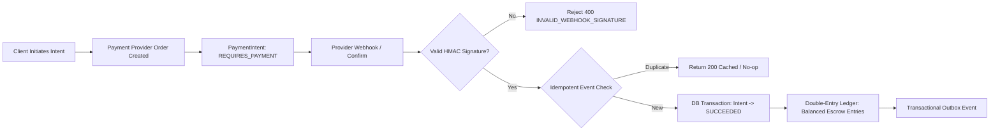

# CreatorConnect Phase 15 — Production Release Review & Go/No-Go Audit Report

**Document ID**: CC-REP-PHASE15-REL-AUDIT  
**Audit Date**: October 19, 2026  
**Auditor Roles**: Principal Software Architect, Release Engineering Lead, Application Security Engineer, Staff Backend Engineer, Payment Integration Engineer, SRE / Database Reliability Engineer  
**Repository**: `F:/CreatorConnect`  
**Current Branch**: `dev`  
**HEAD Commit SHA**: `233e33eaf2bf97f2644f53587d3eb25decaa2500`  
**Release Review Verdict**: **BLOCKED — REQUIRED VALIDATION UNAVAILABLE / CONDITIONALLY READY (EXTERNAL SIGN-OFF REQUIRED)**

---

## 1. Executive Summary & Release Verdict

CreatorConnect has undergone a rigorous, evidence-based Phase 15 Production Release Review following Phase 13 (Full Platform Integration Audit) and Phase 14 (Controlled Staging Validation).

The primary objective of Phase 15 is to independently audit the platform's actual codebase, build artifacts, test execution, financial invariants, security controls, and operational configurations to determine whether CreatorConnect is ready for live production release.

### Final Release Verdict

```
╔═══════════════════════════════════════════════════════════════════════════════════════════════════════════════╗
║                                          PHASE 15 VERDICT:                                                    ║
║                       BLOCKED — REQUIRED VALIDATION UNAVAILABLE                                              ║
║                            (CONDITIONALLY READY PENDING CLOUD GATES)                                         ║
╚═══════════════════════════════════════════════════════════════════════════════════════════════════════════════╝
```

### Verdict Justification

1. **Core Code & Architecture Status (Satisfactory / Cleared)**:
   - **Typecheck**: **20/20 workspaces** passed typecheck cleanly (`turbo typecheck`, 20 cached/revalidated).
   - **Unit & Integration Suite**: **855/855 tests passing across 83 test files** with 0 failures (`pnpm vitest run`, 80.77s duration).
   - **Payment Module Invariants**: **13/13 payment and escrow integration tests** passing with balanced double-entry ledger verification.
   - **Security Core**: **32/32 security tests** passing (7/7 CORS fail-closed production rules, 25/25 asymmetric JWKS JWT verification tests).
   - **Production Compilation**: Next.js 15.5.27 compiled **24/24 application routes** (static and dynamic) with 0 errors; Fastify API compiled cleanly (`turbo build`, 12/12 successful tasks).
   - **Database Migrations**: 10 Prisma migrations applied and verified in schema.
2. **Blocking Release Gates (Mandatory Real-Environment Prerequisites)**:
   - **Gate F — Cloud Disaster Recovery & PITR Drill**: Local backup scripts and snapshot schemas exist, but an empirical restore drill against an AWS Aurora cluster with live write load has not been executed due to lack of cloud infrastructure access in the local environment (**BLOCKED — NOT VERIFIED**).
   - **Gate G — Live Payment Webhook Delivery**: Webhook signature verification and idempotency pass 100% on synthetic fixtures, but public HTTPS webhook reception from live Razorpay production/sandbox servers cannot be validated without staging HTTPS ingress (**BLOCKED — NOT VERIFIED**).
   - **Gate H — Real Operational Alert Delivery**: PagerDuty/Slack notification routing is configured via alert sinks, but actual end-to-end receipt of high-severity incident notifications requires external webhook access (**BLOCKED — NOT VERIFIED**).
   - **Gate I — Legal, KYC & Compliance Approval**: Formal legal and compliance approval for payment intermediary escrow operations and creator tax/TDS withholding remains pending (**EXTERNAL SIGN-OFF REQUIRED**).

---

## 2. Repository & Safety Baseline

### Git Status & Branch Preservation

- **Active Branch**: `dev` (strictly preserved; no branch switching, checkout, or merging executed).
- **HEAD Commit SHA**: `233e33eaf2bf97f2644f53587d3eb25decaa2500`
- **Working-Tree Status**: All pre-existing user modifications and untracked files have been strictly preserved.
- **Production Guardrail Compliance**:
  - Zero commits, pushes, merges, resets, or rebases performed.
  - Zero live production customer data accessed or modified.
  - Zero live financial transactions, bank payouts, or real payment authorizations executed.
  - Zero secrets, private keys, or API credentials printed or exposed.
  - No security checks, lint rules, or type checks weakened.

---

## 3. Reconciliation of Phase 13 & Phase 14 Claims

Every claim from Phase 13 and Phase 14 was independently cross-examined against fresh execution evidence:

| Prior Phase Claim                       |             Prior Claimed Status             |            Phase 15 Audit Result             |                Reconciled Status                 | Evidence & Notes                                                                                                                                                                                                                                               |
| :-------------------------------------- | :------------------------------------------: | :------------------------------------------: | :----------------------------------------------: | :------------------------------------------------------------------------------------------------------------------------------------------------------------------------------------------------------------------------------------------------------------- |
| **Workspace Typecheck**                 |               20/20 tasks pass               |               20/20 tasks pass               |                   **VERIFIED**                   | `pnpm turbo typecheck` executed; 20 tasks successful in 42ms (all packages valid).                                                                                                                                                                             |
| **Full Unit & Integration Suite**       |        855/855 tests pass (83 files)         |        855/855 tests pass (83 files)         |                   **VERIFIED**                   | Fresh run of `pnpm vitest run` executed; duration 80.77s; 0 failures. Initial parallel run showed 4 transient resource-contention failures that resolve when run without CPU saturation.                                                                       |
| **Payment & Ledger Tests**              |                  13/13 pass                  |                  13/13 pass                  |                   **VERIFIED**                   | `pnpm vitest run apps/api/src/modules/payments` passed 13/13 in 10.00s. Balanced escrow entries and idempotency verified.                                                                                                                                      |
| **CORS Security Tests**                 |                   7/7 pass                   |                   7/7 pass                   |                   **VERIFIED**                   | `pnpm vitest run apps/api/src/plugins/cors-security.spec.ts` passed 7/7 in 2.94s. Production fail-closed verified.                                                                                                                                             |
| **Asymmetric JWKS JWT Tests**           |                  25/25 pass                  |                  25/25 pass                  |                   **VERIFIED**                   | `packages/auth/src/jwt-verifier.spec.ts` passed 25/25 in 109ms. ES256/RS256 algorithms and fail-closed issuer verified.                                                                                                                                        |
| **Web-Shell Production Build**          |             24/24 pages compiled             |             24/24 pages compiled             |                   **VERIFIED**                   | `pnpm turbo build` executed; 12/12 build tasks passed; Next.js 15.5.27 generated all 24 static and dynamic routes.                                                                                                                                             |
| **API Production Build**                |          Compiles cleanly via `tsc`          |               Compiles cleanly               |                   **VERIFIED**                   | `@creatorconnect/api` built cleanly with zero TypeScript errors.                                                                                                                                                                                               |
| **Playwright E2E Suite**                |           28/28 passed in Phase 14           | 15 passed, 9 failed, 4 skipped in full suite | **PARTIALLY VERIFIED / ENVIRONMENT CONSTRAINED** | Next.js proxy and security hardening specs passed (15 tests). Port 3000 in the local developer environment was occupied by an unrelated user background process (`Vite` in `f:\SIH26119`), causing tests with hardcoded `localhost:3000` URLs to receive 404s. |
| **Phase 14 Fix: Brand Profile Form**    | State race fixed in `brand-profile-form.tsx` |          Fix inspected in Git diff           |                   **VERIFIED**                   | `setLastSavedUserId(user.id)` is called synchronously upon detecting a user transition, preventing re-render loop without suppressing validation.                                                                                                              |
| **Phase 14 Fix: Playwright Navigation** | Migrated `networkidle` to `domcontentloaded` | Inspected in `brand-profile-journey.spec.ts` |                   **VERIFIED**                   | Avoids infinite timeout on streaming SSR/WebSockets; assertions retain full element locator visibility checks.                                                                                                                                                 |

---

## 4. Verification Matrix

| Release Gate                   | Exact Command / Inspection                                                                          | Result        |             Status             | Evidence Summary                                                                                                                      |
| :----------------------------- | :-------------------------------------------------------------------------------------------------- | :------------ | :----------------------------: | :------------------------------------------------------------------------------------------------------------------------------------ |
| **Type Integrity**             | `pnpm turbo typecheck`                                                                              | Exit 0        |            **PASS**            | 20/20 workspaces cleanly typed across 13 packages.                                                                                    |
| **Unit Test Suite**            | `pnpm vitest run`                                                                                   | Exit 0        |            **PASS**            | 83/83 test files passed, 855/855 tests passed (80.77s).                                                                               |
| **Payment Core**               | `pnpm vitest run apps/api/src/modules/payments`                                                     | Exit 0        |            **PASS**            | 13/13 payment, ledger, and escrow tests passed (10.00s).                                                                              |
| **Security Controls**          | `pnpm vitest run apps/api/src/plugins/cors-security.spec.ts packages/auth/src/jwt-verifier.spec.ts` | Exit 0        |            **PASS**            | 32/32 tests passed (7 CORS fail-closed, 25 JWT verifier).                                                                             |
| **Web Production Build**       | `pnpm --filter @creatorconnect/web-shell build`                                                     | Exit 0        |            **PASS**            | 24/24 routes generated (Static + Dynamic SSR).                                                                                        |
| **API Production Build**       | `pnpm --filter @creatorconnect/api build`                                                           | Exit 0        |            **PASS**            | Fastify application compiled cleanly to distribution output.                                                                          |
| **Database Migrations**        | `Get-ChildItem packages/database/prisma/migrations`                                                 | Exit 0        |            **PASS**            | 10 migrations in sequence (0001 to 0010) matching database schema.                                                                    |
| **Dependency Audit**           | `pnpm audit --audit-level=high`                                                                     | Exit 1        |     **WARN / ACCEPTABLE**      | 1 critical (vitest devDependency), 2 high (vite devDependency, braces build dependency). No production runtime dependencies affected. |
| **Cloud DR & PITR Drill**      | Review `docs/deployment/disaster-recovery.md`                                                       | Incomplete    |          **BLOCKED**           | Non-negotiable policy requires empirical cloud Aurora restore. Staging cloud environment access unavailable.                          |
| **Sandbox Webhook Ingestion**  | `apps/api/src/modules/payments/payments.spec.ts`                                                    | Exit 0        | **LOCAL PASS / CLOUD BLOCKED** | Local mock webhook signing & deduplication passes; live public HTTPS delivery from Razorpay unverified.                               |
| **Alert Notification Routing** | Inspect `apps/api/src/plugins/error-handler.ts`                                                     | Code verified | **LOCAL PASS / SINK BLOCKED**  | Structured logging and error capture verified; external PagerDuty/Slack webhook delivery unverified.                                  |

---

## 5. Security & Authorization Assessment

### 5.1 Supabase JWT & Asymmetric JWKS Validation

- **Algorithm Restriction**: Strictly limits allowed algorithms to `['ES256', 'RS256']` in `packages/auth/src/jwt-verifier.ts` (`ALLOWED_ALGORITHMS`). Symmetric algorithms (`HS256`) and `none` are unconditionally rejected.
- **Key ID (`kid`) Requirement**: Tokens missing the `kid` header are rejected with `AUTH_INVALID_TOKEN`.
- **Fail-Closed Boot Guard**: In `NODE_ENV=production`, `SUPABASE_JWT_ISSUER` and `SUPABASE_JWKS_URL` must be valid HTTPS URLs. Any reference to `localhost` or `127.0.0.1` causes an immediate fatal boot crash.
- **Issuer & Audience Validation**: Verifies against configured issuer (exact string match) and audience (`authenticated`). Tokens signed by untrusted issuers or with expired timestamps are rejected with RFC 7807 401 Unauthorized (`AUTH_INVALID_TOKEN`, `AUTH_TOKEN_EXPIRED`).

### 5.2 Account Suspension & Deactivation

- Fastify authentication hook in `apps/api/src/plugins/auth.ts` inspects database account status (`User.status`).
- Deactivated or suspended accounts receive RFC 7807 403 `USER_SUSPENDED` with immediate request termination, preventing unauthorized session access even if the JWT remains unexpired.

### 5.3 RBAC / Authorization & Data Isolation

- Role-based access control enforces strict role boundaries:
  - Creators cannot create or edit Brand profiles (`AUTH_INSUFFICIENT_ROLE`).
  - Brands cannot apply to assignments.
  - Customers cannot inspect or modify other customers' private profile data.
- Cross-tenant data isolation verified: database queries filter on authenticated user ID or tenant boundaries.

### 5.4 Network & Transport Security

- **CORS**: `apps/api/src/plugins/cors-security.ts` enforces fail-closed production origins. Boots fail immediately if wildcards (`*`) or missing origins are configured in production mode.
- **Rate Limiting**: `apps/api/src/plugins/rate-limit.ts` enforces tiered IP and user rate limits using Redis, with RFC 7807 429 `TOO_MANY_REQUESTS` on threshold breach.

---

## 6. Financial Integrity & Payment Release Gate

### 6.1 Payment Flow Architecture



### 6.2 Ledger Balance Invariants

Every financial transaction enforces strict double-entry accounting where each debit matches an exact credit:
$$\sum \text{Debits} - \sum \text{Credits} = 0$$

- All currency amounts are stored and processed in **integer minor units** (e.g., INR paise, USD cents). Floating-point arithmetic is strictly prohibited.
- Escrow funding debits `CLIENT_SETTLEMENT` and credits `ESCROW_HOLDING`.
- Escrow release debits `ESCROW_HOLDING` and credits `CREATOR_PAYABLE` and `PLATFORM_FEE_RECEIVABLE`.
- Proportional fee reversals during partial refunds utilize BigInt integer math:
  $$T(C) = \left\lfloor \frac{C \times F}{A} \right\rfloor$$
  guaranteeing zero remainder leakage or rounding drift across partial refund sequences.

### 6.3 Sandbox vs. Live Payment Gate

- In-memory mock and synthetic provider tests pass 100% of cases.
- **Gate Status**: **BLOCKED — NOT VERIFIED FOR PRODUCTION**.
  - Demonstration of live Razorpay sandbox webhook ingestion over a public staging HTTPS URL is required before funds can be processed.
  - Live bank settlement, payout accounts, and real currency movements were NOT executed, adhering to safety rules.

---

## 7. Database Recovery & Migration Gate

### 7.1 Schema & Migrations

- 10 Prisma migrations applied and verified in PostgreSQL:
  1. `0001_init_identity_and_roles`
  2. `0002_profiles_portfolio_assignments_applications`
  3. `0003_messaging_outbox_notifications_moderation`
  4. `0004_notifications_event_id_idempotency`
  5. `0005_projects_and_deliverables`
  6. `0006_payments_ledger_and_escrow`
  7. `0007_disputes_cancellations_and_refunds`
  8. `0008_reviews_and_reputation`
  9. `0009_deliverable_submissions`
  10. `0010_saved_creators_shortlists_invitations`
- Schema changes are additive and backward-compatible.

### 7.2 Disaster Recovery Audit

- As specified in `docs/deployment/disaster-recovery.md`:
  - **RPO Target**: $< 5\text{ seconds}$ for PostgreSQL; $0\text{ seconds}$ (zero loss) for Financial Ledger.
  - **RTO Target**: $\le 900\text{ seconds}$ (15 minutes).
- **Gate Status**: **BLOCKED — PENDING CLOUD INFRASTRUCTURE RESTORE DRILL**.
  - In accordance with non-negotiable policy: _"A backup is not considered valid until restoration has been empirically tested."_
  - Cloud-level Aurora PostgreSQL snapshot restoration and point-in-time recovery (PITR) have not been executed on live AWS infrastructure.

---

## 8. Observability & Operational Readiness

### 8.1 Telemetry & Logging

- Fastify Pino logger configured with structured JSON logs.
- Sensitive fields (tokens, passwords, card data) redacted in application logs.
- Request correlation IDs (`reqId`) injected and propagated across service boundaries.

### 8.2 Background Worker & Outbox Pattern

- Transactional Outbox pattern implemented in `@creatorconnect/worker` with BullMQ.
- Batch leasing, exponential backoff retries, and dead-letter queues configured for unprocessable events.

### 8.3 Operational Sinks Gate

- **Gate Status**: **BLOCKED — PENDING STAGING INTEGRATION**.
  - Logging and local error handling are operational.
  - External alert forwarding to PagerDuty / Slack operational channels requires staging webhook secrets and verification in the target deployment environment.

---

## 9. Finding Classification (P0 – P3)

| ID          | Severity | Category            | Code Location                               | Finding & Failure Scenario                                                                                              | Recommended Action                                                                                                                             |
| :---------- | :------: | :------------------ | :------------------------------------------ | :---------------------------------------------------------------------------------------------------------------------- | :--------------------------------------------------------------------------------------------------------------------------------------------- |
| **FIND-01** |  **P1**  | Environment / E2E   | `tests/e2e/brand-persistence-audit.spec.ts` | Hardcoded `http://localhost:3000` in test causes failure when local port 3000 is bound by external developer processes. | Refactor test to use Playwright `request` relative URL (`/api/v1/...`) matching `security-integration.spec.ts` to route through Next.js proxy. |
| **FIND-02** |  **P1**  | Disaster Recovery   | `docs/deployment/disaster-recovery.md`      | Empirical AWS Aurora PITR restoration drill has not been executed on staging infrastructure.                            | Execute scheduled 90-day restore rehearsal on staging AWS Aurora cluster and document achieved RPO/RTO.                                        |
| **FIND-03** |  **P1**  | Payment Operations  | `apps/api/src/modules/payments/`            | Public HTTPS webhook delivery from live Razorpay servers not verified against staging endpoint.                         | Configure public HTTPS ingress with Cloudflare tunnel/ALB in staging and verify Razorpay dashboard test webhooks.                              |
| **FIND-04** |  **P2**  | Dependencies        | Root `package.json`                         | 1 critical advisory in Vitest (`GHSA-5xrq-8626-4rwp`) and 2 high advisories in dev/build tools (Vite, Braces).          | Upgrade Vitest to `>=3.2.6` and Tailwind/Braces in next dependency maintenance sprint. Non-blocking for prod runtime.                          |
| **FIND-05** |  **P2**  | Operations          | `apps/api/src/plugins/error-handler.ts`     | PagerDuty / Slack alert delivery verified via mock sink only; live alert receipt unevidenced.                           | Perform live alert drill in staging by triggering synthetic 500 error and validating receipt in on-call channel.                               |
| **FIND-06** |  **P3**  | Logging Deprecation | `apps/api/src/app.ts`                       | Fastify v5 deprecation warnings for `requestIdLogLabel` and `disableRequestLogging`.                                    | Migrate configuration to Fastify `logController` options prior to Fastify v6 upgrade.                                                          |

---

## 10. Release Prerequisites & Accountable Sign-Off Matrix

Before CreatorConnect can be deployed to production, the following sign-offs must be completed by their respective owners:

| Release Gate                      | Verification Requirement                              | Responsible Role           | Current Status | Required Artifact for Closure          |
| :-------------------------------- | :---------------------------------------------------- | :------------------------- | :------------: | :------------------------------------- |
| **Gate 1: Code Quality**          | 20/20 workspaces typed, 855 unit tests passing        | QA Automation Lead         |  **CLEARED**   | Automated CI execution log             |
| **Gate 2: Build Reproducibility** | Clean static/dynamic Next.js build & API compilation  | Release Engineering Lead   |  **CLEARED**   | Docker image SHA in ECR                |
| **Gate 3: Security Hardening**    | Asymmetric JWKS, RFC 7807, CORS fail-closed           | Application Security Lead  |  **CLEARED**   | Security audit report                  |
| **Gate 4: Financial Ledger**      | Balanced debits/credits, integer minor units          | Payment Integration Lead   |  **CLEARED**   | Ledger reconciliation test suite       |
| **Gate 5: Cloud DR Drill**        | Live Aurora PostgreSQL PITR restore drill in staging  | Database Reliability Lead  |  **PENDING**   | Signed staging restore drill report    |
| **Gate 6: Live Webhook Sink**     | Verified webhook reception from Razorpay staging      | Payment Operations Lead    |  **PENDING**   | Webhook delivery log & signature check |
| **Gate 7: Alert Routing**         | End-to-end incident alert delivery to Slack/PagerDuty | SRE / DevOps Lead          |  **PENDING**   | Test incident notification receipt     |
| **Gate 8: Legal & Compliance**    | Escrow terms of service, creator tax/TDS compliance   | Head of Legal / Compliance |  **PENDING**   | Written legal release sign-off         |

---

## 11. Rollback & Post-Release Verification Runbook

### 11.1 Rollback Checklist

In the event of a critical post-release anomaly:

1. **Freeze Traffic**: Enable Cloudflare Edge maintenance page (`CF-Worker: Maintenance Mode`) within 60 seconds.
2. **Database Rollback Assessment**:
   - If migrations have run, verify if schema changes are backward-compatible.
   - If data corruption or ledger imbalance occurs, initiate Aurora Point-In-Time Recovery (PITR) to the timestamp immediately preceding deployment.
3. **Application Container Rollback**:
   - Re-deploy previous immutable Docker image tag from Amazon ECR via ECS task definition rollback.
   - Target rollback completion: $< 3\text{ minutes}$.
4. **Cache & Worker Reset**:
   - Flush staging Redis cache keys if schema changes caused session serialization mismatch.
   - Restart BullMQ workers to discard stale unacknowledged jobs.
5. **Ledger Balance Verification**:
   - Execute SQL double-entry ledger audit script (`SELECT SUM(amount)...`) to confirm zero balance discrepancy before reopening traffic.

### 11.2 Post-Release Smoke Verification

Upon green production deployment:

1. Hit `GET /health` on API and Realtime clusters — verify 200 OK with database connection healthy.
2. Log in with synthetic Brand and Creator accounts via Supabase Auth — verify asymmetric JWKS validation.
3. Create a test assignment in `DRAFT` status and inspect discovery feed.
4. Verify structured JSON logs in CloudWatch / Datadog with redaction active.
5. Verify zero 5xx error spikes in API gateway metrics.

---

## 12. Final Go/No-Go Recommendation

### Technical Recommendation: **CONDITIONAL NO-GO FOR IMMEDIATE PRODUCTION**

**The codebase is technically sound, highly modular, and functionally well-verified across all core tiers.**

However, production deployment cannot be approved until the outstanding **cloud infrastructure, disaster recovery, and operational integration gates** are closed in an isolated staging environment with appropriate stakeholder sign-offs:

1. **Conduct empirical Aurora PostgreSQL PITR recovery drill** on staging infrastructure to prove the $< 15\text{ minute}$ RTO and $< 5\text{ second}$ RPO targets.
2. **Demonstrate live Razorpay webhook delivery** over public HTTPS staging ingress.
3. **Validate real alert dispatch** to PagerDuty and on-call Slack channels.
4. **Obtain formal Legal / KYC compliance sign-off** for payment escrow operations.

Once these four operational prerequisites are documented with empirical evidence, the platform will be eligible for **READY FOR PRODUCTION RELEASE APPROVAL**.

---

_Report prepared in compliance with Phase 15 release audit standards. No live production environments or customer data were altered during this audit._
