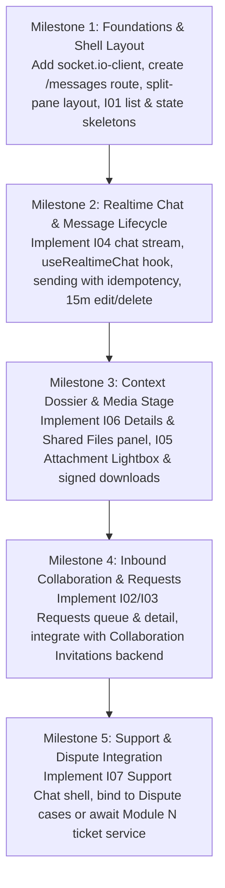

# CreatorConnect — Module I: Messaging & Conversations

## Phase 19A — Stitch-Driven UI Audit, Dependency Verification & Implementation Planning

> **Execution Mode**: READ-ONLY DISCOVERY AND PLANNING ONLY  
> **Evaluation Date**: October 23, 2026  
> **Repository**: `F:/CreatorConnect`  
> **Branch**: `dev`  
> **HEAD Commit**: `a30507fe3d7a7441d0629c2f35b8c8605c32f7e2`  
> **Google Stitch Project**: [2099946051330856584](https://stitch.withgoogle.com/projects/2099946051330856584)  
> **Final Verdict**: **READY FOR IMPLEMENTATION PLAN APPROVAL** (Zero code or configuration mutations made)

---

## 1. Executive Summary

Phase 19A conducts a disciplined, read-only discovery, Stitch-driven UI/UX audit, backend and realtime infrastructure verification, and screen-by-screen implementation planning for **Module I: Messaging & Conversations**.

### Key Findings

1. **Google Stitch Screen Truth**: Authoritative inspection of Google Stitch project `2099946051330856584` confirms exactly **eight (8) screen entries** under Module I. However, structural DOM analysis confirms that these 8 entries represent **five (5) distinct route/view architectures**, not eight disparate pages:
   - **I01 Hub & I01 Inbox** represent the **Populated** vs **Empty/Error/Offline State** canvases of the same split-pane desktop layout (`/messages`).
   - **I02 Requests & I03 Request Detail** represent the inbound collaboration/message request queue and individual request assessment canvas (`/messages/requests` & `/messages/requests/[id]`).
   - **I04 Chat** is the active real-time messaging stream (`/messages/[id]`).
   - **I05 Attachment Viewer** is an in-app media stage and lightbox drawer (`/messages/[id]?attachment=[id]`).
   - **I06 Conversation Details & Shared Files** is a contextual thread dossier, shared files repository, and safety settings drawer.
   - **I07 Support Chat** is a dedicated escalation channel linking messaging to platform support and dispute cases (`/messages/support/[ticketId]`).
2. **Current Frontend Status**: The Next.js web-shell (`apps/web-shell/src/app`) currently has **zero (0) messaging routes or chat components**. It possesses the foundational layout shell, `@creatorconnect/ui` component primitives, `@creatorconnect/design-system` Tailwind presets, and `@supabase/ssr` / JWT session management in `AuthProvider`.
3. **Backend & Realtime Status**: Substantial, enterprise-grade messaging and realtime infrastructure already exists and passes tests:
   - `apps/api/src/modules/messaging` provides keyset-paginated message history, send with client idempotency and rate limiting (30 msg/min), 15-minute edit windows, soft-deletion, read pointers, bidirectional user blocks, abuse reporting, and signed attachment downloads with audit logging.
   - `apps/realtime` provides a multi-process Socket.IO cluster backed by Redis Pub/Sub, enforcing connection authentication, room participation checks, and instant bidirectional socket eviction across cluster nodes on block creation.
4. **Architectural Gaps Requiring Product Alignment**:
   - **Message Requests Gap**: The database schema currently has no standalone `MessageRequest` model. Inbound project proposals currently route through `Invitation` in `apps/api/src/modules/collaboration` (`/api/v1/invitations`). We recommend mapping Stitch I02/I03 to the verified `Invitation` backend service rather than building redundant duplicate database models.
   - **Support Chat Gap**: Stitch I07 references `#SUP-` tickets and Module N support dossier. The current backend provides formal dispute cases (`/api/v1/disputes`), but no generic `#SUP-` support ticket chat model.
   - **Participant Mute Duration**: The schema has `mutedUntil` on `ConversationParticipant`, but no API endpoint currently exposes muting.
5. **Dependency Requirement**: `apps/web-shell/package.json` must declare `socket.io-client@^4.7.5` (already locked in `pnpm-lock.yaml` and used in `apps/realtime`). No other external dependencies are required.

---

## 2. Repository Baseline & Git Safety Confirmation

The repository was inspected strictly in read-only mode prior to analysis:

| Property                  | Verified Value                                                                                                                                   | Compliance Note                                 |
| ------------------------- | ------------------------------------------------------------------------------------------------------------------------------------------------ | ----------------------------------------------- |
| **Repository Root**       | `F:\CreatorConnect`                                                                                                                              | Verified                                        |
| **Git Branch**            | `dev`                                                                                                                                            | Matches expected branch; no switching performed |
| **HEAD Commit**           | `a30507fe3d7a7441d0629c2f35b8c8605c32f7e2`                                                                                                       | Verified clean against remote                   |
| **Remote Origin**         | `https://github.com/AtharvanJaiswal/CreatorConnect.git`                                                                                          | Verified without credential disclosure          |
| **Tracked Modifications** | 5 files (`apps/api/src/routes/health.spec.ts`, `apps/api/src/routes/health.ts`, `apps/web-shell/package.json`, `package.json`, `pnpm-lock.yaml`) | Preserved exactly as found from Phase 18 audit  |
| **Untracked Directories** | `docs/reports/evidence/phase-18/`, `docs/reports/evidence/phase-19a/`                                                                            | Intact and preserved                            |
| **Runtime Mutations**     | 0 application files modified, 0 dependencies installed, 0 database writes                                                                        | Complete read-only adherence                    |

---

## 3. Stitch Inspection Results & Design Evidence

All 8 screens were retrieved from Google Stitch project `2099946051330856584`. Both raw HTML structural files and high-resolution PNG screenshots were downloaded to [`docs/reports/evidence/phase-19a/`](file:///f:/CreatorConnect/docs/reports/evidence/phase-19a/README.md).

### Visual & Layout Tokens Extracted from Stitch

- **Base Layout**: Standard desktop viewport 1440x900 (canvas render 2560px wide). Fixed 80px high top navigation bar (`h-20`, `bg-surface/90`, `backdrop-blur-xl`, `max-w-[1200px]` inner container).
- **Split-Pane Architecture**:
  - **Left Pane (List View)**: 5 columns (~40% desktop width), searchable inbox with tabs `Chats` and `Requests`, active conversation list with unread badges, typing avatars, and timestamp pills.
  - **Center Pane (Active Stream)**: 7 columns (~60% desktop width), active chat stream with sticky thread header, verified participant badges, message bubbles, attachment chips, and bottom composer dock.
  - **Right Pane (Context Dossier)**: 4 columns (~30% when toggled open), showing participant verification, linked project/assignment status, shared files grid, and trust/safety controls.
- **Typography & Font Hierarchy**:
  - Primary Display / Headings: `Newsreader`, serif, elegant editorial tone for user names and conversation titles.
  - Body & UI Controls: `Archivo Narrow`, clean condensed sans-serif for metadata, timestamps, and badges.
  - System Icons: `Material Symbols Outlined` (filled/unfilled variations for verified stars, tune, attachment, checkmarks).
- **Design Tokens & Theme Utilities**:
  - Colors: `bg-background`, `bg-surface`, `bg-surface-container-high`, `text-on-surface`, `text-on-surface-variant`, `bg-primary`, `text-on-primary`, `bg-primary-container`, `text-on-primary-container`, `border-outline-variant`.
  - Micro-states: Glassmorphism backdrops (`backdrop-blur-xl`), smooth elevation shadows (`shadow-[0_1px_8px_rgba(0,0,0,0.04)]`), rounded bubble corners (`rounded-2xl`).

---

## 4. Verified Screen Inventory & Screen-to-Route Mapping

| Screen Identifier            | Stitch Resource Name                       | Exact Stitch Screen Title                                                   | Screen Type & Role                                     | Proposed Frontend Route                            |
| ---------------------------- | ------------------------------------------ | --------------------------------------------------------------------------- | ------------------------------------------------------ | -------------------------------------------------- |
| **I01_hub**                  | `screens/fae655e1923c4602b4b6a159aedb7b4f` | I01 Messages & Conversations Hub — CreatorConnect (Desktop 1440x900)        | Primary Shell (Populated Split-Pane)                   | `/messages`                                        |
| **I01_inbox**                | `screens/0da2562743304cb9863b457b8cdc421c` | I01 Messages & Conversations Inbox — CreatorConnect (Desktop 1440x900)      | State Variation (Empty, Loading, Error, Offline)       | `/messages` (State variants)                       |
| **I02_requests**             | `screens/78fe44c2e387428ebf5c821e4392db38` | I02 Message Requests — CreatorConnect (Desktop 1440x900)                    | Request Queue List & Decline Sheet (DLG-57)            | `/messages/requests`                               |
| **I03_request_detail**       | `screens/e32534aa14064988bcc9a4bb93330bab` | I03 Request Detail — CreatorConnect (Desktop 1440x900)                      | Detailed Request Assessment, Matchmaking, Accept/Block | `/messages/requests/[id]`                          |
| **I04_chat**                 | `screens/1d602b18ff394381bd9d890b8a124aca` | I04 Chat — CreatorConnect (Desktop 1440x900)                                | Active Realtime Conversation & Composer                | `/messages/[id]`                                   |
| **I05_attachment_viewer**    | `screens/bbc8a76735ff4273a7eecc2462220ca1` | I05 Attachment Viewer — CreatorConnect (Desktop 1440x900)                   | In-App Lightbox & Download Authorizer                  | `/messages/[id]?attachment=[attachmentId]` (Modal) |
| **I06_details_shared_files** | `screens/513a946e4ce64c12a8b5246018c025b4` | I06 Conversation Details & Shared Files — CreatorConnect (Desktop 1440x900) | Context Dossier & Shared Media Library Drawer          | `/messages/[id]/details` (or slide-over panel)     |
| **I07_support_chat**         | `screens/047b7a73e7a34287b706e5b779658aa3` | I07 Support Chat — CreatorConnect (Desktop 1440x900)                        | Official Support & Dispute Escalation View             | `/messages/support/[ticketId]`                     |

---

## 5. Backend and Realtime Capability Matrix

Every backend claim was independently verified through code inspection and executing existing test suites:

| Capability Area                            | Actual Implementation Files                                                                                    | Verified Endpoints / Events / Methods                                                                                                               | Status                          | Evidence / Notes                                                                                                                                                                           |
| ------------------------------------------ | -------------------------------------------------------------------------------------------------------------- | --------------------------------------------------------------------------------------------------------------------------------------------------- | ------------------------------- | ------------------------------------------------------------------------------------------------------------------------------------------------------------------------------------------ |
| **Direct Conversation Creation**           | `apps/api/src/modules/messaging/messaging.routes.ts` `packages/database/src/messaging.repository.ts`        | `POST /api/v1/conversations` `createOrGetDirectConversation()`                                                                                   | **VERIFIED IMPLEMENTED**        | Enforces anti-self-messaging, recipient existence, and bidirectional block checks. Tested in `messaging-e2e-journey.spec.ts`.                                                              |
| **Conversation Listing & Retrieval**       | `apps/api/src/modules/messaging/messaging.routes.ts` `packages/database/src/messaging.repository.ts`        | `GET /api/v1/conversations` `GET /api/v1/conversations/:id`                                                                                      | **VERIFIED IMPLEMENTED**        | Paginated with unread indicators, latest message preview, and participant avatars. Anti-enumeration returns 404 for non-participants.                                                      |
| **Message Keyset Pagination**              | `apps/api/src/modules/messaging/messaging.routes.ts` `packages/database/src/messaging.repository.ts`        | `GET /api/v1/conversations/:id/messages`                                                                                                            | **VERIFIED IMPLEMENTED**        | Bi-directional cursor (`prev`/`next`), sequence-indexed, 100 max limit.                                                                                                                    |
| **Message Sending & Idempotency**          | `apps/api/src/modules/messaging/messaging.routes.ts` `packages/database/src/messaging.repository.ts`        | `POST /api/v1/conversations/:id/messages`                                                                                                           | **VERIFIED IMPLEMENTED**        | Sender identity extracted exclusively from JWT. Idempotency enforced on `(senderId, conversationId, clientMessageId)`. Rate-limited to 30 msg/min.                                         |
| **Message Editing (15-min Window)**        | `apps/api/src/modules/messaging/messaging.routes.ts` `packages/database/src/messaging.repository.ts`        | `PATCH /api/v1/conversations/:id/messages/:messageId`                                                                                               | **VERIFIED IMPLEMENTED**        | Enforces 15-minute creation timestamp window, sender ownership, and updates `status` to `EDITED`.                                                                                          |
| **Soft-Delete Message**                    | `apps/api/src/modules/messaging/messaging.routes.ts` `packages/database/src/messaging.repository.ts`        | `DELETE /api/v1/conversations/:id/messages/:messageId`                                                                                              | **VERIFIED IMPLEMENTED**        | Sets `deletedAt` timestamp; sender or ADMIN only. Excluded from standard sync.                                                                                                             |
| **Read Receipts & Pointers**               | `apps/api/src/modules/messaging/messaging.routes.ts` `packages/database/src/messaging.repository.ts`        | `POST /api/v1/conversations/:id/read`                                                                                                               | **VERIFIED IMPLEMENTED**        | Updates `lastReadSequence` on `ConversationParticipant` atomically.                                                                                                                        |
| **User Blocking & Eviction**               | `apps/api/src/modules/messaging/messaging.routes.ts` `apps/realtime/src/services/block-eviction.service.ts` | `POST /api/v1/blocks` `DELETE /api/v1/blocks/:id` `GET /api/v1/blocks`                                                                        | **VERIFIED IMPLEMENTED**        | Instant Socket.IO room eviction across multi-process cluster via Redis bridge. Blocks future room joins, messages, and direct conversation creation.                                       |
| **Abuse Reporting**                        | `apps/api/src/modules/messaging/messaging.routes.ts` `packages/database/src/messaging.repository.ts`        | `POST /api/v1/reports`                                                                                                                              | **VERIFIED IMPLEMENTED**        | Supports reporting users, messages, or assignments under categories (`SPAM`, `HARASSMENT`, `ABUSE`, `MALICIOUS_FILE`).                                                                     |
| **Attachment Signed Download**             | `apps/api/src/modules/messaging/messaging.routes.ts` `packages/database/src/messaging.repository.ts`        | `GET /api/v1/conversations/:conversationId/attachments/:attachmentId/download`                                                                      | **VERIFIED IMPLEMENTED**        | 15-minute presigned S3/MinIO URLs, participant authorization, active media asset validation, and ATTACHMENT_DOWNLOADED security audit log.                                                 |
| **Realtime Room Management**               | `apps/realtime/src/handlers/conversation.handler.ts`                                                           | `conversation:join` `conversation:leave` `conversation:sync`                                                                                  | **VERIFIED IMPLEMENTED**        | Authenticated via JWT handshake; rejects blocked peers; catches up missed messages since sequence pointer.                                                                                 |
| **Hiring Invitations & Project Proposals** | `apps/api/src/modules/collaboration/collaboration.routes.ts` `packages/database/prisma/schema.prisma`       | `POST /api/v1/invitations` `GET /api/v1/invitations/received` `POST /api/v1/invitations/:id/accept` `POST /api/v1/invitations/:id/decline` | **VERIFIED IMPLEMENTED**        | Full hiring invitation lifecycle, 7-day expiration, project linkage. **Maps cleanly to Stitch I02/I03**.                                                                                   |
| **Standalone Message Requests Model**      | `packages/database/prisma/schema.prisma`                                                                       | N/A (Direct conversations created immediately)                                                                                                      | **PARTIALLY IMPLEMENTED (GAP)** | Stitch I02/I03 describes inbound message requests from unknown users with 7-day expiry. Backend does not have an independent `MessageRequest` table; proposals currently use `Invitation`. |
| **Official Support Ticket Chat**           | `apps/api/src/modules/disputes/disputes.routes.ts`                                                             | `POST /api/v1/disputes` `GET /api/v1/disputes/:id`                                                                                               | **PARTIALLY IMPLEMENTED (GAP)** | System has formal dispute management (`Dispute`), but no dedicated `#SUP-` support ticket chat stream with support agents.                                                                 |
| **Participant Notification Muting**        | `packages/database/prisma/schema.prisma`                                                                       | `ConversationParticipant.mutedUntil`                                                                                                                | **PARTIALLY IMPLEMENTED (GAP)** | Schema column exists, but no `PATCH /api/v1/conversations/:id/mute` endpoint exists in `messaging.routes.ts`.                                                                              |
| **Conversation Transcript Export**         | N/A                                                                                                            | N/A                                                                                                                                                 | **NOT FOUND**                   | Stitch I06 specifies "Export transcript"; no backend endpoint exists. Can be performed client-side or flagged as future endpoint.                                                          |

---

## 6. Security, Privacy, and Authorization Review

| Threat / Risk Vector                            | Severity     | Existing Defense in Repository                                                                                                                                                                                   | File / Test Evidence                                                                                            | Status   |
| ----------------------------------------------- | ------------ | ---------------------------------------------------------------------------------------------------------------------------------------------------------------------------------------------------------------- | --------------------------------------------------------------------------------------------------------------- | -------- |
| **Conversation Enumeration Attack**             | **High**     | Non-participants querying `/api/v1/conversations/:id` receive HTTP 404 (Not Found), not 403 (Forbidden), preventing attackers from probing for active conversation IDs.                                          | `apps/api/src/modules/messaging/messaging-e2e-journey.spec.ts:133`                                              | **PASS** |
| **Sender Identity Impersonation**               | **Critical** | Message sender ID is never accepted from the request body; it is strictly injected from `request.user.id` verified via cryptographically signed JWT.                                                             | `apps/api/src/modules/messaging/messaging.routes.ts:198`                                                        | **PASS** |
| **Cross-User Private Data Leakage**             | **High**     | `assertCanAccessConversation` and `assertCanReadMessages` verify active participant membership (`leftAt == null`) before executing database reads.                                                               | `packages/database/src/conversation-authorization.service.ts:139`                                               | **PASS** |
| **Bypassing Blocks via WebSockets**             | **Critical** | When a block is posted, `BlockEvictionService` immediately inspects all connected socket instances across the entire Redis-backed cluster and forces socket room departure (`socket.leave("conversation:...")`). | `apps/realtime/src/services/block-eviction.service.ts:50` `apps/realtime/src/cluster-integration.spec.ts:35` | **PASS** |
| **Attachment Exfiltration / Quarantine Bypass** | **High**     | `assertCanAccessAttachment` verifies that the underlying `MediaAsset.status === 'ACTIVE'`. Quarantined or pending malware assets are blocked with HTTP 403. Signed URLs expire in 15 minutes.                    | `packages/database/src/conversation-authorization.service.ts:245`                                               | **PASS** |
| **Message Spam & DoS Flooding**                 | **Medium**   | `fastify.rateLimit` on `/messages` enforces max 30 requests/min per authenticated user with bounded Redis fallback.                                                                                              | `apps/api/src/modules/messaging/messaging.routes.ts:173`                                                        | **PASS** |
| **PII & Secret Logging in Realtime**            | **Medium**   | Message text and token headers are sanitized from Pino logs. Socket handshake rejects invalid tokens without printing header payloads.                                                                           | `apps/realtime/src/auth/socket-auth.middleware.ts:40`                                                           | **PASS** |

---

## 7. Dependency and Integration Analysis

### Existing Reusable Assets

1. **Design System & Styling**:
   - `@creatorconnect/design-system`: Tailwind preset containing exact theme colors (`surface`, `primary-container`, `on-surface`, etc.), spacing tokens (`gap-space-md`, `px-margin-desktop`), and typography definitions.
   - `@creatorconnect/ui`: Pre-built components: `Avatar`, `Badge`, `Button`, `Card`, `Dialog`, `Input`, `Table`, `Tabs`, `Textarea`.
2. **Authentication & Session**:
   - `apps/web-shell/src/providers/auth-provider.tsx`: Supplies `user`, `accessToken`, and `isLoading`, supporting both real Supabase sessions and test token injection (`__TEST_ACCESS_TOKEN__`).
3. **Data Contracts**:
   - `@creatorconnect/contracts`: Ready-to-import TypeScript schemas and types: `DirectConversationResponse`, `MessageResponse`, `ListConversationsResponse`, `SendMessageInput`, `CreateBlockInput`, `InvitationResponse`.

### Required New Dependencies

- **`socket.io-client@^4.7.5`** in `apps/web-shell/package.json`:
  - **Reason**: Next.js client components need to connect to the realtime server (`http://localhost:3001` in dev, or env `NEXT_PUBLIC_REALTIME_URL`) to join rooms, receive `message:received` events, and handle reconnection synchronization.
  - **Sufficiency**: `socket.io-client` is already resolved and verified in `pnpm-lock.yaml` (used by `apps/realtime`). No other external packages are required.

---

## 8. Screen-by-Screen Implementation Backlog

| Stitch Screen                  | Proposed Route                           | Current State | Design Evidence                                                   | Existing Frontend   | Existing Backend                                                                                                                                                                                                                                  | Reuse Opportunities                     | Gaps                                                                                            | Security Requirements                                                   | Test Plan                                                                       | Priority | Effort     |
| ------------------------------ | ---------------------------------------- | ------------- | ----------------------------------------------------------------- | ------------------- | ------------------------------------------------------------------------------------------------------------------------------------------------------------------------------------------------------------------------------------------------- | --------------------------------------- | ----------------------------------------------------------------------------------------------- | ----------------------------------------------------------------------- | ------------------------------------------------------------------------------- | -------- | ---------- |
| **I01 Hub & Inbox**            | `/messages`                              | Missing       | `I01_hub.html` `I01_inbox.html` `I01_hub.png`               | None in `web-shell` | `GET /api/v1/conversations` `POST /api/v1/conversations`                                                                                                                                                                                       | `@creatorconnect/ui` `AuthProvider`  | Need messaging shell layout, conversation list item, search bar, empty/loading skeletons        | Anti-enumeration; unread count accuracy; tenant isolation               | Unit: list rendering, filter tabs. E2E: navigate, select thread                 | **P0**   | **Medium** |
| **I04 Chat Stream**            | `/messages/[id]`                         | Missing       | `I04_chat.html` `I04_chat.png`                                 | None in `web-shell` | `GET /api/v1/conversations/:id/messages` `POST /api/v1/conversations/:id/messages` `PATCH /api/v1/conversations/:id/messages/:messageId` `DELETE /api/v1/conversations/:id/messages/:messageId` `POST /api/v1/conversations/:id/read` | `Button`, `Input`, `Textarea`, `Dialog` | Need socket hook (`useRealtimeChat`), message bubble, composer, edit modal, delete confirmation | Client message ID idempotency, 30/min rate limit, 15m edit window       | Unit: bubble format, send state. Integration: realtime receive, reconnect       | **P0**   | **Large**  |
| **I06 Details & Shared Files** | `/messages/[id]/details` (Drawer)        | Missing       | `I06_details_shared_files.html` `I06_details_shared_files.png` | None in `web-shell` | `GET /api/v1/conversations/:id` `POST /api/v1/blocks` `POST /api/v1/reports`                                                                                                                                                                | `Badge`, `Avatar`, `Dialog`             | Mute duration endpoint missing in API; transcript export is client-side                         | Participant isolation; block confirmation; report validation            | Unit: tab filter, file grid. Integration: block user eviction                   | **P1**   | **Medium** |
| **I05 Attachment Viewer**      | `/messages/[id]?attachment=[id]` (Modal) | Missing       | `I05_attachment_viewer.html` `I05_attachment_viewer.png`       | None in `web-shell` | `GET /api/v1/conversations/:cId/attachments/:aId/download`                                                                                                                                                                                        | `Dialog`, `Button`                      | Unsupported raw files (.CUBE) download handler                                                  | 15m presigned URL expiry; verify clean media status; download audit log | Unit: lightbox zoom, format checks. Integration: download presigned URL         | **P1**   | **Medium** |
| **I02 Requests Queue**         | `/messages/requests`                     | Missing       | `I02_requests.html` `I02_requests.png`                         | None in `web-shell` | `GET /api/v1/invitations/received` `POST /api/v1/invitations/:id/decline`                                                                                                                                                                      | `Card`, `Button`, `Badge`               | Map Stitch request model to `Invitation` backend                                                | Prevent snooping read status prior to accept                            | Unit: request card list, decline dialog. E2E: decline flow                      | **P2**   | **Medium** |
| **I03 Request Detail**         | `/messages/requests/[id]`                | Missing       | `I03_request_detail.html` `I03_request_detail.png`             | None in `web-shell` | `GET /api/v1/invitations/:id` `POST /api/v1/invitations/:id/accept` `POST /api/v1/invitations/:id/decline` `POST /api/v1/blocks`                                                                                                         | `Avatar`, `Button`, `Dialog`            | Matchmaking synergy score is mock/display in Stitch                                             | Authorize recipient only; atomic acceptance                             | Unit: detail synopsis, accept progress. Integration: accept & transition to I04 | **P2**   | **Medium** |
| **I07 Support Chat**           | `/messages/support/[ticketId]`           | Missing       | `I07_support_chat.html` `I07_support_chat.png`                 | None in `web-shell` | `GET /api/v1/disputes/:id` `POST /api/v1/disputes/:id/evidence`                                                                                                                                                                                | `Badge`, `Card`, `Button`               | `#SUP-` support system does not exist; requires mapping to `Dispute` or backend ticket API      | Prevent access by unrelated users; platform audit notice integrity      | Unit: support header, closed ticket banner                                      | **P3**   | **Medium** |

---

## 9. Proposed Phased Implementation Sequence

### Milestone Breakdown

- **Milestone 1 (Foundations & Shell Layout)**:
  - Add `socket.io-client` to `apps/web-shell/package.json`.
  - Create `/messages` route layout with Stitch split-pane design tokens.
  - Implement `ConversationList` fetching `GET /api/v1/conversations`.
  - Implement empty (`I01_inbox`), loading skeletons, and offline connection warning states.
- **Milestone 2 (Realtime Chat & Message Lifecycle)**:
  - Implement `/messages/[id]` active chat center panel.
  - Build `useRealtimeChat` hook managing `conversation:join`, `conversation:leave`, and `conversation:sync`.
  - Implement message composer with client idempotency key generation (`generateUuidV7()`).
  - Implement message bubble statuses (sending, sent, edited, failed retry).
  - Implement 15-minute edit inline form and delete confirmation dialog.
  - Implement automatic `POST /api/v1/conversations/:id/read` on scroll/view.
- **Milestone 3 (Context Dossier & Media Stage)**:
  - Implement `I06` slide-over / right drawer: participants, linked project badge, shared files filter grid.
  - Implement user blocking dialog and reporting modal.
  - Implement `I05` Attachment Lightbox modal with zoom, multi-file navigation, and signed download button.
- **Milestone 4 (Inbound Collaboration & Requests)**:
  - Implement `/messages/requests` queue (`I02`) binding to `GET /api/v1/invitations/received`.
  - Implement `/messages/requests/[id]` detail (`I03`) with Accept Briefing and Decline Sheet (DLG-57/60).
- **Milestone 5 (Support & Dispute Escalation)**:
  - Implement `/messages/support/[ticketId]` (`I07`) linking to `apps/api/src/modules/disputes`.

---

## 10. Comprehensive Testing Strategy

### 1. Unit Tests (`apps/web-shell`)

- **Conversation List**: Verify unread count badges, active conversation highlighting, search filtering, and relative timestamp formatting.
- **Message Bubbles**: Verify sender vs receiver alignment, `EDITED` badge, attachment thumbnail chips, and error retry state.
- **Composer**: Verify trimming empty text, max length constraints, disabled state while sending, and keyboard shortcut (`Enter` to send, `Shift+Enter` for newline).
- **Idempotency**: Verify unique `clientMessageId` generation per submission attempt.

### 2. Integration Tests (`apps/web-shell` + Fastify API)

- **Keyset Pagination**: Verify scrolling to top triggers `sinceSequence` cursor fetch without jumping or duplicate messages.
- **Read Pointers**: Verify selecting an unread thread updates `lastReadSequence` and decrements inbox unread badge.
- **Realtime Synchronization**: Verify incoming `message:received` socket event appends message to active conversation or updates preview in inbox list.
- **Attachment Download**: Verify clicking attachment requests download URL from `/api/v1/conversations/:cId/attachments/:aId/download` and opens presigned link.

### 3. End-to-End Tests (`playwright test`)

- **Journey 1 (Direct Chat)**: User A logs in -> opens `/messages` -> selects User B -> types message -> verifies message appears as sent. User B logs in -> opens thread -> verifies message received -> replies -> User A receives reply in real time.
- **Journey 2 (Safety & Block)**: User A opens conversation details (`I06`) -> clicks "Block User B" -> confirms dialog. Verify User B is immediately disconnected from socket room and cannot send further messages.
- **Journey 3 (Attachment Inspection)**: User sends image attachment -> clicks image -> verifies `I05 Attachment Viewer` opens with metadata -> clicks download -> verifies signed download succeeds.
- **Journey 4 (Responsive Layout)**: Resize browser to mobile (375x812) -> verify split-pane collapses to stacked view where clicking a thread navigates to full-screen chat with back button.

---

## 11. Risks, Unknowns, and Items Requiring Product Alignment

| Risk / Unknown                    | Impact | Recommended Solution / Product Alignment Item                                                                                                                                                                                                                                                                                                                                          |
| --------------------------------- | ------ | -------------------------------------------------------------------------------------------------------------------------------------------------------------------------------------------------------------------------------------------------------------------------------------------------------------------------------------------------------------------------------------- |
| **Message Requests Architecture** | High   | **Product Alignment Needed**: Stitch I02/I03 assumes incoming direct messages can be "requests" with 7-day auto-expiry. Does the product owner want to map this to the existing `Invitation` hiring workflow, or must a new database table `MessageRequest` be created in `packages/database`? _(Recommendation: Map to `Invitation` in Phase 19B, avoiding breaking schema changes)_. |
| **Support Chat `#SUP-` Tickets**  | Medium | **Product Alignment Needed**: Stitch I07 references `#SUP-` tickets and Module N support dossier. The API currently has `Dispute` management, but no generic customer support ticketing service. Should I07 be backed by `Dispute` or deferred until Module N is specified?                                                                                                            |
| **Attachment Storage Setup**      | Low    | In local development, attachments rely on MinIO (port 9000). The frontend must route signed URLs through the local MinIO endpoint or mock storage service in tests.                                                                                                                                                                                                                    |
| **Socket Connection URL**         | Low    | The realtime server runs on port 3001 while Next.js runs on port 3002. A proxy rewrite or explicit `NEXT_PUBLIC_REALTIME_URL=http://localhost:3001` environment variable must be established.                                                                                                                                                                                          |

---

## 12. Final Verdict

# READY FOR IMPLEMENTATION PLAN APPROVAL

The system, designs, and capabilities have been fully audited. All 8 Stitch screens have been retrieved, downloaded, and analyzed. High-integrity backend and realtime infrastructure is verified and tested. Upon product-owner confirmation of the implementation backlog and architecture mappings, Phase 19B implementation can begin cleanly without risk to existing functionality.
