# CreatorConnect — Phase 19F Checkpoint C Report

## MessageRequest Architecture & Migration Proposal (Refined Specification)

**Report Version:** 2.0.0 (Refined Architecture Specification)  
**Phase:** Phase 19F (Checkpoint C — Refined Architecture, Domain Model & Migration Proposal)  
**Target Repository:** `F:/CreatorConnect`  
**Git Branch Baseline:** `dev`  
**Git Commit Baseline:** `a30507fe3d7a7441d0629c2f35b8c8605c32f7e2`  
**Execution Mode:** Strictly Read-Only / Design & Refinement Mode  
**Database Schema Modifications in this Step:** None (Zero migrations generated or executed)  
**Date:** October 24, 2026  
**Status:** COMPLETE (Refined Architecture Proposal — Ready for Final Implementation Decision)

---

## 1. Executive Summary & Approved Architectural Principles

### 1.1 Context and Purpose

Phase 19F Milestone 1 successfully hardened the core messaging stack across shared-file keyset pagination, author message deletion (with a 15-minute window and outbox emission), caller profile summaries in conversation queries, retry total-deadline elapsed budgets, truthful security and safety claims, and duplicate abuse-report advisory locks.

Following review of the initial Checkpoint C proposal, this refined document establishes the **authoritative, production-grade architectural specification** for CreatorConnect's peer-to-peer Message Request workflow. It directly addresses all product policies, consent invariants, commercial relationship exceptions, concurrency transaction models, and database migration rules required prior to implementation.

### 1.2 Approved Architectural Principles

1. **Dedicated Domain Model**: Use a dedicated `MessageRequest` model (`message_requests`). Commercial Project Invitations (`project_invitations`), Assignments (`assignments`), and Disputes (`disputes`) are **not** overloaded or repurposed as communication-consent records.
2. **Conversation & History Preservation**: All existing active conversations and message histories in `conversations` and `messages` remain 100% active and grandfathered without requiring reacceptance.
3. **Server-Authoritative Consent**: Consent is enforced strictly on the server across HTTP endpoints, message creation, attachment access, read receipts, and realtime room subscriptions. The frontend UI provides an ergonomic presentation, but cannot be relied upon for security enforcement.
4. **Unified Infrastructure**: Reuse the existing `MessagingService`, `ConversationAuthorizationService`, transactional outbox (`outbox_events`), Redis dispatcher, and Socket.IO gateway (`apps/realtime`). No second realtime gateway or duplicate messaging pipeline is introduced.
5. **No Intermediate Unrestricted Conversations**: A normal unrestricted conversation is **not** created merely to send a message request introduction. The introduction is stored directly within `message_requests.initial_message`.

---

## 2. Refined Product Policies

### 2.1 Request Introduction Policy

- **Payload Constraint**: The requester submits a single introductory text message of at most **500 characters** (plain text only).
- **Attachment Prohibition**: **Zero media attachments** are permitted prior to request acceptance. Request creation schemas strictly reject attachment IDs or file uploads.
- **Server-Side Normalization**:
  - Trim leading and trailing whitespace.
  - Reject zero-length strings after trimming (`minLength: 1`).
  - Strip or reject control characters (retaining standard single newlines `\n` and spaces; disallowing null bytes and non-printable ANSI escapes).
- **Anti-Spam & Rate Limiting**:
  - Global user rate limit: maximum **10 message requests created per hour** per authenticated user.
  - Recipient-targeted anti-churn limit: maximum **3 requests to the same recipient within any 30-day rolling window** across all terminal states (`CANCELLED`, `EXPIRED`, `DECLINED`).
- **Physical Isolation**: The initial message is stored in `message_requests.initial_message`. Senders receive **no** `Conversation` record and **no** `ConversationParticipant` record at request creation time. It is physically impossible for the sender to send follow-up messages or join conversation socket rooms.

### 2.2 Request Lifecycle & State Machine

```mermaid
stateDiagram-v2
    [*] --> PENDING: Sender calls POST /chat/requests\n(Intro text only, max 500 chars)

    PENDING --> ACCEPTED: Recipient calls POST /chat/requests/:id/accept\n(Atomically creates Conversation + Seq 1 Message)
    PENDING --> DECLINED: Recipient calls POST /chat/requests/:id/decline\n(30-day cooldown window begins)
    PENDING --> CANCELLED: Sender calls POST /chat/requests/:id/cancel\n(Requester retracts before action; 24h cooldown)
    PENDING --> CANCELLED: Either user blocks the other\n(Triggered by UserBlock creation)
    PENDING --> EXPIRED: 14 days elapsed without action\n(Evaluated lazily or via idempotent sweep)

    ACCEPTED --> [*]: Active Conversation Established\n(Full bidirectional messaging enabled)
    DECLINED --> [*]: Request Closed\n(Resubmission blocked until cooldown expires)
    CANCELLED --> [*]: Request Aborted\n(Anti-churn cooldown prevents immediate re-ping)
    EXPIRED --> [*]: Request Stale\n(Sender may re-request subject to 30-day cap)
```



#### Terminal States & Resubmission Rules

1. **`ACCEPTED`**: Terminal. A direct conversation is atomically created or activated. Both users become active participants. The request record cannot be re-opened or re-transitioned.
2. **`DECLINED`**: Terminal. Recipient rejected contact. A **30-day decline cooldown** begins immediately (`respondedAt + 30 days`). Senders cannot submit a new request to this recipient during this cooldown. If the recipient subsequently initiates a request or project with the sender, the cooldown is cleared.
3. **`CANCELLED`**: Terminal.
   - _Sender Retraction_: Sender retracted the request before the recipient acted. A **24-hour anti-churn cooldown** prevents the sender from repeatedly cancelling and recreating requests to buzz/ping the recipient.
   - _Block Eviction_: Either user blocked the other. Request is immediately cancelled and hidden.
4. **`EXPIRED`**: Terminal. 14 days elapsed without recipient response. Senders may submit a new request after expiry, provided they have not exceeded the 30-day rolling cap (max 3 requests per 30 days to the same recipient).

#### Idempotent Background Expiry Processing

- **Lazy Evaluation Guarantee**: Expiry does **not** rely on a continuously running external cron job. Whenever a request is queried (`GET /chat/requests/:id`, `GET /chat/requests`) or an action is attempted (`/accept`, `/decline`), if `status === 'PENDING'` and `expiresAt < NOW()`, the service lazily and atomically marks it `EXPIRED`. This ensures an expired request can **never** be accepted.
- **Batch Maintenance Sweep**: For inbox hygiene, an idempotent background task in `apps/worker` can periodically execute:
  ```sql
  UPDATE message_requests
  SET status = 'EXPIRED', updated_at = NOW()
  WHERE status = 'PENDING' AND expires_at < NOW();
  ```

### 2.3 Commercial Relationship Exceptions (Consent Gate Bypass Rules)

Direct conversation creation (`POST /api/v1/conversations`) without a prior `MessageRequest` is permitted **only** when an authoritative commercial relationship exists between the caller and recipient.

#### Permitted Commercial Relationships

1. **Active Project Engagement (`Project`)**:
   - `Project` exists where caller is `clientId` and recipient is `talentId` (or vice versa).
   - Project status is in: `IN_PROGRESS`, `SUBMITTED`, `REVISION_REQUESTED`, `APPROVED`, `COMPLETED`, or `DISPUTED`.
2. **Hiring Assignment Application (`Application`)**:
   - `Application` exists where caller is `applicantId` and recipient is the `Assignment.brand.userId` (or vice versa).
   - Application status is in: `SHORTLISTED` or `ACCEPTED`.
3. **Formal Project Hiring Invitation (`ProjectInvitation` Phase 11)**:
   - `ProjectInvitation` exists where caller is `inviterId` and recipient is `inviteeId` (or vice versa).
   - Invitation status is in: `PENDING` or `ACCEPTED`.

#### Authoritative Verification & Dispute Handling

- **No Client-Supplied Trust**: The client cannot merely pass `assignmentId` or `projectId` without verification. The service executes an authoritative join against `projects`, `applications`, or `project_invitations` verifying that **both** caller and recipient are the verified contractual parties in an eligible state.
- **Disputed / Ended Relationships**:
  - When a `Project` is `DISPUTED`: Participants retain active read and write access in the conversation to resolve deliverables with platform mediators.
  - When an assignment or project is `COMPLETED` or `CLOSED`: Participants retain permanent read access to historic message threads for audit, tax, and evidentiary purposes. New direct conversations cannot be initiated without commercial context or a new message request.
- **Mandatory Security Rule**: **Commercial relationships NEVER bypass blocking, account suspension, or deactivation.** If User A blocks User B, all direct communication ceases immediately, regardless of active projects.

### 2.4 Request Listing, Pagination & Privacy Controls

- **Listing Support**: `GET /api/v1/chat/requests` supports:
  - `direction = 'incoming'` (`WHERE recipient_id = :userId`)
  - `direction = 'outgoing'` (`WHERE sender_id = :userId`)
  - `status = 'PENDING' | 'ACCEPTED' | 'DECLINED' | 'EXPIRED' | 'CANCELLED'` (default: `'PENDING'`)
  - Keyset cursor-based pagination using `(createdAt, id)` with `limit` (default: 20, max: 50).
- **Anti-Enumeration Error Semantics**: `GET /api/v1/chat/requests/:id` returns `404 Not Found` (via `MessageRequestNotFoundError`) if the request ID does not exist OR if the calling user is neither the sender nor the recipient. Unauthorized callers learn nothing about request existence.
- **Sender Profile Visibility Before Acceptance**:
  The recipient receives only non-sensitive, public profile fields utilizing the established `PARTICIPANT_USER_SELECT` pattern:
  - `displayName`: Concatenated first/last name or platform username.
  - `avatarUrl`: Public avatar image URL or null.
  - `role`: Primary role (`CREATOR`, `BRAND`, `PROFESSIONAL`, `PODCASTER`).
  - `location`: Public location city and country code.
  - `isVerified`: Platform verification badge status.
- **Strict Information Hiding**: Senders receive **no** read receipts, **no** delivery receipts, **no** typing indicators, and **no** access to the recipient's private details (email, phone, KYC/ledger account IDs, draft listings).

---

## 3. Database Design & Migration Requirements

### 3.1 Proposed Prisma Schema Model

```prisma
enum MessageRequestStatus {
  PENDING
  ACCEPTED
  DECLINED
  EXPIRED
  CANCELLED
}

model MessageRequest {
  id              String               @id @db.Uuid
  senderId        String               @map("sender_id") @db.Uuid
  recipientId     String               @map("recipient_id") @db.Uuid
  conversationId  String?              @map("conversation_id") @db.Uuid
  initialMessage  String               @map("initial_message") @db.VarChar(500)
  status          MessageRequestStatus @default(PENDING)
  declinedReason  String?              @map("declined_reason") @db.VarChar(255)
  expiresAt       DateTime             @map("expires_at") @db.Timestamptz(3)
  respondedAt     DateTime?            @map("responded_at") @db.Timestamptz(3)
  createdAt       DateTime             @default(now()) @map("created_at") @db.Timestamptz(3)
  updatedAt       DateTime             @updatedAt @map("updated_at") @db.Timestamptz(3)

  sender        User          @relation("MessageRequestsSent", fields: [senderId], references: [id], onDelete: Cascade)
  recipient     User          @relation("MessageRequestsReceived", fields: [recipientId], references: [id], onDelete: Cascade)
  conversation  Conversation? @relation(fields: [conversationId], references: [id], onDelete: SetNull)

  @@index([recipientId, status, createdAt(sort: Desc)])
  @@index([senderId, status, createdAt(sort: Desc)])
  @@index([status, expiresAt])
  @@map("message_requests")
}
```

### 3.2 Partial Unique Index & Raw Migration SQL

A standard Prisma `@@unique([senderId, recipientId])` would forbid a user from ever sending another request after a prior one was resolved. The migration will include explicit raw PostgreSQL DDL:

```sql
-- 1. Create enum type
CREATE TYPE "MessageRequestStatus" AS ENUM ('PENDING', 'ACCEPTED', 'DECLINED', 'EXPIRED', 'CANCELLED');

-- 2. Create table with foreign key constraints
CREATE TABLE "message_requests" (
    "id" UUID NOT NULL,
    "sender_id" UUID NOT NULL,
    "recipient_id" UUID NOT NULL,
    "conversation_id" UUID,
    "initial_message" VARCHAR(500) NOT NULL,
    "status" "MessageRequestStatus" NOT NULL DEFAULT 'PENDING',
    "declined_reason" VARCHAR(255),
    "expires_at" TIMESTAMPTZ(3) NOT NULL,
    "responded_at" TIMESTAMPTZ(3),
    "created_at" TIMESTAMPTZ(3) NOT NULL DEFAULT CURRENT_TIMESTAMP,
    "updated_at" TIMESTAMPTZ(3) NOT NULL,

    CONSTRAINT "message_requests_pkey" PRIMARY KEY ("id"),
    CONSTRAINT "message_requests_sender_id_fkey" FOREIGN KEY ("sender_id") REFERENCES "users"("id") ON DELETE CASCADE ON UPDATE CASCADE,
    CONSTRAINT "message_requests_recipient_id_fkey" FOREIGN KEY ("recipient_id") REFERENCES "users"("id") ON DELETE CASCADE ON UPDATE CASCADE,
    CONSTRAINT "message_requests_conversation_id_fkey" FOREIGN KEY ("conversation_id") REFERENCES "conversations"("id") ON DELETE SET NULL ON UPDATE CASCADE
);

-- 3. Standard performance indexes
CREATE INDEX "message_requests_recipient_id_status_created_at_idx" ON "message_requests"("recipient_id", "status", "created_at" DESC);
CREATE INDEX "message_requests_sender_id_status_created_at_idx" ON "message_requests"("sender_id", "status", "created_at" DESC);
CREATE INDEX "message_requests_status_expires_at_idx" ON "message_requests"("status", "expires_at");

-- 4. Partial Unique Index: Exactly one PENDING request per sender-recipient pair
CREATE UNIQUE INDEX "idx_message_requests_unique_pending"
ON "message_requests" ("sender_id", "recipient_id")
WHERE "status" = 'PENDING';

-- 5. Cooldown Lookup Index: Fast evaluation of 30-day decline cooldown
CREATE INDEX "idx_message_requests_decline_cooldown"
ON "message_requests" ("sender_id", "recipient_id", "responded_at" DESC)
WHERE "status" = 'DECLINED';
```

### 3.3 Concurrency, Locking & Atomic Acceptance Transaction

To eliminate race conditions between simultaneous accept, decline, cancellation, blocking, and duplicate creations:

1. **Advisory Transaction Lock**: Every state transition (`/accept`, `/decline`, `/cancel`) acquires an advisory lock on the request ID:
   ```sql
   SELECT pg_advisory_xact_lock(hashtext('msg_req:' || $1::text));
   ```
2. **Atomic Acceptance Unit of Work**: Acceptance occurs inside a single PostgreSQL transaction (`prisma.$transaction`) executing:
   - Verify request is `PENDING` and not expired (`expiresAt > NOW()`).
   - Verify neither user has blocked the other (`UserBlock`).
   - Create direct `Conversation` record (`type = 'DIRECT'`, `currentSequence = 1n`).
   - Create 2 `ConversationParticipant` records (`role = 'MEMBER'`, `lastReadSequence = 0n`).
   - Create sequence `1n` `Message` record (`content = request.initialMessage`, `status = 'SENT'`).
   - Update `MessageRequest` (`status = 'ACCEPTED'`, `conversationId = conversation.id`, `respondedAt = NOW()`).
   - Insert transactional outbox events: `message_request.accepted.v1`, `conversation.created.v1`, and `message.created.v1`.
3. **No Partial State**: If any operation fails, the entire transaction rolls back. A conversation or message is never left orphaned or partially initialized.

---

## 4. API Design & Shared Contracts

### 4.1 Endpoint Specification Matrix

| HTTP Method & Path                       | Caller Role          | Purpose                                | Success Status | Concurrency & Error Semantics                               |
| :--------------------------------------- | :------------------- | :------------------------------------- | :------------- | :---------------------------------------------------------- |
| `POST /api/v1/chat/requests`             | Sender (Active User) | Submit a new message request           | `201 Created`  | Rate limit 10/hr; 409 if pending request or cooldown active |
| `GET /api/v1/chat/requests`              | Sender or Recipient  | Keyset paginated request list          | `200 OK`       | `direction=incoming\|outgoing`, `status=PENDING`            |
| `GET /api/v1/chat/requests/:id`          | Sender or Recipient  | Inspect request dossier                | `200 OK`       | Anti-enumeration: 404 for non-participants                  |
| `POST /api/v1/chat/requests/:id/accept`  | Recipient Only       | Accept request & create conversation   | `200 OK`       | Advisory lock; Idempotent (subsequent calls return 200)     |
| `POST /api/v1/chat/requests/:id/decline` | Recipient Only       | Decline request & start 30d cooldown   | `200 OK`       | Advisory lock; Idempotent                                   |
| `POST /api/v1/chat/requests/:id/cancel`  | Sender Only          | Retract pending request (24h cooldown) | `200 OK`       | Advisory lock; Idempotent                                   |

---

### 4.2 TypeBox Schemas & Contracts (to be added to `@creatorconnect/contracts`)

```typescript
import { Type, type Static } from '@sinclair/typebox';
import { UuidSchema, IsoDateTimeSchema } from '@creatorconnect/validation';

export const MessageRequestStatusSchema = Type.Union([
  Type.Literal('PENDING'),
  Type.Literal('ACCEPTED'),
  Type.Literal('DECLINED'),
  Type.Literal('EXPIRED'),
  Type.Literal('CANCELLED'),
]);
export type MessageRequestStatus = Static<typeof MessageRequestStatusSchema>;

export const CreateMessageRequestInputSchema = Type.Object({
  recipientId: UuidSchema,
  initialMessage: Type.String({ minLength: 1, maxLength: 500 }),
});
export type CreateMessageRequestInput = Static<typeof CreateMessageRequestInputSchema>;

export const MessageRequestResponseSchema = Type.Object({
  id: UuidSchema,
  senderId: UuidSchema,
  recipientId: UuidSchema,
  conversationId: Type.Union([UuidSchema, Type.Null()]),
  initialMessage: Type.String(),
  status: MessageRequestStatusSchema,
  declinedReason: Type.Union([Type.String(), Type.Null()]),
  expiresAt: IsoDateTimeSchema,
  respondedAt: Type.Union([IsoDateTimeSchema, Type.Null()]),
  createdAt: IsoDateTimeSchema,
  updatedAt: IsoDateTimeSchema,
  senderProfile: Type.Optional(
    Type.Object({
      displayName: Type.String(),
      avatarUrl: Type.Union([Type.String(), Type.Null()]),
      role: Type.Optional(Type.String()),
      location: Type.Optional(Type.Union([Type.String(), Type.Null()])),
      isVerified: Type.Optional(Type.Boolean()),
    }),
  ),
});
export type MessageRequestResponse = Static<typeof MessageRequestResponseSchema>;

export const ListMessageRequestsQuerySchema = Type.Object({
  direction: Type.Optional(Type.Union([Type.Literal('incoming'), Type.Literal('outgoing')])),
  status: Type.Optional(MessageRequestStatusSchema),
  limit: Type.Optional(Type.Integer({ minimum: 1, maximum: 50 })),
  cursor: Type.Optional(Type.String({ minLength: 1, maxLength: 512 })),
});
export type ListMessageRequestsQuery = Static<typeof ListMessageRequestsQuerySchema>;

export const ListMessageRequestsResponseSchema = Type.Object({
  items: Type.Array(MessageRequestResponseSchema),
  nextCursor: Type.Union([Type.String(), Type.Null()]),
  hasMore: Type.Boolean(),
});
export type ListMessageRequestsResponse = Static<typeof ListMessageRequestsResponseSchema>;
```

---

## 5. Explicit Mapping of Consent & Realtime Invariants

Every potential communication vector in CreatorConnect has been audited to guarantee server-enforced consent:

| Vector / Action                       | Existing Code Reference                                                                                                                                                                                                                                 | Security Risk Without Gate                                         | Hardened Enforcement Invariant                                                                                                              | Failure Response                              |
| :------------------------------------ | :------------------------------------------------------------------------------------------------------------------------------------------------------------------------------------------------------------------------------------------------------ | :----------------------------------------------------------------- | :------------------------------------------------------------------------------------------------------------------------------------------ | :-------------------------------------------- |
| **Direct Conversation Creation**      | [`messaging.routes.ts:60`](file:///F:/CreatorConnect/apps/api/src/modules/messaging/messaging.routes.ts#L60), [`conversation-authorization.service.ts:116`](file:///F:/CreatorConnect/packages/database/src/conversation-authorization.service.ts#L116) | Unrestricted cold conversation creation bypasses recipient consent | `assertCanStartDirectConversation` verifies either an authoritative commercial relationship exists or an `ACCEPTED` `MessageRequest` exists | `403 Forbidden` (`MESSAGE_REQUEST_REQUIRED`)  |
| **Sending Messages**                  | [`messaging.routes.ts:153`](file:///F:/CreatorConnect/apps/api/src/modules/messaging/messaging.routes.ts#L153), [`conversation-authorization.service.ts:55`](file:///F:/CreatorConnect/packages/database/src/conversation-authorization.service.ts#L55) | Senders could message pending requests                             | `assertCanSendMessage` requires active `ConversationParticipant`. Pending requests have no participant records                              | `404 Not Found` (`CONVERSATION_NOT_FOUND`)    |
| **Reading Introductions**             | `GET /api/v1/chat/requests/:id`                                                                                                                                                                                                                         | Unauthorized callers could scrape private message previews         | Query asserts caller is strictly `senderId` or `recipientId`                                                                                | `404 Not Found` (`MESSAGE_REQUEST_NOT_FOUND`) |
| **Read Receipts**                     | [`messaging.routes.ts:241`](file:///F:/CreatorConnect/apps/api/src/modules/messaging/messaging.routes.ts#L241), [`conversation-authorization.service.ts:66`](file:///F:/CreatorConnect/packages/database/src/conversation-authorization.service.ts#L66) | Senders could confirm recipient read request                       | `assertCanMarkConversationRead` operates only on active conversations. No read receipts exist for requests                                  | `404 Not Found`                               |
| **Typing Indicators**                 | [`conversation.handler.ts:44`](file:///F:/CreatorConnect/apps/realtime/src/handlers/conversation.handler.ts#L44)                                                                                                                                        | Senders could monitor recipient typing                             | Sockets cannot join conversation room before acceptance. Typing events to unauthorized rooms are dropped silently                           | Silent Drop                                   |
| **Media Attachments**                 | [`messaging.routes.ts:400`](file:///F:/CreatorConnect/apps/api/src/modules/messaging/messaging.routes.ts#L400), [`conversation-authorization.service.ts:76`](file:///F:/CreatorConnect/packages/database/src/conversation-authorization.service.ts#L76) | Malware or unsolicited imagery in request                          | Request submission schema rejects attachment IDs; no attachments permitted prior to acceptance                                              | `400 Bad Request`                             |
| **Socket Room Join & Reconnect Sync** | [`conversation.handler.ts:65`](file:///F:/CreatorConnect/apps/realtime/src/handlers/conversation.handler.ts#L65), [`conversation.handler.ts:182`](file:///F:/CreatorConnect/apps/realtime/src/handlers/conversation.handler.ts#L182)                    | Sockets listen to unaccepted conversations                         | `assertCanAccessConversation` verifies active membership before room admission. Sockets cannot join non-existent rooms                      | `NOT_FOUND` Socket Ack                        |
| **Block / Unblock Revocation**        | [`user-block.service.ts`](file:///F:/CreatorConnect/packages/database/src/conversation-authorization.service.ts#L90), [`redis-block-eviction.service.ts:101`](file:///F:/CreatorConnect/apps/worker/src/outbox/redis-block-eviction.service.ts#L101)    | Blocked users could accept pending requests                        | Blocking automatically cancels pending requests and evicts both sockets from conversation rooms                                             | `403 Forbidden` (`USER_BLOCKED`)              |
| **Account Suspension & Deactivation** | [`conversation-authorization.service.ts:129`](file:///F:/CreatorConnect/packages/database/src/conversation-authorization.service.ts#L129)                                                                                                               | Suspended accounts could accept or send requests                   | Authoritative database user status check (`status === 'ACTIVE'`) enforced on all request operations                                         | `403 Forbidden` (`USER_NOT_ACTIVE`)           |

---

## 6. Milestone 2A: Implemented Database Migration & Verification Report

### 6.1 Implemented Artifacts Summary

Milestone 2A was executed strictly within the approved database layer:

1. **Prisma Schema (`packages/database/prisma/schema.prisma`)**:
   - Added `MessageRequestStatus` enum (`PENDING`, `ACCEPTED`, `DECLINED`, `EXPIRED`, `CANCELLED`).
   - Added `MESSAGE_REQUEST_RECEIVED`, `MESSAGE_REQUEST_ACCEPTED`, `MESSAGE_REQUEST_DECLINED` to `NotificationType` enum.
   - Added `MessageRequest` model with UUIDv7 PK, sender/recipient foreign keys to `User` (cascade on user deletion), conversation foreign key to `Conversation` (SetNull on conversation deletion), 500-char `initialMessage`, `declinedReason`, `expiresAt`, `respondedAt`, `createdAt`, and `updatedAt`.
   - Added inverse relations: `User.messageRequestsSent`, `User.messageRequestsReceived`, and `Conversation.messageRequests`.
2. **PostgreSQL Migration (`packages/database/prisma/migrations/0011_add_message_requests/migration.sql`)**:
   - DDL creates enum `MessageRequestStatus`, table `message_requests`, foreign keys, query indexes, and the PostgreSQL partial unique index:
     ```sql
     CREATE UNIQUE INDEX "idx_message_requests_unique_pending"
     ON "message_requests" ("sender_id", "recipient_id")
     WHERE "status" = 'PENDING';
     ```
   - Added decline cooldown index:
     ```sql
     CREATE INDEX "idx_message_requests_decline_cooldown"
     ON "message_requests" ("sender_id", "recipient_id", "responded_at" DESC)
     WHERE "status" = 'DECLINED';
     ```
3. **Database Domain Errors (`packages/database/src/errors.ts`)**:
   - Added `MessageRequestNotFoundError` (404)
   - Added `DuplicateMessageRequestError` (409)
   - Added `MessageRequestCooldownActiveError` (409)
   - Added `MessageRequestInvalidStateError` (409)
   - Added `SelfMessageRequestNotAllowedError` (400)
   - Added `MessageRequestLimitExceededError` (429)
4. **Messaging Repository Methods (`packages/database/src/messaging.repository.ts`)**:
   - `createMessageRequest`: Enforces self-messaging guard, 500-char limit, recipient existence/active check, bidirectional blocks, 30-day decline cooldown, 24-hour cancellation anti-churn cooldown, 30-day rolling cap (max 3), and partial unique pending check. Emits `message_request.created.v1` outbox event.
   - `getMessageRequestById`: Anti-enumeration check (404 for non-participants), lazy expiry evaluation (`expiresAt < NOW()`), and `senderProfile` formatting.
   - `listMessageRequests`: Keyset cursor pagination by `(createdAt, id)` with `direction` filter.
   - `acceptMessageRequest`: Atomic transaction with PostgreSQL advisory lock `pg_advisory_xact_lock(hashtext('msg_req:' || id))`. Idempotent resolution. Creates `Conversation` (`DIRECT`, seq 1), 2 participants, sequence 1 message with `initialMessage`, updates request to `ACCEPTED`, and enqueues outbox events `message_request.accepted.v1` and `message.created.v1`.
   - `declineMessageRequest`: Advisory lock, verifies `PENDING`, sets `DECLINED`, records `declinedReason` and `respondedAt`, enqueues `message_request.declined.v1`. Idempotent.
   - `cancelMessageRequest`: Advisory lock, sender-authorized, sets `CANCELLED`, enqueues `message_request.cancelled.v1`. Idempotent.
5. **Integration Test Suite (`apps/api/src/modules/messaging/message-request.repository.spec.ts`)**:
   - 18 comprehensive tests verifying all validation guards, lifecycle transitions, anti-enumeration, cursor pagination, advisory locking, and outbox event creation.

---

### 6.2 Empirical Verification Results

| Verification Step              | Command Executed                                                                                  | Result / Evidence                                                            | Exit Code |
| :----------------------------- | :------------------------------------------------------------------------------------------------ | :--------------------------------------------------------------------------- | :-------- |
| **Prisma Generation**          | `pnpm --filter @creatorconnect/database run db:generate`                                          | Generated Prisma Client v5.22.0 in 341ms, synchronized client                | `0`       |
| **Migration Deploy**           | `pnpm --filter @creatorconnect/database run db:migrate`                                           | Applied migration `0011_add_message_requests` to local Postgres dev database | `0`       |
| **Database Package Build**     | `pnpm --filter @creatorconnect/database run build`                                                | `tsc` compiled `dist/` cleanly with 0 errors                                 | `0`       |
| **Database Package Typecheck** | `pnpm --filter @creatorconnect/database run typecheck`                                            | `tsc --noEmit` passed with 0 errors                                          | `0`       |
| **MessageRequest Repo Tests**  | `pnpm --filter @creatorconnect/api test src/modules/messaging/message-request.repository.spec.ts` | **18 tests passed** in 282ms                                                 | `0`       |
| **Existing Messaging Tests**   | `pnpm --filter @creatorconnect/api test src/modules/messaging/`                                   | **3 test files, 92 tests passed** (including 69 in `messaging.spec.ts`)      | `0`       |
| **Conversation Auth Tests**    | `pnpm --filter @creatorconnect/api test src/services/conversation-authorization.service.spec.ts`  | **33 tests passed** in 371ms                                                 | `0`       |
| **Monorepo Typecheck**         | `pnpm run typecheck`                                                                              | **20/20 tasks successful** across all 13 packages via Turborepo              | `0`       |

---

### 6.3 Rollback Considerations & Safety Guarantees

- **Data Isolation**: The `message_requests` table operates completely out-of-band from `conversations`, `conversation_participants`, and `messages`.
- **Zero Impact on Existing Chats**: Existing direct conversations are neither migrated nor altered.
- **Rollback SQL**:
  ```sql
  DROP TABLE IF EXISTS "message_requests";
  DROP TYPE IF EXISTS "MessageRequestStatus";
  -- NotificationType enum values can remain harmlessly without rollback
  ```

---

### 6.4 Checkpoint & Approval Gate for Milestone 2B

Milestone 2A is fully implemented, verified, and stopped. No application API routes or frontend modifications have been made.

- [x] **Milestone 2A Complete**: Dedicated schema, migration DDL, repository methods, and integration tests verified.
- [ ] **Milestone 2B Gate**: Awaiting explicit approval to implement shared contracts and Fastify API routes (`/api/v1/chat/requests/*`).

---

_Refined specification and Milestone 2A verification authored by Principal Software Architect & QA Lead — CreatorConnect Engineering Team._
