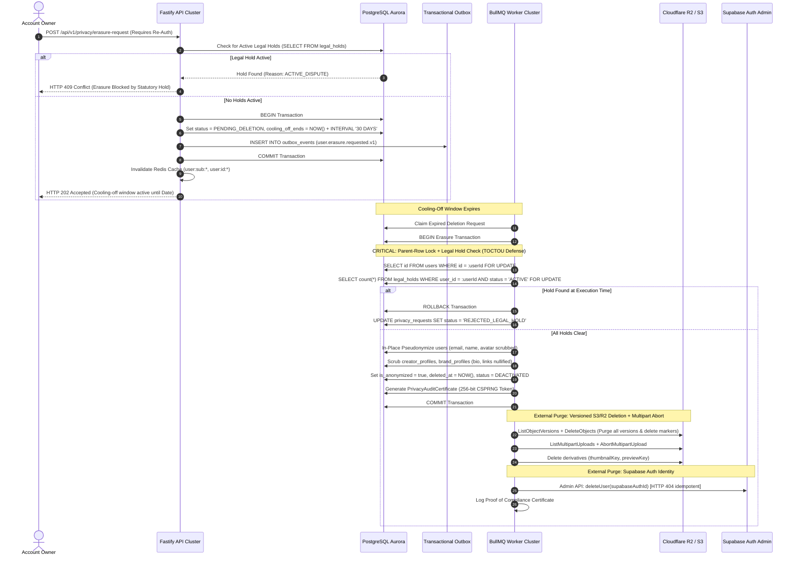

# CreatorConnect — Account Erasure & Privacy Governance Operational Runbook

> **Document Status**: `OPERATIONAL RUNBOOK SPECIFICATION (IMPLEMENTATION VERIFIED — PHASE 3B.8.3)`  
> **Target Audience**: SREs, DevOps Engineers, Staging Operators, Security Incident Responders  
> **Related Phase**: Phase 3B.8 / Phase 3B.8.1 / Phase 3B.8.2 / Phase 3B.8.3  
> **Security Mandate**: Never execute commands against production without verified Change Management approval. Never echo credentials, tokens, or personal identifiers in command outputs or log records.

---

## 1. Scope, Environment Identifiers & Access Guardrails

This runbook defines the exact operational procedure for executing, monitoring, validating, and rolling back account deactivations, privacy requests (Right to Erasure), and data retention purges across CreatorConnect environments.

### Environment Identifiers & Positive Allowlists

| Identifier                  | Staging Specification                                        | Production Specification                                     | Verification Command                                      |
| :-------------------------- | :----------------------------------------------------------- | :----------------------------------------------------------- | :-------------------------------------------------------- |
| **AWS Region**              | `us-east-1`                                                  | `us-east-1`                                                  | `aws configure get region`                                |
| **IAM Execution Role**      | `arn:aws:iam::<STAGING_ACCOUNT_ID>:role/StagingOperatorRole` | `arn:aws:iam::<PROD_ACCOUNT_ID>:role/ProductionPrivacyAdmin` | `aws sts get-caller-identity --query "Arn" --output text` |
| **Target Database Cluster** | `creatorconnect-staging-aurora`                              | `creatorconnect-prod-aurora`                                 | Positive host extraction assertion (No wildcard matching) |
| **Redis ElastiCache ID**    | `creatorconnect-staging-redis`                               | `creatorconnect-prod-redis`                                  | `aws elasticache describe-cache-clusters`                 |
| **Media S3/R2 Bucket**      | `creatorconnect-staging-media`                               | `creatorconnect-prod-media`                                  | `aws s3api head-bucket --bucket <BUCKET>`                 |

---

## 2. Operator Preflight Prerequisites

Before initiating any lifecycle intervention, the operator must verify:

```bash
# 1. Clear ambient workstation secrets
unset DATABASE_URL REDIS_URL SUPABASE_SERVICE_ROLE_KEY

# 2. Verify active IAM role is within approved Staging or Prod allowlist
CALLER_ARN=$(aws sts get-caller-identity --query "Arn" --output text)
echo "Active IAM Role: $CALLER_ARN"
# Ensure ARN matches the authorized operator role for the target environment

# 3. Verify target database host via positive allowlist check
APPROVED_DB_HOST="<VERIFIED_CLUSTER_ENDPOINT>"
# Ensure host strictly matches approved infrastructure inventory
```

---

## 3. Standard Operational Procedures (SOP)

### SOP-01: Administrative Account Suspension

Used when Trust & Safety or Security suspends an account due to policy breach or suspected compromise.

```bash
# Execute administrative status update via authenticated Fastify API
curl -X POST "https://<API_BASE_URL>/api/v1/admin/users/<TARGET_USER_ID>/status" \
  -H "Authorization: Bearer <ADMIN_JWT>" \
  -H "Content-Type: application/json" \
  -d '{
    "status": "SUSPENDED",
    "reason": "Administrative suspension pending investigation: Case #TS-8942"
  }'

# Expected Response: HTTP 200 OK with UserResponse DTO showing status="SUSPENDED"
```

#### Verification:

1. Attempt API access with user's existing token:
   ```bash
   curl -X GET "https://<API_BASE_URL>/api/v1/users/me" \
     -H "Authorization: Bearer <USER_JWT>"
   ```
   **Expected Result**: `HTTP 403 Forbidden` (`USER_SUSPENDED: Account is suspended. Access denied.`)
2. Verify Redis identity cache eviction:
   ```bash
   redis-cli -u "$REDIS_URL" EXISTS "user:id:<TARGET_USER_ID>"
   ```
   **Expected Result**: `0` (Key evicted; in-memory tombstone active).

---

### SOP-02: User-Initiated Account Deactivation & Self-Service Reactivation

#### Deactivation Phase:

1. User invokes `POST /api/v1/users/me/deactivate`.
2. Status in PostgreSQL updates atomically to `DEACTIVATED` under exclusive row lock (`SELECT id, status FROM users FOR UPDATE`).
3. Outbox event `user.lifecycle.transitioned.v1` enqueued.
4. Redis cache keys `user:sub:<SUB>` and `user:id:<ID>` evicted immediately post-commit.
5. All future API requests receive `HTTP 403 Forbidden` (`USER_DEACTIVATED`).

#### Self-Service Reactivation Phase:

1. User logs in via Supabase Auth.
2. Client prompts user: _"Your account is currently deactivated. Would you like to reactivate it?"_
3. User confirms reactivation -> Client calls `POST /api/v1/users/me/reactivate`.
4. API verifies user password/session, updates status to `ACTIVE`, logs `USER_REACTIVATED` audit entry, and warms Redis cache.

---

### SOP-03: Right to Erasure Workflow & TOCTOU Defense

> **Operational Note**: The cooling-off duration (e.g., 30 days) and third-party SLA (e.g., 72 hours) are proposed operational targets and remain `PENDING_LEGAL_APPROVAL`.



#### Detailed Concurrency & External Storage Procedures:

##### 1. Parent-Row Locking Protocol

In PostgreSQL under `READ COMMITTED`, checking `legal_holds` with `FOR UPDATE` returns zero rows when no hold exists, taking zero row locks. To prevent a concurrent transaction from inserting a hold during erasure:

```sql
-- Step 1: Lock the common parent row exclusively
SELECT id FROM users WHERE id = :userId FOR UPDATE;

-- Step 2: Check for active holds
SELECT id, status FROM legal_holds WHERE user_id = :userId AND status = 'ACTIVE' FOR UPDATE;

-- Step 3: If holds count == 0, execute in-place pseudonymization within the same transaction:
UPDATE users
SET email = 'deleted-' || :userId || '@deleted.invalid',
    first_name = 'Deleted',
    last_name = 'User',
    avatar_url = NULL,
    status = 'DEACTIVATED',
    is_anonymized = true,
    deleted_at = NOW()
WHERE id = :userId;
```

Any concurrent attempt to insert a legal hold must execute `SELECT id FROM users WHERE id = :userId FOR UPDATE; INSERT INTO legal_holds...` and will block on the parent row lock, completely preventing phantom-insert race conditions.

##### 2. Versioned Object Storage Purge (S3 / Cloudflare R2)

In versioned buckets, executing standard `DeleteObject` merely creates a `DeleteMarker`, leaving historical versions accessible. Operational purge must delete all object versions:

```bash
# Enumerate and delete all object versions and delete markers
aws s3api list-object-versions \
  --bucket "<BUCKET_NAME>" \
  --prefix "users/<USER_ID>/" \
  --output json \
  --query '{Objects: Versions[].{Key:Key,VersionId:VersionId}}' > /tmp/versions.json

aws s3api delete-objects \
  --bucket "<BUCKET_NAME>" \
  --delete file:///tmp/versions.json

# Abort any orphaned or incomplete multipart uploads
MULTIPART_UPLOADS=$(aws s3api list-multipart-uploads --bucket "<BUCKET_NAME>" --prefix "users/<USER_ID>/" --query 'Uploads[].{Key:Key,UploadId:UploadId}' --output json)
# For each incomplete upload:
# aws s3api abort-multipart-upload --bucket "<BUCKET_NAME>" --key "$KEY" --upload-id "$UPLOAD_ID"
```

**Derivative Asset Purge**: The worker must explicitly query `MediaAsset` records for the user and delete `thumbnailKey` and `previewKey` objects in addition to the primary `storageKey`.

##### 3. Supabase Auth Identity Purge & Partition Recovery

The worker invokes the Supabase Admin API:

```typescript
try {
  await supabase.auth.admin.deleteUser(user.supabaseAuthId);
} catch (error) {
  if (error.status === 404 || error.message?.includes('User not found')) {
    // Idempotent success: identity already removed
  } else {
    // 5xx / 429 / Network timeout: throw to trigger BullMQ exponential backoff retry
    throw error;
  }
}
```

If the worker crashes post-database commit but pre-external purge, the job restarts via BullMQ at the external purge phase without re-running the database transaction.

---

## 4. Emergency Procedures & Incident Response

### INC-01: Accidental Deletion Request Cancellation During Cooling-Off

If a customer requests cancellation of their account deletion within the operational cooling-off window:

```bash
# Call cancellation endpoint on behalf of customer (with verified support ticket)
curl -X POST "https://<API_BASE_URL>/api/v1/privacy/erasure-request/cancel" \
  -H "Authorization: Bearer <CUSTOMER_RECONFIRMED_JWT>"

# Verify database state returned to ACTIVE
psql "$DATABASE_URL" -c "SELECT id, email, status FROM users WHERE id = '<TARGET_USER_ID>';"
# Status must display 'ACTIVE'
```

### INC-02: Database Restore & Re-Erasure Protocol (Backup Protection)

**Scenario**: The PostgreSQL database is restored from a backup snapshot. An account that was previously erased is now resurrected with historical personal data.

#### Mandatory Recovery Sequence:

1. Do **NOT** route live user traffic to the restored database.
2. Execute the automated Re-Erasure Recovery Harness (`RestoreSanitizer`):
   ```bash
   pnpm --filter @creatorconnect/api exec tsx scripts/sanitize-restored-database.ts
   ```
3. **Harness Mechanics (`RestoreSanitizer` in `apps/api/src/modules/lifecycle/restore-sanitizer.ts`)**:
   - Queries `AuditLog` / compliance certificates to identify all historical completed erasure requests.
   - Detects any user records where `status != 'DEACTIVATED'` or email does not match `deleted-${userId}@deleted.invalid`.
   - Re-applies in-place pseudonymization atomically under parent row lock (`SELECT id FROM users FOR UPDATE`).
   - Reconciles and purges external object storage keys and versions.
   - Flushes Redis cache completely (`client.flushall()`).
   - Emits a structured `RestoreSanitizationReport` documenting all sanitized users, purged keys, and verification status.
4. SRE signs off sanitization report before opening DNS / load balancer traffic to the restored cluster. Verified by `restore-sanitization.spec.ts`.

---

## 5. Operational Verification Checklist

```
[ ] Pre-Execution Verification
    [ ] Active AWS IAM Role matches approved Operator Role (no prod execution without change ticket)
    [ ] Target PostgreSQL host verified against approved allowlist (no localhost/dev mix-ups)
    [ ] Status verification confirms PostgreSQL is authoritative source of truth

[ ] Concurrency & Locking Verification
    [ ] Parent-row exclusive lock (SELECT users FOR UPDATE) acquired before legal_holds query
    [ ] Hierarchical lock order strictly adhered to (users -> legal_holds -> privacy_requests)
    [ ] Fail-closed behavior verified if PostgreSQL or hold check fails

[ ] Execution Verification
    [ ] State transition returns HTTP 200/202 with valid RFC 7807 problem detail error handling
    [ ] PostgreSQL row-level status updated atomically in single transaction
    [ ] Immediate Redis eviction confirmed (EXISTS returns 0)
    [ ] In-memory tombstone confirmed active

[ ] Asynchronous Side-Effect Verification
    [ ] Outbox event published cleanly by OutboxProcessor
    [ ] S3/R2 binary assets purged including all VersionIds and DeleteMarkers (no orphaned versions)
    [ ] Incomplete multipart uploads explicitly aborted
    [ ] MediaAsset thumbnail and preview derivatives confirmed deleted
    [ ] External Supabase Auth user deleted via Admin API (404 handled idempotently)
    [ ] Realtime socket connections for target user terminated immediately

[ ] Audit & Compliance Verification
    [ ] AuditLog records event with operator ID, client IP, and action timestamp
    [ ] Zero plaintext passwords, access tokens, or sensitive KYC scans logged to Pino stdout
    [ ] Tamper-evident proof of compliance certificate recorded in privacy_audit_certificates using 256-bit CSPRNG token
```
