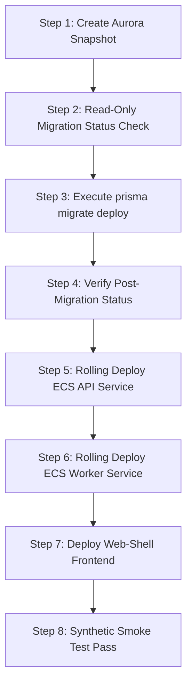

# CreatorConnect — Support Ticketing Staging Operator Handoff Package

**Phase 3B.7.2: Operational Handoff & Staging Validation Runbook (Final Approval Readiness)**

> **Current Release Status**: `BLOCKED`  
> **Blocker Condition**: Remote staging execution, cloud migration execution, and formal compliance/legal retention policy sign-off are outstanding. Do not execute against production or promote to release until all gate criteria are met.

---

## 1. Executive Summary & Purpose

This operational handoff runbook defines the exact, audited procedure for authorized staging operators to validate the **CreatorConnect Support Ticketing Domain** in the staging environment.

### Bounded Scope:

- **Database Migration**: `packages/database/prisma/migrations/0013_add_support_ticketing/migration.sql`
- **Fastify API Domain**: `apps/api/src/modules/support/`
- **Outbox Worker Integration**: `apps/worker/src/outbox/socket-io-dispatcher.ts`
- **Web-Shell Support Client**: `apps/web-shell/src/app/support/` and `apps/web-shell/src/services/support.service.ts`

### Hard Guardrails:

1. **Zero Remote Operations in Development**: This runbook is prepared and verified locally. No remote network calls, staging database mutations, or cloud deployments are performed in this phase.
2. **Zero Secrets in Documentation**: No secret keys, database passwords, or auth tokens are written into runbooks, committed, or echoed in shell output.
3. **No Migration 0014**: Data retention adjustments (soft-delete vs. 7-year audit retention) remain explicitly deferred pending formal Legal & Compliance sign-off.
4. **No Destructive Database Rollback**: Reverting application containers does not reverse a database migration. Once real tickets exist, dropping tables or resetting migrations is strictly prohibited.

---

## 2. Environment Identifiers & Access Prerequisites

Operators must ensure they operate exclusively within the staging boundary. The following table identifies required resources; bracketed placeholders (`<...>`) must be verified against the staging infrastructure inventory before execution.

| Identifier                   | Value / Pattern                                                       | Verification Command                                                                                      |
| :--------------------------- | :-------------------------------------------------------------------- | :-------------------------------------------------------------------------------------------------------- |
| **AWS Region**               | `us-east-1`                                                           | `aws configure get region`                                                                                |
| **AWS Staging Account ID**   | `<STAGING_AWS_ACCOUNT_ID>` _(To be confirmed by Staging Owner)_       | `aws sts get-caller-identity --query "Account" --output text`                                             |
| **IAM Execution Role**       | `arn:aws:iam::<STAGING_AWS_ACCOUNT_ID>:role/<STAGING_OPERATOR_ROLE>`  | `aws sts get-caller-identity --query "Arn" --output text`                                                 |
| **Approved Aurora Endpoint** | `<STAGING_AURORA_CLUSTER_ENDPOINT>` _(Must match positive allowlist)_ | Verified via host extraction check                                                                        |
| **ECS Cluster**              | `creatorconnect-staging-ecs` _(or `<STAGING_ECS_CLUSTER_NAME>`)_      | `aws ecs describe-clusters --clusters <STAGING_ECS_CLUSTER_NAME>`                                         |
| **ECS API Service**          | `creatorconnect-staging-api`                                          | `aws ecs describe-services --cluster <STAGING_ECS_CLUSTER_NAME> --services creatorconnect-staging-api`    |
| **ECS Worker Service**       | `creatorconnect-staging-worker`                                       | `aws ecs describe-services --cluster <STAGING_ECS_CLUSTER_NAME> --services creatorconnect-staging-worker` |
| **ElastiCache Cluster**      | `creatorconnect-staging-redis` _(or `<STAGING_REDIS_CLUSTER_ID>`)_    | `aws elasticache describe-cache-clusters --cache-cluster-id <STAGING_REDIS_CLUSTER_ID>`                   |
| **API Base URL**             | `https://staging-api.creatorconnect.com`                              | `curl -s -o /dev/null -w "%{http_code}" https://staging-api.creatorconnect.com/health`                    |
| **Web Base URL**             | `https://staging.creatorconnect.com`                                  | `curl -s -o /dev/null -w "%{http_code}" https://staging.creatorconnect.com/support`                       |

### Operator Access Prerequisites:

- [ ] Active VPN / Tailscale connection to the Staging VPC CIDR.
- [ ] Multi-Factor Authentication (MFA) authenticated AWS session with the approved Staging Operator Role.
- [ ] Local workstation session cleared of all ambient environment variables (`unset DATABASE_URL REDIS_URL`).
- [ ] Installed and verified tooling: Node.js `20.18+`, pnpm `9.15.4`, AWS CLI `v2`, `jq`, `sed`.

---

## 3. Required Approval Owners & Authorization Scope

Before any change is executed on staging infrastructure, the operator must verify formal sign-offs in the change management ticket:

```
[ ] Engineering Lead / Release Manager:
    - Scope: Code review of PR, build artifact hash verification, migration review.
    - Owner: Atharvan Jaiswal (@atharvan)

[ ] SRE / Infrastructure Lead:
    - Scope: Aurora database snapshot completion, ECS deployment window, rollback readiness.
    - Owner: Staging Infrastructure Lead

[ ] AppSec / Security Lead:
    - Scope: Authorization isolation, IDOR verification, internal note shielding, RBAC matrix.
    - Owner: Security Lead

[ ] Legal & Compliance Officer:
    - Scope: Audit log retention vs GDPR/right-to-be-forgotten conflict review (Status: UNRESOLVED).
    - Owner: Legal & Compliance Directorate
```

> **Authorization Boundary**: The operator is authorized **only** to apply migration `0013_add_support_ticketing` and deploy verified container images for the Support Ticketing domain to **Staging**. Authorization explicitly **excludes** production deployment, manual database row modification, or authoring migration `0014`.

---

## 4. Secret Management & Environment Guardrails

Configuration secrets must **never** be hardcoded in scripts, environment files, or terminal command histories.

### Explicit Operational Separation:

1. **Phase A: Read-Only Preflight Checks** (Operator checks AWS identity, VPC connectivity, Aurora snapshot status, and migration status without modifying any state).
2. **Phase B: Authorized State-Changing Execution** (Operator applies migration `0013` and triggers rolling container updates after explicit sign-off).

### Retrieval Protocol:

All runtime secrets reside in **AWS Secrets Manager**:

- Staging API Secret: `staging/creatorconnect/api`
- Staging Database Secret: `staging/creatorconnect/db` _(or `<STAGING_AURORA_SECRET_ARN>`)_

### Safe Verification (Without Printing Secrets):

Verify secret availability without dumping sensitive values:

```bash
# Check secret metadata only - do NOT echo SecretString
aws secretsmanager describe-secret \
  --secret-id "staging/creatorconnect/api" \
  --query '{Name:Name,LastChangedDate:LastChangedDate,VersionIdsToStages:VersionIdsToStages}' \
  --output table
```

### Positive Allowlist Guardrail for Database Migrations:

When running Prisma migrations from an authorized bastion host or CI runner, pass the connection string strictly in memory within an isolated subshell and validate against an **explicit positive allowlist** (never relying on negative substring checks):

```bash
# 1. Define approved target parameters (to be verified with Staging Owner)
APPROVED_STAGING_ACCOUNT_ID="<STAGING_AWS_ACCOUNT_ID>"
APPROVED_STAGING_DB_HOST="<STAGING_AURORA_CLUSTER_ENDPOINT>"

# 2. Verify active AWS Caller Identity
CALLER_ACCOUNT=$(aws sts get-caller-identity --query "Account" --output text)
if [[ "$CALLER_ACCOUNT" != "$APPROVED_STAGING_ACCOUNT_ID" ]]; then
  echo "FATAL: Active AWS Account ($CALLER_ACCOUNT) does not match approved staging account ($APPROVED_STAGING_ACCOUNT_ID). Aborting." >&2
  exit 1
fi

# 3. Retrieve connection string into memory in local subshell
export DATABASE_URL=$(aws secretsmanager get-secret-value \
  --secret-id "staging/creatorconnect/db" \
  --query 'SecretString' \
  --output text | jq -r .DATABASE_URL)

# 4. Positive Host Allowlist Assertion (without echoing DATABASE_URL)
DB_HOST=$(echo "$DATABASE_URL" | sed -E 's|^postgresql://[^@]+@([^:/]+).*|\1|')
if [[ "$DB_HOST" != "$APPROVED_STAGING_DB_HOST" ]]; then
  echo "FATAL: Target database host ($DB_HOST) does not match approved staging host ($APPROVED_STAGING_DB_HOST). Aborting immediately." >&2
  unset DATABASE_URL
  exit 1
fi

echo "Preflight check passed: Target database host verified against approved allowlist."
```

Immediately upon migration completion:

```bash
unset DATABASE_URL
```

---

## 5. Backup & Recovery Safety Principles

### Core Recovery Rules:

1. **Application Rollback Does Not Revert Schema**: Reverting an ECS task definition or container deployment merely stops new code from running. It does **not** roll back database schema changes or undo applied migrations in PostgreSQL.
2. **Additive Schema Safety**: Migration `0013` is strictly additive (creates new tables `support_tickets`, `support_ticket_messages`, `support_ticket_audits` and enum types). Existing application code that does not query support tables remains backward-compatible with the schema.
3. **Prohibition on Destructive Rollback**: Once migration `0013` is applied and real ticket rows exist, executing destructive commands (`prisma migrate reset` or `DROP TABLE`) is **strictly prohibited**. It permanently destroys audit history and ticket data, and may leave orphaned references.
4. **Forward Recovery as Primary Remedy**: If an application defect is discovered in Support Ticketing after migration `0013` is deployed, the approved recovery path is a **forward hotfix and rolling redeploy**, not database rollback.
5. **Traffic Disablement (Kill Switch)**: If an immediate stop condition occurs (such as an IDOR breach or internal note leak), the operator immediately disables traffic specifically to `/api/v1/support/*` and `/api/v1/staff/support/*` via Cloudflare WAF rule or ALB listener rule, keeping other platform features intact while the incident is investigated.

### Pre-Migration Snapshot Procedure:

Prior to applying migration `0013`, take a dedicated cluster snapshot:

```bash
SNAPSHOT_ID="pre-0013-support-ticketing-$(date +%Y%m%d-%H%M%S)"

aws rds create-db-cluster-snapshot \
  --db-cluster-identifier "<STAGING_AURORA_CLUSTER_IDENTIFIER>" \
  --db-cluster-snapshot-identifier "$SNAPSHOT_ID" \
  --tags Key=Environment,Value=Staging Key=Trigger,Value=Migration-0013

aws rds wait db-cluster-snapshot-available \
  --db-cluster-snapshot-identifier "$SNAPSHOT_ID"

echo "Pre-migration snapshot $SNAPSHOT_ID is available."
```

---

## 6. Read-Only Database & Pre-Migration Checks

Run the read-only migration status check to guarantee schema synchronization and detect any drift before modifying tables.

### 1. Check Migration Status:

```bash
pnpm --filter @creatorconnect/database exec prisma migrate status
```

### Expected Remote Baseline (Condition to Verify):

- The remote staging database must have applied all approved baseline migrations:
  1. `0001_init_identity_and_roles`
  2. `0002_profiles_portfolio_assignments_applications`
  3. `0003_messaging_outbox_notifications_moderation`
  4. `0004_notifications_event_id_idempotency`
  5. `0005_projects_and_deliverables`
  6. `0006_payments_ledger_and_escrow`
  7. `0007_disputes_cancellations_and_refunds`
  8. `0008_reviews_and_reputation`
  9. `0009_deliverable_submissions`
  10. `0010_saved_creators_shortlists_invitations`
  11. `0011_add_message_requests`
  12. `0012_add_community_hub`
- Exactly `0013_add_support_ticketing` must be listed as **pending**.
- Drift check must report: `0 schema differences found`.

> **STOP CRITERIA**: If `prisma migrate status` indicates that the remote database has unapplied migrations other than `0013`, contains schema drift, or differs from the baseline, **HALT IMMEDIATELY**. Do not proceed with migration.

---

## 7. Approved Migration & Deployment Sequence

Execute the linear deployment sequence only after all approvals and preflight checks pass:



### Step 1: Deploy Migration 0013

```bash
pnpm --filter @creatorconnect/database exec prisma migrate deploy
```

_Expected result:_

```
Applying migration `0013_add_support_ticketing`
1 migration applied.
```

### Step 2: Confirm Post-Migration Status

```bash
pnpm --filter @creatorconnect/database exec prisma migrate status
```

_Expected result:_

```
Database schema is up to date!
```

### Step 2B: Application & Schema Compatibility Pre-Deployment Verification

Before rolling out new application containers, operators must verify backward and forward compatibility:

1. **Active Legacy Container Backward-Compatibility**:
   - Migration `0013_add_support_ticketing` is strictly additive (creates new tables `support_tickets`, `support_ticket_messages`, `support_ticket_audits` and enum types).
   - Existing running containers do not reference support tables; verify that live traffic across messaging, community, payments, and verification continues with 0 database query errors immediately following migration application.
2. **New Container Image Artifact Integrity**:
   - Inspect the candidate ECR image digest for `creatorconnect-staging-api` and `creatorconnect-staging-worker` to confirm they were built from the approved Git commit (`e3c826b01389352a9307d9e13f4789d9d56c5d0a`) containing the updated Prisma client with `SupportTicket` models.
   - Verify that container environment variables (`DATABASE_URL`, `REDIS_URL`) match approved staging secrets without printing values.

### Step 3: Rolling Deploy of API Containers

```bash
aws ecs update-service \
  --cluster "<STAGING_ECS_CLUSTER_NAME>" \
  --service "creatorconnect-staging-api" \
  --force-new-deployment

aws ecs wait services-stable \
  --cluster "<STAGING_ECS_CLUSTER_NAME>" \
  --services "creatorconnect-staging-api"
```

### Step 4: Rolling Deploy of Outbox Worker

```bash
aws ecs update-service \
  --cluster "<STAGING_ECS_CLUSTER_NAME>" \
  --service "creatorconnect-staging-worker" \
  --force-new-deployment

aws ecs wait services-stable \
  --cluster "<STAGING_ECS_CLUSTER_NAME>" \
  --services "creatorconnect-staging-worker"
```

### Step 5: Web-Shell Deployment

Deploy the Next.js web application to Cloudflare Pages / Staging ECS:

```bash
aws ecs update-service \
  --cluster "<STAGING_ECS_CLUSTER_NAME>" \
  --service "creatorconnect-staging-web-shell" \
  --force-new-deployment

aws ecs wait services-stable \
  --cluster "<STAGING_ECS_CLUSTER_NAME>" \
  --services "creatorconnect-staging-web-shell"
```

---

## 8. Health & Readiness Verification

Confirm service availability before executing synthetic smoke tests.

### 1. Liveness Probe (`GET /health`)

```bash
curl -f -s -S https://staging-api.creatorconnect.com/health | jq .
```

**Expected Response (HTTP 200)**:

```json
{
  "status": "ok",
  "timestamp": "2026-10-25T...",
  "uptime": 123.45
}
```

### 2. Readiness Probe (`GET /ready`)

```bash
curl -f -s -S https://staging-api.creatorconnect.com/ready | jq .
```

**Expected Response (HTTP 200)**:

```json
{
  "status": "ready",
  "timestamp": "2026-10-25T...",
  "services": {
    "database": "ok",
    "redis": "ok"
  }
}
```

> **STOP CRITERIA**: If `/ready` returns HTTP 503 or `"status": "degraded"`, check database connection limits or Redis cluster reachability. **HALT**.

---

## 9. Synthetic Staging Smoke Test Plan

Operators must execute the synthetic test suite using designated test user personas in the staging sandbox.
All synthetic tickets and messages must be clearly tagged with `[SYNTHETIC-STAGING-SMOKE]` in subjects and bodies.
Real customer data, production user IDs, live credit cards, or actual payment references are strictly forbidden.
Zero tokens, passwords, API keys, or raw authorization headers may be recorded in logs, reports, or ticket comments.

### Test Personas:

- **Customer A**: Designated Creator / Brand test account (`customer_a_token`)
- **Customer B**: Independent test user (`customer_b_token`) — for IDOR verification
- **Staff User**: User with `ADMIN` role (`staff_token`)

---

### Journey 1: Customer Ticket Creation & Initial Audit Trail

- **Prerequisites**: Staging API online (`/ready` probe returns HTTP 200); Customer A persona active with valid JWT.
- **Setup**: Define unique synthetic request body tagged with smoke test identifier.
- **Endpoint**: `POST /api/v1/support/tickets`
- **Auth**: `Bearer <customer_a_token>`
- **Request Body**:
  ```json
  {
    "category": "ESCROW_RECONCILIATION",
    "priority": "HIGH",
    "subject": "[SYNTHETIC-STAGING-SMOKE-ESCROW-000001] Synthetic Reconciliation Test",
    "description": "Synthetic test inquiry for staging rehearsal. Unmistakably synthetic; no real monetary value.",
    "escrowAmount": 100
  }
  ```
- **Expected Response**:
  - HTTP Status: `201 Created`.
  - Response Header: `x-request-id` / `reqId` present.
  - Payload Assertions:
    - `id`: Valid UUIDv7 string.
    - `ticketNumber`: Matches format `^SUP-\d{4}-[A-Z0-9]{5}$` (e.g. `SUP-2026-AB234`).
    - `status`: `'OPEN'`.
    - `priority`: `'HIGH'`.
    - `category`: `'ESCROW_RECONCILIATION'`.
    - `version`: `1`.
    - `requesterId`: Matches Customer A UUID.
- **State Capture**: Record returned `id` as `TICKET_ID_1` and `ticketNumber` as `TICKET_NUM_1`.
- **Evidence to Retain**: `reqId`, `TICKET_ID_1`, `TICKET_NUM_1`, HTTP 201 status code.

---

### Journey 2: Anti-IDOR Cross-User Access Denial

- **Prerequisites**: `TICKET_ID_1` exists; Customer B persona active with valid JWT (distinct from Customer A).
- **Setup**: Customer B attempts to retrieve Customer A's ticket by UUID (`TICKET_ID_1`) and ticket number (`TICKET_NUM_1`).
- **Endpoint**: `GET /api/v1/support/tickets/$TICKET_ID_1`
- **Auth**: `Bearer <customer_b_token>`
- **Expected Response**:
  - HTTP Status: `403 Forbidden`.
  - Response Header: `reqId` present.
  - Payload Assertions:
    - `code`: `'SUPPORT_TICKET_FORBIDDEN'`.
    - `title`: `'Support Ticket Forbidden'`.
    - `status`: `403`.
    - Zero ticket metadata, subjects, descriptions, or requester identities are returned in the response body.
- **Cleanup / Safe Test-Data Handling**: Read-only assertion; no state mutated.
- **Evidence to Retain**: `reqId`, HTTP 403 status code, error code `'SUPPORT_TICKET_FORBIDDEN'`.

---

### Journey 3: Customer Conversation Message Submission

- **Prerequisites**: `TICKET_ID_1` exists in `'OPEN'` status; Customer A token.
- **Setup**: Define synthetic follow-up message text.
- **Endpoint**: `POST /api/v1/support/tickets/$TICKET_ID_1/messages`
- **Auth**: `Bearer <customer_a_token>`
- **Request Body**:
  ```json
  {
    "body": "[SYNTHETIC-STAGING-SMOKE] Customer follow-up inquiry regarding milestone release."
  }
  ```
- **Expected Response**:
  - HTTP Status: `201 Created`.
  - Payload Assertions:
    - `id`: Valid UUIDv7 string.
    - `ticketId`: Matches `TICKET_ID_1`.
    - `authorRole`: `'CUSTOMER'`.
    - `isInternal`: `false`.
    - `body`: Matches submitted text.
- **Evidence to Retain**: `reqId`, message `id`, HTTP 201 status code.

---

### Journey 4: Staff Response, Internal Note Creation & Privacy Shielding

- **Prerequisites**: `TICKET_ID_1` exists; Staff user token (`ADMIN` role); Customer A token.
- **Step 4A (Staff Customer-Facing Response)**:
  - **Endpoint**: `POST /api/v1/staff/support/tickets/$TICKET_ID_1/messages`
  - **Auth**: `Bearer <staff_token>`
  - **Request Body**:
    ```json
    {
      "body": "[SYNTHETIC-STAGING-SMOKE] Staff official response confirming milestone investigation."
    }
    ```
  - **Expected Response**: HTTP `201 Created`, `authorRole: "STAFF"`, `isInternal: false`.
- **Step 4B (Staff Private Internal Note Creation — Unmistakably Synthetic Marker)**:
  - **Endpoint**: `POST /api/v1/staff/support/tickets/$TICKET_ID_1/notes`
  - **Auth**: `Bearer <staff_token>`
  - **Request Body**:
    ```json
    {
      "body": "[SYNTHETIC-STAGING-SMOKE] Staff internal investigation note: synthetic verification marker SYNTHETIC-BATCH-REF-0000-TEST-RECONCILIATION-DO-NOT-PROCESS. Strictly confidential internal audit note."
    }
    ```
  - **Expected Response**: HTTP `201 Created`, `authorRole: "STAFF"`, `isInternal: true`.
- **Step 4C (Customer Conversation Fetch — Strict Privacy Verification)**:
  - **Endpoint**: `GET /api/v1/support/tickets/$TICKET_ID_1/messages`
  - **Auth**: `Bearer <customer_a_token>`
  - **CRITICAL ASSERTIONS**:
    - HTTP Status: `200 OK`.
    - Array `items` contains Customer messages and Staff customer-facing reply (from Step 4A).
    - Every message in `items` satisfies `item.isInternal === false`.
    - Zero messages in `items` contain the text `SYNTHETIC-BATCH-REF-0000-TEST-RECONCILIATION-DO-NOT-PROCESS` or the prefix `[SYNTHETIC-STAGING-SMOKE] Staff internal investigation note`.
    - Proves customer-facing API strictly filters internal notes at the database query level.
- **Step 4D (Staff Conversation Fetch — Confirms Existence in Audit Trail)**:
  - **Endpoint**: `GET /api/v1/support/tickets/$TICKET_ID_1/messages`
  - **Auth**: `Bearer <staff_token>`
  - **Expected Response**: HTTP `200 OK`. The internal note is present with `isInternal: true`, proving the note was stored in PostgreSQL and selectively filtered rather than silently lost.
- **Step 4E (Worker Event Isolation Verification)**:
  - Database `outbox_events` records an event with `eventType: "support.ticket.internal_note.created.v1"`.
  - Worker `SocketIoEventDispatcher` handles this event under `SOCKET_IO_PASSTHROUGH_EVENT_TYPES` with `{ success: true }`, ensuring it is **never** emitted to customer-facing Socket.IO rooms (`conversation:<id>`).
- **Evidence to Retain**: `reqId` for 4A–4D, assertions confirming 0 internal notes exposed to Customer A, and confirmation of internal note presence for Staff.

---

### Journey 5: Status Transitions & Optimistic Concurrency Conflict (Isolated Ticket)

> **Design Principle**: To ensure absolute test independence, Journey 5 uses a dedicated, isolated synthetic ticket (`TICKET_ID_CONCURRENCY`). This guarantees that earlier operations, replies, or assignments cannot inadvertently alter version counters or invalidate expected concurrency tokens. Expected versions are strictly derived from live API responses rather than hardcoded assumptions.

- **Prerequisites**: Customer A token, Staff token (`ADMIN` role).
- **Step 5.1 (Create Dedicated Concurrency Test Ticket & Capture Initial Version)**:
  - **Endpoint**: `POST /api/v1/support/tickets`
  - **Auth**: `Bearer <customer_a_token>`
  - **Request Body**:
    ```json
    {
      "category": "PAYMENT_DISPUTE",
      "priority": "NORMAL",
      "subject": "[SYNTHETIC-STAGING-SMOKE-CONCURRENCY-000002] Concurrency Isolation Ticket",
      "description": "Dedicated ticket created for isolated concurrency and status lifecycle verification."
    }
    ```
  - **Response**: HTTP `201 Created`.
  - **Dynamic State Capture**:
    - Record returned `id` as `TICKET_ID_CONCURRENCY`.
    - Dynamically extract and record `INITIAL_VERSION = response.version` from the response body.
- **Step 5.2 (Authorized Status Transition with Derived Version)**:
  - **Endpoint**: `POST /api/v1/staff/support/tickets/$TICKET_ID_CONCURRENCY/status`
  - **Auth**: `Bearer <staff_token>`
  - **Request Body**:
    ```json
    {
      "status": "IN_PROGRESS",
      "expectedVersion": "$INITIAL_VERSION"
    }
    ```
  - **Expected Response**: HTTP `200 OK`, `status: "IN_PROGRESS"`.
  - **Dynamic State Capture**:
    - Dynamically extract and record `UPDATED_VERSION = response.version` from the response body (satisfies `UPDATED_VERSION === INITIAL_VERSION + 1`).
- **Step 5.3 (Stale Version Conflict Rejection)**:
  - Attempt a subsequent transition passing the captured stale version (`$INITIAL_VERSION` which is strictly less than `$UPDATED_VERSION`):
  - **Endpoint**: `POST /api/v1/staff/support/tickets/$TICKET_ID_CONCURRENCY/status`
  - **Auth**: `Bearer <staff_token>`
  - **Request Body**:
    ```json
    {
      "status": "WAITING_FOR_CUSTOMER",
      "expectedVersion": "$INITIAL_VERSION"
    }
    ```
  - **CRITICAL ASSERTIONS**:
    - HTTP Status: `409 Conflict`.
    - Payload Code: `'SUPPORT_TICKET_CONFLICT'`.
    - Ticket state remains unchanged in PostgreSQL (`status: "IN_PROGRESS"`, `version: $UPDATED_VERSION`).
- **Step 5.4 (Safe Lifecycle Resolution & Cleanup Verification)**:
  - **Route Authorization Check**: Uses `POST /api/v1/staff/support/tickets/:id/status` requiring authenticated staff persona with `ADMIN` role.
  - **State Transition Validity Check**: Transitioning to `'RESOLVED'` is authorized by the domain state machine from `'OPEN'`, `'IN_PROGRESS'`, or `'WAITING_FOR_CUSTOMER'`.
  - **Dynamic Resolution Execution**:
    1. For `TICKET_ID_CONCURRENCY`:
       - Submit `POST /api/v1/staff/support/tickets/$TICKET_ID_CONCURRENCY/status` with `status: "RESOLVED"`, `expectedVersion: "$UPDATED_VERSION"`, `resolutionSummary: "Synthetic smoke test concurrency validation complete."`.
       - Expected: HTTP `200 OK`, `status: "RESOLVED"`.
    2. For `TICKET_ID_1` (from Journey 1):
       - Dynamically fetch current version via `GET /api/v1/staff/support/tickets/$TICKET_ID_1`.
       - Capture `CURRENT_V1_VERSION = response.version`.
       - Submit `POST /api/v1/staff/support/tickets/$TICKET_ID_1/status` with `status: "RESOLVED"`, `expectedVersion: "$CURRENT_V1_VERSION"`, `resolutionSummary: "Synthetic smoke test Journey 1-4 validation complete."`.
       - Expected: HTTP `200 OK`, `status: "RESOLVED"`.
  - **Data Retention Rule**: Do NOT delete database rows (`DELETE FROM support_tickets`). Both synthetic tickets remain safely marked `'RESOLVED'`.
- **Evidence to Retain**: `reqId` for 5.1–5.4, HTTP statuses `201`, `200`, `409`, `200`, and error payload code `'SUPPORT_TICKET_CONFLICT'`.

---

### Journey 6: Outbox Event Processing & Delivery Boundary Audit

- **Prerequisites**: Completed Journeys 1–5; read-only database query access or worker CloudWatch log query access.
- **Action**: Query `outbox_events` table for `aggregate_id IN ('$TICKET_ID_1', '$TICKET_ID_CONCURRENCY')` or inspect worker logs for those IDs.
- **Verification Assertions**:
  1. Outbox events exist for all domain operations:
     - `support.ticket.created.v1`
     - `support.ticket.message.created.v1`
     - `support.ticket.internal_note.created.v1`
     - `support.ticket.status.changed.v1`
     - `support.ticket.resolved.v1`
  2. For every event, `status` has transitioned from `'PENDING'` to `'PUBLISHED'`.
  3. Deduplication table `processed_events` contains records for `(event_id, 'outbox-dispatcher')`.
  4. **Delivery Semantics Invariant**:
     - Worker log inspection confirms all support events were handled cleanly under `SOCKET_IO_PASSTHROUGH_EVENT_TYPES` returning `{ success: true }`.
     - Returning `{ success: true }` signifies that the worker successfully handled the event as an authorized passthrough / no-op; it **does NOT mean** the event was emitted to any client socket or end-user device.
     - Confirmed: Zero socket broadcasts were emitted to client rooms, and zero push/email notifications were sent.
- **Evidence to Retain**: Query output or worker CloudWatch log extract showing event IDs, types, and final `PUBLISHED` status.

---

## 10. Evidence to Capture & Archival Requirements

The operator must archive the following evidence artifacts in the release change ticket:

1. **RDS Snapshot Evidence**: Snapshot ARN and completion timestamp.
2. **Prisma Migration Output**: Exact stdout/stderr output of `prisma migrate status` (pre and post) and `prisma migrate deploy`.
3. **Container Deployment Checksums**: ECS Task Definition revision numbers and ECR image digests.
4. **Health Probe Outputs**: Complete JSON responses from `/health` and `/ready` with response headers.
5. **Synthetic Smoke Test Logs**: Request IDs (`reqId`), HTTP status codes, and assertion results from all 6 smoke journeys.
6. **Worker Logs**: CloudWatch log snippet showing clean event dispatch and zero outbox processor crashes.

---

## 11. Immediate Stop & Rollback Conditions

### Trigger Conditions for IMMEDIATE ABORT:

1. **Migration Failure**: Prisma encounters any DDL or constraint error during `migrate deploy`.
2. **Readiness Probe Failure**: `/ready` does not return HTTP 200 within 3 minutes of container start.
3. **Security / IDOR Breach**: Customer B receives any payload from Customer A's ticket (Status $\ne$ 403).
4. **Data Leakage**: Customer A receives any message where `isInternal == true` via API or realtime.
5. **Worker Outbox Poison Pill**: Worker crashes in loop or encounters unhandled rejections on support events.
6. **Latency / Error Spike**: Staging 5xx error rate exceeds 0.1% or p95 API latency exceeds 500ms.

### Emergency Incident Procedure:

1. **Disable Ingress Traffic**: Block traffic to `/api/v1/support/*` and `/api/v1/staff/support/*` via Cloudflare / ALB rule to protect user data while leaving other platform domains operational.
2. **Rollback Containers**: Revert ECS task definitions for `api` and `worker` to previous stable revisions:
   ```bash
   aws ecs update-service \
     --cluster "<STAGING_ECS_CLUSTER_NAME>" \
     --service "creatorconnect-staging-api" \
     --task-definition "creatorconnect-staging-api:PREVIOUS_REVISION"
   ```
3. **Do NOT Drop Database Tables**: Because migration `0013` is additive, rolling back containers safely ceases queries to support tables. Destructive database rollback (`DROP TABLE` or `migrate reset`) is prohibited.

---

## 12. Legal Retention-Policy Decision Status

> **STATUS: EXPLICITLY UNRESOLVED**

### Context & Constraint:

- Foreign key constraints on `support_ticket_messages.author_id` and `support_ticket_audits.actor_id` enforce `ON DELETE RESTRICT` against the `users` table.
- `ON DELETE RESTRICT` is purely a relational constraint in PostgreSQL preventing orphaned records upon user hard deletion. **It does not constitute an immutable, tamper-evident audit ledger on its own, nor does it establish or satisfy a statutory retention period.**
- **Compliance Conflict**:
  - Financial & Legal: Contract and payment disputes may have statutory retention obligations.
  - Privacy / GDPR: User requests for erasure (Right to be Forgotten).
- **Proposed Technical Path (Deferred)**:
  - Migration `0014` (Soft Deletion with `deleted_at`, anonymization/scrubbing of user PII while preserving audit trails and message bodies with pseudonymized actor IDs).
- **Rule**:
  - Do NOT create migration `0014`.
  - Do NOT modify `ON DELETE RESTRICT` constraints.
  - Release promotion to Production remains **BLOCKED** until formal legal counsel provides written policy sign-off.

---

## 13. Operator Execution Checklist

```
[ ] Phase 1: Pre-Execution Prerequisites
    [ ] Operator identity and IAM role verified against approved allowlist (no prod access)
    [ ] Staging VPC network access confirmed
    [ ] All required approvals recorded in change ticket

[ ] Phase 2: Backup & State Capture
    [ ] Aurora DB cluster snapshot created and verified available
    [ ] Earliest/Latest PITR restore timestamps documented

[ ] Phase 3: Migration Execution
    [ ] Pre-migration "prisma migrate status" executed and archived (0 drift, migrations 0001-0012 applied)
    [ ] "prisma migrate deploy" executed (1 migration applied)
    [ ] Post-migration "prisma migrate status" executed (Schema up to date)

[ ] Phase 4: Container Deployment & Health Verification
    [ ] ECS API service updated and stable
    [ ] ECS Worker service updated and stable
    [ ] ECS Web-Shell service updated and stable
    [ ] Liveness probe "/health" returns HTTP 200 ok
    [ ] Readiness probe "/ready" returns HTTP 200 ready (database ok, redis ok)

[ ] Phase 5: Synthetic Staging Smoke Tests
    [ ] Journey 1: Customer ticket creation verified (HTTP 201, SUP-YYYY-XXXXX format, version 1, initial message)
    [ ] Journey 2: Anti-IDOR enforcement verified (HTTP 403 SUPPORT_TICKET_FORBIDDEN for Customer B, zero leakage)
    [ ] Journey 3: Customer message submission verified (HTTP 201, authorRole CUSTOMER, isInternal false)
    [ ] Journey 4: Staff response & internal note shielding verified:
        - Customer A fetch: HTTP 200, public reply present, 0 internal notes exposed, 0 note text leaked
        - Staff fetch: HTTP 200, internal note present in audit history (isInternal true)
        - Worker outbox: Handled under SOCKET_IO_PASSTHROUGH_EVENT_TYPES, 0 customer socket emissions
    [ ] Journey 5: Isolated concurrency conflict & safe resolution cleanup verified:
        - Dedicated isolated ticket created (version 1)
        - Authorized transition to IN_PROGRESS (HTTP 200, version 2)
        - Stale expectedVersion: 1 rejected (HTTP 409 SUPPORT_TICKET_CONFLICT)
        - Safe resolution of test tickets to RESOLVED (HTTP 200, zero destructive row deletes)
    [ ] Journey 6: Outbox event processing verified (PUBLISHED in outbox_events, logged by worker, 0 unhandled rejections)

[ ] Phase 6: Post-Deployment Sign-Off
    [ ] All evidence artifacts uploaded to release ticket (reqIds, snapshot ARN, migration logs, task hashes)
    [ ] Zero stop conditions encountered
    [ ] Change status marked READY FOR AUDIT REVIEW
```

---

_Runbook prepared for CreatorConnect Phase 3B.7.1._  
_Release Gate Status: `BLOCKED` awaiting operator execution, staging test pass, and legal sign-off._
