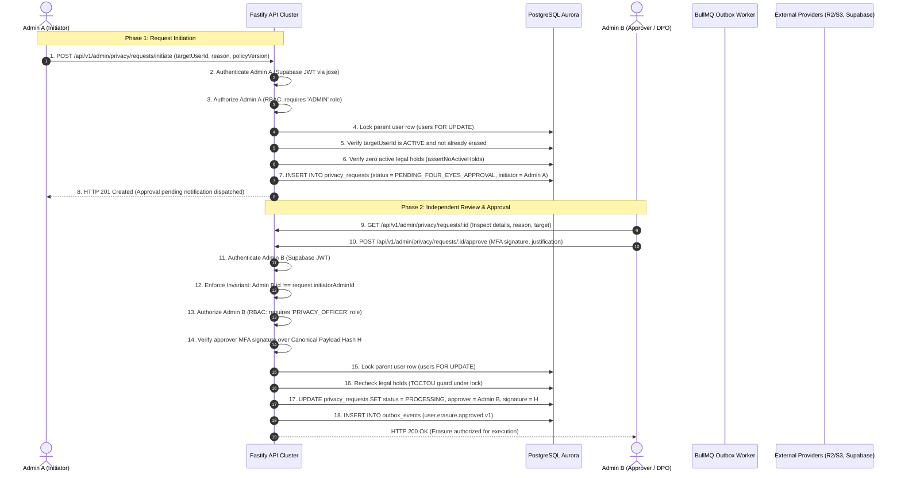

# CreatorConnect — Four-Eyes Administrative Deletion Protocol

## Application Security & Insider-Threat Defense Specification

> **Document Status**: `SECURITY PROTOCOL SPECIFICATION — PENDING APPSEC SIGN-OFF`  
> **Evaluation Date**: November 24, 2026  
> **Target Subsystem**: Administrative Erasure Gateway & Legal Hold Override Protocol  
> **Classification**: Restricted / Application Security & Access Control Governance  
> **Related Phase**: Phase 3B.9 (Stage A Deliverable)  
> **Target Audience**: Application Security Lead, Head of Trust & Safety, Security Operations (SecOps), Principal Software Architect  
> **Threat Model Reference**: `docs/security/account-lifecycle-threat-model.md` (Threat TH-06)

---

## 1. Executive Summary & Security Objectives

In a multi-sided commercial marketplace handling escrow funds, bilateral contracts, deliverables, and user disputes, the capability to permanently deactivate and pseudonymize an account is a high-privilege administrative action.

Under Threat Model **TH-06** (_Elevation / Insider Misuse_), a single compromised administrator, rogue staff member, or coerced operator could attempt to:

1. Maliciously wipe customer identities or seller profiles to cause business disruption.
2. Unlawfully destroy litigation or dispute evidence in violation of court orders or legal holds.
3. Bypass the statutory cooling-off window or user consent flow.
4. Forge compliance certificates to conceal unauthorized deletions.

To eliminate the single-point-of-failure inherent in unilateral administrative action, this specification establishes the **Four-Eyes Administrative Deletion Protocol** (Dual-Authorization Principle).

**No administrative account erasure or legal-hold release may execute without independent, cryptographically verified approval from two distinct, authorized operators.**

---

## 2. Formal Mathematical Invariants & Authorization Contract

### 2.1 The Minimum Authorization Invariant

The fundamental invariant governing the Four-Eyes Protocol is:
$$\mathbf{RequesterID \ne ApproverID}$$

A requesting administrator is strictly prohibited from approving, counter-signing, or unilaterally executing their own deletion request under any circumstance.

### 2.2 The Complete Dual-Authorization Contract

An administrative erasure execution is deemed $\mathbf{Authorized}$ if and only if all eight predicates hold simultaneously:

$$ \begin{aligned}
\mathbf{Authorized}(R) \iff & (RequesterID \ne ApproverID) \\
& \land \mathbf{RoleAllowed}(Requester, \text{'ADMIN'}) \\
& \land \mathbf{RoleAllowed}(Approver, \text{'PRIVACY\_OFFICER'}) \\
& \land \mathbf{ValidMfaSignature}(Approver, H_{approval}) \\
& \land \mathbf{ApprovalBoundToRequest}(R, H_{approval}) \\
& \land \mathbf{PolicyApproved}(R.policyVersion) \\
& \land \neg \mathbf{LegalHold}(R.targetUserId) \\
& \land \neg \mathbf{Expired}(R.approvalTimestamp, \Delta t_{validity})
\end{aligned}$$

Where:
- $RequesterID$: Authenticated UUID of the administrative staff member proposing the action.
- $ApproverID$: Authenticated UUID of the independent officer reviewing and counter-signing the proposal.
- $\mathbf{RoleAllowed}(U, Role)$: CASL/RBAC predicate verifying the operator holds the explicitly authorized role.
- $H_{approval}$: Cryptographic digest binding the approval to the immutable proposal parameters.
- $\mathbf{ValidMfaSignature}$: Cryptographic assertion (WebAuthn / FIDO2 or hardware TOTP) from the approver.
- $\Delta t_{validity}$: Time-to-live of the approval token (maximum 24 hours).

---

## 3. Cryptographic Binding & Canonical Payload Analysis

### 3.1 Canonical Approval Payload
To prevent parameter substitution (e.g. approving user A, then swapping the target to user B before execution), the approval signature must bind strictly to a canonicalized, deterministic JSON representation:

$$\mathbf{H} = \text{SHA256}(\text{Canonicalize}(requestId, targetUserId, action, policyVersion, requesterId, approverId, timestamp, nonce))$$

```typescript
export interface CanonicalFourEyesPayload {
  requestId: string;           // UUIDv7 of the privacy request
  targetUserId: string;        // UUID of the account undergoing erasure
  action: 'ADMIN_ERASURE';     // Explicit action discriminator
  policyVersion: string;       // Authoritative policy reference (e.g., "POL-RET-2026-V1")
  requesterId: string;         // UUID of the initiating administrator
  approverId: string;          // UUID of the approving privacy officer
  timestamp: string;           // ISO 8601 UTC timestamp of approval
  nonce: string;               // 256-bit CSPRNG hex nonce (replay prevention)
}
```

### 3.2 What the Cryptographic Hash Proves — And What It Does Not Prove

> [!IMPORTANT]
> **Cryptographic Limitations of a Bare SHA-256 Hash**:
> - **What it Proves**: The hash proves **Payload Immutability**. If an attacker tampers with any single field (swapping `targetUserId`, altering `policyVersion`, or modifying `timestamp`), the computed hash will mismatch the signed record.
> - **What it Does NOT Prove**: A SHA-256 hash alone does **NOT** prove identity, authenticity, or authorization. Anyone can compute the SHA-256 digest of arbitrary text.
> - **Mandatory Identity Proof**: The digest $\mathbf{H}$ must be signed using an asymmetric cryptographic credential bound to the approver's physical person (e.g. **WebAuthn / FIDO2 hardware authenticator** emitting an ECDSA P-256 signature, or a time-sensitive TOTP assertion verified by a dedicated HSM/KMS service).

---

## 4. 18-Step End-to-End Protocol Lifecycle

The complete Four-Eyes workflow executes across 18 sequential steps:



### Detailed Lifecycle Step Specifications:

1. **Request Creation**: Initiating administrator submits target user ID, administrative justification, case reference, and statutory policy version.
2. **Requester Authentication**: Fastify `authenticate` hook verifies asymmetric RS256/ES256 signature on requester's Supabase JWT.
3. **Requester Authorization**: CASL checks `can('initiate', 'AdministrativeErasure')`. Prohibits standard staff without explicit compliance entitlements.
4. **Target Account Validation**: Verifies target user exists, is not already tombstoned (`@deleted.invalid`), and is not an active Super Admin without board override.
5. **Initial Legal Hold Check**: Queries active legal holds under parent row lock; aborts immediately with HTTP 409 if any hold is active.
6. **Proposal Staging**: Persists request in `privacy_requests` with status `PENDING_FOUR_EYES_APPROVAL` and generates a 256-bit CSPRNG proposal nonce.
7. **Approver Discovery & Notification**: Dispatches an outbox event `user.erasure.approval_requested.v1` notifying all authorized Privacy Officers.
8. **Independent Review**: Approver reviews target user transaction history, active contracts, and justification via read-only compliance dashboard.
9. **Approver Authentication**: Approving officer authenticates via independent Supabase session.
10. **Approver Authorization**: CASL checks `can('approve', 'AdministrativeErasure')`. Verifies role is `PRIVACY_OFFICER` or `DPO`.
11. **Anti-Collusion Enforcement**: System enforces $\mathbf{RequesterID \ne ApproverID}$. If identical, returns `HTTP 403 Forbidden` (`FOUR_EYES_SELF_APPROVAL_PROHIBITED`).
12. **MFA Challenge & Signature**: Approver completes hardware MFA challenge (WebAuthn / FIDO2) over the canonical payload hash $H$.
13. **Time-To-Live Assertion**: Verifies approval occurs within 24 hours of request initiation; stale requests transition to `EXPIRED`.
14. **Pre-Execution Parent-Row Lock**: Background execution worker re-acquires exclusive row lock `SELECT id FROM users WHERE id = :targetUserId FOR UPDATE`.
15. **TOCTOU Legal Hold Re-Check**: Re-verifies hold count $= 0$ inside execution transaction. If a hold was applied during review, execution aborts and transitions to `REJECTED_LEGAL_HOLD`.
16. **In-Place Pseudonymization**: Overwrites user records with tombstone email (`deleted-<uuid>@deleted.invalid`), nullifies bios, preserves foreign keys.
17. **External Provider Purge**: Outbox worker executes S3 multi-version delete and Supabase Admin API identity deletion.
18. **Compliance Audit Certificate Emission**: Issues immutable `PrivacyAuditCertificate` recording approval signature $H$, records processed, and media purged.

---

## 5. Threat-to-Control Mapping Matrix

The following matrix maps specific attack vectors to the platform's preventive and detective controls:

| Threat ID | Threat / Attack Scenario | Preventive Control | Detective Control | Automated Test Evidence |
| :--- | :--- | :--- | :--- | :--- |
| **TH-06.1** | **Rogue Administrator Self-Approval**<br>Admin A attempts to initiate and immediately approve erasure of a target user. | Invariant check $\mathbf{RequesterID \ne ApproverID}$ enforced at API handler and database repository layer. | Forensic audit log `FOUR_EYES_SELF_APPROVAL_ATTEMPTED` generated with actor ID and IP. | `account-lifecycle.spec.ts` (asserts 403 on self-action) |
| **TH-06.2** | **Compromised Account Replay Attack**<br>Attacker intercepts a valid approval token and attempts to replay it against another target. | Cryptographic binding $H$ binds strictly to immutable `targetUserId` and unique 256-bit `nonce`. | Database `UNIQUE INDEX` on `(request_id, nonce)` rejects replay with conflict. | `privacy-audit.spec.ts` (replay test) |
| **TH-06.3** | **Target Substitution (Bait-and-Switch)**<br>Admin initiates request for test user, but alters target user ID to a CEO account before approval. | Request record is immutable post-creation. Any modification to parameters invalidates proposal hash $H$. | Hash verification failure triggers `HTTP 400 INVALID_APPROVAL_PAYLOAD`. | Fastify TypeBox schema validation test |
| **TH-06.4** | **Legal Hold Bypass (TOCTOU Race)**<br>Litigation counsel applies legal hold concurrently while erasure worker executes. | Mandatory parent-row locking (`users FOR UPDATE`). Erasure worker checks active holds *after* acquiring user row lock. | Active hold check under lock throws `LegalHoldActiveError`; rollback commits `REJECTED_LEGAL_HOLD`. | `legal-hold-concurrency.spec.ts` (Scenario 3 & 4) |
| **TH-06.5** | **Collusion Between Two Junior Admins**<br>Two junior staff members collude to mutually approve erasures for each other. | Separation of roles: `initiate` requires `ADMIN`, but `approve` requires distinct role `PRIVACY_OFFICER` or `DPO`. | CASL permission engine rejects approval if operator lacks `PRIVACY_OFFICER` entitlement. | `admin-rbac.spec.ts` (role isolation test) |
| **TH-06.6** | **Stale Approval Execution**<br>An approval granted 6 months ago is suddenly triggered after new contracts are signed. | Strict 24-hour expiration window ($\Delta t_{validity}$). Schedulers sweep and cancel expired pending requests. | Worker rejects expired approval with `EXPIRED_APPROVAL_TOKEN`. | Unit test for approval timestamp verification |
| **TH-06.7** | **Sensitive Information in Logs**<br>Loggers record approver MFA credentials, raw confirmation tokens, or plaintext PII. | Pino logger configuration redacts `authorization`, `password`, `secret`, and `token`. Logs record only `tokenHashPrefix`. | Automated log scanner asserts zero plaintext token leaks. | `privacy-audit.spec.ts` (log redaction test) |
| **TH-06.8** | **Disaster Recovery Personal Data Resurrection**<br>Erased account personal data is resurrected following PITR backup restore. | `RestoreSanitizerService` re-scans compliance certificates post-restore and reapplies tombstones pre-traffic. | Post-restore audit report records all resurrected accounts detected and re-sanitized. | `restore-sanitization.spec.ts` (3 tests pass) |

---

## 6. Emergency Override & Break-Glass Procedures

In extraordinary circumstances (e.g. valid court-ordered emergency gag order, imminent national security directive, or total platform key compromise), standard asynchronous dual-authorization may be overridden strictly under the **Break-Glass Emergency Protocol**:

1. **Dual Executive Key Activation**: Requires simultaneous physical or cryptographic authorization from:
   - **Chief Executive Officer (CEO)** OR **Chief Operating Officer (COO)**, AND
   - **General Counsel** OR **Chief Information Security Officer (CISO)**.
2. **Dedicated Break-Glass Role**: Executed exclusively via dedicated IAM execution role `EmergencyPrivacyAdministrator` with short-lived STS credentials (1-hour lease).
3. **Immutable Forensic Notification**: Triggers high-priority pager alerts (`SEV-1`) to all members of the Security Incident Response Team (SIRT) and writes an immutable audit record to write-once-read-many (WORM) cloud storage.
4. **Mandatory Post-Mortem**: Within 48 hours, a formal Break-Glass Incident Report must be delivered to the Board of Directors Audit Committee.

---

## 7. Residual Risks & Explicit AppSec Decision Requests

The Application Security Directorate must formally review and determine the following four technical questions:

1. **MFA Signature Verification Engine**:
   - *Question*: Shall approver MFA signatures be verified via WebAuthn / FIDO2 hardware tokens (passkeys) using `@simplewebauthn/server`, or via TOTP hardware tokens verified against an internal KMS/HSM service?
   - *AppSec Decision*: `PENDING_APPSEC_DECISION`
2. **Approval Time-To-Live Window**:
   - *Question*: Is the proposed 24-hour approval TTL appropriate, or should it be shortened to 4 hours to minimize the window of credential compromise?
   - *AppSec Decision*: `PENDING_APPSEC_DECISION`
3. **Role Separation Enforcement**:
   - *Question*: Should the platform introduce a dedicated PostgreSQL database role for erasure workers that has permissions exclusively to pseudonymize user rows and zero access to drop tables or alter schema?
   - *AppSec Decision*: `PENDING_APPSEC_DECISION`
4. **Formal Sign-Off on Protocol Specification**:
   - *Status*: **`PENDING_APPSEC_APPROVAL`**
   - *Approver*: Application Security Lead / CISO
   - *Date*: `[Pending Formal Execution]`
$$
