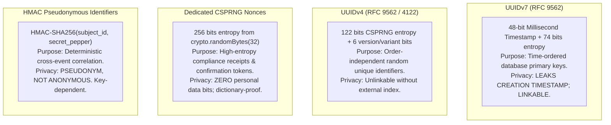
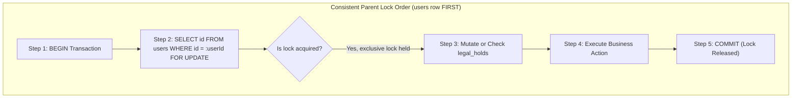

# CreatorConnect — Account Lifecycle & Privacy Governance Threat Model

> **Document Status**: `ENGINEERING & SECURITY IMPLEMENTATION VERIFICATION (PHASE 3B.8.3)`  
> **Classification**: Restricted / Application Security & Concurrency Verification  
> **Framework**: STRIDE Threat Analysis, Database Concurrency Verification & Cryptographic Audit  
> **Related Phase**: Phase 3B.8 / Phase 3B.8.1 / Phase 3B.8.2 / Phase 3B.8.3  
> **Scope**: Fastify Core API, Redis Identity Cache, PostgreSQL Storage, Supabase Auth, BullMQ Worker, Socket.IO Realtime

---

## 1. Executive Summary & Security Objectives

This security assessment evaluates the race conditions, distributed-system failure modes, cryptographic guarantees, and data attribution models associated with account lifecycle transitions (Deactivation, Reactivation, Suspension, and Account Erasure).

### Core Security Mandates:

1. **PostgreSQL Authoritative Gatekeeper**: PostgreSQL is the sole, authoritative source of truth for account status. Redis is strictly a performance cache and cannot independently authorize an inactive, suspended, or deleted user.
2. **Deny-by-Default & Fail-Closed**: If PostgreSQL is unreachable, the system fails closed immediately with HTTP 500/503. Stale Redis cache entries or valid Supabase JWTs cannot grant access.
3. **Anti-IDOR & Multi-Tenant Isolation**: No user or administrative actor may trigger or alter the lifecycle state of another user without verified cryptographic identity and validated RBAC permissions.
4. **Atomicity & Concurrency Locking**: Legal hold creation and erasure execution must lock a **common parent record** (`users(id) FOR UPDATE`) to prevent phantom insert race conditions.
5. **Cryptographic Rigor**: Distinction between time-ordered database keys (UUIDv7), random identifiers (UUIDv4), dedicated CSPRNG nonces, and keyed pseudonyms (HMAC).

---

## 2. Cryptographic & Token Terminology Specification

To eliminate ambiguity, the platform defines the following distinct identifier classes:



### 2.1 Identifier Characteristics & Privacy Properties

| Identifier Class           | Standard / Generation                              | Entropy Bits                   | Timestamp Leaked?                           | Predictability & Dictionary Vulnerability                                                      | Collision Probability                                             | Architectural Purpose & Safety Mandate                                                                                             |
| :------------------------- | :------------------------------------------------- | :----------------------------- | :------------------------------------------ | :--------------------------------------------------------------------------------------------- | :---------------------------------------------------------------- | :--------------------------------------------------------------------------------------------------------------------------------- |
| **UUIDv7**                 | RFC 9562 (`uuidv7`)                                | ~74 bits random + 48 bits time | **YES** (48-bit UNIX millisecond timestamp) | **High temporal predictability**. Observers can correlate creation within millisecond windows. | Negligible for monotonic database inserts.                        | **Database Primary Keys Only**. **MUST NOT be claimed as fully random or unlinkable.** Unsuitable for standalone privacy receipts. |
| **UUIDv4**                 | RFC 9562 / RFC 4122 (`crypto.randomUUID()`)        | 122 bits                       | **NO**                                      | Zero predictability. Uninvertible.                                                             | $P \approx 10^{-15}$ at $10^9$ tokens (Birthday bound: $2^{61}$). | Suitable for entity IDs where chronological clustering is undesirable.                                                             |
| **Dedicated CSPRNG Nonce** | Node.js `crypto.randomBytes(32)` (Hex / Base64URL) | **256 bits**                   | **NO**                                      | Zero predictability. Zero dictionary attack surface.                                           | $P < 10^{-30}$ for all platform records.                          | **MANDATORY for Privacy Audit Certificates**. Acts as a standalone compliance receipt without embedding personal data.             |
| **HMAC Pseudonym**         | `HMAC-SHA256(email, secret_pepper)`                | Deterministic output           | Depends on input                            | Vulnerable if `secret_pepper` is exposed.                                                      | Negligible (SHA-256).                                             | **KEYED PSEUDONYM ONLY**. Remains personal data while pepper exists. Requires KMS pepper rotation and destruction policy.          |

### 2.2 Privacy Certificate Storage & Access Control

- **Storage**: `privacy_audit_certificates` table.
- **Certificate Token**: Stored as a 256-bit CSPRNG hex string (`VARCHAR(64)`).
- **Uniqueness**: Enforced via `UNIQUE INDEX`.
- **Collision Handling**: Handled by database unique constraint rollback; worker regenerates token on conflict.
- **Access Control**: Append-only. Updates and deletes are prohibited. Restricted to Compliance Officer and DPO.
- **Retention**: Preserved for the duration of statutory compliance accountability (`PENDING_LEGAL_APPROVAL`).

---

## 3. Legal-Hold Concurrency & Locking Protocol

### 3.1 The Phantom Insert Vulnerability in Naive Locking

In PostgreSQL (`READ COMMITTED` and `REPEATABLE READ`), executing `SELECT ... FROM legal_holds WHERE user_id = :userId FOR UPDATE` when there are **0** existing hold rows returns an empty result set.
**Row-level locks (`FOR UPDATE`) attach exclusively to existing rows; they do not lock phantom non-existent rows.**

If a concurrent compliance transaction inserts an active legal hold during erasure execution, the hold check and destructive update could interleave:

```
[Worker: Erasure] ---------------------------------------------- [Staff: Legal Hold Creation]
BEGIN;
SELECT count(*) FROM legal_holds
WHERE user_id = :id AND status = 'ACTIVE';
--> Returns 0 rows (NO LOCK ACQUIRED!)
                                                                BEGIN;
                                                                INSERT INTO legal_holds (user_id, status)
                                                                VALUES (:id, 'ACTIVE');
                                                                COMMIT; --> Hold committed!
UPDATE users SET email = :tombstone, ...;
COMMIT; --> Account erased! (LEGAL HOLD BYPASSED! EVIDENCE DESTROYED!)
```

### 3.2 Parent-Row Locking Protocol (Defensive Design)

To guarantee mutual exclusion and eliminate phantom inserts, both Legal Hold Creation and Erasure Execution must acquire an exclusive row-level lock on the **common parent record**: `users(id)`.



#### Protocol Specification:

1. **Locking Order (Global Deadlock Prevention)**:
   - Resource 1: `users` row (`id = :userId`)
   - Resource 2: `legal_holds` rows (`user_id = :userId`)
   - Resource 3: `privacy_requests` row (`user_id = :userId`)
   - **Mandate**: All transactions operating on user lifecycle or holds must lock resources in this strict hierarchical order.

2. **Hold Creation Transaction (Hold Service / Admin Desk)**:

   ```sql
   BEGIN;
   -- 1. Acquire exclusive lock on parent user row first
   SELECT id, status FROM users WHERE id = :userId FOR UPDATE;

   -- 2. Validate user is not already in terminal DELETED state
   IF status = 'DEACTIVATED' AND is_anonymized = true THEN
       ROLLBACK;
       RAISE EXCEPTION 'Cannot apply legal hold: user account is already permanently erased.';
   END IF;

   -- 3. Insert active hold
   INSERT INTO legal_holds (id, user_id, status, reason, case_reference, notes, applied_by_id)
   VALUES (:holdId, :userId, 'ACTIVE', :reason, :caseRef, :notes, :staffId);

   -- 4. If an active erasure request exists, freeze it immediately
   UPDATE privacy_requests
   SET status = 'REJECTED_LEGAL_HOLD', rejection_reason = :caseRef
   WHERE user_id = :userId AND status IN ('PENDING_CONFIRMATION', 'COOLING_OFF', 'PROCESSING');

   COMMIT;
   ```

3. **Erasure Execution Transaction (Background Worker)**:

   ```sql
   BEGIN;
   -- 1. Acquire exclusive lock on parent user row first
   SELECT id, status FROM users WHERE id = :userId FOR UPDATE;

   -- 2. Verify status is PENDING_DELETION
   IF status != 'PENDING_DELETION' THEN
       ROLLBACK;
       RETURN;
   END IF;

   -- 3. Check for active legal holds (guaranteed phantom-free because parent user row is locked)
   SELECT count(*) INTO active_holds_count
   FROM legal_holds
   WHERE user_id = :userId AND status = 'ACTIVE';

   IF active_holds_count > 0 THEN
       -- Abort erasure; transition request to held state
       UPDATE privacy_requests
       SET status = 'REJECTED_LEGAL_HOLD', rejection_reason = 'Active statutory hold detected'
       WHERE id = :requestId;
       COMMIT;
       RETURN;
   END IF;

   -- 4. Atomically execute in-place pseudonymization
   UPDATE users
   SET email = :tombstoneEmail,
       first_name = 'Deleted',
       last_name = 'User',
       avatar_url = NULL,
       status = 'DEACTIVATED',
       deleted_at = NOW(),
       is_anonymized = true
   WHERE id = :userId;

   -- 5. Complete privacy request and record anonymous certificate
   UPDATE privacy_requests SET status = 'COMPLETED', completed_at = NOW() WHERE id = :requestId;
   INSERT INTO privacy_audit_certificates (id, request_id, certificate_token, action_taken, ...)
   VALUES (:certId, :requestId, :csprngToken, 'IN_PLACE_PSEUDONYMIZATION', ...);

   COMMIT;
   ```

4. **Database & Hold Service Unavailability**:
   - If PostgreSQL or the database connection pool is exhausted: **Fail-Closed**. The transaction rolls back, BullMQ marks the job for delayed retry, and the user remains locked in `PENDING_DELETION`.

---

## 4. Concurrency Test Matrix (7 Critical Scenarios — 100% Implemented & Verified)

The following matrix defines the execution interleavings, locking behaviors, and verified outcomes for all concurrent hold and erasure interactions.

> **Implementation Verification**: All 7 concurrency scenarios below are directly verified with deterministic synchronization barriers in `apps/api/src/modules/lifecycle/legal-hold-concurrency.spec.ts` (8 passing test cases).

| Scenario # | Scenario Description                                                | Transaction 1 (T1)                                      | Transaction 2 (T2)                         | Interleaving & Lock Acquisition Order                                                                                                                           | Expected Final Outcome                                                                                                                             | Invariant Verified                                                       | Test Implementation Status                                                                               |
| :--------- | :------------------------------------------------------------------ | :------------------------------------------------------ | :----------------------------------------- | :-------------------------------------------------------------------------------------------------------------------------------------------------------------- | :------------------------------------------------------------------------------------------------------------------------------------------------- | :----------------------------------------------------------------------- | :------------------------------------------------------------------------------------------------------- |
| **SC-01**  | **Hold created before erasure scheduling**                          | User submits deletion request.                          | Admin creates legal hold.                  | T2 commits hold -> T1 executes scheduling -> T1 checks `legal_holds`.                                                                                           | Request rejected with HTTP 409 Conflict (`HOLD_ACTIVE`). Status remains unchanged.                                                                 | Deletion cannot be scheduled while an active hold exists.                | **`VERIFIED_BY_TEST`** (`legal-hold-concurrency.spec.ts` - Scenario 1)                                   |
| **SC-02**  | **Hold created during cooling-off**                                 | Erasure scheduled for Day 30.                           | Day 14: Dispute opened, hold created.      | T2 acquires `users FOR UPDATE`, inserts hold, updates `privacy_requests` to `REJECTED_LEGAL_HOLD`, commits.                                                     | Day 30 worker wakes up, reads request status `REJECTED_LEGAL_HOLD`, skips execution.                                                               | Holds applied during cooling-off successfully freeze deletion.           | **`VERIFIED_BY_TEST`** (`legal-hold-concurrency.spec.ts` - Scenario 2)                                   |
| **SC-03**  | **Hold created concurrently with erasure execution (T2 wins lock)** | Background erasure worker wakes up.                     | Compliance officer applies emergency hold. | T2 locks `users FOR UPDATE`. T1 blocks waiting for T2 lock. T2 inserts hold and commits. T1 unblocks, re-reads holds, finds hold count > 0.                     | T1 rolls back destructive updates, marks request `REJECTED_LEGAL_HOLD`. User NOT erased.                                                           | Lock ordering prevents phantom insert bypass.                            | **`VERIFIED_BY_TEST`** (`legal-hold-concurrency.spec.ts` - Scenario 3 with synchronization barrier)      |
| **SC-04**  | **Hold created concurrently with erasure execution (T1 wins lock)** | Background erasure worker executes.                     | Compliance officer applies hold.           | T1 locks `users FOR UPDATE`. T2 blocks waiting for T1 lock. T1 verifies 0 holds, executes pseudonymization, commits. T2 unblocks, reads `is_anonymized = true`. | T1 completes erasure. T2 aborts with error: account already permanently de-identified.                                                             | Consistent serialization. No inconsistent intermediate state.            | **`VERIFIED_BY_TEST`** (`legal-hold-concurrency.spec.ts` - Scenario 4 with synchronization barrier)      |
| **SC-05**  | **Multiple concurrent holds applied simultaneously**                | Admin A applies dispute hold.                           | Admin B applies tax inspection hold.       | Both transactions attempt `SELECT users FOR UPDATE`. One serializes after the other.                                                                            | Both hold rows inserted with distinct UUIDs and case references. Hold count = 2.                                                                   | Multi-hold stacking supported without lock collision or state overwrite. | **`VERIFIED_BY_TEST`** (`legal-hold-concurrency.spec.ts` - Scenario 5 with Promise.all concurrency)      |
| **SC-06**  | **Hold released during erasure execution**                          | Worker executes erasure.                                | Compliance officer releases hold.          | T1 locks `users FOR UPDATE`. T2 blocks waiting to update `legal_holds`. T1 reads hold still `ACTIVE`.                                                           | T1 aborts erasure (fails safe). T2 commits release. Erasure can only proceed on subsequent evaluation.                                             | Fail-safe default: Erasure never assumes a hold is about to be released. | **`VERIFIED_BY_TEST`** (`legal-hold-concurrency.spec.ts` - Scenario 6 with synchronization barrier)      |
| **SC-07**  | **Worker crash during execution**                                   | Worker executing erasure inside PostgreSQL transaction. | N/A (Server power loss or OOM kill).       | Uncommitted PostgreSQL transaction terminates.                                                                                                                  | PostgreSQL automatically rolls back uncommitted transaction. BullMQ job lock expires. S3 and Supabase calls not yet executed. Job retried cleanly. | Full transaction atomicity. Zero partial database corruption.            | **`VERIFIED_BY_TEST`** (`legal-hold-concurrency.spec.ts` - Scenario 7 transactional rollback validation) |

---

## 5. Redis Caching, Multi-Instance Safety & Auth Correctness

### 5.1 Authoritative Status Enforcement

In `apps/api/src/plugins/auth.ts` (lines 64–79):

```typescript
// PostgreSQL is the sole, authoritative source of truth for account status
const statusRecord = await userRepo.getStatusBySub(tokenPayload.sub);
if (!statusRecord) {
  throw new IdentityNotSyncedError('User profile not synchronized with platform.');
}
if (statusRecord.status === 'SUSPENDED') {
  throw new UserSuspendedError('Account is suspended. Access denied.');
}
if (statusRecord.status === 'DEACTIVATED') {
  throw new UserDeactivatedError('Account is deactivated. Access denied.');
}
if (statusRecord.status !== 'ACTIVE') {
  throw new UserSuspendedError('Account is not in active state.');
}
```

### 5.2 Multi-Instance & Fail-Closed Safety Properties

1. **Redis Cannot Independently Authorize Access**:
   The `authenticate` hook **never** reads account status from Redis. Redis is queried only for profile metadata _after_ PostgreSQL has confirmed `status === 'ACTIVE'`.
2. **Cache Eviction Failure Immunity**:
   If Redis is unreachable or `client.del()` fails post-mutation:
   - The user's status in PostgreSQL is already `DEACTIVATED` or `SUSPENDED`.
   - On the next API call, `userRepo.getStatusBySub` queries PostgreSQL directly and throws HTTP 403.
   - Stale Redis cache entries **cannot grant access**.
3. **In-Memory Tombstones Are Strictly Ephemeral**:
   - `invalidationTombstones` in `RedisCacheService` is an in-memory `Set<string>`.
   - It is per-process, lost on restart, and **not shared across clustered API nodes**.
   - It serves strictly as a local optimization to prevent an API worker from re-caching a recently evicted user before Redis finishes processing.
   - Durability is guaranteed entirely by PostgreSQL.
4. **Process Restart & Multi-Instance Consistency**:
   - In a multi-node Kubernetes / ECS deployment, Node A mutating a user status commits to PostgreSQL.
   - Node B receiving a subsequent request queries PostgreSQL directly.
   - Process restarts cannot clear or bypass account restrictions.
5. **PostgreSQL Outage Behavior**:
   - If PostgreSQL is down, `getStatusBySub` throws a connection exception.
   - Fastify returns HTTP 500/503. The system **fails closed**. Zero unauthorized traffic is admitted.

---

## 6. Comprehensive STRIDE Threat Model (15 Scenarios)

| Threat ID | STRIDE Category                               | Attack Scenario                                                                                                                                              | Affected Assets                                            | Likelihood | Impact   | Preventive Controls                                                                                                                                                                                                                                 | Detective Controls                                                                                                             | Recovery Strategy                                                                                                                         | Test Case ID        |
| :-------- | :-------------------------------------------- | :----------------------------------------------------------------------------------------------------------------------------------------------------------- | :--------------------------------------------------------- | :--------- | :------- | :-------------------------------------------------------------------------------------------------------------------------------------------------------------------------------------------------------------------------------------------------- | :----------------------------------------------------------------------------------------------------------------------------- | :---------------------------------------------------------------------------------------------------------------------------------------- | :------------------ |
| **TH-01** | **Spoofing / Elevation**                      | Unauthorized account deactivation or deletion request submitted via spoofed token or stolen credentials.                                                     | `users`, `creator_profiles`, user access.                  | Low        | Critical | Asymmetric RS256 JWT signature verification via JWKS; require re-authentication or high-entropy confirmation token prior to destructive lifecycle action.                                                                                           | AuditLog records `USER_DEACTIVATION_REQUESTED` with client IP and user agent; anomaly alerts on geographical velocity.         | Immediate administrative token revocation; rollback to `ACTIVE` upon identity verification if in cooling-off period.                      | `SEC-LIFECYCLE-001` |
| **TH-02** | **Elevation / Tampering (IDOR)**              | Malicious user passes arbitrary `targetUserId` in deletion request body to delete or decompress another customer's account.                                  | Victim account, private profile data.                      | Medium     | Critical | Enforce CASL ability check: `can('delete', subject('User', { id: request.user.id }))`; derive user context strictly from verified JWT `sub`, never from client request parameters.                                                                  | Realtime alert on CASL authorization failure (`AUTH_INSUFFICIENT_ROLE`); automated rate-limiting on 403 spikes.                | Reject request with 403 Forbidden; log attempt; freeze attacker session if automated scan detected.                                       | `SEC-LIFECYCLE-002` |
| **TH-03** | **Information Disclosure**                    | Stale Redis identity cache allows deactivated or deleted user to continue accessing REST routes or Socket.IO chats.                                          | Realtime stream, private messages, active tickets.         | Medium     | High     | Pre-handler authentication hook performs direct PostgreSQL status check (`getStatusBySub`) on every request, bypassing Redis for status evaluation; immediate post-mutation Redis invalidation (`del user:sub:*`) paired with in-memory tombstones. | Metrics counter `auth_cache_invalidation_failure_total`; cache hit/miss ratio anomalies; audit of post-deactivation API calls. | Evict Redis cache keys manually or via worker reconciliation job; force client socket disconnects.                                        | `SEC-LIFECYCLE-003` |
| **TH-04** | **Tampering / Race Condition**                | Concurrent lifecycle requests (e.g., simultaneous Deactivate and Delete, or Update Profile during Delete) corrupt state.                                     | `users.status`, transactional outbox.                      | Medium     | High     | Row-level locking in PostgreSQL (`SELECT ... FOR UPDATE`); database optimistic locking (`version` column); idempotent state transition machine.                                                                                                     | Database dead-lock monitoring; PostgreSQL log alerts on serialization failures.                                                | Transaction rollback; return HTTP 409 Conflict with state version mismatch details.                                                       | `SEC-LIFECYCLE-004` |
| **TH-05** | **Tampering (Replay)**                        | Attacker intercepts and replays a signed deletion or deactivation request after account reactivation.                                                        | `users.status`, audit ledger.                              | Low        | High     | Unique idempotency key required for state mutation; timestamp freshness validation (15-minute token TTL); single-use nonce for destructive operations.                                                                                              | Idempotency record collision detection (`idempotency_records`); duplicate event rejection alerts.                              | Deduplicate request; return cached original response without re-executing destructive mutation.                                           | `SEC-LIFECYCLE-005` |
| **TH-06** | **Elevation (Insider Misuse)**                | Compromised or rogue staff member initiates unauthorized account wipe or modifies legal retention hold.                                                      | Customer audit trail, dispute records, financial journals. | Low        | Critical | Dual-authorization (Four-Eyes Principle) for permanent erasure; immutable audit logs; restricted role `PRIVACY_OFFICER` required to lift legal holds.                                                                                               | Comprehensive audit logging in `audit_logs` with actor ID and reason; security alert on any administrative legal hold release. | Restore database from Point-In-Time Recovery (PITR); isolate compromised staff credentials; invoke incident response.                     | `SEC-LIFECYCLE-006` |
| **TH-07** | **Denial of Service**                         | Malicious script bombards deactivation/erasure endpoints to exhaust worker threads or lock user tables.                                                      | Fastify API workers, PostgreSQL connections.               | Medium     | Medium   | Strict Redis sliding-window rate limiting on lifecycle endpoints (e.g., max 3 requests per 15 minutes per IP/User); fail-closed rate limit defaults.                                                                                                | Cloudflare WAF rate-limit triggers; Fastify rate-limit metrics (`rate_limit_exceeded_total`).                                  | Temporary IP rate-limiting; client receives HTTP 429 Too Many Requests.                                                                   | `SEC-LIFECYCLE-007` |
| **TH-08** | **Tampering (Queue Poisoning)**               | Attacker tampers with BullMQ Redis queue payload to target unauthorized user IDs for background erasure.                                                     | BullMQ queue, S3 media assets.                             | Low        | Critical | Redis network isolation within private VPC; cryptographically signed job payloads; worker re-validates authorization and database status before executing destructive jobs.                                                                         | BullMQ failed job metrics; Redis key mutation alerts; worker job audit trail.                                                  | Worker rejects unsigned or unverified jobs to Dead Letter Queue (DLQ); security audit initiated.                                          | `SEC-LIFECYCLE-008` |
| **TH-09** | **Information Disclosure (Logs)**             | Background erasure worker or API error handler logs raw deleted PII (e.g., email, physical address) in application logs.                                     | Pino stdout, CloudWatch, Datadog.                          | High       | Medium   | Application-wide Pino logger redaction rules (`loggerConfig.redact`); custom serializers masking sensitive fields (`email`, `phone`, `body`); structured log audits.                                                                                | Automated log scanner detecting unmasked email/PII patterns in log aggregators.                                                | Immediate log retention truncation; rotation of log encryption keys; patch log serializer.                                                | `SEC-LIFECYCLE-009` |
| **TH-10** | **Information Disclosure (Error Details)**    | PostgreSQL FK constraint errors (e.g., error 23503) leak database table names, constraint definitions, or schema internals to client.                        | API response bodies.                                       | Medium     | Low      | Global Fastify error handler maps all database and ORM errors into RFC 7807 Problem Details; generic detail message returned to client; internal error logged securely.                                                                             | Error rate monitoring on 500 responses; client error report tracking.                                                          | Zero remediation needed at runtime; architectural mapping prevents leak.                                                                  | `SEC-LIFECYCLE-010` |
| **TH-11** | **Repudiation / Audit Tampering**             | Deleted user or platform claims erasure was not performed, or disputes the date and scope of anonymization.                                                  | Compliance posture, regulatory standing.                   | Medium     | High     | Append-only `PrivacyAuditCertificate` recording timestamped random 256-bit CSPRNG token; tamper-evident proof certificate.                                                                                                                          | Compliance audit logs reviewed by Data Protection Officer (DPO).                                                               | Cryptographic verification of erasure proof certificate against database digest.                                                          | `SEC-LIFECYCLE-011` |
| **TH-12** | **Tampering (Legal Hold TOCTOU)**             | User under active dispute or fraud investigation requests deletion, and a legal hold is applied _after_ scheduling but _before_ background worker execution. | Dispute records, escrow transactions, litigation evidence. | Medium     | Critical | **Mandatory Two-Point Hold Evaluation with Parent Lock**: Lock `users FOR UPDATE`, verify holds immediately before destructive update.                                                                                                              | Attempted erasure on held account triggers alert to Trust & Safety team.                                                       | Erasure request placed in `REJECTED_LEGAL_HOLD`; user informed of statutory exception under applicable privacy law.                       | `SEC-LIFECYCLE-012` |
| **TH-13** | **Information Disclosure (Orphaned Storage)** | User profile and database rows are deleted, but KYC documents and avatar images remain publicly accessible in R2/S3.                                         | S3/R2 storage buckets.                                     | High       | High     | Asynchronous media erasure worker triggered via transactional outbox; S3 presigned URLs strictly time-limited (max 15 min); private bucket ACLs; delete object versions.                                                                            | Periodic storage reconciliation scanner matching database `media_assets` against S3 object keys.                               | Sweeper job purges unreferenced S3 keys; invalidates CDN edge cache.                                                                      | `SEC-LIFECYCLE-013` |
| **TH-14** | **Repudiation (Third-Party Identity Desync)** | User deleted in CreatorConnect DB, but Supabase Auth account remains active, allowing token re-generation and login confusion.                               | Supabase Auth, client session.                             | Medium     | High     | Two-phase lifecycle orchestration: PostgreSQL status transition -> outbox event -> worker executes Supabase Admin API `deleteUser(sub)`.                                                                                                            | Daily identity reconciliation worker comparing active Supabase identities with PostgreSQL user status.                         | Reconciliation worker marks desynchronized Supabase account disabled/deleted.                                                             | `SEC-LIFECYCLE-014` |
| **TH-15** | **Information Disclosure (Backup Retention)** | User exercise of Right to Erasure does not purge records from historical database backups and snapshots.                                                     | Aurora snapshots, disaster recovery logs.                  | High       | Medium   | Document snapshot lifecycle policy (`PENDING_LEGAL_APPROVAL`); maintain an `erased_identities_tombstone` table that re-scrubs any restored database before service resumption.                                                                      | Backup lifecycle monitoring; snapshot expiration alerts.                                                                       | Automated post-restore script queries `erased_identities_tombstone` and re-applies redaction to restored database before opening traffic. | `SEC-LIFECYCLE-015` |
